# Assets

Everything you can drag into a view is an asset: a generator, a shader, a view, a picture, a video. This page lists
what comes with VibeVJ and where it is in the *Assets* tab of the [sidebar](The-Screen.md#assets-tab).

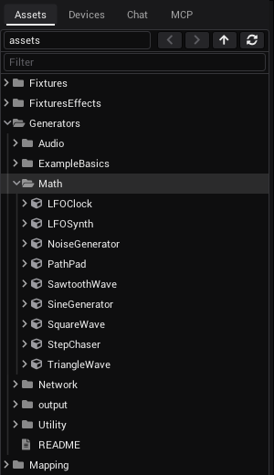

## Find and use an asset

1. Open the *Assets* tab. The icon in front of a name says what it is:

   | Icon | What it is |
   |---|---|
   | Cube | A generator |
   | Wand | A shader |
   | Four squares | A view (*Clipview*, *Patchview*, …) |
   | Diagram | A mapping tool |
   | Light bulb | A fixture or a fixture effect |
   | Stacked layers | A preset |

   An asset is a folder too, but you rarely open it: its arrow is faint. A name too long for the sidebar ends in "…";
   rest the mouse on it to read all of it.
2. Open a folder with its arrow, or type part of a name into *Filter*.
3. Drag the asset into a view. Where it lands decides what it becomes:
   - in a [Patchview](The-Screen.md#views-and-tabs): a window of its own;
   - in an [area](The-Screen.md#dropping-an-asset): the view of that area, a split or a tab;
   - in a cell of a [Clipview](Clipview.md#make-a-clip): a clip;
   - on a [CueList](CueList.md#add-cues): a cue.

How a generator window works is on [Generators](Generators.md). Your own settings of an asset can be kept as a
[preset](Generators.md#presets): it shows up in the folder `presets` inside the asset.

## The folders

| Folder | What is in it |
|---|---|
| `Generators` | Values, audio, network and helpers: see below. `Generators/Python` holds [Python generators](Python-Generators.md). |
| `Generators` | Values, audio, network and helpers: see below. `Native` holds [native assets](#native-assets). |
| `Shaders` | Pictures and effects: `Sources`, `Effects`, `Utilities`. |
| `Views` | The views: *Clipview*, *CueList*, *Patchview*, *Tabview*, with their presets and saved layouts. See [Views and tabs](The-Screen.md#views-and-tabs). |
| `Mapping` | *MapLab*, *LEDMapper*, *MaskTransform*. See [Mapping](Output-and-Devices.md#mapping). |
| `Fixtures`, `FixturesEffects` | Lamps and effects over them: the Phaser, FixtureState, and the [lighting desk](Lighting-Desk.md) (Programmer, Executors, LampValues, CueTrigger). See [Fixtures](Output-and-Devices.md#fixtures). |
| `Textures`, `Videos` | Pictures and [video files](Video.md). Each opens as a generator with an *Out* port. A PNG picture reaches a shader upright: its *Flip Y* is on for a new picture (a project saved before keeps its setting), and a grey picture arrives as grey. |
| `FFGL` | FFGL plugins you add yourself (`.dll`, `.bundle`, `.so`). See [FFGL plugins](#ffgl-plugins). |

## Generators › Math

Sources of moving values. Link their *Output* into anything ([Linking](Linking.md#make-a-link)). Each can run free or
in step with the [timeline](Timeline.md). *Lag*, *Trigger* and *Speed* change a value you link into their *Input*;
*Math*, *Count*, *Hold*, *Select* and *Filter* combine, count, hold, pick and clean values, like the CHOPs of
TouchDesigner.

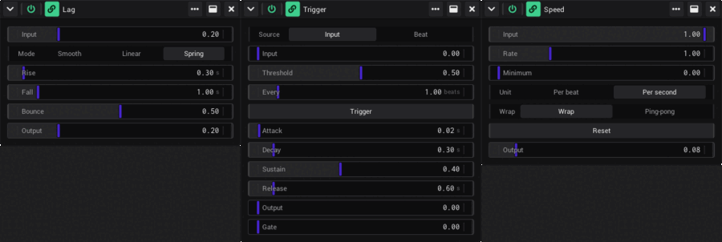

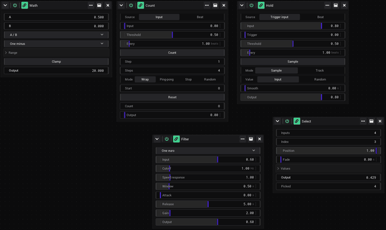

| Generator | What it gives |
|---|---|
| *SineGenerator* | A sine wave: *Frequency*, *Bias*, *Gain*, *Saturation*. *Mode* is *Free* or *Sync*. |
| *TriangleWave*, *SawtoothWave*, *SquareWave* | The same with another shape. |
| *LFOSynth* | Up to 8 waves in one window (*Add wave*), each with its own *Wave* shape, *Frequency*, *Phase*, *Bias*, *Gain* and *Output*. All of them rise and fall with the *Envelope*: *Trigger* starts it, *Release* lets it fall to 0. Until the first *Trigger* the waves pass unchanged. |
| *NoiseGenerator* | Random values: *Type* is *White* or *Pink*, *Rate* sets how often a new value comes. |
| *LFOClock* | A pulse on every beat that falls back to 0. |
| *StepChaser* | A step sequencer in a table: the bar (*Bar length*) is cut into *Steps*, every step has a *Value* or *Hold*, a *Fade in* and a *Fade out*. Every block (*Add block*) has its own *Output*. *Mode* is *Sync* or *Free*. |
| *PathPad* | A point that travels along a path of points you set on a pad (click to add, drag to move, right-click to remove), as *X* and *Y*. *Curve* rounds the path, *Path* is *Loop* or *Ping-pong*, one run takes *Duration* beats. *Output mode* *Relative* adds the path to *Input X* / *Input Y*. |
| *Lag* | Smooths a value you link into *Input*: the *Output* follows it in *Rise* seconds going up and *Fall* seconds going down. *Mode* *Smooth* (fast at first), *Linear* (a constant speed) or *Spring* (overshoots and swings back, *Bounce* sets how much). For jumpy values: the audio energy, a MIDI fader. |
| *Trigger* | An envelope that starts when something happens. The gate opens when *Input* rises above *Threshold* (*Source* *Input*), on every *Every* beats (*Source* *Beat*), or while *Trigger* is held. *Output* rises to 1 in *Attack* seconds, falls to *Sustain* in *Decay* seconds, and falls to 0 in *Release* seconds when the gate closes. *Gate* is 1 while it is open. |
| *Speed* | Turns a speed into a position: the *Output* runs from 0 to 1 (*Wrap*: again from 0, *Ping-pong*: back down) by *Input* × *Rate* per beat or per second (*Unit*). A change of the speed never makes it jump, so the audio energy linked into *Input* makes a pattern run faster when the music is loud. *Minimum* keeps it moving at *Input* 0, *Reset* sets it to 0. |
| *Math* | Combines *A* and *B* (*A + B*, *A - B*, *A * B*, *A / B*, *Min*, *Max*, *Average*, *Difference*, *Power*, *Modulo*), then shapes the result with a *Function* (*Absolute*, *Negate*, *One minus*, *Square*, *Square root*, *Sine*: one wave per 1, *Floor*, *Round*, *Fraction*, *Step*) and maps it with *Range*: *From low* … *From high* becomes *To low* … *To high*; *Clamp* keeps it there. *A*, *B* and *Output* are plain numbers, so the BPM fits in too. With the defaults the *Output* is *A*. |
| *Count* | Counts events: *Input* rising above *Threshold* (*Source* *Input*), every *Every* beats (*Source* *Beat*) or a press of *Count*. Each adds *Step*; *Count* runs from 0 to *Steps* − 1 and then *Wrap*s, turns back (*Ping-pong*), *Stop*s, or jumps to a *Random* other value. *Reset* goes back to *Start*. *Output* is the count as 0 to 1. Link *Count* into the *Index* of *Select* to step through values. |
| *Hold* | Sample and hold: at each trigger (*Trigger* rising above *Threshold*, every *Every* beats, or *Sample*) the *Output* takes *Input* and keeps it. *Mode* *Track* follows *Input* while the trigger is open. *Value* *Random* takes a new random number instead (stepped noise). *Smooth* glides to the new value. |
| *Select* | Picks one of up to 8 values (*Inputs*, the values under *Values*): by *Index* (1 = *Input 1*) or by *Position* (0 to 1 across them); the one moved last wins. *Fade* glides from the old pick to the new one. *Picked* says which one. |
| *Filter* | Cleans or reads a jumpy value. *One euro*: no jitter while it stands still (*Cutoff*), still quick when it moves (*Speed response*). *Average* and *Median* of the last *Window* seconds (*Median* removes short spikes). *Envelope*: follows the peaks, falls in *Release* seconds (*Attack* to rise). *Slope*: how fast *Input* moves, times *Gain*. |

## Generators › Sources

### Text

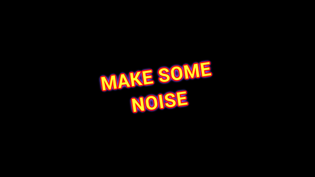

Text as a picture (the Text TOP of TouchDesigner): its *Out* goes into a [clip](Clipview.md#make-a-clip), an effect or a
display like any picture, as big as the project. *Text* holds the words: `|` starts a new line, `{value}` shows *Value*
(under *Number*, with *Decimals*), for example `BPM {value}` with the BPM linked into *Value*.

- *Font*: *Sans*, *Sans bold*, *Mono*, or *Font file* (the path of a `.ttf` or `.otf` file in *Font file*); *Size* in
  pixels of a 1080p picture (it scales with the project), *Uppercase*, *Letter spacing*, *Line height*.
- *Place*: *Align* and *Vertical align* around the point *X* / *Y* (0 to 1), *Rotation*.
- *Colors*: *Color*, *Opacity*, an *Outline* (width, *Outline color*), a *Shadow* (*Shadow blur*, *Shadow distance*:
  0 makes it a glow, *Shadow color*) and the *Background* (its *A* at 0 lets the layers below show through).
- *Animation*: *Typewriter* (*Chars per beat*, then *Hold* beats, again; a blinking *Cursor*), *Scroll left* (a
  ticker), *Scroll up* (credits; both by *Scroll speed*, parts of the picture per beat), *Lines* and *Words* (one at a
  time, a new one every *Every* beats). *Beat pulse* makes the text jump at each beat. *Time* *Free* counts seconds
  (one beat a second), *Sync* the beats of the [timeline](Timeline.md) (it stops with it). *Restart* starts the
  animation again.

## Generators › Utility

| Generator | What it is for |
|---|---|
| *ShowControls* | Your own surface of faders, knobs, buttons and toggles for a show. See [Show controls](#show-controls). |
| *XYPad* | A field you click or drag on: the point sets *X* (left 0 to right 1) and *Y* (top 0 to bottom 1). A link into *X* or *Y* moves the point. |
| *XYPathPad* | A point that walks along a path of points you drag on a field: one walk takes *Travel* beats, *Loop* or *Bounce*, the path *Closed* or *Open*. *Output X* / *Output Y* (-1 to 1) mix it with *Input X* / *Input Y*. |
| *CurvePad* | A point that walks along a closed path of points you set on a pad, as *X* and *Y*: *Curve* rounds it, one run takes *Duration* beats, free or on the beat. |
| *XYPositions* | A list of positions that glide into one X / Y output. |
| *EnvelopeOutput* | A curve you draw, played free or on the beat: one run takes *Duration* beats, the line shows where it plays, *Output* gives its value. |
| *StepChaser* | A step sequencer on the beat: the bar (*Bar length*) is cut into *Steps*, every step has a *Value* (or *Hold*), a *Fade in* and a *Fade out*. Every block (*Add output*) has its own *Output*. |
| *Button-Feld*, *Control-Button-Matrix* | A grid of buttons to link from: 3 × 3, or *Rows* × *Columns*. The *Settings* of a button hold its name, the mode (*Flash*, *Relative*, *Absolute*), *Value*, *Input* and the *Output* to link. |
| *ColorSelector* | Colours for several targets: pick one per row, the target sends it as *RGB* and *HSV*, with *Brightness* and *Smoothing*. *Lamps* under the name of a row colours a group of the fixture setup directly ([lighting desk](Lighting-Desk.md#groups-as-link-targets)). |
| *LoopTrigger* | A clip for the timeline: dropped onto a lane, it starts the [loop timeline](Timeline.md#loop-timelines) picked in *Loop* while the playhead is inside it, *From the start* of its turn or on the bars, and stops it at its end (*Stop at the end*). |
| *control4* | Four plain values, *Control 1* to *Control 4*, to set by hand or MIDI and link. |
| *quantize* | Rounds *Input* down to a number of *Steps* (4: 0, 0.25, 0.5, 0.75) as its *Output*. |
| *value_text* | Shows the value linked into *Input* as text, numbers with up to three decimals. |
| *textbox* | A note. It is saved with the project. |
| *Chat* | The AI chat of the sidebar as a window. |

### Show controls

*ShowControls* (`Generators` › `Utility`) is a surface you lay out yourself, for the controls you play during a show.

1. Drag *ShowControls* into an area or a Patchview. It starts in edit mode with one fader.
2. *Edit* on: *Fader*, *Knob*, *Button* (on while it is held) and *Toggle* (on and off), each with a plus, add a control. Drag a
   control to move it, drag its lower right corner to resize it, × removes it. Everything snaps to a 10 px grid.
3. *Edit* off: the controls are played. A fader and a knob go up and down with the mouse (Shift: finer), a double
   click types a value.

Each control is a normal control of the program: [link](Linking.md#make-a-link) it, map it to MIDI, rename it in its
options (tab *Main*, the name field), set its range and envelope there. Several surfaces make a show UI: put them into
the areas or tabs of a view tab, or as windows into a Patchview. The surface, its controls and their values are saved
with the project.

## FFGL plugins

FFGL plugins, for example the ones made for Resolume, run in VibeVJ like a shader. Put the plugin into the folder
`VibeVJ/assets/FFGL/` (`.dll` on Windows, `.bundle` on macOS, `.so` on Linux); it shows in the *Assets* tab under
`FFGL`.

1. Drag the plugin into a Patchview or an area, or onto a clip of the [Clipview](Clipview.md) to stack it as an effect.
2. Its window is the one of a shader: preview, *Out*, and in *Settings* and *Outputs* the render size, Spout, NDI and
   the display.
3. The section *FFGL* in the *Control* tab holds its parameters as controls: sliders with the range the plugin gives,
   buttons, lists and text fields. Link them and map them to MIDI like any control.
4. An effect has the port *In 1* (a mixer also *In 2*): link a picture into it. In a clip or in the effects of a MapLab
   output it gets the picture before it by itself.

The time and the beat of the timeline go to the plugin. Only FFGL 2 plugins load (Resolume 7 and later); an older one
says so in its window.

## Generators › Python

Scripts in Python as generators (`.py`): their `#@` comments become controls like the `//@` comments of a shader, they
take pictures in and send values and a picture out. *LFO* (a wave), *AverageColour* (the colour of a picture),
*Threshold* (a picture cut at a brightness) and *Edges* (the outlines of a picture, with the package numpy, which
VibeVJ installs the first time) are examples to start from. How to write your own: [Python
generators](Python-Generators.md).

## Native assets
A native asset is a generator written in C (or another compiled language) instead of a shader or a script: an
algorithm that runs on the processor, for example a simulation. It comes as an asset folder like any other and is used
like a shader. *Generators › Native › Life* is one: Conway's Game of Life on a field of 192 × 108 cells.
*Generators › Native › Dither* is another: it brings the picture linked into its *In* down to a few colours, like old
computers and handhelds (Bayer patterns or Floyd-Steinberg, the palette typed in as text).
1. Drag it into a Patchview or an area, or onto a clip of the [Clipview](Clipview.md).
2. Its window is the one of a shader: preview, *Out*, and in *Settings* and *Outputs* the render size, Spout, NDI and
   the display.
3. The section *Controls* in the *Control* tab holds its controls: sliders, number fields, buttons, lists, vectors,
   colours and text fields, the same kinds a shader has. Link them and map them to MIDI like any control.
   A text field keeps as many characters as the asset allows (Dither's *Palette*: colours as `#rrggbb`, up to 16).
4. The section *Values* has its outputs (Life: *Population*, *Births* and *Step*, a pulse at each generation): link
   them into controls of other generators.
5. The *Time* section of the *Control* tab gives it its time (*Free*, *Manual* or *Sync* with the timeline); the beat
   and the tempo of the timeline go to it too. Life makes *Rate* generations a second, or one at every beat with *Sync*.
6. An asset that works on a picture has inputs like a shader: *In* at the bottom of its window (and more by their name)
   and an entry in *Inputs*. [Link](Linking.md) a picture into it: a shader, a video, a camera. VibeVJ
   hands the picture to the asset at the size the asset works in (Dither: 320 × 180); a picture comes one or two
   frames late. Nothing is read while nothing is linked.
7. The section *Plugin* shows the plugin and its version. *Reload plugin* loads it again after it was rebuilt, and with
   *Watch the library* (on) a rebuilt plugin is loaded by itself: the asset keeps its controls, links and state, and
   its window is built again when the controls changed. Not in [show mode](Timeline.md#show-mode).
Its controls are saved with the project and in presets like the controls of a shader, and so is its own state (the
cells of Life). A native asset that cannot be loaded says so in red in its *Controls* section; the log tells why.
Native code runs with the full rights of VibeVJ: only use native assets you trust. How to write one:
`core/shizoscript3_core_cabi/README.md` in the source of VibeVJ, section *A native VibeVJ asset*.
## Generators › Audio and Network

| Generator | What it is for |
|---|---|
| *AudioInputAnalysis* | Beat, tempo, energy and breaks from the music: [Audio](Audio.md). |
| *ArtnetSender*, *ArtnetReceiver* | Single Art-Net channels out and in: [Art-Net](Output-and-Devices.md#art-net). |
| *NDIReceiver*, *SpoutReceiver* | Video from other programs (Spout on Windows, Syphon on macOS): [Receiving video](Output-and-Devices.md#receiving-video). |
| *ProlinkBridge*, *ProlinkDecks* | Tempo, beat and waveforms of CDJs: [Prolink](Output-and-Devices.md#prolink-cdjs). |

## Generators › output

| Generator | What it is for |
|---|---|
| *RGBMask* | Takes a picture (*In*) and gives the average colour inside the rectangles or lines you draw on it, as *Red*, *Green*, *Blue* and *Out*: a lamp follows a part of the picture. *Clear* removes the shapes. |

## Shaders

A shader makes or changes a picture. Every shader has the [tabs *Control*, *Settings* and *Transform*](Output-and-Devices.md#the-tabs-of-a-shader)
and an *Out* port.

| Folder | What is in it |
|---|---|
| `Sources` | Shaders that make a picture: patterns, 3D, noise, LED looks, shaders that draw with the [sound](Audio.md#fft-texture). |
| `Effects` | Shaders that change a picture: colour, blur and feedback, glow, kaleidoscope, mirror, retro looks. Link a picture into their input, or stack them onto a [clip](Clipview.md#make-a-clip). |
| `Utilities` | *output* shows a picture on a display or projector: [Output and devices](Output-and-Devices.md#show-the-picture-on-a-display-or-projector). *Shaderstack* holds several shaders in one generator. |

`Sources` › `Mapping` and `Effects` › `Mapping` hold the shaders for mapping real objects with a mask (light along
outlines, smoke between objects, each window of a facade on its own, test patterns, edge blending; flocks, lasers,
water, fire, sand and lightning that live in the mask; coral, frost, moss and branches that grow over the surfaces
and turn when they are full; slime mould and reaction-diffusion in 3D): see
[Projection mapping building blocks](Output-and-Devices.md#projection-mapping-building-blocks).

**See a shader before you drag it:** rest the mouse on a shader in the list for half a second. A small window beside
the sidebar plays it, with the values its controls start with. It goes when the mouse leaves the shader. An effect
needs a picture to work on, so its window only says so: drop it onto a view with a source to see it.

**See a video before you drag it:** a video file shows its length at the right end of its row. Rest the mouse on it
for half a second and a small window beside the sidebar plays it, without sound, with its size, frame rate and codec
([Video clips](Video.md#use-a-video)).

A double click on a file of a shader opens its code in a tab: see the [code editor](Shortcuts-and-Tips.md#code-editor). Only text files open this way (code, shaders, JSON, Markdown, presets); pictures, videos and sound are dragged onto a view instead.

### Building blocks for generative pictures

Shaders that do one thing each, made to be combined, like the operators of TouchDesigner: link a source into an
effect, that effect into the next. The effects work on any picture (a shader, a video, a camera); in a
[clip](Clipview.md#make-a-clip) they get the picture before them by themselves. Values marked "per beat" follow the
*Time* section of the shader (*Sync*: the beats of the [timeline](Timeline.md)). Every control can be
[linked](Linking.md#make-a-link) and mapped to MIDI.

#### FeedbackTransform (`Effects` › `Feedback&Blur`)

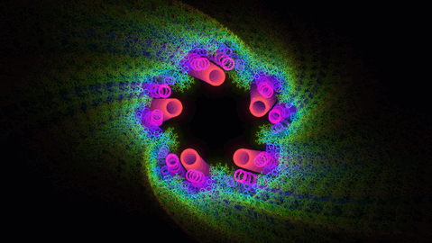

A feedback loop with a transform in it: every frame the last picture is zoomed (*Zoom*), turned (*Rotate*, degrees),
moved (*Move*), blurred (*Blur*), shifted in colour (*Hue shift*) and faded (*Feedback amount*), then the input is put
on top (*Blend mode*: *Lighten*, *Add*, *Screen*, *Key over* with *Key level*, *Mix*). Small values make tunnels,
spirals and trails. The values count per frame. *Center* is the point it zooms and turns around, *Beat punch* zooms in
a bit more at every beat, *Edge mode* says what shows beyond the border when it zooms out, *Reset* clears the trails.

#### Displace (`Effects` › `Morph&Mirror`)

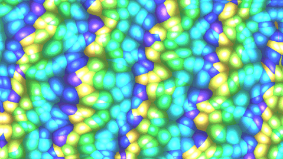

Moves the pixels of the input. *Source* *Noise* needs nothing else: a moving noise (*Noise scale*, *Noise speed* per
beat, *Noise detail*) pushes them around. *Map input* reads the picture linked into the port *Displace map*: *Map mode*
*Red/green offset* moves by its red and green (0.5 is no move), *Luma slope* along the slope of its brightness (glass,
water), *Luma along angle* in one direction (*Angle*). *Map + noise* adds both. *Amount* is how far, *Beat swell* makes it
grow at every beat, *Chroma split* moves red, green and blue apart, *Map scroll* moves the map.

#### Composite (`Effects` › `Utility`)

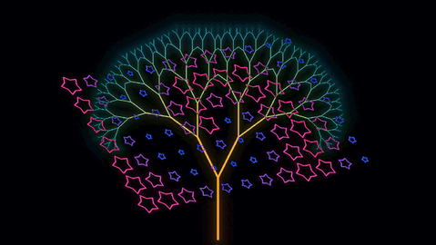

Two pictures in one: *Input* is the bottom, the port *Layer* goes on top with the *Blend mode* (*Over*, *Add*,
*Subtract*, *Multiply*, *Screen*, *Overlay*, *Soft light*, *Hard light*, *Difference*, *Lighten*, *Darken*,
*Color dodge*, *Luma key*, *Mask*) and *Opacity*. *Over* uses the alpha of the layer; *Luma key* cuts out its dark parts
and *Mask* shows the input only where the layer is bright (both from *Key level* with *Key softness*). The layer can be
moved (*Layer offset*), scaled (*Layer scale*) and turned (*Layer rotate*); *Layer edge* *Repeat* tiles it when it is
smaller. *Swap inputs* puts the layer underneath.

#### GradientMap (`Effects` › `Color`)

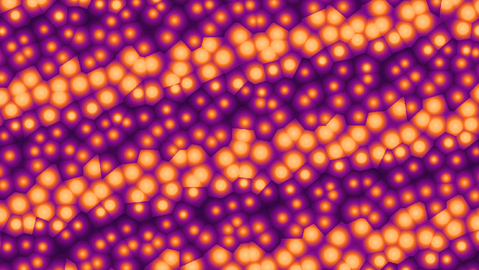

Colours the input with a colour ramp: its brightness (or *Source*: red, green, blue, saturation, hue) picks the colour,
dark the left end, bright the right end. *Palette* *Four colours* uses *Color 1* to *Color 4*; *Rainbow*, *Fire*, *Ice*,
*Neon*, *Sunset*, *Acid* and *Mono* are ready made. *Offset* and *Cycle speed* (ramps per 4 beats) slide the ramp, so the
colours run through the picture; *Repeat* lays it several times (with *Mirror* without hard edges); *Contrast* sharpens
the source, *Amount* mixes back to the input.

#### Levels (`Effects` › `Color`)

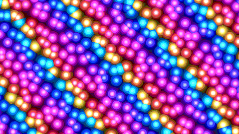

Black point and white point of the input (*In black*, *In white*), *Gamma* for the middle tones, the range of the
result (*Out black*, *Out white*), *Posterize* (steps per channel, 0 off), *Threshold* (black and white, with
*Threshold softness*) and *Invert*. *Channel* limits it to red, green or blue, or to the brightness (*Luma*, keeps the
colours). *Amount* mixes back to the input.

#### Relief (`Effects` › `Glow&Light`)

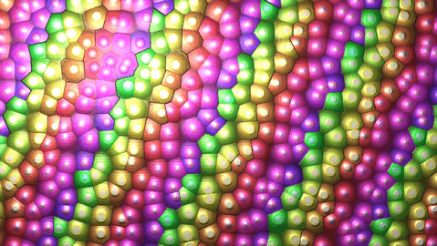

The input as a surface: its brightness (*Height source*) is the height, *Bump* how steep it is, *Sample distance* how
wide the slopes are. *Output mode* *Lit* lights the input colours with a point light (*Light angle*, *Light distance*,
*Light height*, *Light color*, *Ambient*, *Specular*, *Shininess*); *Light spin* moves the light around (turns per 4
beats). *Emboss* is grey relief, *Normal map* the slopes as colours (for other shaders), *Height* the height alone.

#### SDFScene (`Sources` › `3D`)

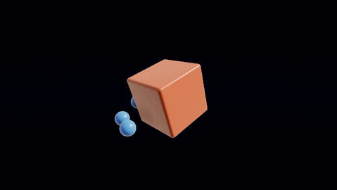

A raymarched 3D object with every part on a control. *Shape A* and *Shape B* (sphere, box, torus, octahedron, gyroid
ball, chain link, hex prism, cross) blend by *Morph*; *Size*, *Roundness*, *Twist*; *Satellites* are balls on orbits that
melt into it (*Blend*). *Copies* *Grid* or *Ring* repeats it (*Spacing*). *Spin* (turns per 8 beats) and *Beat pulse*
move it, the camera orbits (*Camera distance*, *Camera height*, *Camera orbit*). Light and material: *Color A*
(object), *Color B* (satellites), *Light color*, *Light angle*, *Rim*, *Roughness*, *Metallic*, *Background*, *Fog*.
*Quality* 1 is for live use; 2 adds a soft shadow, 3 smooths the edges and costs about four times as much. *Debug mode*
shows normals, the march steps or the depth.

#### InstanceGrid (`Sources` › `Patterns`)

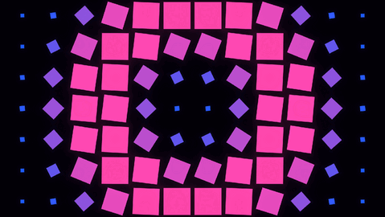

One shape copied over a grid (*Columns* × *Rows*), each copy driven by a *Field*: *Radial wave*, *Linear wave* (*Field
angle*), *Noise*, *Beat chase*, *Random flicker* or *Spiral*, with *Field scale* and *Field speed* (per beat). The field
sets the size of a copy between *Size min* and *Size max*, an extra turn (*Field rotate*) and its colour between *Color A*
and *Color B* (*Color mode*: also *Rainbow*, *Checker*, *Single*). *Shape*: circle, square, triangle, hexagon, star, ring,
cross, line, heart; *Outline* draws only the edge, *Jitter* moves the copies off the grid, *Glow*, *Beat pulse*.

#### FoldFractal (`Sources` › `Patterns`)

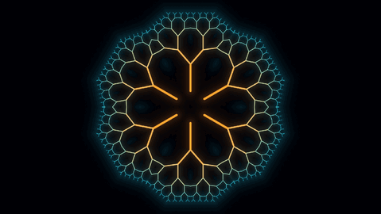

A tree that branches again and again, made by folding space (like an L-system): each of the *Iterations* draws a branch,
turns by *Angle* and makes the next one *Scale* times shorter. *Symmetry* *Tree* grows one tree from the bottom; *Mirror*
and *3-fold* to *8-fold* put 2 to 8 trees around the middle (*Inner radius*): snowflakes and mandalas. *Branch length*,
*Branch shift* (crooked trees), *Shape* (*Lines*, *Dots*, *Rings*, *Leaves*), *Line width*, *Glow*, *Zoom*. *Angle sway*
and *Sway speed* make it breathe with the beat, *Rotate speed* turns it, *Beat pulse* flashes it. The colour goes from
*Color A* (trunk) to *Color B* (tips), or *Rainbow* with *Color cycle*.

## Shaders › Instancing, 3D, transform and points

The fourth set of building blocks (#586): copies of a shape driven by a picture, one effect for cropping, fitting and
tiling, a 3D stage, and a million particles. *Instancer* and *Particles2* are drawn by the graphics card as real points
(a *point pass*), so their cost depends on how many copies or particles there are, not on where they are. Values
marked "per beat" follow the *Time* section of the shader (*Sync*: the beats of the [timeline](Timeline.md)). The
hover preview of the *Assets* tab does not draw the points: it shows its test picture there.

### Instancer (`Effects` › `Morph&Mirror`)

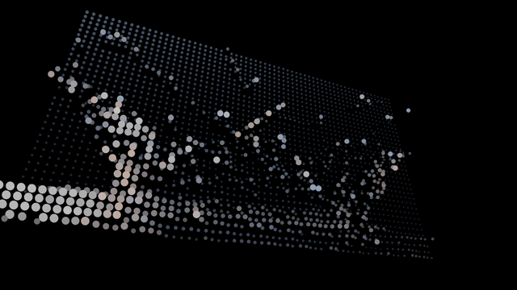

Instancing as in TouchDesigner: one *Shape* (*Circle*, *Square*, *Rounded square*, *Ring*, *Triangle*, *Diamond*,
*Star*, *Cross*, *Line*, *Hexagon*) copied *Columns* × *Rows* times, and each copy takes its size, colour, turn and
depth from the pixel of the input under it. Put it on a video or a camera in a [clip](Clipview.md#make-a-clip).
*Layout mode*: *Grid*, *Hex grid*, *Circle* (columns go around, rows go out), *Sphere* and *Cylinder* (the picture
wrapped around a ball or a drum) or *Scatter* (random places). *Size* is the copy at full value (1 = the cell),
*Min size* at 0; *Size by* says what of the pixel sets it (*Brightness*, *Darkness*, *Red*, *Green*, *Blue* or *Same
for all*), *Value gain* lifts dark pictures. *Threshold* leaves out copies on dark pixels. *Rotate*, *Rotate by* (extra
degrees at full value) and *Spin* (per beat) turn the copies; *Depth* pushes bright copies towards the camera.
*Color mode*: *From picture*, *Gradient by brightness* (*Color A* to *Color B*), *Single color*, *Picture x color*;
*Opacity*, *Outline* (0 = filled), *Blend* *Over* or *Add* (copies add up like light), *Beat pulse*. *View* *3D* with
*Camera tilt*, *Camera turn*, *Camera spin* (per beat), *Zoom* and *Camera distance*, or *Flat*. *Background* and
*Picture behind* (the input under the copies). The far copies are drawn first so the near ones cover them; on a
*Sphere* or *Cylinder* with *Over* the back is hidden.

### Transform (`Effects` › `Utility`)

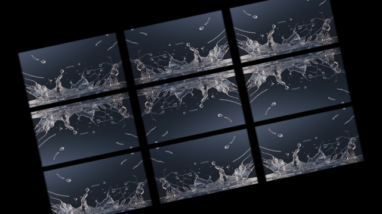

Crop, fit, move, scale, turn and tile a picture in one step (the Crop, Fit, Transform and Tile TOPs). In this order:
*Crop left* / *right* / *top* / *bottom* cut the input; *Fit* puts what is left into the picture: *Stretch*, *Fit*
(all of it, with bars), *Fill* (no bars, cut) or *Pixel size* (1:1 pixels); then *Position*, *Scale*, *Stretch* (x and
y on their own) and *Rotate* around the *Pivot*, *Flip x*, *Flip y*. *Tiles x* and *Tiles y* repeat it inside its
frame, *Tile mirror* mirrors every second copy (seamless patterns), *Brick offset* shifts every second row, *Tile gap*
leaves space between them. *Edge* says what is outside the frame: *Transparent* (the *Background*), *Clamp*, *Repeat*
or *Mirror* (both fill the screen). *Feather* softens the borders. *Scroll* (frames per beat, with *Edge* *Repeat* or
*Mirror*) and *Spin* (degrees per beat) move it with the music. The input is read smoothly also when it is a shader.
*Background* with an *A* of 0 stays transparent for a *Composite*; *Use alpha* cuts the input out by its own alpha
(off by default: many sources write 1 there, some 0).

### Stage (`Sources` › `3D`)

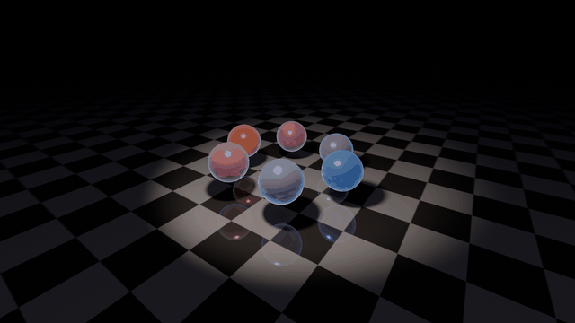

A small 3D scene: objects on a floor under a spot light. *Shape* (*Sphere*, *Rounded box*, *Torus*, *Gem*, *Pill*,
*Box frame*, *Cylinder*, *Blob*) as one object or copied (*Arrangement* *Row* of 3, *Ring* of 6, *Grid* of 3 × 3,
*Spacing*), with *Size*, *Roundness*, *Hover*, *Bounce* (a jump at every beat, the copies one after the other) and
*Spin* (turns per 4 beats). The copies go from *Object color* to *Object color 2*; *Object roughness*, *Metallic* and
*Glow* (they light up, also the floor around them). The floor: *Floor pattern* (*Plain*, *Checker*, *Grid lines*,
*Tiles*, *Rings*), *Floor color*, *Floor color 2*, *Tile size*, *Floor reflection* (the objects mirrored in it) and
*Floor roughness* (blurs the mirror image with the distance). The light: *Light motion* *Fixed*, *Orbit* (*Light speed*
degrees per beat), *Beat jump* (to a new place at every beat) or *Swing*; *Light angle*, *Light height*, *Light
distance*, *Spot angle* (the pool of light), *Light color*, *Light intensity*, *Beat flash*, *Shadow sharpness* (soft
or hard shadows), a back light (*Rim color*, *Rim*) and *Ambient*. The camera: *Camera distance*, *Camera height*,
*Camera angle*, *Camera orbit* (turns per 16 beats), *Zoom*; *Background* and *Fog* towards the horizon. *Quality* 1 is
made for live use at 1080p, 2 adds ambient occlusion and longer marches, 3 smooths the edges (4 times the cost).

### Particles2 (`Sources` › `Simulations`)

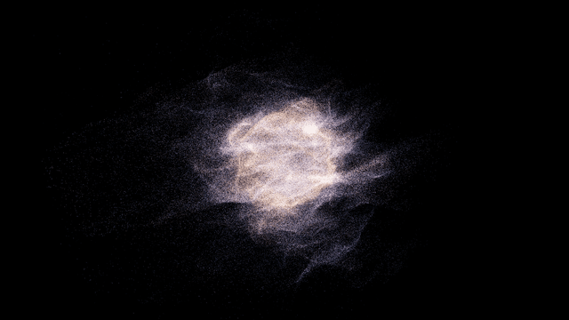

Up to 1 048 576 particles (*Particles*) in 3D, simulated and drawn by the graphics card, each one a real point: unlike
[Particles](#particles-sources--simulations) none is lost when two meet, and the cost follows *Particles*. They are born
at the *Emitter*: *Volume* (a box), *Sphere* (its surface), *Ring*, *Fountain* (upwards), *Field picture* (where the
picture linked into the port *Field* is bright, on the picture plane) or *Galaxy* (a turning disc with three arms), at
*Emitter position* with *Emitter size*, *Start speed* and *Spread*, and live *Lifetime* seconds. Forces: a swirling wind
(*Flow strength*, *Flow scale*: bigger = smaller swirls, *Flow speed* per beat), *Gravity*, *Attract* (to the emitter
position, < 0 pushes away), *Orbit* (around the upright axis), *Drag* (high: they follow the wind closely, in fine
threads), *Field push*. At every beat *Beat burst* gives this share of the particles a new start at the emitter
(*Burst speed*) and *Beat kick* pushes all outwards. *Edge mode* *Free*, *Kill* (born again outside *Bounds*) or
*Wrap*. *Reset* starts them all again.
The picture: *View* *Orbit 3D* (*Camera distance*, *Camera height*, *Camera angle*, *Camera spin* per beat, *Zoom*) or
*Flat* (the picture plane). *Point size* in pixels of a 1080p picture (closer points are bigger), *Size random*, *Point
shape* (*Soft dot*, *Hard dot*, *Glow*, *Square*, *Spark*: shows on points bigger than 3 pixels), *Brightness* of one
particle (they add up: with many, less is more), *Color mode* (*By age*, *By speed*, *Random*, *From field*, *By
height*, *Single color*; *Color A*, *Color B*), *Depth fade*, then *Exposure*, *Trails* and *Background*.

## Your own files

- **Pictures and videos:** copy them into `VibeVJ/assets/Textures` or `VibeVJ/assets/Videos` (or any folder below
  `assets`), then press refresh in the *Assets* tab.
- **Presets** are written into the asset they belong to.
- **Layouts** you save from a view tab are in `Views` and are offered in every
  [empty area](The-Screen.md#an-empty-area).

## Shaders › Blur, time, motion and particles

More building blocks in the spirit of TouchDesigner (#586): a family of blurs, a frame cache that shows the past, an
estimate of how the picture moves, and GPU particles. Like all effects they work on any picture (a shader, a video, a
camera) and take the picture before them in a [clip](Clipview.md#make-a-clip). Sizes are in pixels of a 1080p
picture and scale with the size of the shader. Values marked "per beat" follow the *Time* section of the shader
(*Sync*: the beats of the [timeline](Timeline.md)); *Beat pump* makes the blur grow at each beat and fall back
(*Pump decay*: how fast).

### GaussianBlur (`Effects` › `Feedback&Blur`)

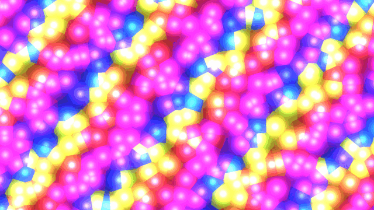

A smooth blur, from a soft touch to a blur of 200 pixels (*Radius*). *Stretch* blurs more across (> 0) or up and down
(< 0). *Output mode*: *Blur*, *Glow* (the blur added on top, *Strength*), *Sharpen* (pushes the picture away from its
blur) or *High pass* (only the fine detail, on grey). *Mask mode* limits it to the *Bright parts* or *Dark parts* of the
input (*Mask level*, *Mask softness*) or to where the picture linked into the port *Blur mask* is bright. *Amount*
mixes back to the input. Large radii are blurred on smaller copies of the picture, so a big blur costs about as much as
a small one.

### DirectionalBlur (`Effects` › `Feedback&Blur`)

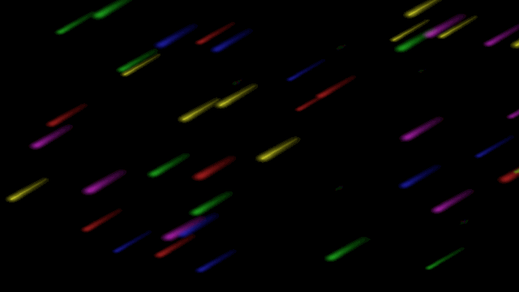

A motion blur along a line: *Blur length* and *Angle* (degrees; *Spin* turns it, turns per 4 beats). *Blur mode*
*Centered* smears both ways, *Trail behind* and *Trail ahead* one way, with *Falloff* fading the far end (comet
tails). *Highlight boost* makes the bright parts streak more (above *Highlight level*). *Direction mode* *Noise swirl*
turns the direction by a moving noise (*Swirl amount*, *Swirl scale*, *Swirl speed* per beat): a painted look.
*Samples* is the quality: the blur has *Samples* × *Samples* taps.

### RadialBlur (`Effects` › `Feedback&Blur`)

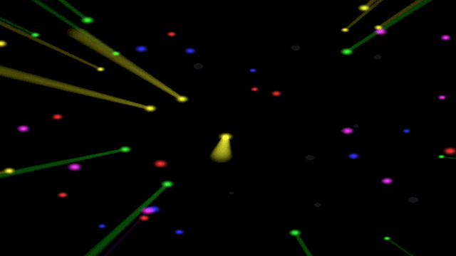

A blur towards the *Center* (*Zoom*: 1 reaches into the center) and around it (*Spin*, degrees); both together make a
spiral. *Direction* *Zoom in*, *Zoom out* or *Both ways*, *Falloff* fades the far end. The center can go round
(*Center motion* *Circle*) or wander (*Wander*) by *Motion radius*, *Motion speed* turns per beat. *Output mode*
*Light rays* streaks only the parts brighter than *Ray level* and adds them on top (*Ray gain*): shafts of light.

### LensBlur (`Effects` › `Feedback&Blur`)

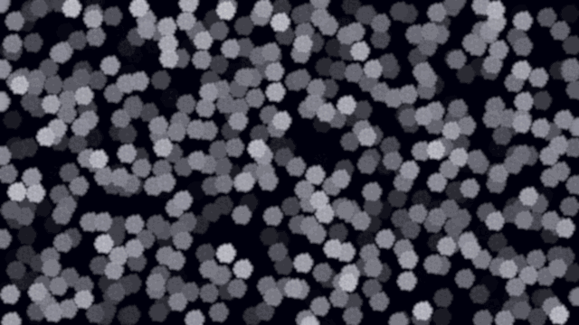

The blur of a camera lens: every point becomes a disc (or a polygon with *Blades* 3 to 8, *Blade rotation*), and the
parts brighter than *Highlight level* become bright discs (*Highlight gain*; *Ring* makes their edge brighter, like an
old lens). *Radius* is the biggest disc. *Focus mode* says what stays sharp: *Everywhere* blurs all; *Depth map
input* reads the brightness of the picture linked into the port *Depth map* as the distance (0 near, 1 far);
*Brightness as depth* uses the input itself; *Around a point* keeps *Focus point* sharp. *Focus distance*, *Focus
range* (the sharp depth) and *Focus falloff*; *Focus sweep* swings the focus once every 4 beats. *View* *Focus map*
shows the size of the discs. *Quality*: 32, 64 or 128 taps.

### TiltShift (`Effects` › `Feedback&Blur`)

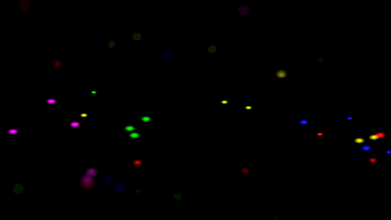

The miniature look: a sharp band (*Focus position*, *Focus angle*, *Focus width*) and a blur that grows away from it
(*Focus falloff*) up to *Blur amount*. *Focus shape* *Ellipse* keeps a round spot sharp instead (*Ellipse aspect*).
*Focus sweep* moves the band up and down, once in *Sweep beats*. *Saturation amount*, *Contrast* and *Vignette amount*
give the toy colours. *View* *Blur map* shows in red where it blurs.

### TimeMachine (`Effects` › `Feedback&Blur`)

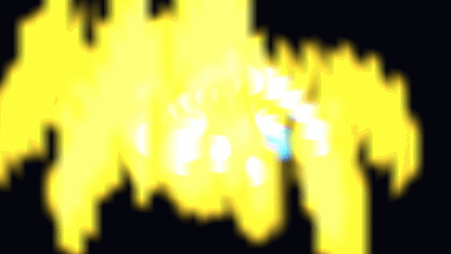

Keeps the last frames of the input (*Cache frames*: 16 at 960 × 540, 36 at 640 × 360 or 64 at 480 × 270; *Record
every* keeps only every n-th frame for a longer past; *Freeze* stops recording) and shows each pixel from another
moment. *Time mode*: *Delay* (the whole picture *Offset* back), *Slit scan* (the delay grows across the picture along
*Slit angle*), *Radial* (from the *Center* out), *Map input* (the brightness of the picture linked into the port *Time
map*: black now, white the oldest frame), *Noise* (a moving noise, *Noise scale*, *Noise speed*) and *Echo* (*Echo
count* copies, *Echo spacing* apart, each *Echo decay* as bright). *Depth* is how much of the cache the displacement
spans, *Invert* swaps now and long ago, *Steps* cuts the delay into bands (time slices). *Beat scratch* throws the
delay back at every beat. *Smooth frames* blends between two frames.

### OpticalFlow (`Effects` › `Utility`)

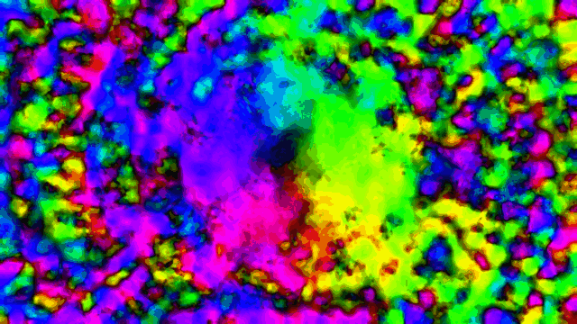

How the input moves, as a picture (the Optical Flow TOP). *Output mode* *Color wheel* shows the direction as the hue
and the speed as the brightness; *Motion mask* white where something moves; *Over input* the colours over the input;
*Vectors* red and green = 0.5 + the motion, the format the port *Displace map* of *Displace* reads with *Map mode*
*Red/green offset*. *Flow gain* scales it, *Threshold* ignores small moves (camera noise), *Smoothing* steadies it over
time. Works best on a camera or a video with clear shapes.

### FlowSmear (`Effects` › `Feedback&Blur`)

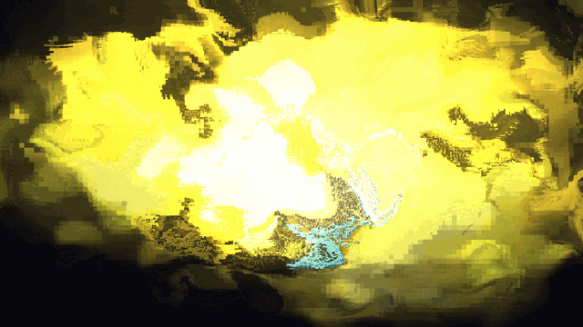

A datamosh: the picture is carried along by its own motion instead of being shown fresh, as a video stream that lost
its key frames, so the old picture smears and melts along whatever moves (*Smear*). *Block size* moves it in blocks
like a broken stream. *Refresh* lets the input back in a little every frame, *Still refresh* where nothing moves
(*Motion threshold*); *Keyframe beats* shows a clean frame every so many beats; *Color drift* turns the colours of the
moving parts. *Reset* shows the input clean.

### Particles (`Sources` › `Simulations`)

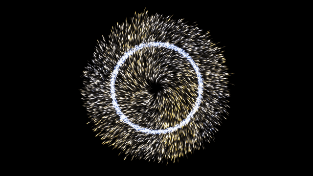

Up to 130 000 particles at 1080p, simulated on the graphics card. They are born at the *Emitter*: *Everywhere*,
*Point*, *Ring*, *Fountain* (upwards) or *Field picture* (where the picture linked into the port *Field* is bright),
at *Emitter position* with *Emitter size*, *Emit rate*, *Start speed* and *Spread*, and live *Lifetime* seconds. Forces:
a swirling wind (*Flow strength*, *Flow scale*, *Flow speed*), *Gravity*, *Attract* (to the emitter position, < 0 pushes
away), *Orbit*, *Drag*, *Field push* (along the slopes of the brightness of *Field*). At every beat the emitter fires
(*Beat burst*, *Burst speed*) and *Beat kick* pushes all particles outwards. They are drawn as dots of *Particle size*
with a *Streak* along their motion, *Glow* and *Brightness*; *Color mode*: *By age* and *By speed* from *Color A* to
*Color B*, *Random*, *From field*, *Single color*. *Trails* keeps the last frames. *Edge mode* *Wrap* or *Kill*.
The simulation counts frames: at 30 fps the particles move half as fast as at 60 fps. Each cell of 4 × 4 pixels holds
one particle, so when two meet one is lost.

## Shaders › Video into 3D and time

Effects that turn a video, a camera or any picture into something else (#586), in `Effects` › `Video3D`: three that
build 3D out of it (lines, dots, blocks) and two that play with its time. Put one on a video in a
[clip](Clipview.md#make-a-clip) or link a video into its *input* in a Patchview. They look right at 1080p with their
defaults; sizes in pixels are pixels of a 1080p picture and scale with the size of the shader.

What they all have:

- **The music.** Like the [sound shaders](#shaders--sound) they hear a running
  [AudioInputAnalysis](Audio.md#fft-texture) by themselves (or the one linked into their port *Audio*); without a sound
  they follow the beat of the [timeline](Timeline.md). *Music*: *Auto* (the sound while it plays, else the beat),
  *Sound*, *Beat*, *Off*; *Music gain* makes a quiet sound stronger. The beat effects (a flash, a burst, a ripple, a
  glitch) fire on each kick of the sound, or on every *Beat every*-th beat.
- **The camera** of the three 3D ones: *Camera tilt* (looking down onto the picture), *Camera turn* (around it),
  *Camera sway* (rocks to and fro over 16 beats), *Camera orbit* (turns per 16 beats), *Camera distance* (small: strong
  perspective, the size stays the same) and *Zoom*.
- *Background mode*: *Colour* (*Background color*), *Transparent* (alpha 0 where nothing is drawn, for *Add* or an
  *Over* with alpha in [Composite](#composite-effects--utility)) or *Picture* (the input behind, *Picture behind* sets
  how bright).

### RuttEtra (`Effects` › `Video3D`)

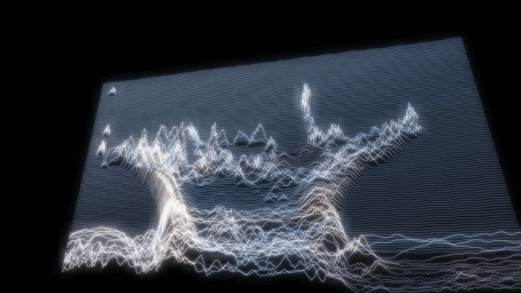

The Rutt/Etra video synthesizer of the 1970s: the picture becomes *Lines* glowing scanlines, each bent up by the
brightness under it (*Displacement*), seen in 3D. *Line mode*: *Horizontal* (the rows), *Vertical* or *Grid* (as many
columns as make square cells). *Displace direction*: *Up* (in the picture plane, the classic look), *Towards camera*
(a relief) or *Both*; *Displace by* *Brightness*, *Darkness*, *Red*, *Green*, *Blue* or *Saturation*. *Detail* is how
many segments a line has, *Smoothing* calms a noisy picture, *Cutoff* blanks the lines on dark parts, *Scroll* rolls
the lines through the picture (per beat). *Thickness*, *Brightness* (*Brightness by picture*: dark parts dim the
line), *Glow* and *Glow size*, *Depth fade*, *Exposure*. *Color mode*: *Picture*, *Gradient* (*Color A* on dark parts
to *Color B* on bright ones), *Single colour*, *Picture x colour*; *Saturation boost*. The music: *Bass displace*
lifts the lines with the bass, *Beat flash* lights some of them on the beat, *Wave* wobbles them with the waveform
like an oscilloscope. The lines are drawn by the graphics card (a *point pass* of quads, one a segment): *Lines* ×
*Detail* is the cost.

### PointCloud (`Effects` › `Video3D`)

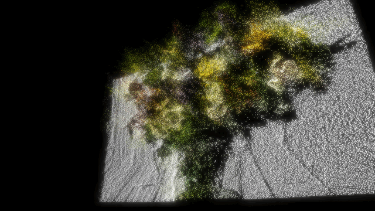

The picture as *Columns* × *Rows* dots in 3D, each pushed towards the camera by the brightness under it (*Depth*,
negative pushes it away; *Depth by* as above). *Point size* (*Size by brightness*), *Point shape* *Soft dot*, *Disc*,
*Square* or *Ring*, *Jitter* (a cloud instead of a grid), *Threshold* (no dots on dark parts), *Turbulence* (a slow
drift). On the beat the dots burst apart and spring back: *Explode* (how far), *Explode mode* *Random*, *Outwards*,
*Towards camera* or *Swirl*, *Explode spread* (the burst starts in the middle and runs out), *Spring* (how fast they
swing back). *Bass depth* pushes the depth with the bass, *Beat flash* lights some dots. Colour, *Brightness*, *Glow*,
*Depth fade* and *Exposure* as for RuttEtra (*Gradient* goes from far to near). Drawn as real points: the cost is the
number of dots, 57 600 by default, up to two million.

### Voxels (`Effects` › `Video3D`)

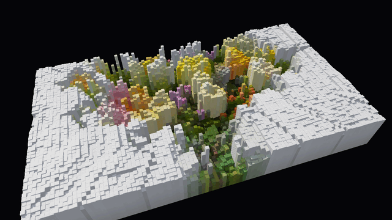

The picture as a grid of blocks, *Columns* across (the rows follow, so the blocks are square), each as high as the
brightness of its cell (*Height*, *Height by*, *Height curve*: above 1 only the bright parts stand up; *Base height*).
*Block mode*: *Extrude* (columns from the ground) or *Cubes* (one floating cube a cell, at its height). *Gap* between
the blocks, *Bevel* (rounded edges in the light), *Edge glow* (light lines along the edges), *Side shade*. On the beat a
*Ripple* runs out from the middle (*Ripple speed*); *Wave* rolls all the time; *Bass height* lifts the blocks. The
light: *Sun angle*, *Sun height* (low: long shadows), *Sun strength*, *Ambient*, *Specular*, *Emission* (the blocks
glow in their colour), *Saturation boost*, *Floor color*, *Exposure*. Every pixel walks the grid along its ray (no
raymarching steps): *Quality* 1 without shadows, 2 with shadows (the default), 3 also 4× antialiasing (four times the
cost). Fewer *Columns* is cheaper.

### SlitScan (`Effects` › `Video3D`)

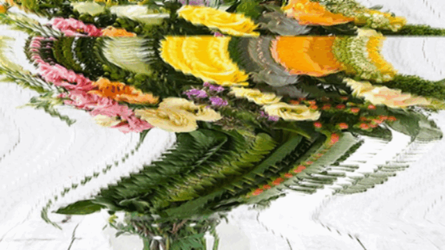

Every part of the picture shows another moment. It keeps the last frames (*Cache frames*: 16 at 960 × 540 up to 144
at 320 × 180; *Record every* keeps every n-th frame for a longer past; *Freeze* stops recording and holds it: map it
to a MIDI pad). *Time mode*: *Rows* (the top is now, the further down the longer ago: moving things smear), *Columns*,
*Diagonal* (along *Angle*), *Radial* (from *Center* out), *Brightness* (bright parts of the input show the past),
*Time map* (the brightness of the picture linked into the port *Time map*; without one, *Brightness*) and *Slit stack*
(the slit-scan camera: every frame the picture moves on by *Scan speed* pixels and the slit of the input at *Slit
position* fills the gap, so one axis of the picture becomes time; *Scan direction* *Left*, *Right*, *Up*, *Down* or
*Out* from the middle; at full size). *Depth* is how much of the past the displacement spans, *Offset* a delay
everywhere, *Reverse* swaps now and long ago, *Steps* cuts the time into bands, *Wobble* bends them in a slow wave,
*Smooth frames* blends between two frames. *Bass depth* stretches the time with the bass, *Beat scratch* throws it
back on the beat. *Amount* mixes back to the input. [TimeMachine](#timemachine-effects--feedbackblur) is its
sibling with *Delay*, *Noise* and *Echo*.

### Datamosh (`Effects` › `Video3D`)

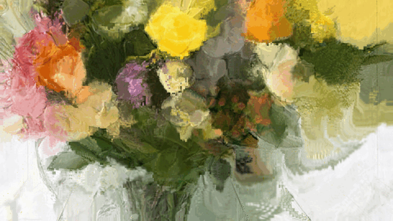

A broken video file on purpose: a codec saves most frames as "move these blocks of the last picture, add this little
difference"; datamoshing puts those moves on an old picture, so it smears and melts along the motion. Here the
motion of each block of *Block size* (8 to 64 pixels) is found like an encoder does (a search up to 12, 28 or 60
pixels a frame by *Quality* 1 to 3) and its own last picture is moved along it, plus *Residual* of the change of the
input (0: only the old picture moves; 1: it heals almost at once). *Mosh trigger*: *Beats* (it moshes *Mosh beats* of
every *Mosh cycle* beats, the rest is clean, like a key frame), *Hold only* or *Always*; *Mosh hold* moshes while it
is on and *Mosh* is the amount (map them to a MIDI pad and a fader). *Decay* heals it back to the live picture a
little every frame. *Hold vectors* freezes the motion so the same moves keep pushing (the "bloom" of a datamosh);
*Melt* adds a slow flow, so a still picture melts too; *Strength* scales the motion; *Glitch blocks* sends random
blocks the wrong way on the beat; *Color bleed* lets the colours run further than the brightness. *Output mode*
*Motion vectors* shows the motion (direction as hue) to set it up. [FlowSmear](#flowsmear-effects--feedbackblur)
smears along a smooth optical flow instead of blocks.

## Backgrounds: carpets and tunnels

Moving backgrounds for big LED walls (#586): four carpets, flat patterns that scroll, warp and change on the beat,
in `Sources` › `Patterns`, and three tunnels, raymarched 3D flights with real materials, in `Sources` › `3D`. Their
time counts beats when the *Time* section of the shader is *Sync* (seconds with *Free*), so the motion follows the
[timeline](Timeline.md). Every control can be [linked](Linking.md#make-a-link) and mapped to MIDI.

### The controls all carpets have

- **Motion:** *Speed* (multiplies the time), *Scroll speed* (tiles per 4 beats) in the direction *Scroll angle*,
  *Rotation* and *Rotate speed* (turns per 64 beats).
- **Warp:** *Warp mode* *Swirl*, *Cloth waves* (a flying carpet), *Lens* (a magnifier that wanders), *Flow* (noise)
  or *Beat ripple* (a ring on every beat), with *Warp amount* and *Warp scale*. *Loop beats*: after this many beats
  the warp and the breathing repeat.
- **LED wall:** *LED pixel*, *Softness*, *Wall columns*, *Wall rows*, *Screen column*, *Screen row*, *Screen gap*,
  *Canvas offset*, *Brightness*, *LED gamma*, *Black floor*, *Quality* (see the tips below).
- Most of them morph to a second pattern and back: *Morph every* beats, the change takes *Morph beats*.

### LED-wall tips

- **One carpet over several screens:** give each output its own copy of the shader with the same values, only
  *Screen column* / *Screen row* differ (1 = left / top), and set *Wall columns* × *Wall rows* to the size of the
  wall. Each copy draws its part of one big carpet: the lines and the motion run on from screen to screen. Use
  *Sync* time, so all copies have the same time. *Screen gap* is the frame between two screens in screen heights: a
  diagonal line then continues straight across it. *Canvas offset* moves the whole carpet by hand.
- **No moiré:** when the LED processor scales the output down to the wall (a 1920 × 1080 output on a wall of 240 ×
  135 LEDs), set *LED pixel* to the size of one LED in output pixels (here 8). Every LED then gets one clean
  colour, filtered over the LED, and no line is ever thinner than one LED. With one output pixel per LED leave it at
  0. *Softness* 1.5–2 calms the edges of slow motion on coarse walls (pitch 6 mm and more). *Quality* 2 and 3 take
  4 and 9 samples per LED.
- **Brightness:** an LED wall at full white is blinding: *Brightness* 0.4–0.6 is plenty indoors. *LED gamma* above 1
  darkens the mid tones of a wall whose processor has no gamma curve (the picture looks washed out). *Black floor*
  0.02–0.05 lifts black when the darkest parts flicker.
- **Clean loops:** use 4, 8, 16, 32 or 64 for *Loop beats*, *Morph every* and the other "every" values. The time of a
  shader starts again at 4096, and these divide it.

#### CarpetGirih (`Sources` › `Patterns`)

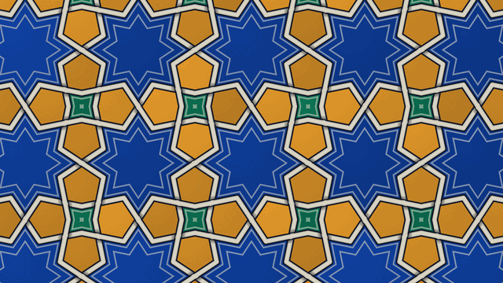

Islamic star patterns (girih, zellige), drawn with Hankin's method: from the middle of each edge of a tiling two
bands start at the *Contact angle* and meet inside the tile. *Tiling*: *Squares p4m*, *Hexagons p6m*, *Octagons
4.8.8*, *Dodecagons 3.12.12* (the wallpaper groups p4m and p6m); the carpet morphs to *Tiling b* tile by tile.
*Contact angle* (low: the outlines of the tiles, 60–70: classic stars, 88: spokes), *Angle breath* (the stars open
and close over *Loop beats*), *Beat twist*, *Strap width*, *Outline width*, *Interlace* (the bands go over and under
each other), *Echo lines* inside the stars, *Glaze* (each tile a little different, a soft gloss), *Beat pulse*.
*Palette*: *Fes zellige*, *Alhambra*, *Isfahan*, *Mamluk*, *Neon night* or *Custom colours* (*Band color*, *Outline color*,
*Star color*, *Star color b*, *Ground color*); *Color swap every* lets the fill colours change places.

#### CarpetPersian (`Sources` › `Patterns`)

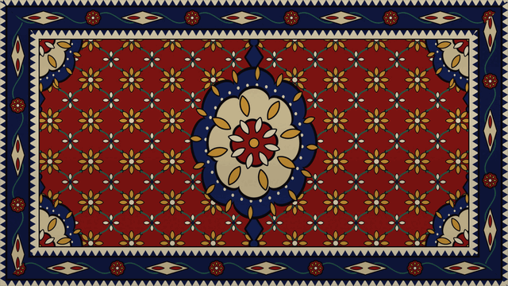

A Persian medallion carpet: medallion with pendants, quarter medallions in the corners, a field of flowers on a
lattice of vines, a main border with rosettes and cartouches between two zigzag guard bands. *Carpet layout*: *Whole
wall* (one carpet over all screens), *Repeat carpets* (*Carpet size*, *Carpet aspect*) or *Field only*. *Medallion
shape* *Lobed*, *Star*, *Lozenge* (stepped, tribal) or *Round*, morphing to *Medallion shape b*; *Medallion size*,
*Medallion points*, *Medallion spin* (the inner rings), *Breathe*, *Corner size*, *Field density* (the field scrolls
with *Scroll speed*), *Border width*, *Border run* (the border motifs run around the frame). *Knots* and *Knot size*
draw the knots of the wool, *Abrash* the stripes of hand-dyed yarn. *Palette*: *Tabriz*, *Kashan*, *Heriz*, *Nain*,
*Qashqai*, *Neon* or *Custom colours*. *Beat pulse* and *Twinkle* light the medallion and some flowers on the beat.

#### CarpetKilim (`Sources` › `Patterns`)

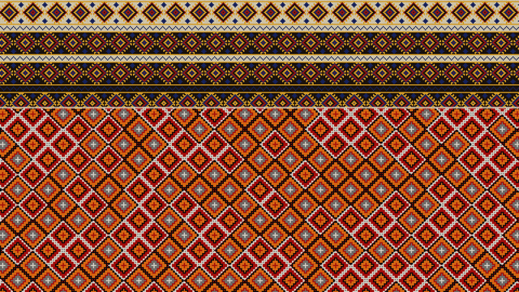

Woven patterns on a grid of stitches; a stitch can be exactly one LED (*Stitch* in LED pixels). *Pattern*:
*Kilim* (bands of stepped diamonds with hooks), *Ikat* (eyes with feathered edges where the dye ran along the
threads, *Bleed*), *Eye-dazzler* (serrated Navajo diamonds of thin stripes) or *Kente* (strips of blocks that slide up
and down, *Strip slide*). The loom weaves *Pattern b* in from the bottom, row by row. *Motif size*, *Ring flow* (rings
flow out of the diamonds), *Color step every* (the colours move one step through the palette), *Weave* (the texture
of the yarn), *Beat pulse*. *Palette* *Auto* gives each pattern its classic colours.

#### CarpetOpArt (`Sources` › `Patterns`)

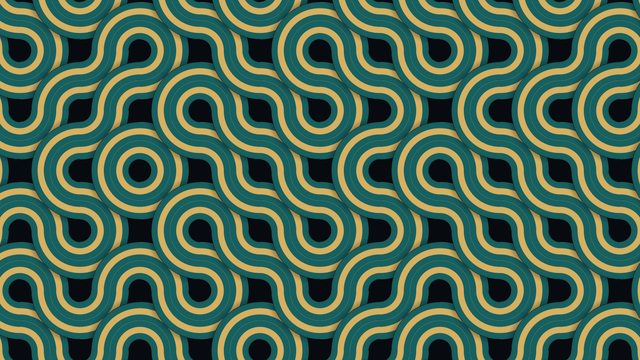

Op-art and Art-Deco tilings: *Truchet weave* (striped arcs, a quarter of the tiles turns every *Flip every* beats),
*Deco fans* (overlapping scales with rings and a sunburst), *Vasarely bulge* (a checkerboard pushed out by a sphere,
*Bulge*, *Bulge size*) and *Riley waves* (stripes bent by travelling waves, *Wave amount*). An iris opens from the
middle of the wall to *Pattern b*. *Scale*, *Bands*, *Line ratio*, *Flow* (stripes and rings per beat), *Shading*,
*Beat pulse*; *Palette* *Black and white*, *Deco gold*, *Riley colour*, *Neon* or *Custom colours*.

### The controls all tunnels have

*Speed*, *Fly speed* (metres per beat), *Curves* (how much the tunnel bends), *Banking* (the camera leans into the
bends), *Roll speed*, *FOV*, *Fog*. On every beat a light is born far ahead and races towards and past the camera:
*Beat lights* (its brightness), *Light speed*, *Light color* and *Light color b* (every second beat). *Exposure*,
*Brightness* (the brightest white, for LED walls), *Debug view* (normals, march steps, depth, materials).
*Quality* 1 is for live use at 1080p, about as heavy as [SDFScene](#sdfscene-sources--3d); 2 traces the reflections
further and adds ambient occlusion, 3 adds soft shadows and more steps and costs about twice as much as 1. The tunnel
repeats itself every 256 metres, so a flight never runs out of precision.

#### TunnelChrome (`Sources` › `3D`)

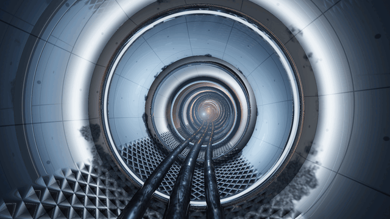

A metal pipe tunnel: polished ribs with lamps in them, darker panels with seams and rivets, a diamond tread plate
on the floor, pipes along the floor (*Pipes*). The metal mirrors the tunnel (a traced reflection). *Metal*
(*Chrome*, *Brass*, *Copper*, *Black steel*, *Titanium*), *Roughness*, *Grime* (oil and dust in the corners and on
the floor), *Rust*, *Tube radius*, *Rib spacing*, *Rib depth*, *Lamp color*, *Lamp glow*, *Lamp every* (ribs),
*Lamp flicker*.

#### TunnelConcrete (`Sources` › `3D`)

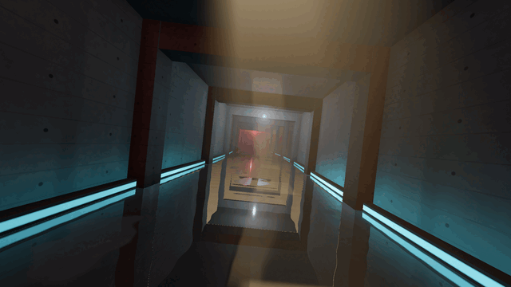

A brutalist concrete tunnel: board-marked walls with tie holes and stains, pillars and beams, slots in the ceiling
that let shafts of light fall through the haze, and a wet floor whose puddles mirror the tunnel. *Tunnel width*,
*Bay length* (pillar to pillar), *Wetness*, *Stains*, *Concrete color*, *Shaft color*, *Shaft light*, *Shaft angle*,
*Dust* (in the shafts), strip lights along the walls (*Strip color*, *Strip glow*, *Strip mode*: *Steady*, *Chase on
the beat*, *Flash on the beat*, *Off*).

#### TunnelOrganic (`Sources` › `3D`)

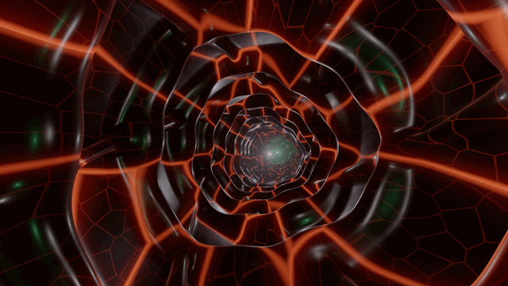

A biomechanical tunnel: ribs like vertebrae, tendons that twist along the walls and melt into them, a dark wet
skin, and the light of glowing veins shining through it from below (subsurface). It swells like a heart on every
beat (*Heartbeat*), pulses run along the veins (*Vein pulse*). *Tube radius*, *Rib spacing*, *Rib size*,
*Tendons*, *Twist*, *Skin color*, *Flesh color* (the light inside the skin), *Gloss*, *Vein color*, *Vein glow*.

## Shaders › Sound

Building blocks that draw or move with the music (#586). They read the spectrum and the waveform of the
[audio analysis](Audio.md#fft-texture) by themselves while an *AudioInputAnalysis* runs anywhere in the project: no
link is needed, also not in a [clip](Clipview.md#make-a-clip). Without one, *Test signal* *Auto* plays a made-up beat
(so the preview moves); *Off* keeps them quiet then, *Always* plays it with the analysis too. Link the analysis'
*FFT texture* into their port *Audio* to use another analysis than the running one. Frequencies are in Hz, low on the
left; values marked "per beat" follow the *Time* section of the shader.

### Spectrum (`Sources` › `Audio`)

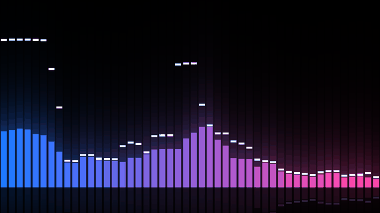

The frequencies as bars (*Bar count*, between *Low frequency* and *High frequency*). *Layout mode*: *Bottom* (with a *Reflection*
below the *Baseline*), *Center* (both ways), *Top and bottom*, *Circle* (from *Inner radius*, turning by *Spin*).
*Style*: *Bars*, *Blocks* (an LED meter, *Block count*) or *Curve* (a smooth filled line). *Mirror* puts the low
frequencies in the middle. *Gain* and *Curve* (above 1 only the loud parts reach up), *Rise* and *Fall* (seconds),
peak caps that hang *Peak hold* seconds and fall at *Peak fall*. Colours: *Low to high*, *By height*, *Rainbow* or
*Single color*, *Glow*, *Beat flash*.

### Oscilloscope (`Sources` › `Audio`)

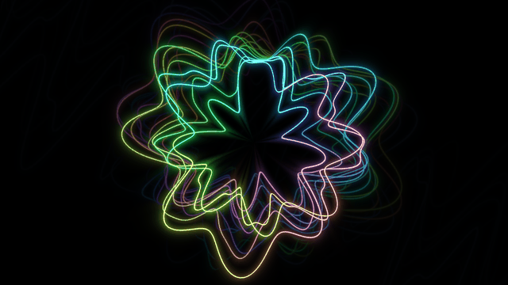

The waveform as a glowing line. *Mode*: *Line*, *Mirror*, *Filled*, *Circle* (around a ring of *Radius*). *Window*:
how many samples are drawn; *Trigger* *Rising edge* starts the line where the wave crosses zero upwards, so a steady
tone stands still. *Auto gain* draws quiet music as tall as loud music. *Trail* keeps the last frames like the
phosphor of a scope; *Trail zoom*, *Trail rotate* and *Trail hue* move and colour them every frame: tunnels and
spirals. *Rainbow*, *Glow*, *Beat punch*.

### Spectrogram (`Sources` › `Audio`)

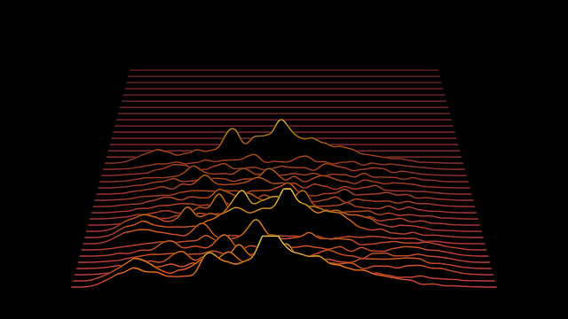

The sound over time: the last 256 frames of the spectrum (or of the waveform, *Signal*). *View*: *Waterfall*
(frequency across, time running *Up*, *Down*, *Left* or *Right*), *Ridgeline* (a stack of lines in depth, the newest
in front: *Line count*, *Ridge height*, *Perspective*, *Line width*), *Circle* (time outwards from *Inner radius*) and
*Raw* (the level as grey: link it as a map into *Displace*, *GradientMap*, *InstanceGrid* or the *Field* of
*Particles*). *History*: frames shown; *Scroll speed*: rows a frame; *Freeze* stops it. *Palette*: *Heat*, *Ice*,
*Neon*, *Mono*, *Two colors* (*Color a*, *Color b*).

### AudioDisplace (`Effects` › `Morph&Mirror`)

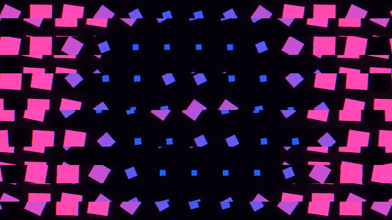

The sound moves the pixels of the input by *Amount*. *Mode*: *Wave rows* (each row, or column with *Direction*
*Vertical*, pushed by the waveform; *Wave length*), *Spectrum rings* (rings around *Center* swell with the
frequencies, low inside; *Ripple*), *Band slices* (*Slices*, each pushed by its own band: a glitch that dances) and
*Bass zoom* (the bass zooms in, the mids turn it by *Twist*). *Color split* pulls red and blue apart with the highs,
*Flash* brightens with the bass, *Smoothing* calms the levels, *Edge mode* fills the border.

## Shaders › Foreground objects

Eye catchers for the middle of the picture (#586): one object, rendered as close to a photo as a live shader can get,
that moves with the music. They are in `Sources` › `Objects`. Put one in the top layer of a
[Clipview](Clipview.md#make-a-clip) over a background, or use it alone.

What they all have:

- **The music.** Like the [sound shaders](#shaders--sound) they hear a running
  [AudioInputAnalysis](Audio.md#fft-texture) by themselves (or the one linked into their port *Audio*). Without a
  sound the object follows the beat of the [timeline](Timeline.md) (a made-up kick, snare and hats).
  *Music*: *Auto* (the sound while it plays, else the beat), *Sound* (only the sound), *Beat*, *Off*. *Music gain*
  makes a quiet sound stronger, *React* sets how much the object moves. The bass and the kicks push a spring, so the
  object moves like a thing with weight: it overshoots a little and settles.
- **Glitch.** *Glitch* is the amount all the time; *Glitch on beat* adds a glitch every *Glitch every* beats, *Glitch
  on sound* one on each kick of the sound, each fading in *Glitch length* seconds; *Glitch hold* is a full glitch while
  it is on (map it to a MIDI pad with [MIDI learn](MIDI.md#map-a-control-with-midi-learn)). *Glitch kind*: *Slices*
  (bands pushed sideways), *RGB split*, *Tear* (wobbling lines, a band that jumps, blocks of digital noise), *Shatter*
  (the object itself breaks into blocks that fly apart; the Prism slices instead) or *Mix* (a different one each
  time).
- **The picture.** *Background mode*: *Scene* (the object in its world), *Colour* (on *Background color*) or
  *Transparent* (black and no alpha around the object, for *Add* in a Clipview or *Over* in
  [Composite](#composite-effects--utility)). *Exposure*, *Tone mapping* (*AgX*, *AgX punchy*, *ACES*, *Neutral*),
  *Bloom* and *Bloom size* (the glow around bright parts), *Vignetting*, *Grain*, *Edge smoothing*.
- **Quality** 1 is for live use with other layers, 2 is the full look (reflections in reflections, shadows),
  3 adds 4× antialiasing and costs four times as much. On a weak graphics card lower *Render scale* in the *Settings*
  tab of the shader. The camera of the 3D ones orbits on its own (*Camera distance*, *Camera height*, *Camera angle*,
  *Camera orbit* in turns per 16 beats, *Zoom*, *Camera shake* for a slow hand-held drift); the LavaLamp is flat and
  fills the picture.
- *Debug mode* shows the normals and what costs time.

### Monolith (`Sources` › `Objects`)

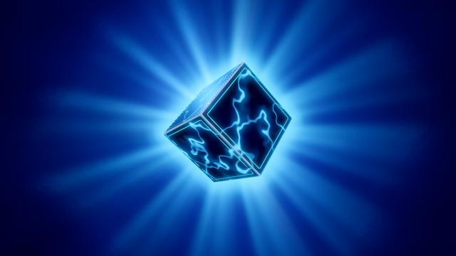

A glossy black cube alone in the dark that glows like crazy: its light fills the whole picture, made for VJing over
nothing or as a layer with *Add*. The object pours its light into the space around it: a hot halo that hugs the shape
and a wide glow that reaches the corners (*Glow*, *Glow radius*: 0 a tight halo, 1 the whole picture, *Glow color*),
lit smoke in it (*Haze*) and light rays that shoot out of it (*Rays*, *Ray length*, *Ray count*: how many bright
beams, *Ray spin* in turns per 16 beats). *Glow beat* pumps the glow with the kicks (the beat without sound),
*Flicker* drops it out now and then like a failing neon tube, *Color cycle* turns the hue of the lines, the glow and
the rays (turns per 16 beats). The tone mapping keeps the bright glow coloured instead of flat white; turn *Exposure*
down for less.

The object: cubes, pyramids, triangle prisms, octahedra or the slab of *2001* (*Shape*), alone or as *Trio*, *Ring*
or *Orbit* (*Arrangement*), with *Size*, *Bevel*, *Spin*, *Tilt*, *Hover* and *Pulse* (the music makes it bigger for
a moment). Black lacquer (*Base color*, *Roughness*) under a mirror-like *Clear coat* with *Smudges*; the bevels are
brushed metal (*Edge color*) whose highlights stretch along the brushing (*Anisotropy*). *Lines*: neon lines inset
along the *Edges*, *Circuit* traces or a *Scan* band that runs up on every beat (*Line color*, *Line intensity*,
*Line width*, *Lines react* to the mids and kicks). *Face glow*: veins of light run over the faces, as if the object
glowed inside.

*Environment* *Void* (the default) puts nothing around it. *City* (a neon city), *Panels* (light strips) and *Studio*
put a world around it and into its reflections (*Neon A*, *Neon B*, *Environment brightness*), with a wet floor from
*Floor reflection* (0 by default) and *Haze* as glowing air. *Reflections* above 1 makes the clear coat mirror more
than real lacquer does; *Background blur* puts the world out of focus.

### Prism (`Sources` › `Objects`)

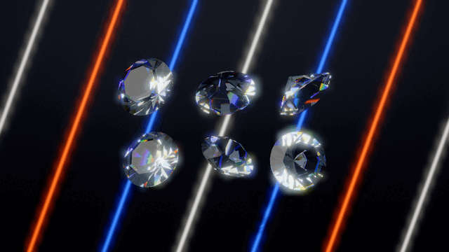

Clear glass that bends and splits light like photographed crystal. Every pixel is ray traced through the glass: the
light reflects at the surface (Fresnel), bends in, reflects inside the glass (total internal reflection: the sparkle of
a cut gem) and bends out again. This is done for up to 8 wavelengths, each with the index of refraction the *Glass*
has at that wavelength (*Crown glass*, *Flint glass*, *Fused silica*, *Diamond* after the Sellmeier formula, or
*Custom* with its own *IOR*). So what is seen through the glass splits into rainbow fringes, inside and at the edges.
*Dispersion* sets how far the colours split: 1 is the real glass, 0 no rainbow, the default 6 is more than real glass.
*Spectral samples* is how many wavelengths are traced (1: no rainbow), *Bounces* how often light may reflect inside.
*Glass tint* and *Absorption* colour the light by how far it went through the glass (thick parts get darker and more
coloured).

- **Shape**: *Prism*, *Pyramid*, *Cube*, *Gem* (a round brilliant), *Shards*, *Sphere* (a crystal ball: the backdrop
  upside down in it), *Torus*, *Capsule*, *Octahedron*, *Dodecahedron*, *Icosahedron*, *Twisted box*, *Knot*, *Blob*
  (drops that melt into each other), *Heart*, *Star*, *Lens* and *Drop*. *Morph* turns it into *Morph shape*, *Morph
  cycle* does that by itself over that many beats (0: off). *Size*, *Depth* (how long the prism is, how thick the heart
  and the star are), *Twist*. Motion: *Spin* (around its axis, turns per 16 beats), *Turn*, *Rock*, *Tumble* (around
  the vertical) and *Tilt*. The music makes it bigger (*Pump*, the bass and the kicks), rocks it (the mids) and
  spreads the colours (the highs).
- **Grid**: *Count x* and *Count y* (1 to 6 each) make a grid of copies, *Spacing* sets the distance (copies that would
  touch get smaller). *Instance rotation* turns each copy more than the one before, *Instance variation* tilts and
  spins each its own way, *Shape variation* gives that share of the copies another shape at random. The camera moves
  back so the whole grid shows; a grid costs about as much as one object.
- **What the glass bends**: *Backdrop* is a wall behind the glass. *Auto* is the picture linked into the input
  *Background* (a video, a camera, another layer: where no glass is in front of it, it fills the screen as it is, so the
  glass bends the picture in place), else *Lines*. The patterns: *Stripes*, *Lines* (thin bright lines on black: the
  strongest rainbows), *Grid*, *Checker*, *Gradient* (a studio sweep), *Bokeh* (lights out of focus); *None* is the
  studio alone. *Backdrop distance* (farther bends it more), *Backdrop scale*, *Backdrop angle*, *Backdrop scroll*,
  *Backdrop color a* and *b*, *Backdrop brightness*. *Caustics* is the shadow and the focused light the glass throws
  on the backdrop. *Environment* is what the glass mirrors and shows at its sides: *Soft boxes* (a bright photo studio),
  *Studio* (dark), *Black*, *Neon*; *Sparkle* is a small bright lamp that makes glints and coloured sparks inside.
- **The beam of the album cover**: *Beam intensity* above 0 sends a white beam into the glass, traced for 32
  wavelengths; it leaves as a fan of colours that glows in the air (*Haze*) and lands on a black floor (*Floor
  amount*). For the cover of *The Dark Side of the Moon*: *Shape* *Prism*, *Beam intensity* 8, *Environment* *Studio*,
  *Camera distance* 5.5 (*Backdrop* *Auto* is then the dark studio, and the prism keeps its axis towards the camera).
  *Beam color*, *Beam width*, *Spread* (how the colours widen), *Beam angle* (with the *Prism* 0 is the path of least
  bending), *Beam direction*, *Beam offset*, *Beat flash*.
- **Cost**: *Quality* 1 traces one path through the glass for all wavelengths (at most 3) and lets each leave with
  its own bend; 2 traces a path for each wavelength (the full rainbow inside); 3 adds 4× antialiasing.

### Ferrofluid (`Sources` › `Objects`)

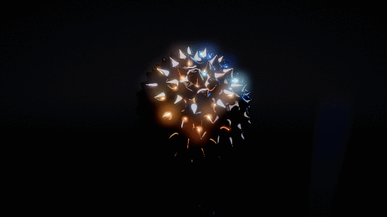

A blob of black magnetic oil that grows spikes like real ferrofluid on a magnet: the spikes stand on a hexagonal
pattern and their height follows the magnetic field, which is the music through a spring (*Response*: how fast,
*Viscosity*: how thick the fluid is, low lets the spikes overshoot). *Form*: a *Floating ball* or a puddle in a
*Dish*. *Spikes* (how many), *Field* (the field without music), *Spike height*, *Sharpness* (round humps to needles),
*Field direction* (all around alike, or tallest at the top and bottom), *Ripples* (the highs), *Wobble* (the mids),
*Spin*. The surface is a black mirror with the rainbow of an oil film (*Oil sheen*, *Film thickness* in nanometres);
*Fluid color*, *Roughness*, *Key color*, *Rim color*, *Light intensity*, *Light angle*, *Environment* (*Studio*,
*Neon*, *Dark*), *Floor reflection*.

### LavaLamp (`Sources` › `Objects`)

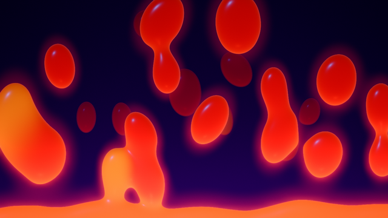

The wax of a lava lamp over the whole picture, without the lamp: glowing drops rise, melt together, tear apart and
sink again. A small simulation: a lamp under the picture heats the wax at the bottom, warm wax rises, cools at the
top and sinks; the drops drift, drag each other along where they touch and share their heat (*Blobs*: up to 32, every
third one swims further back, smaller and darker; *Blob size*, *Flow*: how fast it all moves, *Heat*, *Buoyancy*,
*Merge*: how softly they melt into each other and how far apart they still touch). *Pool* is the molten wax lying on
the bottom that the drops rise out of (0: none), *Depth* how much the back layer shows (*Quality* 1 leaves it out).

The wax is lit from below and from inside: thin rims let more light through than thick cores (*Wax color*, *Hot
color* for the hottest wax, *Glow*, *Wax density*), the skin is glossy (*Environment brightness*, *Room light*: the
colour of the light it mirrors). *Palette*: *Colours* (*Wax color*, *Hot color*, *Liquid color*), *Magma*, *Ocean*,
*Toxic*, *Ultraviolet* or *Rainbow* (each drop its own colour, blended where they melt together). The liquid catches
the light of the lamp and of the wax (*Liquid color*, *Liquid glow*, *Lamp power*); *Background mode* *Colour* (black
by default) or *Transparent* shows only the drops. The music heats the wax, the kicks lift the warm drops and the highs
ripple them (*Surface wobble*).

## See also

- [Generators](Generators.md)
- [The screen](The-Screen.md)
- [Clipview](Clipview.md)
- [Output and devices](Output-and-Devices.md)
- [Linking](Linking.md)
