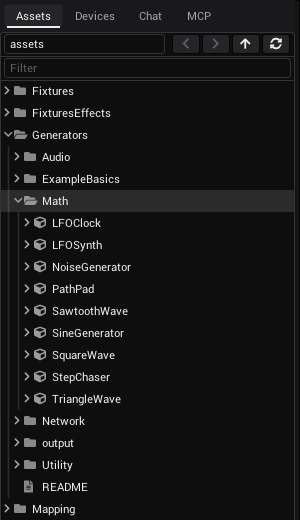

# Assets

Everything you can drag into a view is an asset: a generator, a shader, a view, a picture, a video. This page lists
what comes with VibeVJ and where it is in the *Assets* tab of the [sidebar](The-Screen.md#assets-tab).

## Find and use an asset

1. Open the *Assets* tab. The icon in front of a name says what it is:

   | Icon | What it is |
   |---|---|
   | Cube | A generator |
   | Wand | A shader |
   | Four squares | A view (*Clipview*, *Patchview*, …) |
   | Diagram | A mapping tool |
   | Light bulb | A fixture or a fixture effect |
   | Stacked layers | A preset |

   An asset is a folder too, but you rarely open it: its arrow is faint. A name too long for the sidebar ends in "…";
   rest the mouse on it to read all of it.
2. Open a folder with its arrow, or type part of a name into *Filter*.
3. Drag the asset into a view. Where it lands decides what it becomes:
   - in a [Patchview](The-Screen.md#views-and-tabs): a window of its own;
   - in an [area](The-Screen.md#dropping-an-asset): the view of that area, a split or a tab;
   - in a cell of a [Clipview](Clipview.md#make-a-clip): a clip;
   - on a [CueList](CueList.md#add-cues): a cue.

How a generator window works is on [Generators](Generators.md). Your own settings of an asset can be kept as a
[preset](Generators.md#presets): it shows up in the folder `presets` inside the asset.

## The folders

| Folder | What is in it |
|---|---|
| `Generators` | Values, audio, network and helpers: see below. |
| `Shaders` | Pictures and effects: `Sources`, `Effects`, `Utilities`. |
| `Views` | The views: *Clipview*, *CueList*, *Patchview*, *Tabview*, with their presets and saved layouts. See [Views and tabs](The-Screen.md#views-and-tabs). |
| `Mapping` | *MapLab*, *LEDMapper*, *MaskTransform*. See [Mapping](Output-and-Devices.md#mapping). |
| `Fixtures`, `FixturesEffects` | Lamps and effects over them. See [Fixtures](Output-and-Devices.md#fixtures). |
| `Textures`, `Videos` | Pictures and [video files](Video.md). Each opens as a generator with an *OUT* port. |

## Generators › Math

Sources of moving values. Link their *Output* into anything ([Linking](Linking.md#make-a-link)). Each can run free or
in step with the [timeline](Timeline.md).

| Generator | What it gives |
|---|---|
| *SineGenerator* | A sine wave: *Frequency*, *Bias*, *Gain*, *Saturation*. *Mode* is *Free* or *Sync*. |
| *TriangleWave*, *SawtoothWave*, *SquareWave* | The same with another shape. |
| *LFOSynth* | Several waves in one window, each with a shape of its choice and an envelope. |
| *NoiseGenerator* | Random values: *Type* is *White* or *Pink*, *Rate* sets how often a new value comes. |
| *LFOClock* | A pulse on every beat that falls back to 0. |
| *StepChaser* | A step sequencer on the beat, with fade in and fade out per step. |
| *PathPad* | A point that travels along a path you draw, as X and Y. |

## Generators › Utility

| Generator | What it is for |
|---|---|
| *XYPad* | A pad you drag on: X and Y. |
| *XYPathPad*, *CurvePad* | A point that walks along a path, free or on the beat. |
| *XYPositions* | A list of positions that glide into one X / Y output. |
| *EnvelopeOutput* | A curve you draw, played free or on the beat. |
| *StepChaser* | A step sequencer on the beat. |
| *Button-Feld*, *Control-Button-Matrix* | A grid of buttons to link from. |
| *ColorSelector* | Colours for several targets, with *Brightness* and *Smoothing*. |
| *quantize* | Rounds an input to a number of steps. |
| *value_text* | Shows a value as text. |
| *textbox* | A note. It is saved with the project. |
| *Chat* | The AI chat of the sidebar as a window. |

## Generators › Audio and Network

| Generator | What it is for |
|---|---|
| *AudioInputAnalysis* | Beat, tempo, energy and breaks from the music: [Audio](Audio.md). |
| *ArtnetSender*, *ArtnetReceiver* | Single Art-Net channels out and in: [Art-Net](Output-and-Devices.md#art-net). |
| *NDIReceiver*, *SpoutReceiver* | Video from other programs: [Receiving video](Output-and-Devices.md#receiving-video). |
| *ProlinkBridge*, *ProlinkDecks* | Tempo, beat and waveforms of CDJs: [Prolink](Output-and-Devices.md#prolink-cdjs). |

## Generators › output

| Generator | What it is for |
|---|---|
| *RGBMask* | Takes a picture and gives the average colour of a shape you draw on it, as *R*, *G*, *B*: a lamp follows a part of the picture. |

## Shaders

A shader makes or changes a picture. Every shader has the [tabs *Control*, *Settings* and *Transform*](Output-and-Devices.md#the-tabs-of-a-shader)
and an *OUT* port.

| Folder | What is in it |
|---|---|
| `Sources` | Shaders that make a picture: patterns, 3D, noise, LED looks, shaders that draw with the [sound](Audio.md#fft-texture). |
| `Effects` | Shaders that change a picture: colour, blur and feedback, glow, kaleidoscope, mirror, retro looks. Link a picture into their input, or stack them onto a [clip](Clipview.md#make-a-clip). |
| `Utilities` | *output* shows a picture on a display or projector: [Output and devices](Output-and-Devices.md#show-the-picture-on-a-display-or-projector). *Shaderstack* holds several shaders in one generator. |

A double click on a file of a shader opens its code in a tab: see the [code editor](Shortcuts-and-Tips.md#code-editor). Only text files open this way (code, shaders, JSON, Markdown, presets); pictures, videos and sound are dragged onto a view instead.

## Your own files

- **Pictures and videos:** copy them into `VibeVJ/assets/Textures` or `VibeVJ/assets/Videos` (or any folder below
  `assets`), then press refresh in the *Assets* tab.
- **Presets** are written into the asset they belong to.
- **Layouts** you save from a view tab are in `Views` and are offered in every
  [empty area](The-Screen.md#an-empty-area).

## See also

- [Generators](Generators.md)
- [The screen](The-Screen.md)
- [Clipview](Clipview.md)
- [Output and devices](Output-and-Devices.md)
- [Linking](Linking.md)
