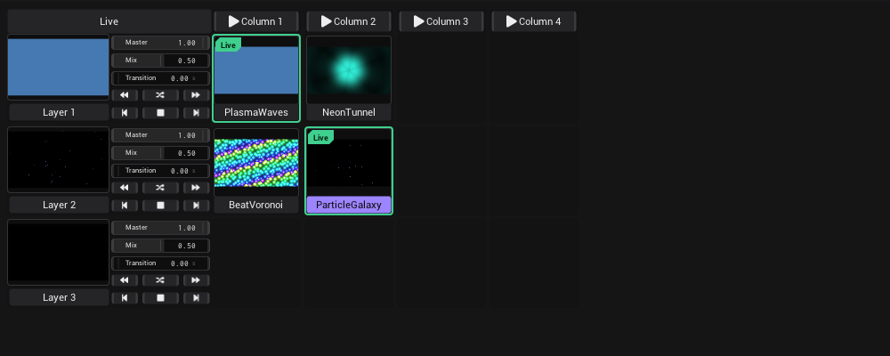

# Clipview

The Clipview is where you play clips live. Each row is a layer, each cell is a clip, and you start clips by hand, by
column, by MIDI or with autoplay. A [CueList](CueList.md) is the same thing shown as lists of cues.

## The parts

| Part | Where | What it does |
|---|---|---|
| *Live* | Top left corner | Locks the grid for playing. See [Live](#live). |
| *Column 1*, *Column 2* … | Top row | Starts every clip in that column at once. A layer that has no clip in the column stops. |
| Layer | Left column | Layer picture, name tag (*Layer 1* …), *Master*, *Mix*, *Transition* and the [transport buttons](#transport-buttons). |
| Clip | Each cell | The clip picture (click to start it) and its name tag below (click to select it). |
| *Preview* | Bottom left window | The finished picture of the whole Clipview. Its switch *No Alpha* turns the transparency of the picture off. |
| *Layer* | Bottom right window | What the selected clip or layer is made of, and its settings. |
| *In* | Bottom left corner | A port for a picture from outside. *(Not used by the layers yet.)* |
| *Out* | Bottom right corner | The finished picture as a port. Link it to an output: see [Output and devices](Output-and-Devices.md#show-the-picture-on-a-display-or-projector). |

- A new Clipview has 3 layers and 4 columns. The grid grows as you fill it: it always keeps one free row and one free
  column at the edge. It does not get smaller again.
- Drag the top edge of the *Preview* or *Layer* window up or down to give the grid more or less room. Drag the edge
  between the two windows to change their widths.
- The mouse wheel scrolls the grid. Shift + mouse wheel makes the cells bigger or smaller; the size is saved.

## Layers

Layer 1 is the top row and gives the final picture. Each layer lays its live clip over the layers below it.

| Control | What it does |
|---|---|
| Blend mode (above the picture) | How the layer is laid over the layers below: *No Blend*, *Add*, *Add Mask*, *Mix*, *Multiply*, *MultiplyInput*, or a chroma key on red, green or blue. The same setting as *LayerBlend* in the *Layer* window. |
| *Master* | Brightness of the whole layer. 1 = full (the start value), 0 = black. |
| *Mix* | How strongly the clip of the layer is blended over the layers below. Starts at 0.5. What it does depends on the blend mode. |
| *Transition* | How long the fade to a new clip takes, in seconds, up to 60. 0 = a hard cut. |

*Transition* counts seconds, whatever the tempo: *Transition* 4 fades for four seconds. Lower it during a fade and the
fade gets shorter.

A layer stays in its row: its name tag selects it, it is not dragged into the grid like a clip.

Click the name tag of a layer to select it. The *Layer* window then shows:

- **The stack** at its left: the entry *LayerBlend*. Its *Controls* hold the blend mode of the layer, the same one as
  in the layer cell. With *No Blend*, *Mix* has no effect.
- **The section *Layer Settings*:**

| Setting | What it does |
|---|---|
| *Name* | The name on the tag of the layer. |
| *Layer input from* | Which layer this one is laid over. 1 (the standard) = the layer below. |
| *Autoplay* › *Duration* | How long each clip plays during [autoplay](#autoplay-and-duration), in beats. Starts at 64. |
| *Macros* › *Map to clip macros*, *Macro 1* … *Macro 8* | See [Macros](#macros). |

## Clips

### Make a clip

1. Open the *Assets* tab in the sidebar.
2. Drag a shader, a generator (also one without a picture, like the *Phaser* of a fixture), a view or a preset of one,
   a picture or a [video](Video.md) onto an empty cell. It becomes a clip, named after the file, and is selected.
3. Drag another asset onto the clip, or onto the list in the *Layer* window, to stack it onto the clip as an effect.

What can become a clip is on [Generators](Generators.md#what-a-generator-is) and [Assets](Assets.md).

### Start and select

- **Click the clip picture** to start it.
- **Click its name tag** to select it (violet). The *Layer* window shows its stack and the section *Clip Settings*.
  Click the tag again to deselect.

### Move, copy, delete

- **Move:** drag the clip by its name tag to an empty cell.
- **Copy:** hold Ctrl when you let go.
- **Onto another clip:** the first asset of the clip you drag is stacked onto that clip, with fresh settings. The clip
  you dragged goes, unless you hold Ctrl.
- **Delete:** select the clip. In the *Layer* window, click × (tooltip *Remove*) on every entry of its stack. When
  the last entry goes, the clip goes. There is no other way to delete a clip.

### The stack of a clip

The list at the left of the *Layer* window has one button per asset of the selected clip. Click one to see its
controls, × removes it. *LayerBlend* of a layer cannot be removed.

## Live and next clips

| What you see | Means |
|---|---|
| Green ring and *Live* badge | The clip is on air. |
| Dashed green ring | The clip is fading in (a transition is running). |
| Amber ring and *Next* badge | You started this clip while a transition was running. It plays when the fade ends. |

- Only one clip waits as *Next*. Start another one during the fade and it takes the place.
- Start the clip that is fading in again to cancel the *Next* clip.
- Click the live clip during a fade: it waits as *Next* and comes back when the fade ends.

## Transport buttons

Each layer has two rows of three buttons.

| Button | Tooltip | What it does |
|---|---|---|
| Backward | *Autoplay backwards* | Autoplay goes to the left, wraps at the start. |
| Random | *Autoplay random* | Autoplay in random order: every column once, then a new order. |
| Forward | *Autoplay forwards* | Autoplay goes to the right, wraps at the end. With no clip live it starts with the first. |
| Previous | *Previous clip* | Starts the clip to the left of the live one. |
| Stop | *Stop the layer* | Turns autoplay off and stops the layer. No clip is live. |
| Next | *Next clip* | Starts the clip to the right of the live one, or the first clip of the layer when none is live. |

- The three autoplay buttons are toggles, only one can be on (green). Click it again to turn autoplay off.
- The transport buttons and the column buttons have notches: drag from them to [link](Linking.md#make-a-link) them.
  They have no options, so map them with [MIDI learn](MIDI.md#map-a-control-with-midi-learn).

## Autoplay and Duration

1. Press *Play* in the [timeline bar](Timeline.md#the-transport-bar). Autoplay counts the beats of the timeline, so it
   waits while the timeline is stopped.
2. Set the *Duration* of the layer in *Layer Settings* › *Autoplay*.
3. Turn on one of the autoplay buttons.

- Starting a clip by hand starts the count again. So does a jump back of the timeline.
- Autoplay, *Previous clip* and *Next clip* skip clips with *Trigger* set to *Hold* and clips with *Exclude* on.

## Clip settings

| Setting | What it does |
|---|---|
| *Name* | The name on the tag of the clip. |
| *Trigger* | *Normal*: a click starts the clip. *Hold*: the clip plays while you hold the picture; on release the last *Normal* clip of the layer comes back, if one was started before. |
| *Inputs* | For each input of the clip: which layer it gets its picture from. See below. |
| *Autoplay* › *Exclude* | Autoplay, *Previous clip* and *Next clip* skip this clip. |
| *Autoplay* › *Duration* | The play time of this clip in beats. *Layer* (-1) uses the *Duration* of the layer. |
| *Autoplay* › *Transition* | The fade time of this clip. *Layer* (-1) uses the *Transition* of the layer. It also counts when you start the clip by hand. |
| *Macros* › *Macro 1* … *Macro 8* | Eight sliders you can link to anything inside the clip. |

### Inputs: Relative / Absolute

Effects that take a picture can use another layer as their input. The line above the inputs reads
"−1 layer above · 0 off · +1 layer below".

- **Relative:** the number counts from the layer of the clip. 1 = the layer below, −1 = the layer above, 0 = off.
- **Absolute:** the number picks one fixed layer, wherever the clip sits. It counts from 0: 1 = *Layer 2*, 2 = *Layer 3*.
  0 is off, so *Layer 1* cannot be picked this way; use *Relative* for it.
- A new clip starts with its first input (an input named `input` or `iChannel0`) at 1, the layer below, and the
  others at 0.

## Macros

Macros let one set of knobs control whichever clip is playing.

1. In each clip, link its *Macro 1* … *Macro 8* to the effect values you want to play with (see [Linking](Linking.md)).
2. In the settings of the layer, turn on *Map to clip macros*.
3. Map *Macro 1* … *Macro 8* of the layer to your controller (see [MIDI](MIDI.md)).

When a clip starts, the layer macros jump to the macro values of that clip. Moving a layer macro then moves the same
macro of that clip.

## Live

*Live* in the top left corner locks the grid for playing:

- clips cannot be moved and no asset can be dropped on the grid;
- the name tags of the clips become plain labels, so no clip can be selected by accident;
- starting clips, the columns and the transport keep working.

*Live* is saved with the project. It is the lock of one Clipview; [show mode](Timeline.md#show-mode) locks the whole
program.

## What is saved

With the [project](Getting-Started.md#what-is-saved-with-a-project): the size of the grid and of its cells, *Live*, and
every clip, layer and stack with its settings, links and MIDI mappings. Save a Clipview with everything in it as a
[preset](The-Screen.md#the-menu-of-an-area) to use it in another project.

## See also

- [CueList](CueList.md)
- [Linking](Linking.md)
- [Timeline](Timeline.md)
- [Video](Video.md)
- [Generators](Generators.md)
- [Assets](Assets.md)
- [Shortcuts and tips](Shortcuts-and-Tips.md)
