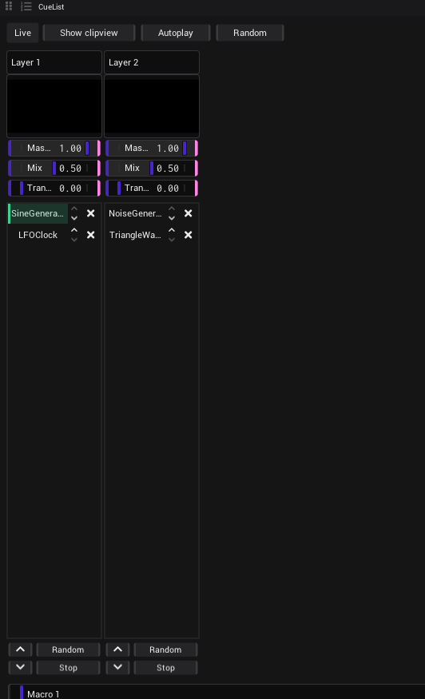

# CueList

A CueList shows clips as lists of cues: one list per layer, one button per cue. It is made for running a show from a
few big buttons. Under its surface it is a [Clipview](Clipview.md): a cue is a clip, a list is a layer.

## Open one

- Pick the *CueList* tile in an [empty area](The-Screen.md#an-empty-area), or
- drag *CueList* from the *Assets* tab (folder `Views`) into an area.

## Add cues

- **A new list:** drag an asset (a shader, a generator, a picture, a [video](Video.md)) from the *Assets* tab onto
  the empty part of the CueList. It becomes the first cue of a new list.
- **One more cue:** drag an asset onto a list. The cue is added at its end.

There is no way to sort the cues in a list yet. To change the order, switch on *Show clipview* and move the clips
there.

## A list

From top to bottom:

| Part | What it does |
|---|---|
| Name | The name of the layer. Type to rename it. |
| Picture | The picture of the layer. |
| *Master*, *Mix*, *Transition* | The same three controls as in the [Clipview](Clipview.md#layers); they move together with them. |
| The cues | One button per cue, with the name of its clip. Click one to start it. The cue that is live, fading in or waiting is highlighted. Clicking the live cue again does not stop it. |
| × beside a cue | Tooltip *Remove this cue*. Deletes the cue with its clip. Hidden while *Live* is on. |
| Chevron up, chevron down | Tooltips *Previous cue*, *Next cue*. They go round at the ends. With no cue live they do nothing. |
| *Random* | Starts any cue of the list. |
| *Stop* | Stops the layer and turns its autoplay off. |

The buttons at the bottom of a list have notches: [link](Linking.md#make-a-link) them, or map them with
[MIDI learn](MIDI.md#map-a-control-with-midi-learn).

## The bar at the top

| Button | What it does |
|---|---|
| *Live* | Locks the lists for playing: the × of every cue is hidden, and the Clipview behind them is locked too ([Clipview](Clipview.md#live)). |
| *Show clipview* | Shows the Clipview behind the lists instead of the lists. The settings of a cue are only there: *Name*, *Trigger*, *Duration*, *Transition*, *Inputs*, *Macros* ([Clip settings](Clipview.md#clip-settings)). |
| *Autoplay* | Turns *Autoplay forwards* on or off in every list: the cues play in order, one after the other, each for the *Duration* of its layer (64 beats at the start); after the last cue the list starts again. It counts the beats of the [timeline](Timeline.md), so press *Play* there. |
| *Random* | Starts one random cue in every list at once. |

*Show clipview*, *Autoplay* and *Random* can be linked and mapped to MIDI.

## Macros

The sliders *Macro 1* … *Macro 8* at the bottom are not connected to anything yet. *(Planned.)* For macros that work
today, see [Macros](Clipview.md#macros) of the Clipview.

## What is saved

A CueList is saved like a Clipview, with the [project](Getting-Started.md#what-is-saved-with-a-project) or as a
[preset](The-Screen.md#the-menu-of-an-area). The *Live* button comes back as it was saved.

## See also

- [Clipview](Clipview.md)
- [Timeline](Timeline.md)
- [The screen](The-Screen.md)
- [Shortcuts and tips](Shortcuts-and-Tips.md)
