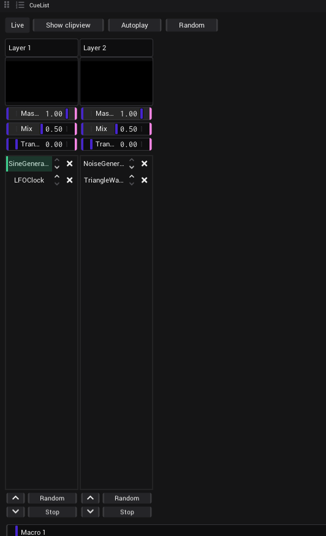

# CueList

A CueList shows clips as lists of cues: one list per layer, one button per cue. It is made for running a show from a
few big buttons. Under its surface it is a [Clipview](Clipview.md): a cue is a clip, a list is a layer.

## Open one

- Pick the *CueList* tile in an [empty area](The-Screen.md#an-empty-area), or
- drag *CueList* from the *Assets* tab (folder `Views`) into an area.

## Add cues

A new CueList has no list yet. In its place it shows one empty column, *New list*, with the hint where the cues go.

- **A new list:** drag an asset (a shader, a generator, a picture, a [video](Video.md)) from the *Assets* tab onto
  the empty column or the empty part of the CueList. It becomes the first cue of a new list; the empty column goes
  away. When the last cue of the last list is removed, it comes back.
- **One more cue:** drag an asset onto a list. The cue is added at its end.
- **Generators of a Patchview:** Alt + drag them onto the CueList like an asset. They move into the cue (Ctrl when
  you let go: copies of them). See [Select and move generators](Generators.md#select-and-move-generators).

## Change the order

Beside each cue are two small arrows (tooltips *Moves this cue up*, *Moves this cue down*): the cue swaps places with
the cue before or after it. The arrow up of the first cue and the arrow down of the last one are greyed out. Each move
is one step of [undo](The-Screen.md#undo-and-redo) (*Move cue up*, *Move cue down*, Ctrl+Z / Ctrl+Y). A cue that is live
stays live while it moves.

The order of a list is the order of the clips in its row of the Clipview behind it, from left to right, so it is
saved with the project. Moving a cue swaps two clips there; moving clips in *Show clipview* changes the order of the
cues too. While *Live* is on the arrows are hidden.

## A list

From top to bottom:

| Part | What it does |
|---|---|
| Name | The name of the layer. Type to rename it. |
| Picture | The picture of the layer. |
| *Master*, *Mix*, *Transition* | The same three controls as in the [Clipview](Clipview.md#layers); they move together with them. *Transition* is in seconds with the same curve as the layer's, so both show the same number. |
| The cues | One button per cue, with the name of its clip. Click one to start it. The cue that is live, fading in or waiting is highlighted. Clicking the live cue again does not stop it. |
| Small arrows beside a cue | Move the cue one place up or down ([Change the order](#change-the-order)). Hidden while *Live* is on. |
| × beside a cue | Tooltip *Remove this cue*. Deletes the cue with its clip. Hidden while *Live* is on. |
| Chevron up, chevron down | Tooltips *Previous cue*, *Next cue*. They go round at the ends. With no cue live they do nothing. |
| *Random* | Starts any cue of the list. |
| *Stop* | Stops the layer and turns its autoplay off. |

The buttons at the bottom of a list have notches: [link](Linking.md#make-a-link) them, or map them with
[MIDI learn](MIDI.md#map-a-control-with-midi-learn).

## The bar at the top

| Button | What it does |
|---|---|
| *Live* | Locks the lists for playing: the arrows and the × of every cue are hidden, and the Clipview behind them is locked too ([Clipview](Clipview.md#live)). |
| *Show clipview* | Shows the Clipview behind the lists instead of the lists. The settings of a cue are only there: *Name*, *Trigger*, *Duration*, *Transition*, *Inputs*, *Macros* ([Clip settings](Clipview.md#clip-settings)). |
| *Autoplay* | Turns *Autoplay forwards* on or off in every list: the cues play in order, one after the other, each for the *Duration* of its layer (64 beats at the start); after the last cue the list starts again. It counts the beats of the [timeline](Timeline.md), so press *Play* there. |
| *Random* | Starts one random cue in every list at once. |

*Show clipview*, *Autoplay* and *Random* can be linked and mapped to MIDI.

## Macros

The sliders *Macro 1* … *Macro 8* at the bottom are one set of faders for every cue: each one sets the macro of the
same number of the running cue (*Macro 1* … *Macro 8* in its [clip settings](Clipview.md#clip-settings)).

1. In each cue, link its *Macro 1* … *Macro 8* to the effect values you want to play with (*Show clipview*, then the
   clip settings; see [Linking](Linking.md)).
2. Move the faders at the bottom of the CueList, or map them to your controller (see [MIDI](MIDI.md)).

- A fader sets that macro of the running cue of every list, and of the cue that is fading in.
- When a cue starts, it gets the values of the faders: the faders stay where they are and the new cue follows them.
  Its own macro values are overwritten.
- A fader takes over once it was moved. A fader you never moved leaves the macros of the cues alone, so cues keep
  the values you set in their clip settings (and projects of before keep working as they did). Which faders were
  moved is saved with the CueList.
- A list with no running cue gets nothing; the next cue that starts there gets the values.

This is the other way round from the [macros of a layer](Clipview.md#macros) in the Clipview, which jump to the values
of the clip that starts.

## What is saved

A CueList is saved like a Clipview, with the [project](Getting-Started.md#what-is-saved-with-a-project) or as a
[preset](The-Screen.md#the-menu-of-an-area). The *Live* button comes back as it was saved.

## See also

- [Clipview](Clipview.md)
- [Timeline](Timeline.md)
- [The screen](The-Screen.md)
- [Shortcuts and tips](Shortcuts-and-Tips.md)
