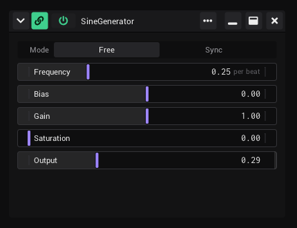

# Generators

A generator is the building block of VibeVJ. This page explains what a generator is, how you add one, what the buttons in
its window header do, and how you keep its settings as a preset.

## What a generator is

Every effect, source, input, output and utility in VibeVJ is a generator: a shader, an LFO, the audio analysis, an Art-Net
sender, a text box. Even the views (Clipview, Patchview, Tabview) are generators. Each one runs in its own window with its
own controls, and every control can be linked to any other control (see [Linking](Linking.md)).

What comes with VibeVJ is listed on [Assets](Assets.md).

These files open as a generator:

| In the *Assets* tab | Becomes |
|---|---|
| An asset (cube icon; the folder ends in `.asset`, the list shows the name without it) | A generator with its own controls, for example *SineGenerator* |
| A folder ending in `.glsl` (cube icon) | A shader generator, for example from `Shaders` › `Sources` or `Effects` |
| A `.png` image | An image generator |
| A `.txt` file | A text generator |
| A video file (`.mp4`, `.mov`, `.mkv`, `.webm`, `.avi` and more) | A video player |
| A `.preset` file | The generator the preset belongs to, with the saved settings (see [Presets](#presets)) |

## Add a generator

1. Open the *Assets* tab in the sidebar.
2. Find the asset. Type part of its name into *Filter* to find it faster.
3. Drag it into a view:
   - into a **Patchview** or the timeline area: the window opens where you drop it;
   - into an **empty area** (a new view tab, a tab of a Tabview, half of a split): it fills the area;
   - onto a **filled area**: an edge splits the area, the middle adds the generator as a tab. Nothing is replaced. See
     [The screen](The-Screen.md#dropping-an-asset);
   - onto the **tab bar of a Tabview**: you get a new tab with it;
   - into a **Clipview**: it becomes a clip (see [Clipview](Clipview.md#make-a-clip));
   - onto a **CueList**: it becomes a cue (see [CueList](CueList.md#add-cues)).

To remove a generator, click × in its header. A generator that fills an area has no window header: use *Delete view…*
in the menu of the area (⋯ in the header of the area, or a right click). Ctrl + Z brings a generator back that you removed or
takes back one you dropped in: see [Undo and redo](The-Screen.md#undo-and-redo).

## The window header

The header runs along the top of the window. From left to right; on the right: *More*, maximize, close:

| Button | Tooltip | What it does |
|---|---|---|
| Chevron | *Collapse* / *Expand* | Shrinks the window to its header and opens it again at its old size. It points down while the window is open and right while it is collapsed. Saved with the project. |
| Power icon | *Generator active* | Switches the generator on and off. The icon is green while it runs. When it is off, the generator stops and its name is dimmed. It is a control: you can link it or map it to MIDI. |
| Link icon | *Always draw links* | Draws the cables of this generator all the time, even when *Cable view* is off: a local cable view. On at the start in a Patchview. Saved with the project. See [Seeing your links](Linking.md#seeing-your-links). |
| Name | | The name of the asset |
| ⋯ | *More* | Opens the menu with the less used actions (below). |
| Maximize | *Maximize* | The window fills the whole view and the other windows are hidden. Press it again to go back. While maximized, the chevron and *Close* are hidden, and the zoom of the Patchview is set back and held. |
| × | *Close* | Closes the generator. |

> Screenshot to add: the header from left to right, with each button labelled.

### The ⋯ menu

| Item | What it does |
|---|---|
| *Copy settings* | Copies the settings of this generator: what a [preset](#presets) holds. The copy stays inside VibeVJ, it is not on the clipboard of your system. |
| *Paste settings* | Puts the copied settings into this generator. Works only between generators of the same asset; otherwise nothing happens. |
| *Save preset…* | Saves the settings as a preset file (see [Presets](#presets)). |
| *Reload module* | Loads the code of the generator again and keeps its settings and all its links. Useful after you changed the files of the asset. |
| *Hide header (E)* | Hides the header. Press E to show it again. |
| *Fit to content* | Makes the window as big as its controls need, within the view it is in. See [Window size](#window-size). |

### Window size

- In a Patchview a new window is as big as its controls need. *Fit to content* in the ⋯ menu does the same later, for
  example after you added channels or steps.
- A window with its header is at least 256 px wide, so the buttons of the header never cover the name. Hide the header
  (E) to make it smaller, down to a single control.
- A collapsed window is only its header. Its size cannot be dragged until you open it again.

### Hide and show the header with E

1. Click into the generator window.
2. Press E. The header disappears, or comes back if it was hidden.

This also works where a generator has no header at first: where it fills an area of a view tab, a tab of a Tabview or half of a split. Press E
there to reach the power button, the ⋯ menu and the other buttons.

## Select and move generators

In a Patchview (and in the *Patch* area of the timeline) you can select generators and take them to another view.

**Select**

- Click the header of a generator: it is selected and shows a violet outline. A click on one that is selected
  already keeps the whole selection.
- Ctrl + click or Shift + click a header: adds the generator, or takes it out of the selection again.
- Drag on the empty canvas: a frame appears, and everything it touches is selected. The outlines show while you drag,
  so you see what the frame takes before you let go. With Shift or Ctrl the frame adds to the selection.
- Click the empty canvas: nothing is selected.

**Move**

1. Hold Alt and drag one of the selected generators. A small label at the mouse says what you drag: the name of the
   generator, or "2 generators". Alt + drag on a generator that is not selected takes that one alone.
2. Drop it:
   - in the same Patchview: the generators move to that place;
   - on another Patchview: the generators move there and keep their arrangement;
   - on an area: the generator becomes the view of that area. On an edge it splits the area, in the middle it is added
     as a tab. More than one generator: the first goes where you drop it, the others become tabs.
3. Hold Ctrl when you let go to drop copies. The originals stay where they are.

- A generator that moves keeps its controls, links and MIDI mappings. Nothing is reloaded.
- A copy has the settings of its original. Links between the generators you copy together are copied too: two linked
  generators give two copies linked the same way. Links to generators you did not copy are not.
- Ctrl + C copies the selected generators, Ctrl + V pastes them: into the Patchview the mouse was over last, the first
  one where the mouse was. The copy stays inside VibeVJ, it is not on the clipboard of your system. A paste is one
  step of [Undo and redo](The-Screen.md#undo-and-redo), and the pasted generators are the selection then.
- Alt is the key of [*Settings* › *Appearance* › *Move areas with*](Settings.md#move-areas-with).
- Ctrl + Z takes a move or a copy into an area or another Patchview back: see
  [Undo and redo](The-Screen.md#undo-and-redo). A move inside the same Patchview is not a step.
- Not yet: dropping generators into a Clipview cell or a CueList.
- Not in show mode.

## Presets

A preset is a file with the settings of one generator. It is stored inside the asset, so it shows up next to it in the
*Assets* tab.

A preset holds the values of all controls, their names, ranges, envelopes and MIDI mappings, the links inside the
generator, the power button and *Always draw links*. It does not hold the place and size of the window, and not the
links to other generators.

To save a preset:

1. Click ⋯ › *Save preset…*.
2. Type a *Preset name*.
3. Click *Save*. The file `<preset name>.preset` is written to the `presets` folder inside the asset.

A generator or view that fills an area has no ⋯ menu in sight: use *Save as preset…* in
[the menu of the area](The-Screen.md#the-menu-of-an-area).

To use a preset:

1. In the *Assets* tab, open the asset and its `presets` folder. Press refresh if the new preset is not listed yet.
2. Drag the `.preset` file into a view, like any asset.
3. The generator opens with the saved settings, where you dropped it. The position and size of the window are not part of
   the preset.

Many assets come with presets already, for example the Tabview and some shaders. The presets of the views are
offered in every [empty area](The-Screen.md#an-empty-area).

To copy settings from one window to another without a file, use *Copy settings* and *Paste settings* instead.

## In show mode

In show mode (the lock in the timeline bar) you can still use the power button and all values. These do nothing until you
leave show mode: *Close*, *Paste settings* and *Reload module*. Windows cannot be moved or resized. See
[Show mode](Timeline.md#show-mode).

## What is saved

With the [project](Getting-Started.md#what-is-saved-with-a-project), for every generator window: where it is and how
big, whether it is maximized or collapsed, the power button, and everything a preset holds.

## See also

- [Assets](Assets.md)
- [Linking](Linking.md)
- [The screen](The-Screen.md)
- [Clipview](Clipview.md)
- [Shortcuts and tips](Shortcuts-and-Tips.md)
- [Troubleshooting](Troubleshooting.md)
