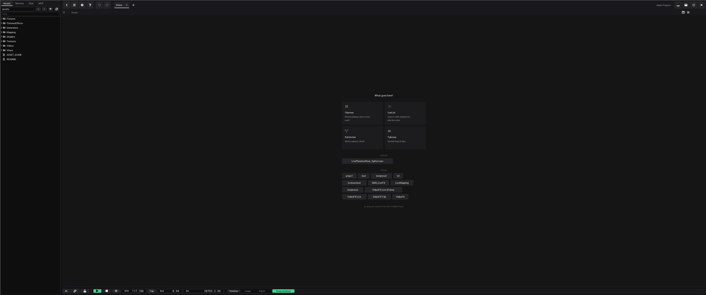
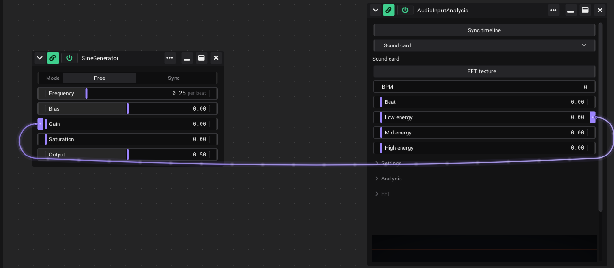

# Getting started

This page gets you from the download to your first saved project: install VibeVJ, start it, build a small project, save it
and open it again.

## Install

VibeVJ is portable. There is no installer and nothing else to install.

1. Download the portable version of VibeVJ for Windows (GitHub: `shizotech/shizoengine3_standalone`).
2. Unpack it into a folder where you are allowed to write files, for example your *Documents* folder. VibeVJ keeps your
   projects and personal settings inside its own folder.
3. In the folder you find `VibeVJ.exe` and a folder `VibeVJ` with the assets, the engine and your projects.

The Linux build works the same way. Its program file is `VibeVJ.out`.

## Start

1. Double-click `VibeVJ.exe` (on Linux: start `VibeVJ.out` in its folder).
2. VibeVJ opens the project you used last. The very first time this is the example project *first_time*.
3. While a project loads, the screen shows *Loading...*.

The VibeVJ window has no title bar of its own. You move it by dragging an empty part of the top bar: see
[The program window](The-Screen.md#the-program-window).

**Help is one key away:** F1 opens this wiki in the program, on the page for what the mouse is on. The **?** button
of the top bar opens it where you left it. See [The Help window](The-Screen.md#the-help-window).

## Your first project

1. In the sidebar, open the *Projects* tab and click *New project*.
2. Answer "Create a new project?" with *Yes*. The project name at the right of the top bar now reads
   *&lt;New Project&gt;*.
3. The big area on the right asks "What goes here?". Click the *Patchview* tile. The Patchview is a free area for
   generator windows. The other views are on [The screen](The-Screen.md#views-and-tabs).
4. In the sidebar, open the *Assets* tab, then `Generators` › `Math`, and drag *SineGenerator* into the Patchview. It
   opens in its own window where you drop it.
5. Drag a second generator next to it, for example a shader from `Shaders` › `Sources`. What else there is:
   [Assets](Assets.md).
6. Link the two: drag from the right notch of the Sine Generator's *Output* onto a control of the shader. The shader
   control now moves with the sine wave. How links work is on [Linking](Linking.md#make-a-link).
7. Save the project (see below).

## Save

All project actions are in the *Projects* tab of the sidebar, the first tab. What else the tab shows is on
[The screen](The-Screen.md#projects-tab).

| Entry | What it does |
|---|---|
| *New project* | Asks "Create a new project?" and then clears all views, generators and links. |
| *Open…* | Asks for a project name and opens that project. |
| *Save* | Saves the project. A new project without a name first asks for one. Key: Ctrl + S. |
| *Save as…* | Asks for a new name and saves the project under it. From then on you work in the new project. Key: Ctrl + Shift + S. |
| *Exit* | Saves the project and closes VibeVJ. |
| *Projects* | Every saved project, newest first. Click one to open it. See [Open a project](#open-a-project). |
| *Templates* | Projects to start from. Click one to open it as a new project. See [Templates](#templates). |

To save a project for the first time:

1. In the *Projects* tab, click *Save* (or *Save as…*).
2. In the dialog *Save project*, type a name in *Project name*.
3. Click *Save*. While it saves, the screen shows *Saving...*. The name appears in the top bar, at the right, left of
   the window buttons.

**Exit and unsaved projects:** *Exit* saves a project that has a name and closes VibeVJ. A new project that was never
saved first asks "Save the new project before quitting?". *Yes* opens the dialog *Save project*, *No* closes VibeVJ
and your work is lost, *Cancel* keeps VibeVJ open. The close button (✕) of the top bar does the same.

### Autosave

Every five minutes VibeVJ also writes the open project into the folder `VibeVJ/autosave/`, with or without a name. It
does not touch your project folder: only *Save* does that. *Save* and a normal *Exit* delete the autosave again.

In [show mode](Timeline.md#show-mode) there is no autosave: the show is built and only played, and a save could make
a frame late. The next autosave comes five minutes after you leave show mode. Save before the show.

When VibeVJ did not close properly (a crash, a power cut), the next start asks "VibeVJ did not close properly. Restore
the autosave …?":

- *Yes* opens the autosave, under the name of its project. Look it over, then *Save* to keep it. Until then the autosave
  stays, in case VibeVJ stops again.
- *No* deletes the autosave and opens the project as it was last saved.

How often it saves, or not at all, is set in [*Settings* › *Project* › *Autosave*](Settings.md#autosave). An autosave
holds the same files as a project folder; to keep one by hand, copy `autosave/` into `projects/` under a new name.

### What is saved with a project

Every project is a folder in `VibeVJ/projects/<project name>/`. It holds:

- your views and generators, with their windows, positions and sizes,
- the values of all controls, your links and MIDI mappings,
- the generators in the timeline area,
- your fixtures,
- the project settings in *Settings* › *Project* and *Settings* › *Links* (see [Settings](Settings.md)).

Not in the project: the settings in *Settings* › *Appearance*, for example the accent colour and *Calm notches*. They
are personal and valid for every project.

To copy or back up a project, copy its folder.

## Open a project

1. In the sidebar, open the *Projects* tab. The section *Projects* lists all your projects, newest first. The one
   you have open has a check mark.
2. Click the name of the project.

A project you saved for the first time shows up in the list at once. To open a project by its name instead:

1. In the *Projects* tab, click *Open…*.
2. In the dialog *Load project*, type the name exactly as the project folder is called.
3. Click *Load*.

If no project with that name exists, VibeVJ says "Project … not found" and keeps the project you have open. Pick the
project from the list to be sure.

## Templates

A template is a project to start from, for example a layout you build every show on. The templates are the folders in
`VibeVJ/templates/`, next to `VibeVJ/projects/`.

1. In the sidebar, open the *Projects* tab. The templates are listed in the section *Templates*, below the projects.
2. Click the name of the template. It opens as a new project: the top bar reads *&lt;New Project&gt;*.
3. Save it under a name of its own (*Save* asks for one). The template stays as it is.

To make a template, save a project and copy its folder from `VibeVJ/projects/` into `VibeVJ/templates/`. Without a
`templates` folder the tab has no section *Templates*.

## Next steps

- Find your way around the window and build your own layout: [The screen](The-Screen.md).
- Learn the generator window: [Generators](Generators.md). See what comes with VibeVJ: [Assets](Assets.md).
- Make things move: [Linking](Linking.md).
- Play clips live: [Clipview](Clipview.md), or run a show from a few buttons: [CueList](CueList.md).
- Follow the music: [Audio](Audio.md) and the tempo in the [Timeline](Timeline.md).
- Connect a controller: [MIDI](MIDI.md).
- Get the picture out, to a projector or to lights: [Output and devices](Output-and-Devices.md).
- Lock everything for the show: [Show mode](Timeline.md#show-mode).

## See also

- [The screen](The-Screen.md)
- [Generators](Generators.md)
- [Settings](Settings.md)
- [Shortcuts and tips](Shortcuts-and-Tips.md)
- [Troubleshooting](Troubleshooting.md)
