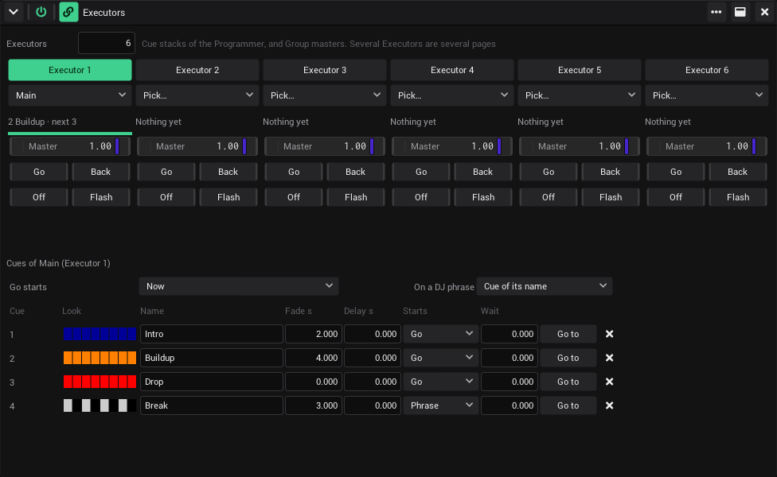
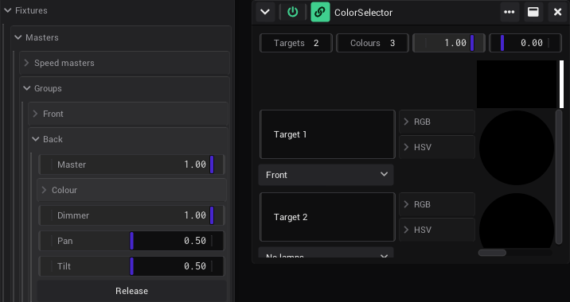

# Lighting desk

VibeVJ can be run like a lighting console such as a grandMA: select lamps, set their values in the programmer, call up
palettes, store cues and play them on executors. It takes what is good about a console, not its old ways: you pick lamps
on the stage instead of by number, take colours from the video, start cues on the drop of the music, record what you
see, and every store can be undone. It works on every lamp of the
[fixture setup](Output-and-Devices.md#fixtures): pars, moving heads and LED bars, and the virtual lamps that stand for
your video. A slice of [MapLab](Output-and-Devices.md#mapping) or a shader becomes a lamp, so the same palette, the same
cue and the same fader move the light and the projection together.

| Part | What it is |
|---|---|
| *Programmer* (`FixturesEffects`) | Select lamps, set values, palettes, store cues, the command line |
| *Executors* (`FixturesEffects`) | Faders and buttons that play cue stacks and are the masters of groups |
| *LampValues* (`FixturesEffects`) | The channels of one lamp as outputs: a shader follows a lamp |
| *CueTrigger* (`FixturesEffects`) | Starts a cue when a clip starts: the video show runs the light |
| *ProjectionZone* (`Fixtures` › `Virtual`) | The lamp of a MapLab slice: dimmer, colour, pan, tilt, zoom, rotate, strobe |
| *Look* (`Fixtures` › `Virtual`) | A lamp for a shader: dimmer, colour, speed, size and four FX |
| *Masters* (Devices › Fixtures) | Four Speed masters; per group its Group master and inputs to link into (Colour, Dimmer, Pan, Tilt) |

All of it acts on the controls of the lamps in Devices › Fixtures, as the [Phaser](Output-and-Devices.md#effects-over-fixtures)
does. Links, MIDI and the Art-Net mapping of a console keep working on top of it.

## The way of a console

1. **Lamps:** set them up in the fixture setup. For the video: *Lamps for slices* in MapLab (a ProjectionZone for every
   slice), *New look* in LampValues (a Look for a shader).
2. **Select** them in the Programmer: a group, or lamps.
3. **Set values:** the rows in the middle, a palette on the right, or the command line.
4. **Store** the programmer as a cue: *Store cue*.
5. **Play** the cues on an executor: *Go*, *Back*, *Off*, its *Master*.

## The programmer

Drag *Programmer* from `FixturesEffects` into a view.

- **Selection (left):** click a group or a lamp to select it. Ctrl+click adds it to the selection or takes it out.
  *All lamps* selects every lamp, the virtual ones too.
- **The stage (middle, top):** the lamps and slices from above, in the colour they show. See
  [Pick on the stage](#pick-on-the-stage).
- **Values (middle):** *Dimmer*, *Colour*, *Pan*, *Tilt* and every other channel the selected lamps have. A value set
  here goes to every selected lamp that has the channel. A lamp without a dimmer (an RGB par) takes *Dimmer* as the
  brightness of its colour.
- A value in the programmer has its name in the accent colour. It wins over everything else (cues, the Phaser, links)
  until you press *Clear*.
- *Clear* empties the programmer and the selection. The lamps go back to what they had before.
- *Highlight* lights the selected lamps at full, to find them in the rig.
- *Blind* and *Take*: see [Blind and take](#blind-and-take).

## Pick on the stage

The plan above the values shows the stage from above, the audience at the bottom: lamps as circles, slices and looks as
small rectangles, each in the colour it shows. The selected ones have a violet ring.

- **Click** a lamp: only it is selected. **Ctrl+click** adds it or takes it out. A click on nothing empties the
  selection.
- **Drag** a rectangle: the lamps in it, from left to right (the order a phaser runs over them).
- **Words** on the command line pick by place, from the selection of the same line or from all lamps: `left`,
  `right` (of the middle), `front` (towards the audience), `back`, `high`, `low`, `middle` (the middle third across),
  `lit` (shows light now), `dark`, `odd`, `even`. `group heads left at 0` darks the left half of the heads,
  `lit at color red` turns every lit lamp red, `left half` works too.

## Palettes

The palettes are on the right of the Programmer, by kind: *Colour*, *Position*, *Beam* and *Look* (everything).

- **Call one up:** select lamps, click the palette. A palette sets each lamp by what its channels do. *Red* turns pars,
  LED bars, MapLab slices and shader looks red alike, and *Centre* puts moving heads and slices in the middle.
- **Store a new one:** set values in the programmer, click **+** under its kind. A palette stores the values of every
  selected lamp, and for other lamps the same values by what their channels do.
- **Store into a palette:** *Store*, then click the palette.
- **Delete:** *Delete*, then click the palette.

A new project starts with the colours *Red* to *White*, the look *Full* and the position *Centre*. The palettes are
saved with the project (`desk.json`).

## Cue stacks

A cue stack is a list of numbered cues. A cue stores only what was in the programmer when you stored it. Everything
else stays as the cues before it left it (tracking): a cue that only changes the colour keeps the positions of the cue
before.

1. Set values in the programmer.
2. Below the values: pick the stack (*New stack* makes one), the number (*Cue* 0: the next one), the *Fade* in seconds.
3. *Store cue*. A cue with that number already there takes the new values on top of its own.
4. *Clear* and set the next look.

## Record what you see

*Record* (next to *Store cue*) stores what the lamps show now, not only the programmer: the selection, or every lamp
when none is selected, effects included. A Phaser in the middle of its circle, a cue that is playing, the colours of
the picture: what you see is what the cue gets. On the command line: `record cue 4`, `group pars record`.

Each cue keeps a picture of what the lamps showed when it was stored: the *Look* column of the
[cues of an executor](#executors), one colour per lamp from left to right.

## Blind and take

*Blind* (top of the Programmer): the programmer is not sent. Build the next look while the show goes on; the plan of the
Programmer shows the programmer, the rig the show. *Take* sends it live, fading in from what the lamps show in the
*Fade* of the store row (`take 4` on the command line), and turns *Blind* off.

## Undo

*Store cue*, *Record*, a deleted cue, a stored or deleted palette, a new or deleted stack, *Clear* and a command line
that stores or clears are steps of the undo history of VibeVJ: *Undo* in the top bar or Ctrl+Z, *Redo* or Ctrl+Y.
Values set in the programmer are not steps of their own (there are too many); *Clear* takes them all back in one.

## Executors

Drag *Executors* from `FixturesEffects` into a view. Each executor plays a cue stack, or is the master of a group.
Several Executors generators are several pages of faders.

| Control | Cue stack | Group |
|---|---|---|
| The list | The stack it plays (*New stack* makes one) | *Group: …* |
| *Master* | Scales the dimmers the stack sends | The Group master of the group |
| *Go* | The next cue (after the last: the first) | — |
| *Back* | The cue before | — |
| *Off* | The stack lets go: the lamps go back to what they had | — |
| *Flash* | While held: at full (a stack that is off starts, and goes off again) | While held: at full |

The line under the list says which cue plays and which comes next; the bar under it shows the fade.

- **Mixing:** dimmers mix by the highest value (HTP), every other channel by the stack started last (LTP). The
  programmer is above all of them.
- **Map them:** *Master*, *Go*, *Back*, *Off* and *Flash* are controls like any other: [map them to MIDI](MIDI.md)
  (a fader wing) or [link](Linking.md) them.

**The cues of an executor:** click its name. The cues of its stack show below:

| Column | What it does |
|---|---|
| *Cue* | The number |
| *Look* | What the lamps showed when it was stored, one colour per lamp from left to right |
| *Name* | Type to rename it |
| *Fade s*, *Delay s* | How long it fades in; how long it waits after it started before it fades |
| *Starts* | *Go*: with Go. *Follow*: when the cue before has faded in. *Wait*: seconds after the cue before started. *Beats*: beats of the [timeline](Timeline.md) after the cue before started. *Drop*, *Break*: at the next drop or break of the music. *Phrase*: at the next phrase of the DJ (see [Cues from the music](#cues-from-the-music)) |
| *Wait* | The seconds or beats of *Wait* and *Beats* |
| *Go to* | Plays this cue now |
| × | Deletes the cue |

*Beats* keeps a chase of cues on the music: with the timeline playing, each cue comes after so many beats.

## Cues from the music

Light follows the music without a person on Go:

- **Go on the beat:** above the cues of an executor, *Go starts*: *Now*, *Next beat*, *Next bar*, *Next 4 bars* or
  *Next phrase*. With *Next bar* a Go waits for the next bar of the [timeline](Timeline.md) while it plays ("Waits for
  the bar" under the list), so a cue lands on the one even when the button is pressed early. *Next phrase* waits for
  the next phrase of the DJ (below). *Back* and *Go to* wait too, *Off* does not. A [Prolink](Output-and-Devices.md#prolink-cdjs)
  bridge with *Sync timeline* keeps the timeline on the beat of the CDJs, so the beats and bars are the DJ's.
- **On the drop:** a cue with *Starts* *Drop* starts by itself at the next drop, *Break* at the next break.
  [Audio Input Analysis](Audio.md) hears them: a break starts when it detects one, the drop is its end. A
  [Prolink](Output-and-Devices.md#prolink-cdjs) bridge adds a drop when the master deck reaches a memory cue.
- **The phrases of the DJ:** see [DJ Link phrases](#dj-link-phrases).
- **A whole song:** build the stack as the song goes (intro, build, drop, break, drop), with *Beats* for the steps
  inside a part and *Drop* / *Break* where the music turns. The [Chat](The-Screen.md#chat-tab) can build it from a
  description of the song with the command line ("cue 1 blue for the intro, on the drop all white and strobe").

### DJ Link phrases

rekordbox finds the phrases of a track (Intro, Verse 1 to 6, Buildup, Break, Drop, Outro). With a
[ProlinkBridge or ProlinkDecks](Output-and-Devices.md#prolink-cdjs) generator connected, the desk knows the phrase of
the master deck and reacts to each new one by itself. No AI is needed: the rules are fixed and run every frame.

- **On a DJ phrase** (above the cues of an executor): *Go* plays the next cue at every new phrase. *Cue of its name*
  plays the cue named like the phrase: a cue *Drop* on a drop, *Intro* on the intro. A cue named like the group of the
  phrase, or starting with it, takes the phrases of the group: *Verse* (or *Verse calm*) plays on Verse 1 to 6. Two
  cues of one phrase take turns. The stack has to be on: Go it once, *Off* stops it following.
- **Starts** *Phrase*: a cue starts at the next new phrase, whatever its name.
- **Go starts** *Next phrase*: a Go waits for the next phrase.
- A project that loads while the DJ plays starts no cue for the phrase that is already running.
- Without CDJs, try it with the command line: `music phrase Drop` does what a new Drop phrase does.

A whole set: name the cues of a stack Intro, Buildup, Drop, Break, Outro, set *On a DJ phrase* to *Cue of its name*, Go
once. The [Chat](The-Screen.md#chat-tab) can build such a stack too, and the same rules play it.

## Groups as link targets

Other generators drive lamps without a detour:

- **ColorSelector:** each row has *Lamps* under its name: *All lamps* or a group. A colour picked in the row colours
  those lamps directly. *RGB* and *HSV* still send the colour for anything else.
- **The inputs of a group:** Devices › Fixtures › *Masters* › *Groups* › the group: *Colour* (R, G, B), *Dimmer*, *Pan*,
  *Tilt*. [Link](Linking.md) into them: an LFO into *Dimmer*, the RGB outputs of a shader or ColorSelector into
  *Colour* (drag the vector onto *Colour*: R, G and B link at once), a MIDI fader into *Pan*.
- An input sends once it has moved (or a link moved it). *Release* stops the inputs of the group: its lamps go back to
  what they had. The inputs that sent are saved with the project and send again after a load.

Both mix like a cue stack: dimmers by the highest value, the rest by what moved last (a colour picked now wins over the
stacks started before, a Go after it wins again), the programmer above them. The Group masters, the blackout and
*Record* see what they send. On a lamp without dimmer, *Dimmer* scales the colour.

You can still link a generator straight into the controls of a lamp in Devices › Fixtures; the desk sends to a control
only while a cue or the programmer has a value for it.

## Masters

Devices › Fixtures › *Masters*:

- **Groups:** per group of the fixture setup its *Master*, which scales the brightness of the lamps of the group (the
  dimmer, on a lamp without dimmer its colour) on top of their values (an executor on a group moves the same slider),
  and its inputs (see [Groups as link targets](#groups-as-link-targets)).
- **Speed masters:** *Speed 1* to *Speed 4*. A phaser that follows one (*Speed master* in its settings) runs that many
  times as fast: 2 twice as fast, 0 stands still. One fader sets the speed of many phasers.

## The command line

The top of the Programmer is a command line as on a console. Enter runs it, *help* lists the commands. The words can
be in any case; names with spaces go in quotes.

| Type | What it does |
|---|---|
| `group 1`, `group "Front pars"`, `fixture 3`, `fixture 1 thru 8`, `all` | Selects. `+` adds, `-` takes out: `group 1 + group 2`, `all - group heads` |
| `at 50`, `full`, `out` | Dimmer of the selection in percent |
| `at color red`, `at #ff8000`, `at 100/50/0` | Colour (a name, hex, or red/green/blue in percent) |
| `pan 25`, `tilt 75`, `zoom 80`, `strobe 0` | A channel by its name, in percent |
| `palette 2`, `at palette red` | Calls up a palette (number or name) |
| `left`, `right`, `front`, `back`, `high`, `low`, `middle`, `lit`, `dark`, `odd`, `even` | Picks by place, of the selection of the line or of all lamps: `group heads left`, `lit at 0` |
| `store cue 3 fade 2`, `store`, `store cue 5 stack Chase` | Stores the programmer as a cue (next number when none is given) |
| `store cue 4 name Drop starts phrase` | A cue with a name and how it starts (go, follow, wait, beats, drop, break, phrase) |
| `record cue 4`, `record` | Stores what the lamps show now (the selection, else all) |
| `store palette colour Sunset` | Stores a palette |
| `go`, `back`, `goto 3`, `off`, `go stack Chase` | Plays the stack used last (or the one named) |
| `blind`, `take`, `take 4` | Programmer not sent (again: sent); sent live, fading in (seconds) |
| `phrases match`, `phrases go`, `phrases off` | What the stack used last (or `stack <name>`) does on a new phrase of the DJ |
| `music drop`, `music break`, `music phrase Drop` | Does what the music does: to try cues without a DJ or a sound card |
| `clear`, `highlight`, `help` | Empties the programmer; the selection at full (again: off); lists the commands |

Several commands in one line: `group 1 at 50 group 2 at 0` (a selection after values starts a new one).

The [Chat](The-Screen.md#chat-tab) and AI tools over the *MCP* tab use the same command line ("make the pars red and
store it as cue 3").

## Colour from the picture

The top of the palettes of the Programmer takes colours from the video:

1. Pick the picture: any shader, video or MapLab output whose *Video router* is on (*Outputs* › *VideoRouter* ›
   *Enable Router*).
2. *Colours from picture*: colour palettes *Picture 1*, *Picture 2* … of the colours the picture is made of now, the
   strongest first. A second click replaces them. Call them up on any lamps, store them into cues.
3. *Follow picture*: the selected lamps (none selected: all) take the colour of the picture where they hang, live: from
   left to right across the picture, from the highest to the lowest down it (lamps at one height: the middle row).
   The programmer stays above it; the picture's colours stay under it. Off, the lamps go back to what they had.

The picture is read small (16 × 9): enough for its colours, cheap enough to run all the time.

## Mapping as lamps

*Lamps for slices* in MapLab gives every slice a ProjectionZone lamp (see [Virtual fixtures](Output-and-Devices.md#virtual-fixtures)).
Its channels act on the slice:

| Channel | On the slice |
|---|---|
| *Dimmer*, *Colour* | Brightness and tint |
| *Pan*, *Tilt* | Move the picture inside the slice, up to its width / height either way (middle: where its *Transform* puts it) |
| *Zoom* | From half to twice the size (middle: as it is) |
| *Rotate* | Half a turn either way (middle: as it is) |
| *Strobe* | 0 off, then flashes from 1 to 20 times a second |

The lamps stand on the stage plan where the slices are in the outputs, upstage and as wide as the rig. So a phaser
*Left to right*, a position palette or a fan of moving heads runs through the lamps and the slices as one.

## Shaders as lamps

*LampValues* sends the channels of one lamp as outputs. [Link](Linking.md) them into the parameters of a shader.

1. Drag *LampValues* from `FixturesEffects` into a view.
2. *New look* makes a virtual lamp *Look* (Dimmer, Colour, Speed, Size, FX 1 to FX 4) and picks it. Or pick any lamp: a
   shader can follow a real par too.
3. Link *Dimmer*, *Colour - R* … into the shader.

Now palettes, cues, executors, the Phaser and the Art-Net mapping of a console move the shader as they move a lamp.

## Light cues in clips

*CueTrigger* starts a cue when it is switched on. Put it into a clip of a [Clipview](Clipview.md) or a
[CueList](CueList.md): when the clip starts, the light goes with it. One show for picture and light.

- *Stack*, *What* (*Go*: the next cue, *Go to cue*, *Back*, *Off*) and the *Cue* number for *Go to cue*.
- *Trigger* does it by hand; link a beat or a button into it, or map it.
- Not when a project loads.

## What is saved

The palettes and the cue stacks are saved with the project (`desk.json`, with *Go starts* and *On a DJ phrase* of each
stack, and which inputs of the groups sent), the executors, LampValues, CueTrigger and the *Lamps* of a ColorSelector
with their view. The programmer is not saved.

## See also

- [Output and devices](Output-and-Devices.md): the fixture setup, the Phaser, MapLab, Art-Net
- [Clipview](Clipview.md) and [CueList](CueList.md)
- [MIDI](MIDI.md)
