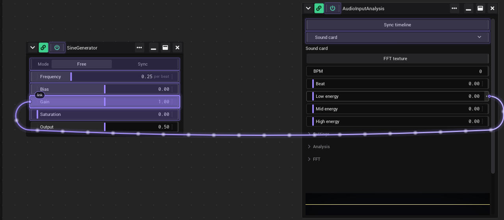
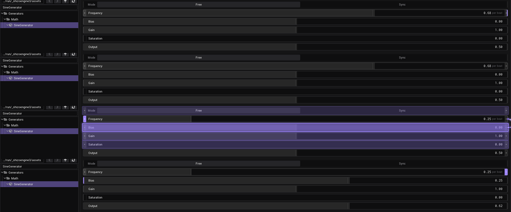
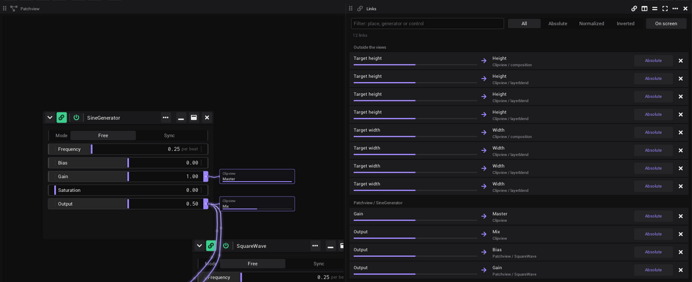
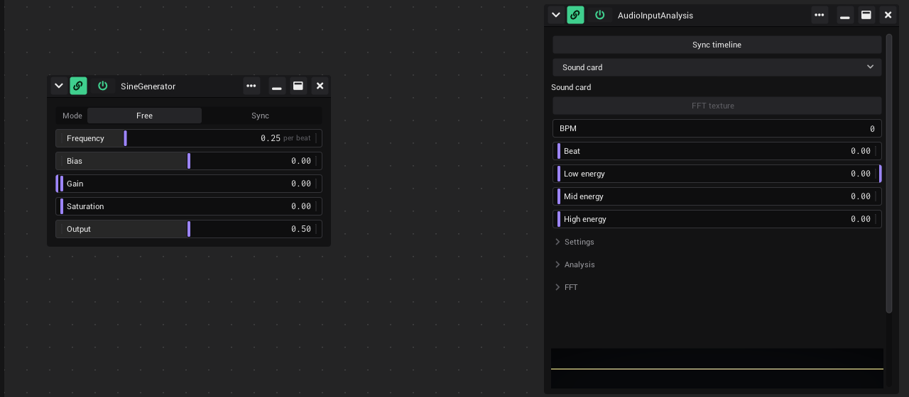

# Linking

Any control can drive any other control. A link sends the value of one control to another: an LFO moves a slider, a
button starts a clip, the beat of the music drives an effect. This page covers the notches, making and removing links,
the options of a control, and how to see where your links go.

## Notches: left in, right out

Every row that can be linked has two small tabs at its edges, the notches.

| Notch | Means | Click | Drag |
|---|---|---|---|
| Left (input) | Something can come in. Violet when a link arrives. | Opens [the options](#the-options-of-a-control) | Starts a link |
| Right (output) | Something goes out. Filled with the colour of its cable. | Opens the options | Starts a link |

- **Click or drag:** a press that moves less than 4 px is a click, more is a drag.
- **Direction of the cables:** they leave the right notch of the sender and end at the left notch of the receiver. If
  the receiver sits further left than the sender, the cable hangs in a loop below both and still comes in from the left.
- **Very small buttons** (narrower than 48 px, for example the transport buttons of a [Clipview](Clipview.md#transport-buttons)):
  a click on the right notch presses the button. Use the left notch for the options there; dragging from the right notch
  still links.
- **A grip instead of notches:** a few controls (the header of a vector, a button that lies over a picture) have one
  dot instead. It shows when the mouse is on the control and is violet when the control is linked. Drag from it to link.

### Calm notches

So the screen stays quiet, free notches rest as thin grey edges. A notch opens in full:

- while the mouse is on its row,
- while you drag a link from the row, or its options are open,
- while it is linked (unless *Linked notches* is *Edge only*).

While its notches are folded, a slider marks both ends of its travel with a short grey line, so you can read 0 % and
100 %. The line fades while the notch opens.

Two settings in [*Settings* › *Appearance*](Settings.md#appearance) change this. They are personal, not part of the
project:

- *Linked notches* › *Edge only* keeps linked notches as thin coloured edges too, until you hover the row.
- *Calm notches* chooses where the grey edges of free notches are drawn: *Everywhere* (the standard) or *Clipview only*.
  With *Clipview only* a free notch outside a Clipview shows nothing until you hover its row; a slider then marks the
  end of its travel with a short grey line.

## Make a link

1. Hover the row you want to send from. Its notches open.
2. Press on its right notch and drag. The controls that can take the link get a thin violet outline. A control this
   row is already linked to gets a red, dashed outline instead: dropping there removes the link.
3. Let go over the control that should receive. It gets a stronger outline while you are over it, and the label at the
   cable end says *link*.

- You can also start from the left notch. The result is the same: the link goes from the row where you start to the
  row where you let go.
- A control cannot link to itself.
- A new link between a slider and a slider, button or combo box gets the type *Normalized* (the place in the range is what
  counts); every other new link is *Absolute*. Change it in the options: see [Link types](#link-types).
- While you drag, only the cable you drag is drawn. To see the others, turn on the [cable view](#seeing-your-links).

### Hold and drag

Made for touch screens, works with the mouse too.

1. Press anywhere on a row and hold still. After 100 ms the notch starts to fill with violet, after 400 ms it is full.
2. Drag. On the right half of the row the link starts from the output, on the left half from the input.

- If you move 4 px or more before the 400 ms are over, the row changes its value as usual.
- If the press had already changed the value, the value goes back when the link starts.
- Hold and drag works on value fields and buttons. Not on *In* / *Out* ports, not on controls with a grip dot, and not
  on the thumb of a slider (the violet bar): holding the thumb still just picks it up.
- A [pure output](#pure-outputs) always links from its output, whichever half you hold.

### Ports

Pictures travel through ports: an *Out* port gives the picture of a generator, an *In* port takes one.

- An *Out* port carries its dot on the right, where its cables leave; an *In* port on the left.
- Like every notch, the cap of a port is a thin edge until the port is linked or the mouse is over it.
- An *Out* port takes no links: its generator writes it.
- You link ports like values: drag from the *Out* of one generator to the *In* of another. How the picture then leaves
  VibeVJ is on [Output and devices](Output-and-Devices.md).

## Remove a link

- Drag the same link again onto the same receiver. The cable turns red and dashed, its label says *unlink*, and letting
  go removes the link.
- Or open the options (click a notch), go to *Out* or *In*, and click × next to the link.

## The options of a control

Click a notch to open the options of a control. They close when you click anywhere outside them, or the notch again.
They open below the control, or above it when there is more room there, and are not cut off by a small generator
window. Drag any edge of the options to make them bigger, for example the top edge to give the envelope of *Env* more
room. They keep that size when you open them again.

| Tab | What is there |
|---|---|
| *Main* | The display name of the control, used in link lists. Sliders and number fields also have *min* and *max* (the range) and *smoothing* (the value follows with a delay). |
| *In* | The links that come in. *Select sender* lists the controls marked as sender, to link from one without dragging. |
| *Out* | The links that go out. *Make sender* marks this control as a sender. |
| *MIDI* | The MIDI mapping of the control and *MIDI backpropagate*. See [MIDI](MIDI.md#the-midi-tab-in-the-options). |
| *Env* | An envelope and a sync to the timeline. See [Envelope and sync](#envelope-and-sync). Sliders and number fields only. |

Each link row in *In* and *Out* shows the other control, the link type and × to remove the link. The type can be
changed in both lists.

### Senders

A sender is a control you want to link from often, for example the *Beat* of the audio analysis.

1. Open the options of that control, tab *Out*, and click *Make sender*.
2. In any other control, open the options, tab *In*, and pick it under *Select sender*.

This makes a link without dragging, also to a control in another tab.

### Envelope and sync

The tab *Env* of a slider or number field changes how its value runs.

- **The graph** is a curve from left (the lowest position of the control) to right (the highest). What the control
  sends is read from the curve. A straight line from bottom left to top right changes nothing.
  - Click an empty place: adds a point. Drag a point: moves it; Shift snaps it to the grid.
  - Right click a point between the two ends: deletes it.
  - B: makes the selected point a curve, or a corner again. The mouse wheel on a selected point sets how round it is.
  - The mouse wheel anywhere else, or Page Up / Page Down, changes the grid.
- **The list** above it makes the [timeline](Timeline.md) move the control:

| Choice | The control |
|---|---|
| *NO SYNC* | Stays where you put it. |
| *SYNC* | Runs through its range once per beat, again and again. *SyncMultiplier* sets how often per beat; *x 2* doubles it, */ 2* halves it. |
| *TRIGGER* | Runs through its range once, over one beat, each time *Trigger* is pressed. |
| *LOOP* | Runs through its range over one beat, again and again, while *Trigger* is held. Back to the start when it is let go. |
| *PINGPONG* | Runs up through its range and back down, again and again: one way per beat. *SyncMultiplier* sets how often, as with *SYNC*. |

*Trigger* is a control of its own: link a button or a beat to it, or map it to a pad ([MIDI](MIDI.md)).

The second list, *Source*, is the clock: *Timeline* (the main timeline) or one of the [loops](Timeline.md#loops). On a
loop, one turn of the loop is what one beat is on the main timeline: *SYNC* runs through the range once per turn,
*TRIGGER* over one turn. A control whose loop was deleted stands still and shows *Missing source*.

On a slider the fill shows the value that is sent, after envelope and smoothing; the thumb shows where you put it.
A value you type into the slider (double click) is the value that is sent, as it is: the thumb moves to where the
curve gives it. The same for an *Absolute* link and for a project or preset that is loaded. MIDI and *Normalized* links
move the thumb, and the curve makes the value of it.

## Link types

The type sets how the value travels. Change it in the *In* or *Out* list of the options.

| Type | What the receiver gets | Cable |
|---|---|---|
| *Absolute* | The raw value. | Accent colour (violet at the start), solid |
| *Normalized* | The position of the sender in its range, mapped onto the range of the receiver. | Magenta, solid |
| *Inverted* | Like *Normalized*, but upside down. | Light blue, dashed |

- A link has a type and nothing else: no amount, no curve. To scale a value, set *min* and *max* of the receiver, or
  shape it with the [envelope](#envelope-and-sync).
- If one row sends links of different types, its right notch is split into bands, one per type: top *Absolute*, middle
  *Normalized*, bottom *Inverted*.

## Pure outputs

Some rows are written by their generator every frame, for example the *Output* of a Sine Generator or the *Beat* of
[Audio Input Analysis](Audio.md#the-values). A link into them would be overwritten at once, so:

- they have only the right notch, always visible;
- they take no incoming links and get no outline while you drag.

Link **from** them into the control they should drive.

## Disabled controls

A greyed-out control has no grip dots on its notches and takes no links.

## Seeing your links

| What | Where | What it does |
|---|---|---|
| *Cable view* | Link button in the [timeline bar](Timeline.md#the-transport-bar), or [*Settings* › *Links*](Settings.md#links) (one switch) | Draws every link as a cable, in every [area](The-Screen.md#the-areas). It does not open the notches. Saved with the project. |
| *Cables of an area* | Link button in the [header of an area](The-Screen.md#the-header-of-an-area), or *Show cables* in [its menu](The-Screen.md#the-menu-of-an-area) | Draws the links of everything in this area as cables, also of the tabs of a Tabview in it. Saved with the project. |
| *Off-screen link hints* | *Settings* › *Links* | While *Cable view* is on: a small violet badge with a number on a control whose link partner is not on screen (other tab, scrolled away, covered). It counts up to "99+". |
| *Always draw links* | Link icon in the [header of a generator](Generators.md#the-window-header) | Draws the links of this one generator even when *Cable view* is off: a local cable view. New generators in a Patchview start with it on. |
| *Only the selection* | *Settings* › *Links* | While generators are selected (a frame or a click in a Patchview): only their cables at full strength, all others dimmed and without cards. Without a selection every cable shows. Saved with the project. |
| *End all local cable views* | Rest the mouse on the link button in the timeline bar, then click the broken link that slides in on its right half | Switches *Always draw links* off in every generator and the cables of every area at once. *Cable view* stays as it is. |

- **The bubble:** while *Cable view* is off, a small violet bubble on the link button counts the generators that draw
  their own links and the areas that show their cables.
- **Cables between what is on screen.** All three switches draw the same way: when both ends are on screen the cable
  runs straight from one to the other, also from one area into another. It stays inside the layout of the view tab
  and never runs over the top bar or the sidebar.
- **An end scrolled out of the same view** (a Patchview moved so that one of two linked generators is outside): a
  thin dashed line runs from the notch to a tag at the edge of the view, with the name of the generator and an arrow
  that points where it is. A click on the tag scrolls there.
- **Cards for what is not on screen.** A cable whose other end is not on screen (a tab that is not in front, scrolled
  out of view, covered) ends in a **card** next to its control: it says where the other end is (the area and the
  generator) and shows its value as it changes. Several links of one row to the same place share a card with their
  number. Where there is less room the card is a narrow tag of one line, and where there is none at all a small
  arrow at the notch.
- **No cards inside a view's own parts.** A link to a control that a generator keeps hidden itself, for example the
  Clipview behind the lists of a [CueList](CueList.md), gets no card: it would cover the view.
- **Hover a card** (or tag, or arrow) to open it and see where its cables go. **Click it** to go there:
  the view tab and the tab of a Tabview come to the front, a maximized area gives the room back, a Patchview scrolls,
  and the control flashes.
- **Cables side by side:** cables that would run on top of each other lie next to each other instead, a few pixels
  apart, without crossing.
- **Lay a cable yourself:** where no control is under it, a cable can be pulled with the mouse (the cursor turns into
  a hand and a dot marks its middle). It then runs through the point you let go. A double click on it lays it
  automatically again. The shape is saved with the link.
- **Following links across views:** see [below](#following-links-across-views).
- **Peek at one row:** rest the mouse on a linked notch for a bit more than half a second. The left notch shows the
  cables coming in, the right notch the cables going out, and the control at the other end lights up. A small number
  on the corner counts partners that are not on screen. Not while *Cable view* is on (the cables are there already) and
  not in show mode.
- **What a control is linked to:** rest the mouse anywhere on a linked control. Its tooltip lists the links: *in* for
  what drives it, *out* for what it drives, each with the partner, where the partner is (the area and the generator)
  and the link type, and *not on screen* for a partner you cannot see right now. The colours are those of the notches:
  *in* in the accent colour (violet by default) like a linked input notch, *out* and the link type in the colour of the
  cable (absolute the accent, normalized pink, inverted light blue). The list opens after a quarter of a
  second, sooner than other tooltips, and the control's cables show faintly then, as a hint; on a notch they show in
  full. A faint cable to a partner that is scrolled out of its view ends dashed at the edge of that view, with an arrow
  pointing to where the partner is. Not in show mode.
- **Follow a link from the list:** once the list has locked (the bar under it is full, or a middle click), move into it
  and rest on a partner: the partner glows where it is on screen, and its own list opens next to it. Rest on one of
  its partners to go on (Speed → Tempo → Tap Tempo), so you can follow a chain without leaving the control.
- **Many cables:** the small pulses on a cable run from the sender to the receiver. With more than 40 cables on screen
  the pulses stop, with more than 300 the cables are drawn in a plainer way, so the frame rate holds.

### The Links view

The *Links* view lists every link of the project, wherever its two ends are. Put it into an area like any view: pick
*Links* in an [empty area](The-Screen.md#an-empty-area).

- **One row per link:** the sender on the left with its value as a thin bar, an arrow, the receiver on the right with
  the area and generator it is in. The rows are grouped by the area and generator of the sender.
- **Go there:** click the sender or the receiver. Its view tab and tab come to the front, the area scrolls to it and
  the control flashes. *Back* (Alt+Left) then goes to the other end of the link.
- **See both ends:** rest the mouse on a row. Both controls light up on screen.
- **Change the type:** the button with the type (*Absolute*, *Normalized*, *Inverted*, in the colour of the cable)
  takes the next type with each click.
- **Remove a link:** the × at the end of the row. It goes at once, without a question.
- **Filter:** type words into the box at the top: a row stays when its places or control names contain all of them.
  Next to it pick one type, or *On screen* for the links whose two ends are on screen now.
- No links yet: the view says so. In [show mode](#show-mode) the type and × buttons are locked.
- An AI tool connected over the *MCP* tab of the sidebar gets the same list (`vibevj_list_links`).

## Following links across views

| What | How | What it does |
|---|---|---|
| *Back* | Arrow button left in the top bar, or Alt+Left | After a click on a card: back to the control the jump started at, with its view tab and tab. It remembers the last 20 jumps; its tooltip says where it goes. |
| *Signal path* | Hold Alt and point at a linked control | The whole chain of this control lights up, across all views: what it drives (+1, +2 …) and what drives it (−1, −2 …). Everything else is dimmed. Steps that are not on screen show as cards with their step, and their tabs are outlined. While Alt is held the path stays, so the mouse can go to one of its cards and click it. |
| *Badges on tabs* | View tabs in the top bar and the tabs of a Tabview | A tab that holds the other end of a cable on screen shows a link badge with the number of such links. While the mouse is on a card that leads into it, or the signal path does, the tab is outlined. |
| *Link into another tab* | Drag a link onto a tab and wait a moment | The tab comes to the front and the link can go onto a control in it. |
| *Links view* | *Links* in the picker of an empty area | Every link of the project as a list, with a filter. A click on one end goes there. See [The Links view](#the-links-view). |

## What is saved

With the [project](Getting-Started.md#what-is-saved-with-a-project): every link with its type and the shape of a cable
laid by hand, the values of all
controls, their display names, ranges, envelopes and sync, the sender marks, the MIDI mappings, and *Always draw
links* of every generator, and which areas show their cables. A [preset](Generators.md#presets) keeps the links inside its generator, not the links to
other generators.

## Show mode

While [show mode](Timeline.md#show-mode) is on, linking is locked:

- Notches take no clicks and no drags. A click on the notch area reaches the control itself.
- Hold and drag is off.
- Free notches are hidden. Linked ones stay as a coloured edge, so you know why a value moves.
- The rows keep less room for the notches, so the sliders get a bit longer. A short grey line marks where the travel
  of a slider ends.
- No hover opening, no cables, no off-screen badges. The link button in the timeline bar is greyed out.

Values, buttons and clips keep working.

## See also

- [Generators](Generators.md)
- [MIDI](MIDI.md)
- [Clipview](Clipview.md)
- [Timeline](Timeline.md)
- [Settings](Settings.md)
- [Shortcuts and tips](Shortcuts-and-Tips.md)
- [Troubleshooting](Troubleshooting.md)
