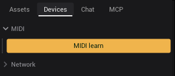
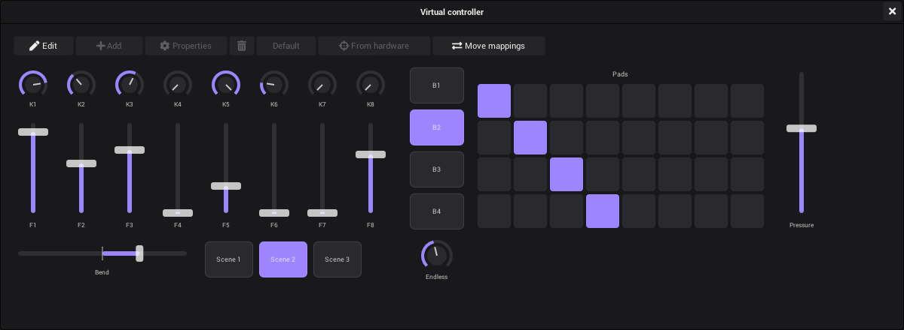

# MIDI

Play VibeVJ with a MIDI controller. Any control with a notch can follow a fader, a knob or a pad, and the controller can
follow VibeVJ back (motor faders, pad lights).

## Your devices

MIDI devices are in the [sidebar](The-Screen.md#sidebar), tab *Devices*, section *MIDI*.

- Every controller that VibeVJ finds gets its own section, named after the device. Plug in a controller and it shows up
  within a second: VibeVJ looks for new devices all the time.
- A controller that is unplugged keeps its section. Its name then ends in "· Offline". Plug it back in and the name
  goes back to normal.
- A device with an input (it sends MIDI to VibeVJ) shows a *MIDI mapping* button and a row *In · name*. A device with
  an output (it receives MIDI) shows a row *Out · name*.

| Button | Where | What it does |
|---|---|---|
| *MIDI learn* | Top of the MIDI section | Learn mode for all devices: the next MIDI message from any controller is learned. Amber while it is on. |
| *MIDI mapping* | In the section of one device | Learn mode for this device only. Messages from other controllers are ignored while learning. |

Only one device can be the learn device. Turn *MIDI mapping* on for a second device and it takes over from the first; the
button of the first goes off.

## Map a control with MIDI learn

1. Open the tab *Devices* and the section *MIDI*.
2. Click *MIDI learn* (or *MIDI mapping* of one device). Every control now gets an amber overlay.
3. Click the overlay of the control you want to play, for example the *Mix* of a layer or the power button of a
   generator.
4. Move a fader or a knob, or hit a pad, on the controller. The overlay now shows what was learned, for example
   "CC 7 ch1", and the control jumps to the value of the controller.
5. Click the overlay of the next control and move the next fader. Repeat for every control you want.
6. Click *MIDI learn* (or *MIDI mapping*) again to leave learn mode. The overlays go away and the mappings stay.

What the overlay says:

| Overlay | Message |
|---|---|
| "CC 7 ch1" | Control change number 7 on channel 1 |
| "N 36 ch10" | Note 36 on channel 10 |
| "PB ch1" | Pitch bend |
| "PG ch1" | Program change |
| "AT ch1" | Channel pressure (aftertouch) |
| "AP 36 ch1" | Poly pressure of note 36 |

Tips:

- Moving another fader while a control is still selected replaces its mapping. Select the next control first.
- Several controls can learn the same fader. They all follow it.
- Pitch bend, program change and channel pressure have no number: a mapping to one of them listens to the whole
  channel.
- A mapping belongs to one device, found by its name. It is saved with the project and works again as soon as a device
  with the same name is connected.

## What a message does

| From the controller | The control gets |
|---|---|
| Control change (CC) | The value of the knob or fader, 0 to 127 spread over the range of the control |
| Note (pad, key) | The velocity while pressed, 0 when released |
| Pitch bend | The position of the wheel over the range of the control: down is the minimum, the middle is the middle, up is the maximum |
| Program change, aftertouch | The value of the message, 0 to 127 spread over the range of the control |
| Control change with *Relative* (an endless encoder) | Steps: the value moves up or down by them instead of being set |

- A fader fills the whole range of the control. To use only a part, set *min* and *max* in the options of the control
  (tab *Main*), or map a helper control and link it on with a *Normalized* or *Inverted* link. Both are on
  [Linking](Linking.md#the-options-of-a-control).
- To smooth a jumpy knob, set *smoothing* there.

## The MIDI tab in the options

Click a notch of a control to open its options. The tab *MIDI* shows the mapping of this control.

| Item | What it does |
|---|---|
| Mapping row, for example "nanoKONTROL2 CC 7 · ch 1" | Shows the learned device, the kind of message (*Note*, *CC*, *Program*, *Pitch bend*, *Channel pressure*, *Poly pressure*), its number and the channel. |
| × next to the mapping | Removes the mapping. |
| *MIDI backpropagate* | On (the standard): when the value changes in VibeVJ (mouse, a link, a clip), the value is sent back to the controller, so motor faders move and pad lights follow. Turn it off if the controller should only send. Saved per mapping. |
| *Absolute* / *Relative* | For a control change. *Absolute* (the standard): the message sets the value, for faders and knobs with a stop. *Relative*: for an endless encoder, which sends steps; the value moves by them. Encoders send their steps in one of two ways, *Relative (1 = up, 127 = down)* or *Relative (65 = up, 63 = down)*; the manual of the controller says which. With the wrong one the value runs the wrong way or jumps. Saved per mapping. |

- A value that just came from the controller is not sent back to it for a second, so a fader does not fight itself.
- Some controls have no options (for example *Target FPS* in [*Settings* › *Project*](Settings.md#project), *Cable view*
  in *Settings* › *Links*, or the transport buttons of a [Clipview](Clipview.md#transport-buttons)). To remove their
  mapping, turn on *MIDI learn*, click the overlay of the control and press Esc.

## What can be mapped

Every control with a notch: value fields and sliders, control buttons, lists and switches, the power button of a
generator window, the columns, layers and transport of a Clipview, the buttons of a [CueList](CueList.md), the
transport of the [timeline](Timeline.md#the-transport-bar), fixture channels. Plain buttons without a notch (for
example *Save* in the *Projects* tab of the sidebar) cannot be mapped.

[Pure outputs](Linking.md#pure-outputs) (rows with only a right notch, such as *BPM* or *Low energy* of
[Audio Input Analysis](Audio.md)) are written by their generator all the time. A MIDI mapping on them is overwritten
at once, so map the controls they drive instead.

## The virtual controller

Knobs, faders, buttons and pads on the screen that send MIDI like a controller. With it you map controls and prepare a
show without hardware: the mappings belong to the device *Shizo Virtual MIDI*, and they work the moment you play the
virtual controller.

Open it with *Virtual controller* in the sidebar, tab *Devices*, section *MIDI*. The device *Shizo Virtual MIDI* is
listed there like a plugged in controller, with its own *MIDI mapping* button.

| Element | Sends | Play it |
|---|---|---|
| Knob | Control change (CC 21-28 in the standard layout) | Drag up and down. Shift for fine steps, the mouse wheel works too. |
| Fader | Control change (CC 41-48) | Click or drag on the track. |
| Button | Note (24-27) | Press. A *momentary* button sends note off when released, a *toggle* button stays on until the next click. |
| Pads | One note per pad (36-67, row by row) | Press a pad. |
| XY | Two control changes, one for x and one for y | Drag inside it. |
| Endless knob | Steps of a control change (1 = up, 127 = down) | Drag up and down. Its mapping is *Relative*: the control moves by the steps, so it does not jump when the knob and the control disagree. |
| Pitch bend | Pitch bend of its channel | Drag. It springs back to the middle when you let go, unless *Properties* says otherwise. |
| Pressure | Channel pressure (aftertouch) of its channel | Press on the track; it goes back to 0 when you let go. |
| Program | A program change (0-127) | Click. The button of the program that is chosen lights, also when the program comes from VibeVJ. |

To map a control, use [MIDI learn](#map-a-control-with-midi-learn) as with a real controller: *MIDI learn* on, click
the overlay of the control, then turn a knob or hit a pad of the virtual controller.

When a mapped control changes in VibeVJ, the element follows: the knob turns, the pad lights (*MIDI backpropagate*).

### Change the layout

Click *Edit* (not in [show mode](#show-mode): there the controller is played, not changed).

- Drag an element to move it, drag its lower right corner to size it.
- *Add* adds an element below the others: knob, endless knob, fader, button, pads, XY, pitch bend, pressure, program or
  label. It gets the next MIDI number no other element of its channel uses.
- *Properties* changes the selected element: label, MIDI channel, CC or note, the mode of a button or a knob
  (absolute or relative), rows and columns of pads, the program of a program button, whether a pitch bend springs back. Controls mapped to the element follow its new numbers.
- The bin deletes the selected element, *Default* brings the standard layout back.

The layout is saved with the [project](Getting-Started.md#save). Every element keeps its id and its MIDI number when the
layout changes, so mapped controls keep working.

### Later with a real controller

A mapping belongs to one device, found by its name: mappings learned from the virtual controller listen to
*Shizo Virtual MIDI*. Two buttons bring them to your real controller, so on site nothing is learned again.

1. Plug the real controller in once (at home or on site) and click *Edit*.
2. Select an element and click *From hardware*, then move the knob or fader, or hit the pad, that should play it on
   the real controller. The element takes its number and channel, and the controls mapped to the element come along.
   Pads take the note of the first pad you hit; an *XY* takes two knobs, first the one for x, then the one for y. Click
   *Waiting…* to stop without a change.
3. Repeat for every element you use.
4. Click *Move mappings*. *From device* is *Shizo Virtual MIDI*, *To device* the name of your controller as
   *Devices › MIDI* shows it. Every mapped control now listens to the real controller.

When the elements already send the numbers of your controller (you typed them in *Properties*, or the layout was made
for it), step 4 is enough, also without the controller plugged in. To prepare the next show with the virtual
controller again, move the mappings back: *From device* your controller, *To device* *Shizo Virtual MIDI*.

Whenever an element gets another number (*From hardware*, *Properties*, *Default*), the controls mapped to it follow.

### Other programs

On Linux, *System port* in the window makes *Shizo Virtual MIDI* a MIDI port of the system (ALSA sequencer). Other
programs, for example a DAW or another VJ tool, then list it like a controller:

- they get what you play on the virtual controller;
- what they send to it comes into VibeVJ like from a controller: mapped controls follow, and MIDI learn works with it.

Connect it in the other program, or with `aconnect` / a patchbay such as qjackctl. VibeVJ remembers the switch on this
computer (not in the project). If the button does not stay on, the ALSA sequencer is missing (`modprobe snd-seq`).

On Windows a virtual port needs a driver: install [loopMIDI](https://www.tobias-erichsen.de/software/loopmidi.html),
make a port there, and VibeVJ lists it in *Devices › MIDI* like a controller. On macOS the button is greyed out for now; the
*IAC Driver* in *Audio MIDI Setup* makes a port that VibeVJ lists as a device.

### For agents

An agent in the [Chat](The-Screen.md#chat-tab) or over the MCP server can read and set the layout
(`get_controller_layout`, `set_controller_layout`), map an element to a control in one step (`map_controller_element`),
play an element (`play_controller_element`) and move all mappings to a real controller or back
(`move_controller_mappings`). So it can build a controller that fits the project: knobs for the
levels, pads for the clips.

## Show mode

In [show mode](Timeline.md#show-mode) the notches are locked, so options and links cannot be changed. Set up your
mappings before the show.

## See also

- [Linking](Linking.md)
- [Clipview](Clipview.md)
- [Generators](Generators.md)
- [Output and devices](Output-and-Devices.md)
- [Troubleshooting](Troubleshooting.md)
