# Output and devices

How the picture leaves VibeVJ (a display or projector, NDI, Spout, other generators) and how VibeVJ talks to lights
(Art-Net, fixtures, LED mapping) and to the DJ booth (Prolink).

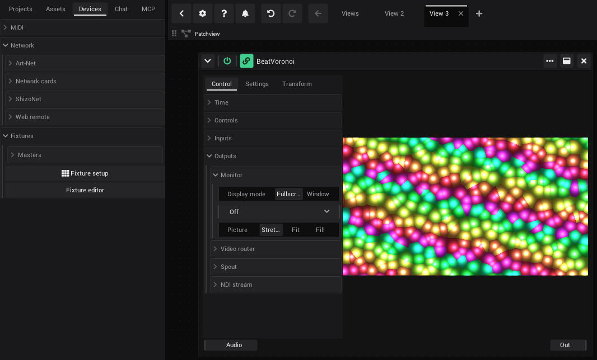

## Show the picture on a display or projector

Every shader generator can send its picture out. A simple way is the shader *output* in `Shaders` › `Utilities`.

1. Drag *output* from the sidebar tab *Assets* (`Shaders` › `Utilities`) into a view.
2. Link the *Out* port of your [Clipview](Clipview.md#the-parts) (or of any generator) into the input of *output*.
   See [Ports](Linking.md#ports).
3. On the tab *Control*, open *Outputs* › *Monitor*.
4. Choose the *Display mode* first: *Fullscreen* or *Window* (a window without a frame).
5. Choose the *Display*: *Display 1*, *Display 2* …, each with the name of the display, its resolution and its role
   (*Control* or *Output*, see [Settings › Display](Settings.md#display)). The output opens there.
   With *Size* *Custom* (tab *Settings*), *Width* and *Height* are set to the resolution of that display. With *Size*
   *Project* (the standard) the shader keeps the project size, which follows the output displays.
6. *Picture*: what happens when the picture and the display have another shape. *Stretch* (the standard) fills the
   display and distorts the picture, *Fit* shows all of it with black bars, *Fill* fills the display and cuts the
   edges off.
7. To stop, set *Display* to *Off*. Closing the output window does the same.

*Display mode* and *Picture* can be changed while the output shows.

The project keeps the name of the display. At another venue, where the displays are connected in another order, the
output goes to the display with that name. When it is not connected, the output stays off and the [Log](Troubleshooting.md#the-log)
says so: it never lands on the screen VibeVJ itself is on.

## The tabs of a shader

A shader generator has three tabs: *Control*, *Settings* and *Transform*.

The section *Controls* of the tab *Control* holds the shader's own controls. Their names come from the shader's code in
plain words: `bg_colour` shows as *Background colour*, `timeMultiplier` as *Time multiplier*. Its inputs are *In* (or
*In 1*, *In 2*, …, *Channel 0*, …), its picture goes out at *Out*.

Some shaders also measure something in their picture and give it out under *Values*, as
[pure outputs](Linking.md#pure-outputs) from 0 to 1: the [growing shapes](#growing-shapes) give out how much of their
area is grown (*Life*) and where they are in a turn. Link from them like from any output, for example *Life* into
the opacity of another layer or *Turn pulse* into a flash. They follow the picture with a frame or two of delay, and
stand still while nothing shows the shader.

### Outputs (tab Control)

| Section | Controls | What it does |
|---|---|---|
| *Monitor* | *Display mode*, *Display*, *Picture* | Picture on a display, see above. |
| *Video router* | *Enable router*, *Video router name* | Offers the picture to other shaders by name. In another shader, open *Inputs*, then the input, and pick the name from the list. *No Input* clears it. |
| *Spout* / *Syphon* | *Enable Spout*, *Spout name* (on macOS *Syphon*) | Sends the picture to other programs on the same computer: Spout on Windows, Syphon on macOS (Resolume, MadMapper, VDMX, OBS list it as *VibeVJ - <name>*). |
| *NDI stream* | *Enable NDI*, *NDI name* | Sends the picture over the network as NDI. |
| *Save screenshot* | (a button) | Saves the picture as a PNG in its render size (*Settings* › *Size*), not the size of the preview, into the folder `screenshots` of VibeVJ: `<shader>_<date>_<time>.png`. The PNG is opaque; a float picture is cut off at 1. The tooltip of the button then names the file. Link it to a MIDI key to take screenshots during a show. |

The names start as the shader name plus a short random code, so two outputs never clash. Type your own name to make it
easy to find in the receiving program.

### Render settings (tab Settings)

The tab has the groups *Render*, *Size*, *Format* and *Mask*.

| Setting | What it does |
|---|---|
| *Size* | *Project* (the standard) uses *Target width* and *Target height* from [*Settings* › *Project*](Settings.md#project). *Custom* uses *Width* and *Height* below. |
| *Render scale* | Multiplies the size. 0.5 renders at half size (faster), 1 at full size. |
| *Component format*, *Pixel format* | The format of the picture. NDI always sends 8-bit RGBA; a float picture is converted (values above 1 are cut off). |
| *Render mask* | Turns the mask input on or off. |

How the time of a shader runs (*Free*, *Manual*, *Sync*) is on [Settings](Settings.md#default-sync).

### Transform and projection mapping (tab Transform)

| Control | What it does |
|---|---|
| *X*, *Y* | Moves the picture. |
| *Rotate*, *Zoom* | Turns and scales it. |
| *Flip X*, *Flip Y* | Mirrors it. |
| *Clip UV* | Cuts the picture off where a move, a turn or the zoom pushes it out of its frame. |
| *Projection mapping* › *Edit Grid* | Shows a grid over the picture. Drag its points to fit the picture onto a surface. |
| *Subdivide*, *Reset* | A finer grid; back to the plain grid. |
| *Grid* › *X*, *Y* | How many fields the grid has across and down, 1 at the start. |
| *Fine* › *X*, *Y* | How finely each field is divided, 4 at the start. |

For several slices and outputs with masks and soft edges, use *MapLab*: see [Mapping](#mapping).

## Blackout

When something goes wrong on the screen or in the lights, press **Ctrl + B** (Cmd + B on a Mac) or the Blackout button
in the bar of the [timeline](Timeline.md#the-transport-bar), next to the show mode lock. Everything that leaves VibeVJ
goes black at once:

- the Display outputs of shaders and of MapLab (the picture on a projector or monitor),
- the NDI of every shader and of the whole window, and the Spout of every shader,
- the brightness and colour channels of your [fixtures](#fixtures) and every [LEDMapper](#ledmapper).

Pan, tilt, gobos and the other channels of a fixture stay where they are, so moving heads do not swing. The views in
VibeVJ keep showing everything, so you see what will come back. The button is marked while the blackout is on.

Press Ctrl + B or the button again: the outputs come back with a fade, one second at the start. Change it in
[*Settings* › *Output* › *Blackout*](Settings.md#output).

- It works in show mode.
- The button has a notch: map it to a MIDI pad ([MIDI](MIDI.md)) to have it under your hand.
- A blackout is not part of the project: opening a project keeps the outputs as they are.
- *ArtnetSender* sends exactly what you give it: the blackout does not change it.

## The whole window as NDI

[*Settings* › *Output*](Settings.md#output) › *NDI* sends the whole VibeVJ window as NDI (*Enable NDI*, *NDI name*,
"ProgramOut" at the start).

## Receiving video

*NDIReceiver* and *SpoutReceiver* (in `Generators` › `Network`) bring video from other programs in. *Camera* (in
`Generators` › `Input`) brings in a webcam, a capture card (HDMI / SDI) or another video device of this computer.

1. Open the list *Pick a sender…* at the top and pick a sender, or type its name into *Sender*.
2. Link *Out* of the generator onward.

- *Flip Y* (NDI) turns the picture upside down. Under the list NDI shows whether it is connected.
- *Size* shows the width and height of the picture that comes in.
- *Video router* offers the picture to shaders by name, as a shader does.
- *Camera*: pick the camera in the list at the top (*Test pattern* shows a moving picture without a camera).
  *Resolution* and *Frame rate* ask the camera for a size and a rate; one it does not have falls back to what it
  delivers by itself. The line under the list shows what comes in, e.g. `Logitech BRIO: 1920x1080 30 fps mjpeg`. A
  camera that is unplugged or used by another program is tried again every few seconds. On macOS the screens are in
  the list too (*Capture screen 0*), and the first time macOS asks whether VibeVJ may use the camera.
- NDI needs the NDI runtime on this computer. *SpoutReceiver* receives Spout on Windows and Syphon on macOS (the list
  shows the Syphon servers as *<app> - <name>*); on Linux it says that neither exists there:
  see [Troubleshooting](Troubleshooting.md#ndi-not-visible).

## Art-Net

The sidebar tab *Devices*, section *Network* › *Art-Net*:

- *Art-Net sync* (on at the start) sends an Art-Net sync after every frame, so all nodes update at the same moment.
- Every Art-Net node that VibeVJ finds on the network gets a section "name [MAC]" with its IP and MAC address.

Two generators in `Generators` › `Network` work with single channels.

| Generator | How to use it |
|---|---|
| *ArtnetSender* | Pick a node in the list at the top (*No node* until you do); its IP and MAC show below. Click *Add channel* or *Add 16-bit channel*: each row has *Universe*, *Channel* (1–512) and a slider *Value* that sends 0–255 (16-bit: 0–65535). × removes a row. *Start universe* and *Start channel* shift all rows. The node is remembered by its MAC address; until it answers, the line below says "not found on the network". |
| *ArtnetReceiver* | It listens to all Art-Net on the network, there is no node to pick. Click *Add channel* or *Add 16-bit channel*. The *Value* of a row follows that channel (a [pure output](Linking.md#pure-outputs)). Click the crosshair of a row (learn, amber while it waits), then move the fader on your console: *Universe* and *Channel* are filled in. *Start universe* and *Start channel* shift all rows. |

With the power button off, the sender stops sending and the receiver stops following. Learn still works.

For whole lamps instead of single channels, use fixtures.

### Art-Net mapping

Any control with a notch can follow a DMX channel of a lighting console, the way it follows a fader of a MIDI
controller: no *ArtnetReceiver* needed. This is how VibeVJ is played from a console (grandMA, ChamSys, ...) that sends
Art-Net.

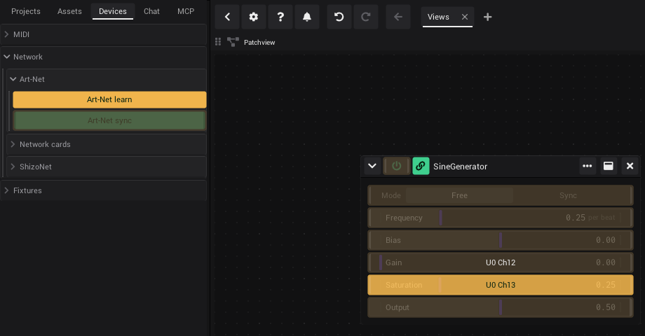

1. Open the tab *Devices*, section *Network* › *Art-Net*, and click *Art-Net learn*. Every control gets an amber overlay.
2. Click the overlay of the control you want to play, for example the *Mix* of a layer or the power button of a
   generator.
3. Move a fader on the console. The overlay shows what was learned, for example "U0 Ch12" (universe 0, channel 12),
   and the control jumps to the value of the fader.
4. Click the overlay of the next control and move the next fader. Repeat for every control you want.
5. Click *Art-Net learn* again to leave learn mode. The overlays go away and the mappings stay.

- The first channel that changes is learned: start learn while the console stands still. A running chase or effect on
  the same universe can be learned instead of your fader.
- The channel goes over the range of the control: 0 is the minimum, 255 the maximum. A button is on above the middle.
- Only a change of the channel moves the control. While the fader stands, the mouse, [links](Linking.md) and MIDI still
  move it.
- The mapping listens to the Art-Net of every sender on the network, by universe and channel. It is saved with the
  project (and with presets), like a MIDI mapping.
- *Art-Net learn* and *MIDI learn* share the overlay: turning one on turns the other off.
- To remove a mapping: the × in the tab *MIDI* of the options of the control (below), or *Art-Net learn* on, click the
  overlay of the control and press Esc.

In the options of the control, tab *MIDI*, the mapping has a row "Art-Net U0 · Ch 12" (universe 0, channel 12; 16-bit: "Ch 12+13") with its ×, and
*16-bit (fine on the next channel)*: on, the channel and the next one are one value (coarse and fine, 0 to 65535), for
a 16-bit fader. Learn takes the coarse channel (the first one that moves); switch 16-bit on afterwards. A control
that learns another fader keeps its 16-bit setting.

### Network cards

*Devices* › *Network* › *Network cards* chooses the network cards Art-Net and ShizoNet use: VibeVJ looks for nodes over
them (ArtPoll, ShizoNet), sends the Art-Net sync over them, and only accepts nodes from their networks.

- *All* (at the start): every card, as before.
- *Network cards*: the wired and Wi-Fi cards, without docker, VPN, WSL or Hyper-V switches.
- *Picked*: only the cards switched on in the list below. It starts with the cards *Network cards* would use.

The list shows every card with its address, "virtual" and "down" where that applies. *Refresh* reads the cards again,
e.g. after plugging in a USB network adapter. The choice belongs to this computer: it is the same for every project.

## Fixtures

Fixtures are lamps: a par, a moving head, a pixel bar, or a [virtual lamp](#virtual-fixtures) that tints a slice of
MapLab. Each kind of lamp is described once by a file in `Fixtures` of
the *Assets* tab (`Bars`, `MovingHeads`, `Pars` and some examples). The lamps of your rig are set up once per project
in the fixture setup, and saved with the project.

A lamp is addressed the way it is set on the lamp: a node, a universe and a DMX start address. There are no internal
universes or patch layers in between.

### Set up your lamps

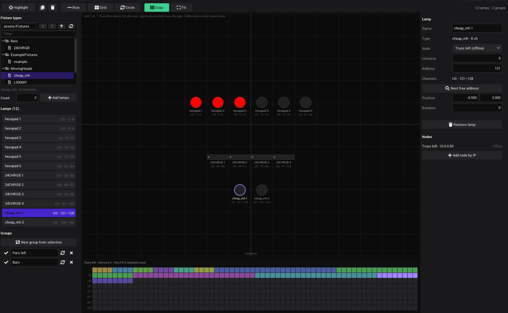

1. In the tab *Devices*, open *Fixtures* and click *Fixture setup*. The fixture setup opens in a new tab.
2. Your Art-Net nodes are listed on the right under *Nodes* as soon as they answer. A node that does not answer
   ArtPoll (or is not on the network yet): *Add node by IP*, with its IP address and a name.
3. In *Fixture types* on the left, click a type, set *Count* and click *Add lamps*. Or drag the type onto the plan.
   New lamps get the next free channels of the node you picked last, one after the other. A lamp with a GDTF file
   (GDTF Share, the manufacturer): [import it](#import-a-gdtf-file) first.
4. Click a lamp on the plan or in the list *Lamps*. On the right: *Name*, *Node*, *Universe* and *Address*.
   *Next free address* moves it to the first channels nobody else uses.
5. Move the lamps on the plan to where they hang: drag them, *Row*, *Grid* or *Circle* for the selected lamps. The plan
   is the stage seen from above, the audience at the bottom, one square a metre. The form shows what a lamp is: a moving
   head is round on a square yoke (the notch is its front), a bar is long (the dot is its first pixel), a par round, a
   dimmer square.

| On the plan | What it does |
|---|---|
| Click | Selects a lamp |
| Shift+click, or a box dragged on the empty plan | Selects more lamps. The numbers show the order you picked them in |
| Drag a lamp | Moves the selected lamps (in quarter metres while *Snap* is on) |
| Scroll, right or middle mouse button | Zoom, move the plan. *Fit* shows all lamps |
| Delete, Ctrl+D, Ctrl+A, Esc | Remove, duplicate, select all, select none |
| Arrow keys | Move the selected lamps a quarter metre (with Shift: 5 cm) |
| R, Shift+R | Turn the selected lamps 15° one way or the other |
| Page Up, Page Down | Raise or lower the selected lamps half a metre (with Shift: 10 cm), see [the stage in 3D](#the-stage-in-3d) |
| *3D* | The stage in perspective instead of the plan, see [the stage in 3D](#the-stage-in-3d) |
| *Programmer* | The [programmer of the lighting desk](Lighting-Desk.md#the-programmer) under the stage instead of the universe map: select lamps and set their values while the stage shows them |

With several lamps selected, *Node*, *Universe* and *Start address* go to all of them: *Address in order* gives them
addresses one after the other in the order you picked them.

**Problems are red.** Two lamps on the same channels, a lamp past channel 512 or without a node are red in the list
and on the plan, and the top right says how many lamps need attention. A lamp is also red when a segment of a
[LEDMapper](#ledmapper) writes its channels without being meant for it (a segment or group whose *Lamp* is that lamp
is fine). The *universe map* at the bottom shows the 512 channels of the universe of the selected lamp: each lamp has
its own colour, the selected ones are highlighted, channels a LEDMapper sends to are grey, red channels are used twice.
Point at a channel to see who uses it, lamps and LEDMapper segments; click it to select that lamp. **Drag a lamp in the
map** to other channels: its address changes, the other selected lamps of that universe move with it, and the place it
would go is green when it is free (red when something else is there). The arrows at the top right show the universe
before and after.

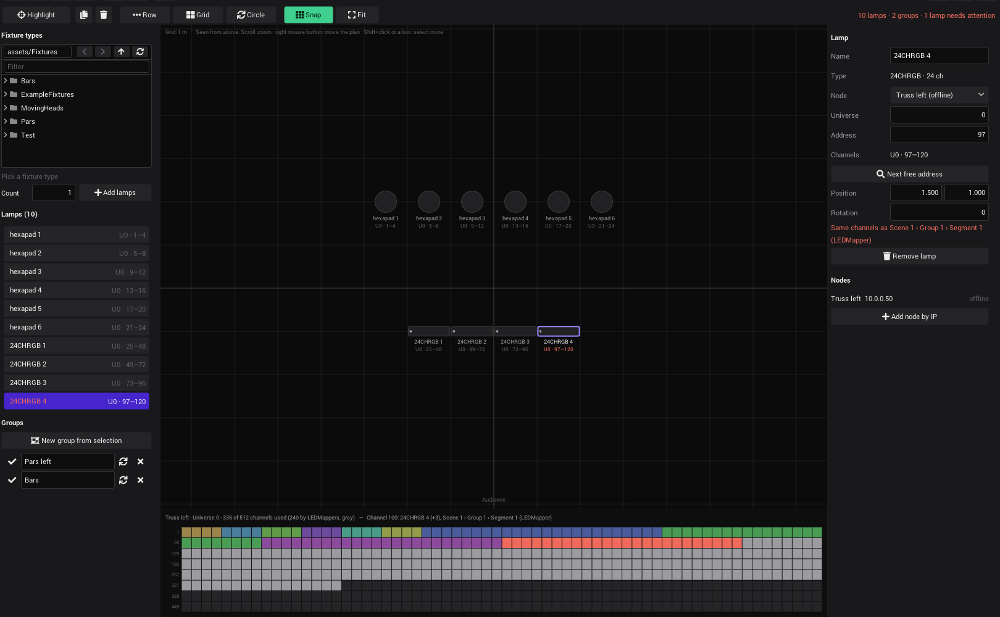

**Find a lamp in the rig.** Switch on *Highlight*: the selected lamps go to full (white, intensity full). Select other
lamps and they light up instead. Off: back to their values.

**With the AI.** The *Chat* and an AI tool connected over the *MCP* tab can work on the fixture setup too: list, add,
address, move, group and remove lamps, add nodes by IP, show a universe and find channels that are used twice ("put
eight hexapads on the truss node from address 1 and make a group of them"). See [The screen](The-Screen.md#chat-tab).

**With the AI and a camera.** Put a *Camera* (see [Receiving video](#receiving-video)) into a view and point it at the stage: the AI
can then look at the rig while it works. It lights one lamp after the other to find each in the picture, moves a
moving head and looks where its beam lands, tries colours, and corrects the fixture setup by what it sees ("find out
which of the four pars is which and order the group from left to right", "aim the spots at the drum riser"). While it
tests, the lamps it holds send its values instead of their own (also over a running Phaser); *Blackout* still darkens
them. When it is done it lets them go, and they send their own values again. The AI needs a model that can see
pictures (in the *Chat*: a vision model; over *MCP*: a client that takes images).

**Groups.** *New group from selection* makes a group of the selected lamps, in the order you picked them: that order
is the order of a [Phaser](#effects-over-fixtures). ✓ selects the lamps of a group, ⟳ replaces them by the selection.

### The stage in 3D

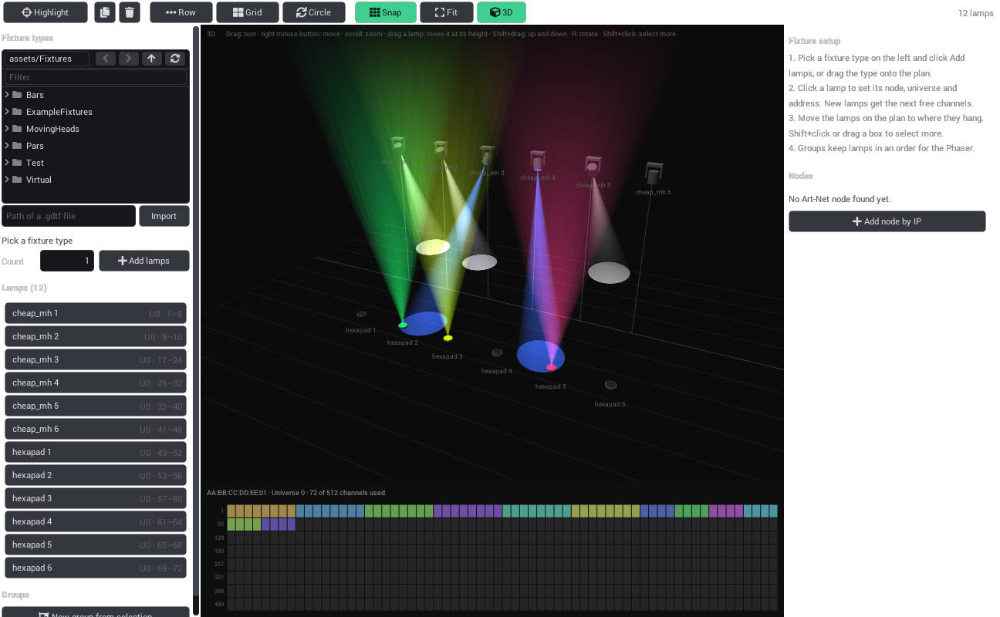

*3D* in the toolbar of the fixture setup shows the stage in perspective: each lamp at its height, its beam in the colour
it is sent and turned by its pan and tilt, so you see what the [Phaser](#effects-over-fixtures) does to moving heads.

- *Height* (metres above the floor) and *Mount* are in the settings of a lamp, also for several lamps at once. *Standing
  (floor)*: the beam goes up at the middle of tilt; *Hanging (truss)*: the lamp hangs upside down and the beam goes down.
- *Lean* (degrees) leans a lamp towards its front: a bar on the floor angled at the audience, a moving head on the side
  of a truss. *Rotation* turns which way its front is.
- Each kind of lamp has its form, its front in the colour it is sent: a moving head hangs (or stands) on its foot, its
  yoke turns with pan and its head with tilt (you see where it points also when it is dark), a bar is a long box whose
  light is a sheet as wide as the bar, a par is a can, a dimmer a box. The fixture file says what it is (*Kind* in the
  [fixture editor](#make-a-fixture-file)), else it is guessed from the channels.
- A lamp [imported from a GDTF file](#import-a-gdtf-file) is drawn with its own 3D model: its base, its yoke turning
  with pan, its head with tilt, the beam coming out of its lens (in the colour it is sent). The
  [Phaser](#effects-over-fixtures) draws them in its 3D plan and its clip cell once they are big enough there.
- The beams stop at the floor and light it where they land, weaker the farther they reach. Its colour wheel and gobo
  wheel show too: the beam has the colour of the slot the wheel is on (with only a dimmer and a colour wheel), and the
  light on the floor the shape of the gobo it is on (open: round).
- The selected lamps glow at their edges in the accent colour, a lamp with a problem in red.
- How far a moving head turns and how wide its beam is comes from the fixture file (*Pan °*, *Tilt °*, *Beam °* in the
  [fixture editor](#make-a-fixture-file)).
- Drag the empty stage to turn it, drag with the right or the middle mouse button to move it, scroll to zoom. *Fit*
  shows all lamps.
- Click a lamp to select it (Shift+click for more), drag it to move it at its height. Shift+drag it to move it up and
  down, with the selected lamps (the top left shows its height). R, Page Up / Page Down and the arrow keys work as on
  the plan. *3D* again goes back to the plan.

### Play them

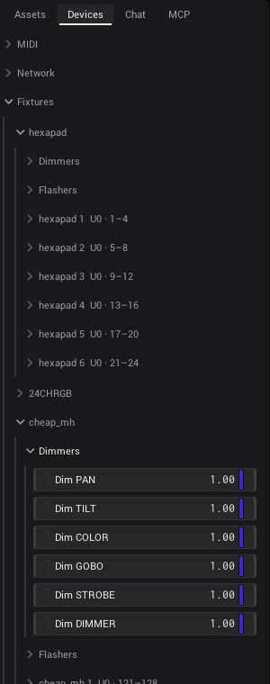

The lamps appear in the tab *Devices*, section *Fixtures*, one section per fixture type:

| Part | What it does |
|---|---|
| *Masters* (at the top) | A *Group master* per group of the fixture setup (the brightness of its lamps) and four *Speed masters* for the Phaser. See [Masters](Lighting-Desk.md#masters). |
| *Dimmers* | One *Dim* slider per channel. Scales that channel on every lamp of this type. |
| *Flashers* | A slider and a *Flash* button per channel. While *Flash* is held, every lamp takes the slider value on that channel. |
| One section per lamp | Its name and address, then a slider per channel. A colour channel has a colour picker; an RGBW colour has sliders for red, green, blue and white. |

Every slider has notches: [link](Linking.md) it to an LFO or the [audio analysis](Audio.md), or map it to
[MIDI](MIDI.md). Links and MIDI mappings stay when you re-address or move a lamp.

To program the lamps as on a lighting console (select, palettes, cues, faders), use the
[lighting desk](Lighting-Desk.md).

### Make a fixture file

*Fixture editor*, next to *Fixture setup* in the tab *Devices*, opens the fixture editor.

1. Click *Create new fixture*. Double-click its name to rename it (lamps of that type follow the new name).
2. Click the fixture, then *Add Channel* for each channel, in the order of the DMX chart of the lamp.
3. Give each channel its type: *8-bit*, *16-bit*, *RGB* or *RGBW*, and a count for channels that repeat (the 8
   pixels of a bar: one *RGB* channel with a count of 8).
4. *Function* (on the right of a channel) says what the channel does: *Dimmer*, *Pan*, *Tilt*, *Colour mix*, *Colour
   wheel*, *Strobe / shutter*, ... *Auto* guesses it from the name and shows the guess (*Auto: Pan*); pick another one
   when the guess is wrong. The [Phaser](#effects-over-fixtures) offers effects that fit (a circle for pan and tilt, a
   rainbow for a colour) and the [3D view](#the-stage-in-3d) turns the beam by pan and tilt.
5. *Pan °* and *Tilt °* above the channels: how far the head turns from 0 to full, from its data sheet (most moving
   heads: 540 and 270). *Beam °*: how wide the beam is in the 3D view (0: 15 for moving heads, 30 for other lamps).
6. *Kind*: what the lamp is, for its form on the plan and in the 3D view: *Moving head*, *Bar*, *Par* or *Dimmer*.
   *Automatic* guesses it: pan or tilt make a moving head, two or more colours a bar, one colour a par.
7. The number left of *Function*: the DMX value the channel starts at when a lamp is added (0-255, 16-bit 0-65535): a
   shutter that is closed at 0 gets its "open" value, pan and tilt their middle (32768). Projects that are loaded keep
   their own values.

Lamps of the type in the fixture setup take the change at once.

### Import a GDTF file

GDTF (General Device Type Format) is the fixture format of grandMA3, Vectorworks, Capture and the
[GDTF Share](https://gdtf-share.com): one `.gdtf` file per lamp with all its DMX modes. VibeVJ makes a fixture file of
each mode.

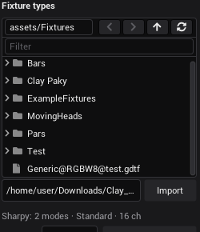

- Paste the path of the `.gdtf` file into the field under *Fixture types* in the fixture setup and click *Import*.
  (Windows: Shift + right-click the file, *Copy as path*; the quotes are taken off.)
- Or put the `.gdtf` file into `assets/Fixtures` (any folder in it). It shows up under *Fixture types*: click it to
  import it, or drag it onto the plan to import it and add a lamp of its first mode where you drop it.

The fixture types go to `assets/Fixtures/<manufacturer>/<fixture>/`, one per DMX mode, named `<fixture> - <mode>`
(*Sharpy - Standard*). The first mode is picked for *Add lamps*; the others are in that folder. The `.gdtf` file is
kept next to them (its 3D models are in it). Importing the same file again writes its fixture files again.

| In the GDTF file | In the fixture file |
|---|---|
| The channels of a mode, in DMX order | 8-bit and 16-bit channels (a 24-bit one: 16-bit plus an 8-bit *ultra*); addresses the mode does not use: *Unused* |
| Red, green, blue (and white) of one cell next to each other | One *RGB* / *RGBW* channel; the same cell repeated (the pixels of a bar) one channel with a count |
| The attribute of a channel (Pan, Dimmer, ColorAdd_R, Shutter1, Gobo1, Zoom, ...) | Its name and its *Function* |
| Pan and tilt range, beam angle, the model of the lamp | *Pan °*, *Tilt °*, *Beam °*, and its size on the plan and in [3D](#the-stage-in-3d) |
| What it is | *Kind*: pan or tilt make a moving head, colours in two or more cells a bar, one a par, else a dimmer |
| The value each channel starts at (its default) | The start value of the channel: a new lamp has its shutter open and pan and tilt in the middle |
| The 3D models (glTF, 3DS) | A simple copy of them (`<fixture>.mesh`), for the [3D view](#the-stage-in-3d) |
| The wheels: colour slots, gobo images | `<fixture>.wheels`: the colour of each slot and a small black and white copy of each gobo, which slot each value of a channel turns to; the [3D view](#the-stage-in-3d) shows them |

A mode with a second DMX start address (a DMX break) gives a fixture file for each part, *(break 2)*. The fixture
files can be changed in the [fixture editor](#make-a-fixture-file) like any other; what it does not show (the size,
where the file came from) stays.

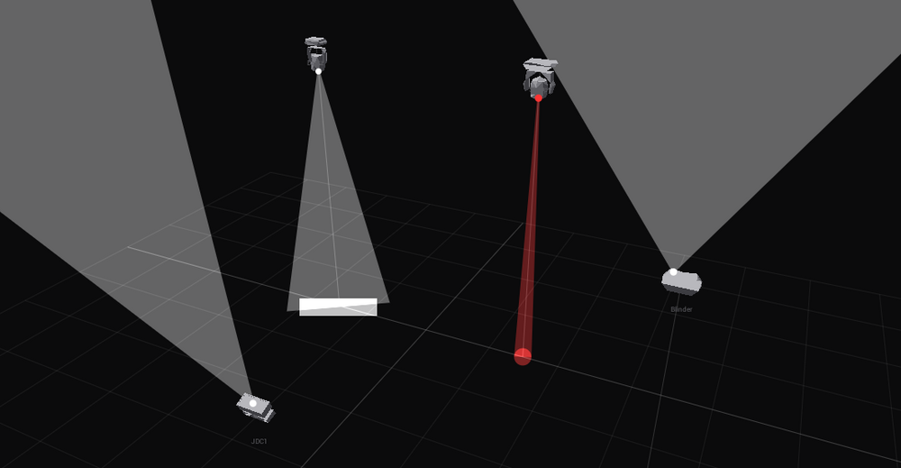

Agents import with `import_gdtf` (MCP, `vibevj_fixture_setup` in the Chat) and add lamps with the paths it returns.

### Effects over fixtures

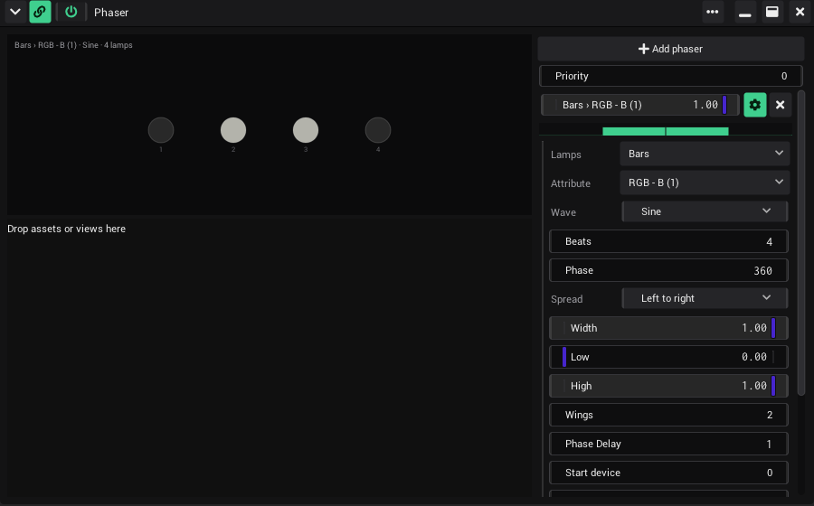

The *Phaser* in `FixturesEffects` runs an effect over the lamps of a group: each lamp a bit later than the one before. It
uses the words of a lighting desk: wave, speed, phase, width, wings.

**Quick effects.** Drag *Phaser* into a view, pick the lamps under *Quick effects* (a group of the fixture setup, or all
lamps of a type) and click an effect: a phaser that is set up already. Open its ⚙ to change it.

| Quick effect | What it does |
|---|---|
| *Chase*, *Wave*, *Sparkle* | The brightness: one lamp after the other, a soft wave, a random brightness each quarter beat. On lamps without a dimmer channel their colour goes from black to white. On lamps that already run an effect on the same channels it goes over it (*Multiply*: a chase over a rainbow). |
| *Rainbow*, *Fade* | The colour: the rainbow runs over the lamps; or they fade between colour A and B. |
| *Circle*, *Fan*, *Figure 8* | Moving heads (pan and tilt): circles one after the other, sweeping out and in mirrored left and right, a figure 8. |

**A phaser of your own.** *Add phaser*, then in its settings (⚙):

1. *Lamps*: a group of the fixture setup, or all lamps of a type.
2. *Attribute*: what it moves. *Position (Pan + Tilt)* for moving heads, *Colour* for a colour (on a bar: all its
   pixels, or one of them), or one channel such as *DIMMER* (each with what it does, from the
   [fixture file](#make-a-fixture-file)).
3. Under its Level slider: the *Wave* (or the *Shape* of a position, the *Colours* of a colour) and how long a cycle is
   in beats (it follows the BPM of the [timeline](Timeline.md)). These two are always in sight.
4. *Phase* spreads the effect over the lamps: 0° all together, 360° one cycle from the first lamp to the last.

| Setting | What it does |
|---|---|
| Level slider (the row) | 0 holds the lamps at *Low* (a position at its centre, a colour dark), 1 runs the full effect. Link or map it like any slider. |
| *Wave* | *Sine*, *Triangle*, *Ramp up*, *Ramp down*, *Square*, *Pulse*, *Random*, or *Input* (below). |
| *Shape* (position) | *Circle*, *Figure 8*, *Pan sweep*, *Tilt sweep*, *Square*, *Random*, drawn around *Pan centre* / *Tilt centre*, as big as *Size* (1: the whole pan and tilt range). |
| *Colours* (colour) | *Fade*: the wave mixes *Colour A* (bottom) and *Colour B* (top). *Rainbow*: the hues run over the lamps, the Level is the brightness. RGBW lamps get the white part of a colour on W. |
| *Blend* | How it combines with other phasers on the same channels, see below. |
| *Cycle* | Length of a cycle in beats. |
| *Phase* | Degrees of the effect spread over the lamps. 720 makes two waves. |
| *Spread* | Which lamp comes first: *In order* (the order of the group), *From the middle*, *Left to right*, *Right to left*, *Back to front*, *Front to back*, *Outside in*. The directions use where the lamps hang on the plan. |
| *Width* | The part of a cycle the wave runs; the rest of it the lamp stays at *Low*. A *Pulse* with a small width is a chase. |
| *Low*, *High* | The values at the bottom and the top of the wave (one channel). |
| *Wings* | Mirrors the phase: with 2 wings the second half of the lamps runs the other way. |
| *First lamp*, *Last lamp* | Only the lamps from … to … of the group (counted from 0, *Last lamp* -1: to the last). |
| *Auto mirror X* / *Y* | Lamps left of (behind) the middle of the stage get the mirrored value: pan and tilt move symmetrically. |
| *Speed master* | *None*, or *Speed 1* to *Speed 4* of Devices › Fixtures › *Masters*: the cycle runs that many times as fast. See [Masters](Lighting-Desk.md#masters). |
| *Priority* (top) | Orders this Phaser among other Phaser generators on the same channels (see *Blend*). |

**A cue of the desk.** The *Cue* of a phaser's settings (⚙) plays a cue of a [cue stack](Lighting-Desk.md#cue-stacks)
instead of a wave of its own: its values and its [effect timeline](Lighting-Desk.md#effect-timelines), whether the
stack plays or not. See [The Phaser plays a cue](Lighting-Desk.md#the-phaser-plays-a-cue).

**Several phasers on the same channels.** Each phaser has a *Blend*. The phasers are taken from the lowest *Priority*
to the highest (the phasers of one Phaser in their order), each one on top of what the ones before sent:

| Blend | What it does |
|---|---|
| *Priority* | Replaces what is below it: the higher priority wins (as before). |
| *Highest* | The higher value wins (HTP). |
| *Add* | Adds its value. |
| *Multiply* | Scales what is below: a dimmer wave over a colour chase, a chase over a rainbow. |
| *Lowest* | The lower value wins. |

The bars under each row show what the phaser itself sends to each lamp; the plan on the left shows the lamps of the
phaser whose settings are open as they really look (every phaser on them blended), moving heads with a line to where
they point.

**3D.** *3D* (top right of the plan) shows the stage of the fixture setup instead, as
[the stage in 3D](#the-stage-in-3d) does: the lamps at their height, their beams in the colour they are sent and turned
by pan and tilt, lamps of a GDTF import with their 3D model. Drag to turn it, scroll to zoom, right click to go back. *Only its lamps* (on at first) shows only the lamps the
phasers of this Phaser drive (the ones of the phaser whose settings are open with a ring); off, every lamp of the fixture
setup is there and the others are dimmed.

**In a clip.** A Phaser in a [clip](Clipview.md#make-a-clip) draws its plan in the cell of the clip, in 2D or 3D as
set here: every lamp it drives, as the lamps look now. So the grid shows what each Phaser clip drives.

**Input and the patch view.** With the wave *Input* the Level slider is the value that runs over the lamps, each lamp
*Phase delay* beats later than the first. *Patch* (top right) shows the patch view on the left: put an LFO or the audio
analysis there and link it into the slider. The patch view opens by itself when you pick *Input*; the rest of the time
the plan of the lamps takes the whole left side. Phasers of older projects keep their patch view and keep doing what
they did.

### FixtureState

*FixtureState* in `FixturesEffects` turns the lamps into a texture, so the video follows the light: a shader takes the
colours the lamps are sent, where they hang and where moving heads point.

1. Drag *FixtureState* into a view. Under *Out* pick the lamps: *All lamps* of the fixture setup (in its order), a
   group (in its order) or every lamp of a type. The line below says how many lamps the texture has, the squares on
   the right show what each one shows.
2. Link *Out* into an input of a shader, or switch on its *VideoRouter* and pick it in the input of the shader.
   *FixtureGlow* in `Shaders` › `Sources` › `Fixtures` is an example: each lamp a glow in its colour, left to right as
   the lamps hang on the plan, higher the higher they hang.

The texture has one column per lamp and three rows (float RGBA):

| Row | What it holds |
|---|---|
| 0 | What the lamp shows: its colour times its dimmer in R, G, B; the dimmer in A |
| 1 | Where it hangs on the plan, in metres: x (to the right), y (towards the audience), z (height); A = 1 |
| 2 | Pan and tilt 0 to 1 as sent (0.5 for a lamp that does not move); B = 1 for a moving head |

The values are those that [Devices › Fixtures](#play-them) sends: the Phaser, links, MIDI and the blackout move them.
In a shader: `uniform sampler2D fixtures;`, then `texelFetch(fixtures, ivec2(lamp, row), 0)`, and
`textureSize(fixtures, 0).x` is the number of lamps.

## Mapping

The generators in `Mapping` bring pictures onto surfaces and LEDs. They are tools of their own; this is what each is
for.

| Generator | What it is for |
|---|---|
| *MapLab* | Projection mapping with several inputs, slices and outputs: cut slices out of the inputs, place and warp them with a grid, mask them, blend their edges. Each output has an *Out* port and goes to a display, Spout, NDI or a video router: see [the outputs of MapLab](#the-outputs-of-maplab). |
| *LEDMapper* | LED strips, bars and matrices drawn over a picture; their colours go to Art-Net nodes or to lamps of the fixture setup. See [LEDMapper](#ledmapper). |
| *MaskTransform* | One mask or warp surface between an *In* and an *Out*. |
| *MaskDraw* | A mask drawn with the mouse over a photo of the building: rectangles, ellipses, polygons with curves, freehand and a magnetic lasso that follows the edges of the photo; shapes can be animated, follow a moving video and come from an SVG. Its *Mask* goes into the mask port of a mapping shader. See [drawing a mask](#drawing-a-mask-maskdraw). |

Their inputs list every picture that is offered by a *Video router*: a shader, a [video](Video.md#controls) or a
receiver with its router on. Shaders made for mapping real objects with a mask (light along the outlines, smoke
between the objects, each window of a facade on its own, test patterns, edge blending) are described in
[Projection mapping building blocks](#projection-mapping-building-blocks).

### The outputs of MapLab

Under its name each output shows a small live picture of what goes out of it (after its effects); a click on it opens
the output like its arrow does. Open an output with its arrow (right column of MapLab). Besides *Width*, *Height* and
*Edge Smooth* it sends its picture on, without a shader generator in between:

| Section | What it does |
|---|---|
| *VideoRouter* › *Enable Router* | Offers the output under its name in every input list (shaders, LEDMapper, MapLab). |
| *Display* | *Display*: the screen it is shown on (*Off*: none), each with its name, resolution and role. *Display mode*: *Fullscreen* covers that screen, *Window* is a window of its own on it. *Picture*: *Stretch*, *Fit* or *Fill*, as for a shader (see [above](#show-the-picture-on-a-display-or-projector)). |
| *Spout* / *Syphon* | *Enable Spout* sends it to other programs, named after *Spout name*: Spout on Windows, Syphon on macOS. |
| *NDI stream* | *Enable NDI* sends it as an NDI source, named after *NDI name*. |

The names start as the name of the output.

*Size of the display* (under *Width* and *Height*) sets the size of the output to the resolution of the display it is
shown on, or, when it is on none, of the first output display of [*Settings* › *Display*](Settings.md#display).

The project keeps the name of the display an output is shown on, as for a shader: at another venue, where the displays
are connected in another order, the output goes to the display with that name, and stays off when it is not connected
(the [Log](Troubleshooting.md#the-log) says so). It never lands on another display, also not on the screen VibeVJ is on.
A project saved before this has no name yet: its output goes by the place of the display until it is chosen again.

**Effects of an output.** *Effects* opens the effects of the output in the upper half of MapLab (where an input mask
shows). Drag shaders from the *Assets* tab onto the list on the left of it: the first one gets the mapped output, each
next one the one before, and the last one is what the output sends (*Out*, the display, Spout, NDI and the video
router). Click an entry to see its controls; × removes it. The effects are saved with the project.

**LED mapping of an output.** *LED mapping* opens the *LEDMapper* of the output over the whole projection area of
MapLab. The first click makes it: one LEDMapper per output, outside its effects. It maps the LEDs from what the output
sends, so after its effects, and the output goes out unchanged. A second click closes it again; it keeps sending while
it is closed. *Remove LED mapping* removes it with its segments. The LED mapping is saved with the project. How the
LEDMapper works: see [LEDMapper](#ledmapper). (A project from before October 2026 keeps a LEDMapper it had in the
effects of an output there.)

### Virtual fixtures

A slice of MapLab can be a lamp: its brightness and colour follow a lamp of the [fixture setup](#set-up-your-lamps),
so the effects for lamps (the [Phaser](#effects-over-fixtures), a chase, a rainbow) play on the projection, and the
console moves the slices with its [Art-Net mapping](#art-net-mapping) as it moves the lamps.

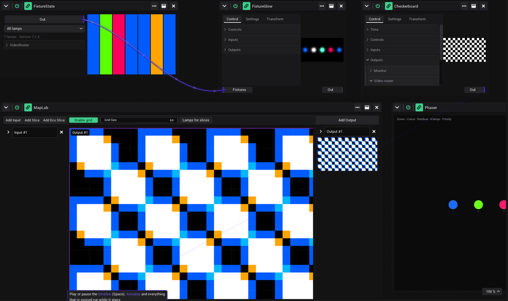

1. Make the slices in MapLab and place them.
2. Click *Lamps for slices* at the top: every slice without a lamp gets a virtual lamp of the type
   `Fixtures` › `Virtual` › *ProjectionZone*, named after the slice, and a group *MapLab slices* with them from left
   to right. On the stage plan they stand upstage (3 m high), across the width of the rig, where the slices are in the
   outputs: a Phaser *Left to right* runs through lamps and slices as one.
3. Run a Phaser over the group *MapLab slices* (a quick effect such as *Rainbow* or *Chase*), or move the lamps in
   Devices › Fixtures.

- The colour of the lamp times its dimmer tints the slice in every output: full and white leaves it as it is, black
  hides it. New virtual lamps start at full and white, so the slices look as before until an effect moves them.
- The list under *Blendmode* in the settings of a slice picks its lamp: *No lamp*, or any lamp of the fixture setup.
  A slice can follow a real lamp too (a par next to the screen): it takes the colour the par is sent.
- A virtual lamp needs no node and is not red for it in the fixture setup. Give it a node and it is sent as well.
- Clicking *Lamps for slices* again adds lamps only for new slices, puts the group in order again and places the lamps
  where the slices are now.
- Besides *Dimmer* and *Colour* a ProjectionZone has *Pan*, *Tilt*, *Zoom*, *Rotate* and *Strobe*: they move, zoom,
  turn and flash the picture in the slice on top of its *Transform*. In the middle (*Strobe* 0) the slice is as before.
  The Phaser runs *Position* (a circle, a figure 8) on slices as on moving heads. See
  [Mapping as lamps](Lighting-Desk.md#mapping-as-lamps).
- Palettes, cues and executors of the [lighting desk](Lighting-Desk.md) move the slices like any lamp.
- The lamps and the group are part of the fixture setup; MapLab keeps which lamp each slice follows.

### LEDMapper

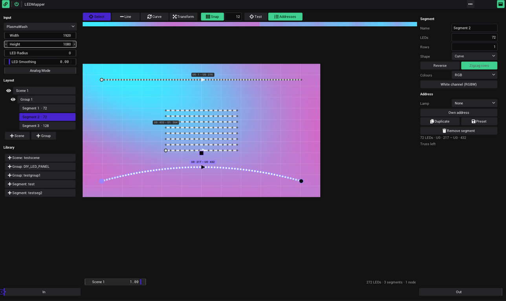

The LEDMapper takes the colours for your LEDs from a picture. Each **segment** is one strip with its own number of
LEDs, drawn where it is in the picture: a line, a curve, or a matrix with several rows. A **group** is what one node
gets (its segments one after the other), a **scene** is a set of groups with a master.

1. Pick the picture in *Input* (every shader, video or receiver whose *Video router* is on).
2. Drag on the picture: a new LEDMapper starts with *Line*. *Curve* draws a curve. A scene and a group are made for the
   first segment; the group goes to the first node found. Or click a preset in the *Library* on the left.
3. Click the segment: on the right set *LEDs*, *Rows* (a matrix), *Colours* (the order of the colour channels; many
   strips are *GRB*) and *White channel* for RGBW LEDs.
4. Click its group in the *Layout* on the left: *Node*, *Universe* and *Address* of the first LED. The segments of a
   group follow one after the other.
5. Switch on *Test*: the selected segment, group or scene is white on the real LEDs and everything else black, to find
   a strip in the rig.

| On the picture | What it does |
|---|---|
| *Select* (V) | Click a segment to pick it. Drag it, its ends, or the square handle of a curve. Delete removes it, Ctrl+D duplicates it, R reverses it. The arrow keys move it (or the selected group) a cell of the grid with *Snap*, else a pixel (Shift: ten). |
| *Line* (L), *Curve* (C) | Drag to draw a segment into the selected group. Its LEDs and colours are those of the segment before. Esc or the right mouse button: back to *Select*. |
| *Transform* (T) | Moves and scales the whole selected group (drag the corners or the middle); *Angle* in its settings turns it. |
| *Snap*, grid | Ends snap to a grid of this many cells across the picture. |
| *Addresses* | Shows the first and the last DMX address of each segment. |
| *Channels* | Shows the channels of the universe of the selection under the picture (below). |

**Where the data starts.** The big dot is the first LED, the arrow the direction of the data. *Reverse* (R) turns it
around; *Zigzag rows* makes every second row of a matrix run back, as most LED panels are wired.

**Channels.** Under the picture are the 512 channels of the universe of the selected segment or group: its segments in
the colours they have on the picture, the lamps of the [fixture setup](#set-up-your-lamps) on that universe grey,
other LEDMappers darker, red where two meet. **Drag a segment there to other channels**: the first segment of a group
moves the whole group (its *Universe* and *Address*), another segment gets its *Own address*. The place it would go is
green when it is free. Lamps of the fixture setup can be dragged the same way: their address in the fixture setup
changes. A segment whose address comes from a lamp cannot be dragged: drag the lamp. The arrows at the top right show
the universe before and after.

**Addresses.** The first and last address of the selection are under its settings. A segment can have its *Own
address* (the next ones follow it). *Spacing* in the group: 0 = each segment right after the one before, otherwise
the channels from the start of one segment to the start of the next (512: a universe each). *Whole pixels per
universe* fills a universe with whole LEDs only (170 RGB, 128 RGBW), as many nodes expect. A segment is red when
another one writes the same channels of its node: in this LEDMapper, in another LEDMapper, or a lamp of the
[fixture setup](#set-up-your-lamps) it is not meant for. The status under the picture counts them, and the settings
of the segment say what it overlaps with.

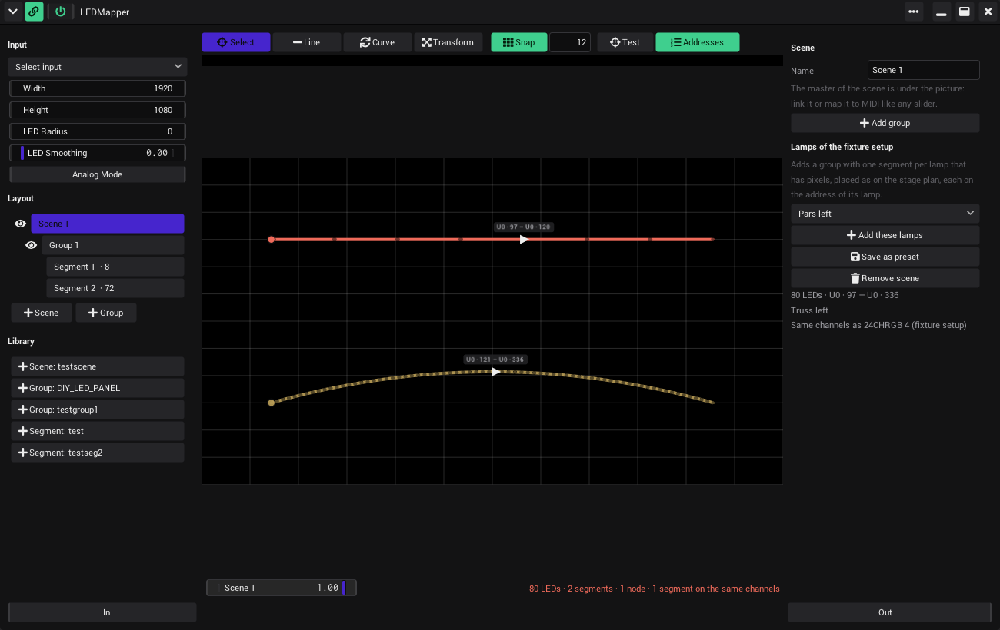

**Lamps of the fixture setup.** A group's *Output* can be a *Lamp of the setup* instead of a node, and a segment can
have a *Lamp*: the address then comes from the lamp and follows it when you re-address the lamp. *Add these lamps*
in the settings of a scene makes a group of all lamps of a group or type that have colour channels, one segment per
lamp, placed as they hang on the stage plan.

**Masters and switching off.** Under the picture is a *Master* slider per scene (link it or map it to MIDI). The eye
in the *Layout* switches a scene or group off: it is not sent at all. *Brightness* in a group scales its LEDs.

**Presets.** *Preset* in the settings of a scene, group or segment saves it; the *Library* on the left lists the
presets by kind: click one to insert it (a scene as a new scene, a group into the selected scene, a segment into the
selected group; one is made when there is none), × deletes it. Presets can also be dragged in from the *Assets* tab
(`Mapping` › `LEDMapper` › `scenes`, `groups`, `segments`) onto the picture.

| Left column | What it does |
|---|---|
| *LED Radius* | 0: each LED takes the pixel under it. More: the average of a circle of this many pixels. |
| *LED Smoothing* | Changes fade over a few frames. |
| *Analog Mode* | Smoothing like a light bulb: up quickly, down slowly. |
| *Width*, *Height* | Size of the picture the segments are drawn on. |

### Drawing a mask (MaskDraw)

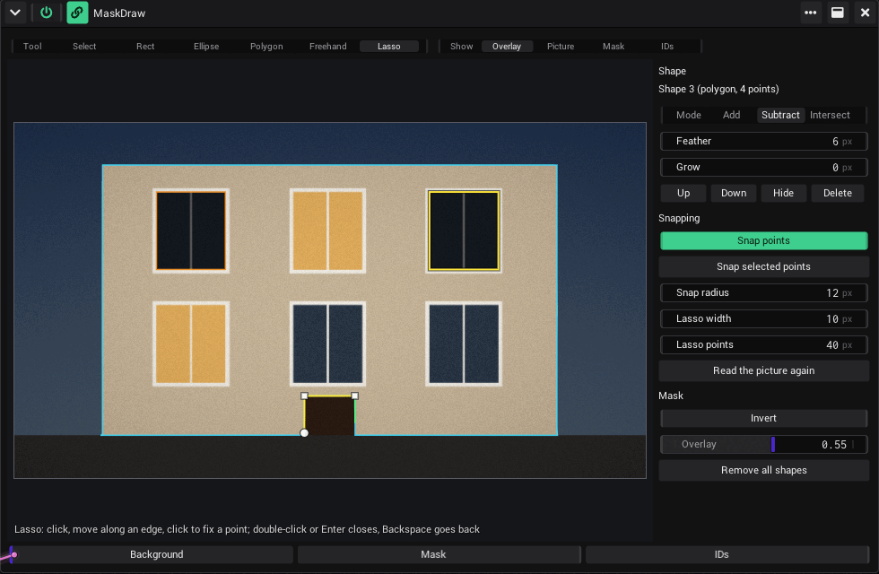

*MaskDraw* (`Mapping`) makes a **mask**: white where a surface of the building is, black where the projector should
not light. That is the form the *Mask* ports of the mapping shaders take. You draw it with the mouse over a picture of
the building, so it fits what the projector really hits.

1. Link a picture into *Background*: a photo of the building taken from where the projector stands (best: through the
   [camera](#receiving-video), or a picture of the projector's own output on the building), a video or the output
   itself. It is only for drawing on; it is not part of the mask. A PNG or JPG file: switch on its *Flip Y* (MaskDraw
   shows the picture the way a shader sees it, and a picture file arrives upside down there).
2. Pick a tool in the bar at the top, or click into the picture once and press its key:

   | Tool | Key | How |
   |---|---|---|
   | *Select* | V | Click a shape to select it, drag it, or drag one of its points. Double-click an edge (or Ctrl+click): a new point there (on a curve too, the curve keeps its form). Right-click a point: it goes. A selected point of a curve shows its handles: see [curves](#curves). |
   | *Rect*, *Ellipse* | R, E | Drag. Shift: a square or a circle. The points of a rectangle can be dragged one by one afterwards (a window seen at an angle). An ellipse has a handle in the middle and one for each radius (the first one also turns it). |
   | *Polygon* | P | Click the points; click the first one, double-click or press Enter to close it. Press and drag instead of a click: a smooth point, the drag pulls out its handles (a pen). Backspace or a right-click takes back the last point, Esc throws it away. |
   | *Freehand* | F | Draw with the button held; let go to close it. |
   | *Lasso* | L | The magnetic lasso: click on an edge of the picture and move along it. See below. |

3. Link *Mask* into the mask port of a shader (or anything that takes a picture). *IDs* gives every shape in a flat
   colour of its own, black elsewhere: an ID map for a shader that treats each region on its own.

**The magnetic lasso** follows the strongest edges of the *Background*, like the magnetic lasso of an image editor:
click where the outline starts, then move the mouse along the edge (the button can be up or held). The green line
from the last fixed point to the mouse runs along the edges of the picture, not straight. Every *Lasso points*
pixels of the screen a point is fixed by itself; click to fix one yourself where the edge turns or gets weak.
Backspace or a right-click takes back the last fixed point. Double-click, Enter, or a click on the first point closes
the outline; the way back to the first point follows the edges too. Without a *Background* it draws straight lines.

- Zoom in (mouse wheel) for fine work: the lasso follows the pixels of the picture, not of the screen. Middle or right
  drag pans, Z fits the picture again.
- Where the edge is weak (a wall against a sky of the same brightness), fix points more often. *Lasso width* is how far
  around the mouse it looks for the edge: smaller when two edges lie close together, larger for a rough hand.
- It follows a still of the picture, taken when an outline starts. *Read the picture again* takes a new one, e.g.
  after the camera moved. With a moving video, draw on a still (stop it) or on a photo; shapes that should stay on a
  moving object [follow the picture](#following-a-moving-picture) afterwards.
- *Lasso curves* turns the outline into a few [curves](#curves) instead of many short lines.

**Snapping points.** With *Snap points* on, polygon points and dragged points jump onto the nearest corner of the
picture, or else onto the nearest edge, within *Snap radius* pixels of the screen; holding Shift does the opposite for
one click. S snaps the selected point (Shift+S: every point of the selected shape); *Snap selected points* does the
same. A rectangle drawn roughly over a window becomes exact with Shift+S.

**Shapes and holes.** The shapes are applied in their order (the list goes from the first drawn to the last): *Add*
makes the shape white, *Subtract* cuts it out of what the shapes before it made (a window in a wall: draw the wall,
then the window, then X or *Subtract*), *Intersect* keeps only what is inside it. *Up* / *Down* (or [ and ]) change the
order, *Hide* (H) leaves a shape out for a while. *Feather* gives the selected shape a soft edge this many pixels wide,
*Grow* moves its edge out (negative: in) by this many pixels, both in pixels of the mask. Without a selection *Mode*,
*Feather* and *Grow* are what new shapes get. *Invert* makes the whole mask the other way round.

| Also | |
|---|---|
| Delete / Backspace | The selected point, or else the selected shape |
| Ctrl+D | A copy of the selected shape, a little to the side |
| Arrow keys | Move the selected point or shape by a pixel (Shift: ten) |
| Tab | The next shape |
| *Show* | *Overlay*: the picture, darker where the mask is black (*Overlay* sets how much). *Picture*, *Mask*, *IDs*: only that |
| *Opacity* | How much of the selected shape reaches the mask (0: nothing). A shape is in *IDs* while it is at least 0.5 |

#### Curves

The edges of a shape can be **curves** (Bezier curves, as in Illustrator or Inkscape): an arch over a door, a round
window, the dome of a church.

- With the *Polygon* tool, press and drag where a point goes: it becomes a smooth point and the drag pulls out its
  handles; a plain click is a corner.
- *Select* a shape and click one of its points: the handles of that point and of its neighbours show. Drag a handle to
  bend the curve; the other handle of a smooth point turns with it. Alt+drag moves only that handle (the point
  becomes a corner with two handles).
- Alt+click a point, C or *Smooth* turns a corner into a smooth point (its handles along the line between its
  neighbours) and a smooth point back into a corner. Shift+C does it for every point of the shape.
- *Lasso curves* fits a lasso or freehand outline with curves: a handful of points instead of hundreds, corners stay
  corners, straight edges stay straight. *Curve tolerance* is how far (pixels of the mask) the curves may leave the
  path you drew: small follows every bump, large gives fewer points.

The mask is made from the exact curve (cut into lines a 1/200 pixel from it), so a curve is as sharp as a straight edge.

#### Animated masks

A shape (or the whole mask) can move between **keys**: a reveal that grows over the facade, a window that opens, a
mask that slides with the music. Each key is the shape at a *phase* from 0 to 1.

1. Select a shape (no selection: the keys of the whole mask, which move, scale, turn and fade everything at once).
2. *Add key* at phase 0. Set the *Phase* to 1 and change the shape: drag it, its points or handles, or set *Move X*,
   *Move Y*, *Scale*, *Rotate*, *Opacity*, *Feather*, *Grow*. Once a shape has keys, every change you make is written
   into the key at the phase it is shown at (a new key is made there when there is none).
3. Pick what runs the phase with *Drive*:

   | Drive | The phase |
   |---|---|
   | *Phase* | The *Phase* control. [Link](Linking.md#make-a-link) anything into it: an [envelope of the timeline](Timeline.md#envelopes), an LFO, a MIDI fader |
   | *Beats* | One loop every *Beats* beats of the [timeline](Timeline.md) (*Ping-pong*: forth and back, no jump at the end) |
   | *Clip* | Once over the clip, when MaskDraw lies on the timeline as a [clip](Timeline.md#clips-and-lanes) |

Between two keys the shape goes the way *Ease* of the first one says: *Linear*, *In* (slow start), *Out* (slow end),
*In-out*, *Smooth*, *Hold* (it jumps at the next key). Two keys with the same number of points move point by point;
a rectangle into an ellipse, or into a lasso outline with other points, is a **morph**: both outlines are spread evenly
over the same number of points and blended. Before the first key and after the last the shape holds still; for a loop
without a jump, make the last key like the first (or use *Ping-pong*). *Key* picks a key (Drive *Phase*: the mask
jumps to it), *Time* moves it, *Delete key* removes it. *Phase now* shows the phase whatever drives it: link it out
to move something else along with the mask.

#### Following a moving picture

For a moving object in a live video (a dancer's board, a car, a box on stage) shapes can **follow** the picture: switch
on *Follows* for the shapes (or select none and use the MCP query `mask_follow`), then *Follow the picture*. *Rate*
times a second MaskDraw takes a small copy of the *Background* (at most 640 pixels wide), and every following shape
looks for its edges near its outline and moves onto them: a few pixels a frame are followed easily, *Radius* is the
most it moves in one step (keep it smaller than the distance to the next edge that is not its own).

- *Keep form* (on): a shape only moves as a whole, its form stays as drawn. It does not drift: a move of less than a
  third of a pixel is no move, and when too little of its outline finds an edge (the object left the picture) it stays.
  Off: its points also go onto the edges, the outline adapts to an object that changes its form.
- *Lock* on a shape: following and re-snapping never move it (the frame of the building while the dancer moves).
- *Re-snap now* puts the selected shape (none: every following shape) onto the edges of the frame now, one step that
  Ctrl+Z takes back. A shape with keys moves by its keys, not by following.

#### SVG files

Outlines drawn elsewhere come in as shapes: traced over a photo in Inkscape or Illustrator, or exported from the CAD
plans of the building. Type the file into *File* (a path from the VibeVJ folder or a full path) and press *Import*:
paths (curves stay curves, arcs become curves), polygons, polylines, rectangles (rounded too), circles and ellipses,
in groups with transforms. A path made of several outlines (a wall with its windows as one compound path) gives one
shape each; one that lies inside another is a hole (*Subtract*). *Fit*: *Contain* puts the page of the SVG (its
viewBox) into the mask keeping its aspect, centred (draw on a page of the size of the photo and it fits exactly);
*Stretch* fills the mask; *Bounds* fits the shapes themselves; *None* takes SVG units as pixels of the mask. Hidden
elements and what is in `<defs>` are left out.

*Export* writes the shapes as they are shown now into *File*, as an SVG of the size of the mask (add white, subtract
black, intersect grey), to use again in another project or to refine in an editor. Mode, *Feather*, *Grow* and the
names are kept in it and come back on an import.

Every drawing and every change is a step of [undo](The-Screen.md#undo-and-redo) (Ctrl+Z). The mask has the size of
the [project](Settings.md#project); the shapes are kept in parts of the picture (0 to 1), so a new size keeps them in
place. They are saved with the project.

## Projection mapping building blocks
Shaders for mapping real objects: a facade, a stage set, boxes, a sculpture. Most of them take a **mask**, a picture in
which white is a surface or an object and black is free space, and do their work around it: light that runs along the
outlines, smoke that flows between the objects, rain that lands on them, each window of a facade on its own. They are
in the *Assets* tab under `Shaders` › `Sources` › `Mapping` and `Shaders` › `Effects` › `Mapping`, and they work like
any shader: in a Patchview, as clips of the [Clipview](Clipview.md), in the effects of a
[MapLab output](#the-outputs-of-maplab).
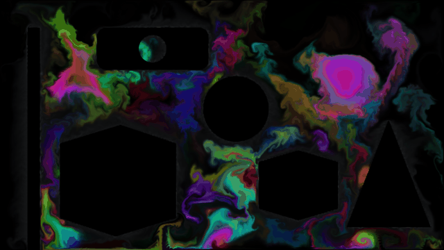
| Shader | Folder | What it is for |
|---|---|---|
| [EdgeSweep](#edgesweep) | `Effects` | Lights the outlines of the picture and of the mask and runs light along them: sweeps, rings, a radar, comets that trace every contour, a flash on the beat. |
| [MaskFluid](#maskfluid) | `Sources` | Smoke or liquid that flows around the objects (or stays inside them), from jets, from the outlines, from a picture, in bursts on the beat. |
| [MaskPhysarum](#maskphysarum) | `Sources` | Physarum, the yellow slime mould: up to a few hundred thousand agents grow a transport network between the objects (they are its food), rendered as wet, glossy slime in 3D. |
| [MaskReaction](#maskreaction) | `Sources` | Reaction and diffusion (Gray-Scott coral, mazes, spots, mitosis; waves and spirals): one pattern on the objects and another around them, in 3D as wax, metal or jelly. |
| [MaskContours](#maskcontours) | `Sources` | Light that grows out of the objects or into them: glow, contour lines that flow, ripples on the beat, offset outlines, a heat map. |
| [RegionChase](#regionchase) | `Sources` | Every region of the mask on its own (each window, each face of a box): chases, steps and random rooms on the beat, a picture in each region. |
| [MaskRain](#maskrain) | `Sources` | Rain, snow, sparks or drops of light that land on the top surfaces of the objects and splash; nothing falls under an overhang. |
| [MaskReveal](#maskreveal) | `Effects` | Shows the input only on the surfaces, cut cleanly, and wipes it in: from the outlines, from the middle, across, a noise dissolve. |
| [MaskPrep](#maskprep) | `Effects` | Makes a clean mask of any picture once for all the others: threshold, blur, grow / shrink, soft edge, calibration, a check view. |
| [MappingTest](#mappingtest) | `Sources` | Test patterns for setting up: grid, circles, colour bars, grey ramps, the mask on its own, the projector number, overlap zones, a beat square. |
| [EdgeBlend](#edgeblend) | `Effects` | Soft edges where the pictures of two projectors overlap, with gamma and black level lift. |
Six more sources simulate something that lives in the mask (a flock, laser beams, water, fire, sand, lightning):
[Simulations in the mask](#simulations-in-the-mask).
| [GrowCoral](#growcoral) | `Sources` | [Growing shapes](#growing-shapes): coral, mazes, fingerprints or spots that grow over the surfaces and turn when they are full. |
| [GrowFrost](#growfrost) | `Sources` | Frost and ice crystals that grow from seeds and the outlines, each crystal its own way, and thaw or melt back. |
| [GrowMoss](#growmoss) | `Sources` | Moss, lichen or mould that spreads in colonies with a soft, living texture, dries out and grows again. |
| [GrowBranches](#growbranches) | `Sources` | Branches, roots, vines or veins whose tips meander, climb, follow the outlines and split; light runs through them, they burn away like fuses. |
### The mask
**Make it from the view of the projector.** The mask has to match what the projector sees, not what you see from the
audience. Put *MappingTest* on the projector, take a photo from next to the lens (or use the output of MapLab, already
warped onto the object) and paint the surfaces white on black in any paint program, at the size of the output
(1920 × 1080 for a full HD projector). Three examples are in `Textures`: `mapping_mask_facade.png` (windows),
`mapping_mask_objects.png` (objects on a stage) and `mapping_idmap_boxes.png` (an ID map, see
[RegionChase](#regionchase)).
**Feed it in.** Every shader of the set has the port *Mask*:
- in a Patchview, [link](Linking.md#make-a-link) the *Out* of the picture into *Mask*;
- in a [Clipview](Clipview.md), put the mask picture into a lower layer and set the input *mask* of the clip to that
  layer (*Relative* 2 is two layers below the clip, see [Inputs](Clipview.md#inputs-relative--absolute)); the layer of
  the clip covers it, so it is not seen;
- or pick any picture with a [Video router](#outputs-tab-control) in the list of the input (tab *Control*,
  *Inputs*, *Mask*): a MapLab output, a *MaskPrep*, a camera.
A new PNG picture has *Flip Y* on, so it reaches the shader upright; a mask that is upside down (a picture from an
older project, a camera) is fixed with *Flip Y* of the picture or *Mask flip* *Vertical*. A grey PNG works as it is (*Mask channel* *Brightness* takes the brightest channel). Without a mask,
*Mask source* *Auto* shows demo shapes (a facade or objects), so a shader shows something when it is dropped in;
*EdgeSweep* then only lights the edges of its input.
**The mask controls** are the same in every shader of the set (same names, so a preset, a link or a MIDI mapping means
the same everywhere):
| Control | What it does |
| *Mask source* | *Auto* (the linked picture, else the demo shapes), *Mask input*, *Demo facade*, *Demo objects*, *None*. |
| *Mask channel* | *Brightness* (the brightest channel), *Alpha* (a PNG with transparency), *Red*, *Green*, *Blue*. |
| *Mask threshold*, *Mask softness* | Where white begins, and how soft that cut is. |
| *Mask invert* | Swaps surface and free space. |
| *Mask blur* | Pixels: smooths a noisy or jagged mask (a camera, a rough drawing) before the threshold. |
| *Mask offset*, *Mask scale*, *Mask rotation*, *Mask flip* | Calibration: moves, scales, turns and mirrors the mask against the picture. |
| *Show mask* | The mask in red over the picture, to check that it sits on the object (MappingTest: *Mask overlay*, MaskPrep: *Check over the input*). |
**Calibration.** Warp the picture onto the object first (the [Transform tab](#transform-and-projection-mapping-tab-transform)
or MapLab), then fit the mask: turn up *Show mask* and move *Mask offset*, *Mask scale* and *Mask rotation* until the
red sits exactly on the real object; or put *MappingTest* with *Mask overlay* on the projector, which draws the
outline of the mask onto the object itself. Line widths, glows and edges are set in **pixels of the output**, so they
look the same whatever the size of the mask picture. When several shaders use the same mask, prepare it once with
*MaskPrep* and link its *Out* into all of them.
**Beat and MIDI.** *Pulse every* (beats; 0: off) and *Trigger* fire a pulse: a flash of the outlines, a burst of
smoke, a ripple, lightning. Map *Trigger* to a pad or a note of a MIDI controller ([MIDI](MIDI.md)) to fire it by
hand. Speeds count beats while the shader's time is *Sync* (see [Default sync](Settings.md#default-sync)) and stand
still when the timeline stops; for an installation without a running timeline set the *Time* of the shader to *Free*.
The smoke of MaskFluid and the comets of EdgeSweep move every frame and keep moving when the timeline stops.
### EdgeSweep
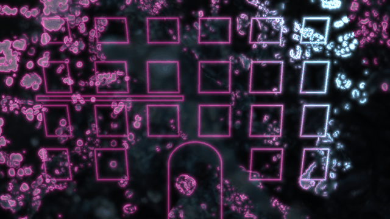
`Effects` › `Mapping`. Finds the outlines of the input picture (Sobel, thinned to one pixel), of the mask, or both
(*Edge source*), and lights them as lines of *Line width* pixels with a *Glow*. *Sweep mode*: *Linear* (a band of
light across the picture at *Sweep angle*), *Radial* (rings from *Sweep center*), *Around* (a radar around it),
*Trace* (comets that run along every outline, around corners; *Trace speed*, *Trace tail*, how many start at a pulse
and all the time, which way), *Pulse* (all outlines flash), *Sparkle*. *Sweep speed* is sweeps per beat; at speed 0
*Sweep position* moves the light by hand (a fader). *Pulse amount* flashes all outlines at each pulse. Colours: two
colours (head and tail), the colours of the input, or a rainbow. *Output mode*: over the input (*Input level*), the
lines only (with alpha, to lay over other layers), or the input seen only through the lines. *Debug view* shows the
distance field and the comets. Cost: about 15 small passes at half size, the same for any number of outlines.
### MaskFluid
`Sources` › `Mapping`. A real fluid simulation (stable fluids: advection, vorticity, pressure solve) on a quarter of
the size, the smoke on half the size. *Mask role*: *Obstacles* (it flows around the white shapes) or *Container* (it
stays inside them: liquid moving inside the windows); *Borders*: walls or open. Smoke comes from jets (*Emitter
layout*: a row at the bottom, around the edges, a circle, wandering; *Emitter count*, *Jet strength*, *Jet angle*,
*Jet wobble*), from the outlines of the mask (*Edge emit*: the objects smoke; *Edge push* blows away from them), from
the picture linked into the port *Emit picture* (*Picture emit*, *Picture push*: a video makes smoke where it is
bright), and from a burst at each pulse (*Burst mode*: a smoke ring at a random place, all jets, all outlines).
*Buoyancy* makes smoke rise (negative: cold fog sinks), *Vorticity* keeps the swirls, *Velocity fade* and *Dye fade*
calm it down. *Look*: *Smoke*, *Liquid* (a lit surface), *Glow*, *Velocity*. *Obstacle view*: *Black* keeps the real
objects dark, so only the space between them is lit; *Colour*, *Outline*, *Transparent*. Cost: 15 passes, most on a
quarter of the size.

### MaskContours
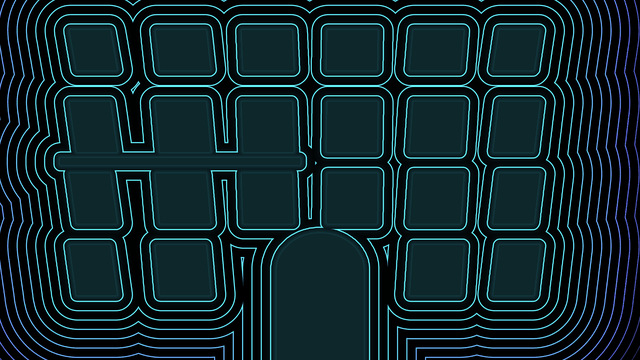
`Sources` › `Mapping`. Light from the distance to the outlines of the mask: *Style* *Glow*, *Contour lines* (every
*Spacing* pixels, flowing outwards or inwards with *Speed*), *Ripples* (a ring leaves the outlines at each pulse beat,
*Ripple speed*), *Offset outlines* (*Outline count* copies of the outline with a chase), *Heat map*. *Side*: around
the objects, inside them or both; *Reach* is how far the light goes; *Warp* makes the lines wobble. *Fill* lights the
objects themselves. Cost: 13 small passes at half size, then one read a pixel.
### RegionChase
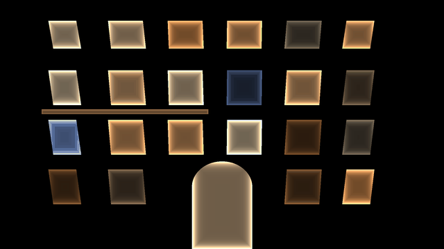
`Sources` › `Mapping`. Splits the mask into regions and plays each one by itself: no slices to draw for 30 windows.
*Region source*: *Connected shapes* (each white shape is a region) or *Colours of an ID map*: each flat colour is a
region, also where two touch, so the three visible faces of a box are three regions. Draw an ID map without
anti-aliasing (`mapping_idmap_boxes.png`). *Pattern*: *Chase*, *Step* (*Groups* steps a round, e.g. the columns of
windows), *Random* (*Density* of the regions on at each step), *Flicker*, *Wave*, *Pulse*, *Fill up*; *Order*: left to
right, right to left, top down, bottom up, random, by size, from the middle; *Fade* within a step; *Off level*.
*Fill style*: *Solid*, *Gradient*, *Inner glow*, *Outline*, *Picture in each region* (the picture of the port *Fill
picture* in every window), *Picture across*. *Palette*: two colours, a rainbow by order, random hues, *Warm rooms*
(lit windows, some with a TV). *Debug view* *Regions* shows each region with its box. The fills and the order use the
box around a region, so they fit rectangles best. When the mask changes the regions are found again within a few
frames; a mask that changes all the time (a camera) is found every frame from scratch, which only holds for small
regions.
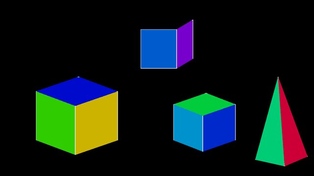
### MaskRain
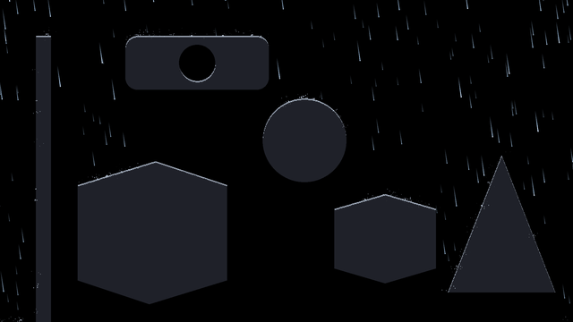
`Sources` › `Mapping`. *Kind*: *Rain*, *Snow* (flakes stay where they land for a while), *Sparks*, *Light drops*.
Drops fall at *Fall angle*, stop on the first surface below them and splash; under an overhang nothing falls.
*Density*, *Speed*, *Drop size*, *Streak*, *Splash*, *Layers* (depth); *Ground*: the bottom of the picture is a floor.
*Surface glow* makes the top surfaces glisten, *Flash* lights the surfaces up at each pulse like lightning. Each drop is
worked out per pixel, so it keeps its place when the timeline jumps. Cost: 12 small passes (the fall map) and a few
dozen drops looked at per pixel.
### MaskReveal
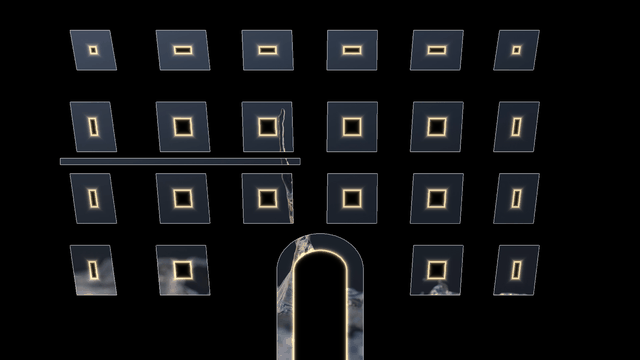
`Effects` › `Mapping`. The input only on the surfaces of the mask: *Grow* (pixels, negative shrinks), *Feather* (the
soft edge, pixels), *Outline width*, *Outside level*. *Wipe*: *Fade*, *Linear*, *Radial*, *From the outlines*
inwards, *From the middle* outwards (*Wipe depth* pixels), *Noise*; *Drive*: *By hand* (*Reveal*: a fader, a MIDI
knob), *Loop* (*Loop beats*, *Hold*) or *At each pulse*. A bright front runs with the wipe (*Front width*, *Front glow*,
*Front color*). Outside the surfaces it is transparent, for layers.
### MaskPrep
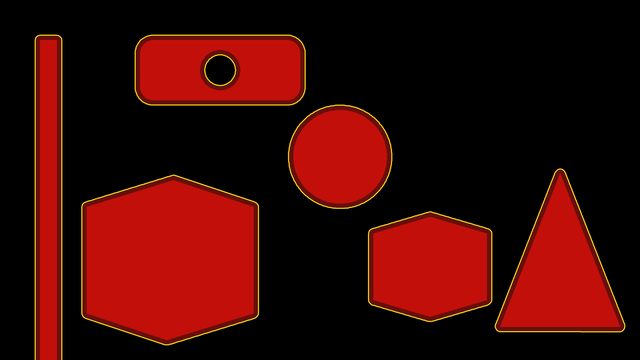
`Effects` › `Mapping`. Its input is the picture the mask is made of. All the mask controls, then *Grow* and *Feather*
in pixels. *Output mode*: *Mask*, *Mask as alpha*, *Outline*, *Check over the input* (the mask in red and its outline
in yellow over the input, to check the threshold and the calibration), *Distance field* (grey: 0.5 on the outline).
### MappingTest
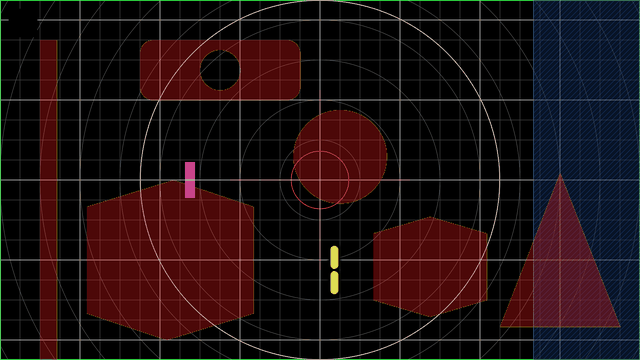
`Sources` › `Mapping`. *Pattern*: *Grid*, *Grid and circles* (a circle that is not round on the wall shows a wrong
aspect or warp), *Checkerboard*, *Colour bars*, *Grey ramps* (the bottom row: the darkest steps, to see where the
projector's black ends), *Solid colour*, *Mask check*. On top: *Crosshair*, *Diagonals*, *Frame* (a line on the
outermost pixels: is the whole picture on the surface?), *Projector id* (a big number), the overlap zones *Blend left*
... *Blend bottom* (hatched), *Beat square* and *Beat bar* (step with the beat: put both projectors side by side to see
whether they are in time), *Mask overlay*.
### EdgeBlend
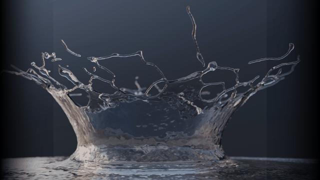
`Effects` › `Mapping`. For projectors whose pictures overlap: put it last on the output of each one (the effects of a
MapLab output). *Blend left* ... *Blend bottom*: the overlap in pixels on that side. The ramp is Paul Bourke's edge
blend curve (*Blend center*: the brightness of each projector in the middle of the overlap; *Blend power*: 1 straight,
more an S curve), made in light and encoded with the projector's *Gamma*, so both halves add up to an even brightness
on the wall. Projectors are never fully black: in the overlap two blacks add up, so *Black lift* lifts the black
outside the overlaps to match. *View* *Ramps only* and *Test grey* help to set it up: on a flat grey the overlap
must disappear.
### Simulations in the mask
Six more sources in `Sources` › `Mapping` (besides [MaskFluid](#maskfluid)) in which something lives inside the mask
or around the objects: a flock, laser beams, water, fire, sand and lightning. They take the same mask and the same
mask controls as the rest of the set, and the same *Pulse every* / *Trigger*. Each has a *Mask role* or a setting like
it (the white shapes are obstacles, a container, mirrors, ...) and an *Obstacle view*: *Black* keeps the real objects
dark, so the projector lights only the space between them; *Colour*, *Outline*, *Transparent* (for layers).
| Shader | What lives in the mask | Show use |
|---|---|---|
| [MaskSwarm](#maskswarm) | A flock of a few thousand birds, fish or fireflies that streams around the objects and gathers on their outlines. | Life around a set; scatters or surges on the beat. |
| [MaskBeams](#maskbeams) | Laser beams that bounce off the objects (mirrors), bend through them (glass, prisms that split the colours) or hit them (hot spots). | A laser show on a facade or a set, beams that sweep with the beat. |
| [MaskRipples](#maskripples) | Water in the surfaces or around the objects: rain, drops on the beat, waves from the shores, refraction of a picture, caustics. | Windows full of water, a pond around objects, the caustic light of a pool on a wall. |
| [MaskFire](#maskfire) | Flames that burn on top of the objects and climb up their outlines, embers that fly. | A burning building, fire along the edges of a stage set. |
| [MaskSand](#masksand) | Sand or a liquid that pours down, piles up on the top surfaces and runs off the edges. | An hourglass in each window, a picture that falls apart into sand on the drop. |
| [MaskLightning](#masklightning) | Electric arcs between the objects, strikes from the sky onto them, plasma on their outlines. | A strike on the drop, a Tesla coil between two points. |
They simulate on a smaller grid (a half, a quarter or an eighth of the size; the cost is in each part) and step once a
frame, so they keep moving while the timeline stops and run faster at a higher frame rate. Speeds of things that
follow the beat (a sweep, a spout that wanders) count beats. None of them blows up on a long run: every state is
clamped and a NaN is reset.
#### MaskSwarm
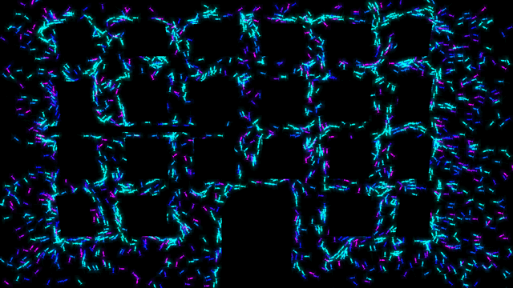
Boids (separation, *Alignment*, *Cohesion* within *View radius*) on a grid of cells, one boid a cell, about 2300 at
*Population* 0.07 in a 1080p picture. *Mask role*: *Obstacles* (they steer around the white shapes *Avoid distance*
pixels ahead and stream past them), *Container* (they stay inside the shapes), *Ignore*. *Edge attract* makes them
gather *Edge offset* pixels outside the outlines and flow along them (*Edge flow*: which way round). *Wander* is a
swirling wind, *Attract* pulls them to *Target* (map it to an XY pad), *Borders*: wrap, bounce, open. *Spawn*: where
new boids appear while there are fewer than *Population* (anywhere, from the edges of the picture, from the outlines,
at the target). *Pulse action*: *Scatter* (the flocks burst apart; give it *Pulse every* 8 or more, so they can form
again), *Burst from the outlines*, *Gather on the outlines*, *Turn around*, *Speed up* (the default: a surge on each
beat). *Shape*: *Birds* (flapping), *Fish* (a wagging tail), *Dots*, *Streaks*, *Fireflies* (blinking); *Boid size*,
*Glow*, *Trails*; colours single, two, by heading, by speed, rainbow. *Debug view*: the cells, the distance field, the
count. Cost: the boids on an eighth of the size (49 reads a cell), the walls from a jump flood at a quarter of the
size, the trails at half size, the final pass 9 to 25 reads.
#### MaskBeams
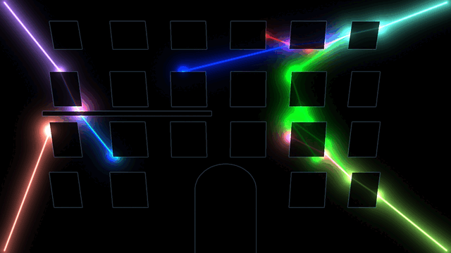
Up to eight beams (*Beams*) from an *Emitter layout*: a row at the bottom or the top, left and right, the corners, the
centre (a fan, 360° all around) or *Point A*. *Aim* turns them all, *Fan* spreads them. *Motion*: *Still*, *Sweep*
(*Sweep range*, *Sweep speed* in sweeps per beat, *Sweep phase* lets them follow each other), *Rotate*, *Step on
pulse* (a new angle at each pulse), *Wander*. *Surfaces*: *Mirrors* (reflected, *Reflectivity* per bounce), *Glass*
(bent by *Glass index*, totally reflected inside; *Dispersion* splits each beam into red, green and blue: prisms),
*Absorbers* (the beam stops in a hot spot on the object: the projector lights a spot on the real surface). *Frame
edges*: mirror or absorb; *Bounces* up to 7. The light: *Beam width*, *Glow*, *Glow width* in a drifting *Haze*, *Hit
glow* and *Hit size*; *Pulse look* *Flash* or *Strobe* (on only at a pulse). *Obstacle view* *Outline* draws the edges
of the shapes, lit by the beams nearby. Cost: the jump flood at half size, the beams traced in a 8 × 48 pass, their
light at half size (each pixel looks at every segment: 4 beams of 6 segments are 24).
#### MaskRipples
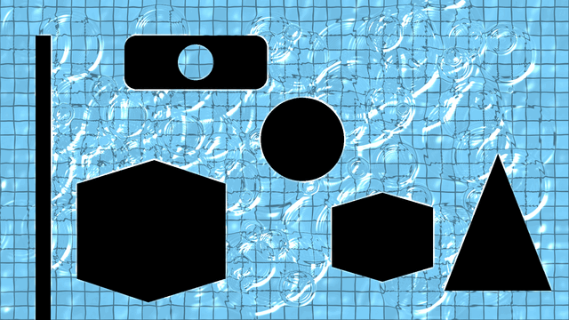
The wave equation on half the size. *Water place*: *In the surfaces* (each white shape is a pool: the windows),
*Around the objects* (they stand in a pond), *Everywhere*. *Shore*: *Reflect*, *Fixed* or *Soft* (the waves run out).
Stirred by *Rain* (drops a frame, *Drop size*, *Drop strength*), *Wind* (small waves everywhere, *Wind scale*), points
that swim through it (*Swimmers*), a pulse (*Pulse action*: a big drop, waves from all shores at once, a rain burst)
and a picture in the port *Picture* (*Picture stir*: *Motion*, where the picture changes, e.g. a camera of people
walking past; *Brightness*, where it is bright). *Look*: *Water* (the picture of the port *Picture* under the water,
moved by *Refraction*, with *Caustics* and a *Highlight* from *Light angle*, *Water tint*, *Foam* at the shore;
*Floor look* *Tiles* or a colour when nothing is linked), *Caustic light* (only the dancing light of a pool's floor:
project it onto a real surface), *Contour lines*, *Height*. *Land view* *Picture* shows the picture outside the water
too. Cost: one small pass of 9 reads, the final pass about 20 reads.
#### MaskFire
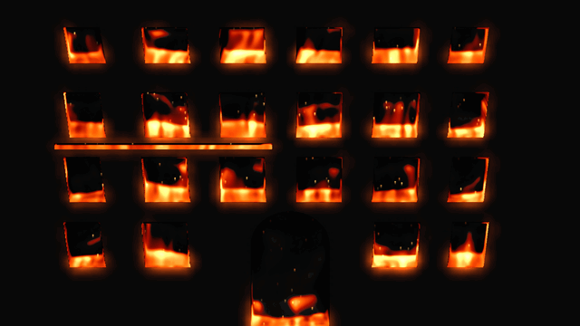
A heat field on half the size, carried up by a swirling flow (*Rise*, *Turbulence*, *Turbulence scale*, *Wind*) that
runs along the outlines (*Climb*: the flames lick up the sides of an object and around its corners) and does not
enter the walls; *Cooling* breaks the flames into tongues (more cooling, shorter flames). *Fire source*: *Top edges*
(on top of the objects), *All outlines*, *The surfaces* (their faces burn), *Bottom of the picture*, *Picture only*
(the bright parts of the port *Emit picture* burn, with *Picture fuel*: a logo, a text, a video). *Mask role*:
*Obstacles*, *Container* (fire inside the shapes: a burning building), *Free*. *Embers* fly up and glow out (*Ember
life*, *Ember size*). *Pulse action*: *Flare*, *Embers*, both, *Ignite all outlines*. *Palette*: fire, blue gas, green,
magic, two colours; *Flame height* stretches the colours; *Smoke* above the flames. *Obstacle view* *Lit by the fire*
(the default) lights the real object softly where flames are near. Cost: heat at half size (~25 reads), embers on a
quarter, the glow on a sixteenth, the final pass ~15 reads.
#### MaskSand
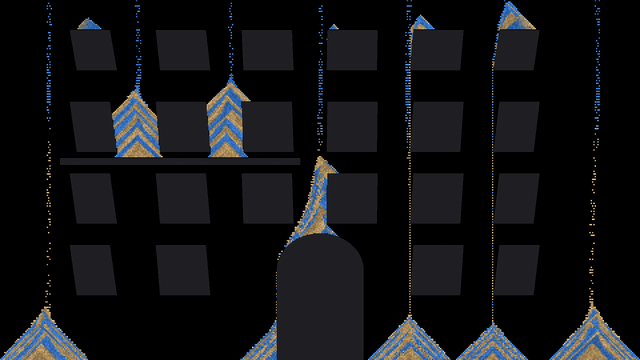
A falling sand automaton on a quarter of the size (blocks of 2 × 2 cells, two steps a frame; no grain is lost or made
twice). *Material*: *Sand* (piles up; *Slide*: how easily it slides down, less makes steeper piles), *Liquid* (spreads
sideways, *Flow*), *Both* (every second spout pours liquid; sand sinks through it). *Spouts* along the top (*Pour*,
*Spout width*, *Spout wander*) and *Snow* from the whole top edge. *Mask role*: *Obstacles* (it piles on the top
surfaces and runs off their edges) or *Container* (the shapes fill up). *Ground*: a floor or open; *Drain* removes
grains on the floor slowly, so the picture does not fill up. *Pulse action*: *Pour burst*, *Picture to sand* (the
bright parts of the port *Picture* become grains of their colour and fall), *Shake*, *Open the floor*, *Clear*;
*Clear now* empties it while it is on. *Colour mode*: *Sand*, *Strata* (layers of *Color A* and *Color B*), *Rainbow*,
*Picture colours*, *Two colours*. *Look*: *Grains*, *Smooth* (dunes, a shiny liquid), *Glow*. Cost: two small passes of
8 reads, the final pass 1 to 20 reads.
#### MaskLightning
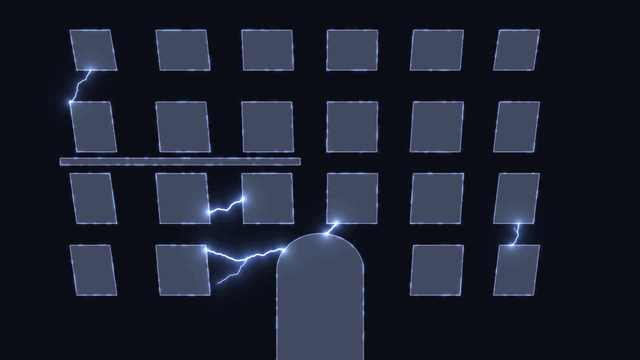
*Arc mode*: *Between objects* (from a point on an outline across the free space to the next object), *Sky strikes*
(from the top down onto the first surface), *To the frame*, *Crawl on outlines*, *Between A and B* (*Point A* and
*Point B*: two electrodes). *Timing*: *Strikes on pulses* (a flash that flickers out, new arcs at each pulse),
*Continuous* (*Continuous level*, new ends every *Hold* frames), *Both*. The path: *Roughness* (zigzag), *Crackle*
(how often it changes between the same ends), *Branches* (side arcs), *Max length*, *Spread*. The look: *Core width*,
*Glow width*, *Glow*, *Arc color*, *Core color*, *Hit glow*, *Object flash* (the objects light up with a strike), *Sky
flash*, *Plasma* (a flicker along the outlines while arcs burn). Up to 6 arcs and 6 side arcs of 32 pieces each, made
in a 35 × 12 pass; each pixel only looks at the arcs whose box it is in. Cost: the jump flood at half size, then 1 to
about 70 segment distances a pixel.
### Growing shapes
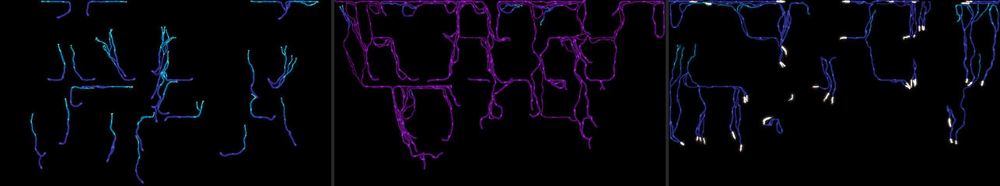
Four sources in `Sources` › `Mapping` that grow organic shapes on the surfaces of the mask: [GrowCoral](#growcoral),
[GrowFrost](#growfrost), [GrowMoss](#growmoss) and [GrowBranches](#growbranches). They take the same
[mask](#the-mask) as the others, with the same mask controls. *Mask role* says where they grow: *On the surfaces*
(the white of the mask is the soil), *Around the objects* (the black is the soil: moss on the wall between the
windows) or *Everywhere* (the outlines still seed and guide them). Without a mask (*Mask source* *None*) they grow
over the whole picture.
**They never just fill up and stop.** Each one counts how much of its soil is grown (576 places, new ones every frame)
and, when that share reaches *Turn at*, it **turns**: the old generation goes away in a way that has its own look,
and a new one grows from new seeds. It turns as well after *Turn every* beats (0: off), when it has not grown for
*Turn when stuck* beats and 240 frames (0: never; it then reseeds instead of standing still), on the button *Turn*
(map it to a pad or a note, [MIDI](MIDI.md)) and, with *Pulse action* *Turn*, at each pulse (*Pulse every*,
*Trigger*). A turn takes *Turn length* beats. *Cycle mode*:
| Cycle mode | What happens |
|---|---|
| *Wither* | The old parts die first, the young ones last: the shapes dry out, brown and crumble. The next generation starts halfway. |
| *Burn* | A narrow fire runs through the shapes along the way they grew (from the seeds out to the tips), leaving charcoal and embers that go out. The next generation starts after 60 % of the turn. |
| *Invert* | The empty space becomes the new soil: the next generation is seeded along the edges of the old one and grows into its gaps, while the old one pales and fades. |
| *Recede* | The shapes draw back into their seeds, the youngest parts first, lighting up as they go. The next generation starts after 70 % of the turn. |
| *Reseed* | New seeds at new places grow at once and overgrow the old generation, which fades. |
**Seeds:** *Seed points* random places of the soil (new places each generation), *Seed edges* runs along the
outlines of the mask, *Seed from picture* where the picture linked into the port *Seed picture* is bright (all the
time while it grows: a video or a camera plants seeds), and with *Pulse action* *Seed burst* a group of *Burst
seeds* at a random place at each pulse (try *Pulse every* 4).
**Colours:** *Palette* from young to old (*Moss*, *Coral*, *Lichen*, *Embers*, *Ice*, *Deep sea*, *Two colours* with
*Color young* and *Color old*); *Age span* is how many beats a part takes to get the colour of old age;
*Generation hue* lets each generation wander a little away from the palette; *Glow*; *Background*; *Transparent*
makes the empty parts transparent, to lay the shapes over other layers. *Pulse glow* lights them up at each pulse.
**Values:** under *Values* (tab *Control*) every growing shader gives out *Life* (the share grown divided by *Turn
at*: 1 when it turns), *Turning* (0 to 1 through a turn, 0 while it grows), *Turn pulse* (1 when a turn begins, then
it falls) and *Coverage* (the share grown). [Link](Linking.md#make-a-link) them into other layers: a video that
fades in as the moss covers the wall, a strobe on *Turn pulse*.
The simulations run at half the size, a few steps every frame, so they grow at the same speed in frames, not in
beats: a slow computer grows slower. *Grow speed* sets the pace. The turn and the colours count beats (half a second
each while the timeline stands still). Each has a *Debug view* that shows what it simulates.
#### GrowCoral
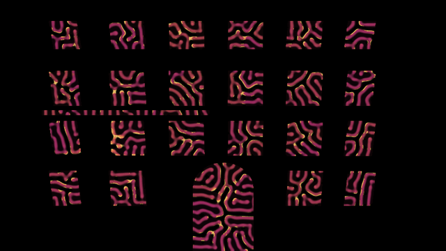
A reaction and diffusion (Gray-Scott), six steps a frame: fronts spread from the seeds and leave a pattern behind.
*Pattern*: *Coral* (slow, branching), *Maze*, *Fingerprint*, *Spots*, *Worms*, *Bubbles*; *Variation* changes the
pattern from place to place, *Feed offset* and *Kill offset* tune it (too much kill and it dies). *Relief* lights the
shapes like a surface, *Fill between* colours the area it has reached between the lines. Nothing flows through the
outlines, so the pattern fits each window. Cost: 6 steps of 21 reads at half size, then about 50 reads a pixel.
#### GrowFrost
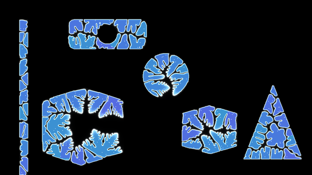
Freezing water as Kobayashi's phase field: crystals grow where the water is cold, give off heat and branch into
dendrites; each crystal keeps its own axes. *Symmetry*: 6 arms make snow, 4 square crystals, 2 needles;
*Anisotropy* how strictly they follow their axes, *Side branches* noise at the tips, *Cold* how hard it freezes,
*Latent heat* (more: thinner, more branched), *Cooling* (how fast the heat goes; much makes compact grains),
*Orientation*: each crystal its own way, all the same (*Angle*), or along the outline that seeded it. The look:
*Ice opacity*, *Rim* (bright edges), *Sparkle* (glints that twinkle), *Heat glow*. It turns with *Recede* by
default: the ice melts back into its seeds. Cost: 6 steps of about 40 reads at half size, then about 40 reads a pixel.
#### GrowMoss
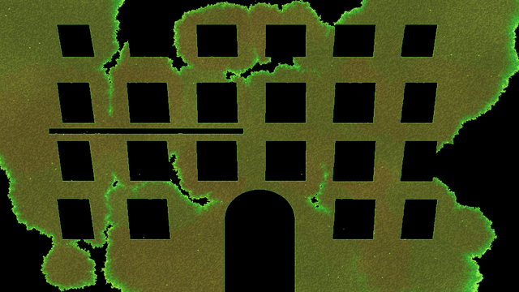
A stochastic front, two steps a frame: a free place next to living ones is reached with a chance that grows with the
number of living neighbours, on fertile ground and along the outlines (*Follow edges*). *Patchiness* and *Patch size*
make some places fertile and some barren, so the fronts are ragged; the covered parts get thick with *Thicken*. Each
seed starts a colony that keeps its own shade (*Colony colors*). *Style*: *Moss* (soft tufts), *Lichen* (flat crusts
with growth rings, best with the palette *Lichen*), *Mould* (fuzzy, glowing threads); *Texture size*, *Relief*,
*Breathing* (slow waves of light), *Spores* (little lights that drift up). Cost: 2 cheap steps at half size, a texture
of a few noise reads a pixel.
#### GrowBranches
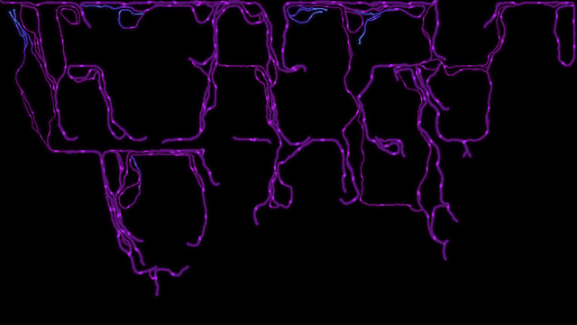
Tips that grow, two steps a frame: they meander (*Wander*), turn up or down (*Climb*: positive climbs like ivy,
negative hangs down like roots), feel ahead and turn away from other branches and walls (*Avoid*), run along the
outlines of the mask (*Follow edges*) and split (*Branching*, *Branch angle*). A tip that runs into a branch ends
there; one that is stuck for 3 beats dies. The wood gets thicker with age (*Thickness* in pixels for the oldest and
first branch, *Taper* for each split). Light runs through it from the seeds to the tips (*Sap flow*, *Sap speed*,
*Sap spacing*) and the tips glow (*Bud glow*). The area within *Spacing* pixels of a branch counts as grown. It burns
by default: fire runs along the branches like a fuse. Cost: 2 steps at half size (a tip reads about 80 texels, the
rest 9), a jump flood of the wood (11 passes of 9 reads at half size), then 12 reads a pixel.

### Physarum and reaction-diffusion

Two simulations in `Sources` › `Mapping` that are rendered like a photo of a real thing: [MaskPhysarum](#maskphysarum)
(slime mould) and [MaskReaction](#maskreaction) (reaction and diffusion), with [the same 3D look](#the-3d-look).

#### MaskPhysarum

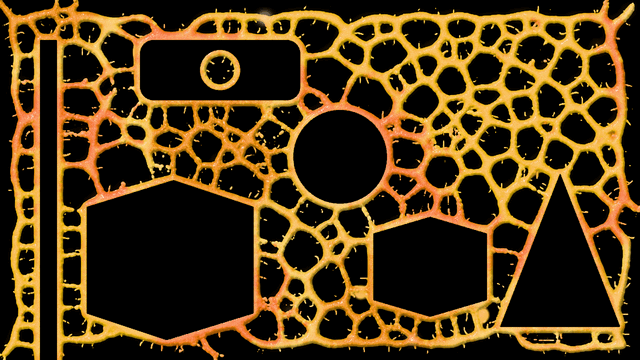

MaskPhysarum is *Physarum polycephalum*, the yellow slime mould that finds the shortest
paths between pieces of food, after Jeff Jones's agent model: up to a few hundred thousand agents on a grid of half
the size (*Population*: the share of cells with one; 0.12 is about 60 000 at 1080p, 0.5 about 250 000) smell the
trail at three sensors ahead (*Sensor angle*, *Sensor distance*), turn towards the strongest smell (*Turn angle*,
*Wander*), step (*Step size*, two steps a frame) and leave trail (*Deposit*); the trail spreads (*Diffusion*) and
fades (*Decay*). A cell holds one agent, so they jostle like the real cells. Over a minute the dense web thins out into
a network of thick veins. *Mask role*:

- *Food around objects* (the default): the slime cannot enter the white shapes and is fed in a strip of *Food band*
  pixels around them, so it wraps every object and links them with veins;
- *Food*: it grows over the shapes; *Walls*: it avoids them, nothing feeds it; *Container*: it stays inside them;
  *Ignore*.

More food: *Food points* (random places, *Food size*), the *Brush* (a button: map it to a pad; food at *Brush
position* while it is on), the bright parts of the picture linked into the port *Food picture* (*Picture food*).
*Strains* (1 to 8, 5 by default): kinds of agent, each with its own colour and its own way to move. *Palette* picks
the colours (*Slime*: yellows and oranges, *Colour A to B*, *Rainbow*, *Fire*, *Ocean*, *Toxic*, *Candy*), *Color
variation* how far they go from *Colour A* (0: one colour), *Behavior variation* how differently they move: a strain
gets a longer or shorter *Sensor distance* and *Deposit* (thick veins or a fine web), a wider or narrower *Sensor
angle* and *Turn angle* (straight or curly paths), and some are slower. The first strain moves with the controls as
they are. The strains start in patches, smell their own kind more than the others (*Repulsion*: 0 they share one
network, more and they keep apart) and compete for the food, so the network has veins of different colours that meet
and mix. *Species* 2: two slimes in *Colour A* and *Colour B* that avoid each other's trail (*Repulsion*); the strains
then split between the two. *Capillaries*: thin veins and fingers of veinlets that run out of the thick veins.
*Show agents*: every agent as a tiny dot in its strain's colour (they move, so the veins sparkle). *Spawn*: where the
agents start, everywhere, in the centre, in a ring or on the food. *Pulse action* at each pulse: a drop of food at a
random place, *Scatter* (the agents turn at random), *Move food* (the food points jump), *Repel* (a hole the slime
grows back into), *Restart*. Cost: about 15 passes, the simulation at half the size.

#### MaskReaction

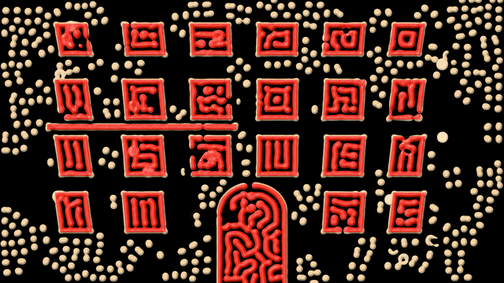

MaskReaction runs reaction and diffusion at half the size, eight steps a frame (*Sim
speed* fewer). *Model*: *Gray-Scott* (*Pattern*: coral, mitosis, worms, mazes, spots, U-skate, holes, chaos, or
*Custom* with *Feed* and *Kill*), *FitzHugh-Nagumo waves* (an excitable medium: waves and spirals, *Wave width*,
*Wave threshold*) or *BZ spirals* (the three chemicals of the Belousov-Zhabotinsky reaction, *BZ rate*). *Mask role*:
*Two patterns* (*Pattern* on the white shapes, *Pattern outside* around them; *Nothing* lets it die outside), *Inside
only* / *Outside only* (the rest is a wall the pattern lines up along; *Wall view* what the wall shows), *Ignore*. It
starts from *Seed mode* (random spots, the outline of the mask, the centre, noise everywhere); more seeds come at each
pulse (*Pulse action*: spots, the outline, a ring, *Restart*, *Disturb* wipes a disc that grows back), from the
*Brush* and from the picture in *Seed picture*. Changing the *Model* starts it again. It has no life cycle: for patterns that grow, fill and turn, see
[GrowCoral](#growcoral).

#### The 3D look

The same in both. The simulation becomes a height field (*Relief height* in pixels at 1080p) that
is lit like a photo: *Look* *Photoreal*, *Classic flat* (the plain colours) or *Glow*. *Material*: *Wet slime*
(glossy, with light that goes into the slime and comes out deeper yellow, and thin parts that shine in back light),
*Wax*, *Gold*, *Chrome*, *Glass jelly* (the ground seen through it), *Ceramic*; *Gloss* and *Subsurface* fine-tune
it. *Light angle*, *Light height* (low light: long soft shadows), *Light colour*, *Light power*, *Rim light* (a light
from behind), *Environment* (the reflections of a studio), *Shadows*, *Occlusion* (darker creases and contact shadows
on the ground, and the crevices: forks, the foot of a shape). *Detail*: a micro relief of grain, wrinkles along the
shapes and many small glints (*Detail size*: the size of the grain in pixels at 1080p). *Aging*: what stays gets a
deeper, darker colour while new growth stays light; *Tip glow*: new growth (tips, a front) glows and lets light
through. *Ground*: *Black* for projection, *Colour*, *Agar* (a dish of jelly), *Transparent* (alpha, for layers).
*Camera tilt* looks at the relief from the side (0, straight down, keeps the picture on the mask), *Camera zoom*.
*Breathe* makes the relief swell in slow waves, *Pulse swell* and *Pulse glow* at each pulse; *Bloom* and *Bloom
threshold*, *Exposure*, *Tonemap* (*Neutral* keeps the colours, *Filmic AgX* rolls highlights off to white).
*Obstacle view* / *Wall view* and *Show mask* work like in the other shaders; *Debug view* shows the height, the
normals, the trail or the chemicals, the agents and the mask. The lighting costs most at full size: on a weak GPU use
*Classic flat*, or *Render scale* 0.5 in the *Settings* tab.

## Prolink (CDJs)

Two generators in `Generators` › `Network` read the CDJs through **DJ Watch**, a small ESP32 box in the DJ network
(`dj-watch.local`; it was called prolink-bridge before). Both use the same connection.

- **Prolink Bridge** (*ProlinkBridge*) gives the values of the tempo master deck: BPM, beat and bar, beat and downbeat
  pulses, beats to the next cue, cue ramp, drop pulse, progress, playing, on air, master deck, and *Low* / *Mid* /
  *High* from the waveform.
  - *Sync timeline* (on at the start) makes the [timeline](Timeline.md#sync-the-timeline-from-audio) follow the master
    deck while it plays.
  - *Bar lock* (on at the start) also puts the bar on its downbeat.
  - *Phase offset* moves the beat earlier or later; *Pulse length* sets how long the pulses last (10 to 1000 ms).
- With either of them, the [lighting desk](Lighting-Desk.md#dj-link-phrases) plays cues on the phrases of the master
  deck (Intro, Buildup, Drop, ...) and on its memory cues.
- **Prolink Decks** (*ProlinkDecks*) draws the decks with their waveforms, cues and phrases as a video output (*Out*).
  - Each section *Deck 1* … *Deck 4* has *BPM*, *Beat*, *Low*, *Mid*, *High*, *Progress*, *Cue ramp*, *Playing*,
    *On air*, *Phrase ramp*, *Buildup* and *Drop*. These are [pure outputs](Linking.md#pure-outputs): link from them,
    not into them.
  - The section *History* lists the tracks that were played, with *Save CSV*, *Save TXT* and *Clear*.
  - *Time display* (section *Settings*) shows the *Remaining* time of each track (default) or the *Elapsed* time.
  - Next to the BPM of each deck the words *On air* (green, needs a mixer on the network), *Master* and *Sync*; a green
    ▶ before the time while a deck plays.
  - *Style* changes the colours of the waveforms (*CDJ* or *VibeVJ*); the background, texts and badges look like the
    rest of VibeVJ in both.
  - Keys on its picture: H shows the history, + and - zoom, 0 resets the zoom.
  - *Output* sets the size of the picture: fixed sizes from 1920 x 1080 to 3840 x 1080 and flat strips, *Custom*
    (*Width (px)* and *Height (px)*) or *Fit window* (the shape of the generator window, *Height (px)* high). The picture in the
    window takes the whole width of the window.
  - *Zoom* is the time across the waveforms at a width of 1920 px. A wider output shows more seconds at the same speed,
    most of them ahead of the playhead. The zoom bar under the picture shows the seconds you see.

*Source* (in the section *Settings*) is *USB* (finds DJ Watch by itself, or set *Port*), *Demo* (plays a recorded
set, no hardware), *Network* (a relay ESP32 over ShizoNet) or *Network card* (no DJ Watch, see
[Without DJ Watch](#without-dj-watch-network-card)). The line at the top shows the connection ("DJ Watch
connected") or what is wrong: the messages are on [Troubleshooting](Troubleshooting.md#esp32-not-found).

### Without DJ Watch (network card)

With the source *Network card* VibeVJ needs no DJ Watch: this computer joins the DJ network itself, through one of its
network cards, and does what DJ Watch does. It shows up there as one more player (like ShowKontrol or Beat Link),
gets the status of the players and fetches titles, waveforms, cues and artwork from them. Everything else works the
same: both generators, the history, *Sync timeline*.

Use a network card of its own for the DJ network: a second Ethernet port on the board, a PCIe card or a USB Ethernet
adapter.

- **Why a card of its own?** CDJs and mixers are made for a small, quiet network. Art-Net (often many universes, 40
  times a second, as broadcast) and ShizoNet in the same network can disturb them, and with two networks on one card
  the computer does not know which way a broadcast should go. With two cards the DJ network stays as the DJ set it up.
- VibeVJ sends Pro DJ Link only through the card it uses for the DJ network. Art-Net and ShizoNet keep using the
  other card. When the computer would send its own broadcasts (ShizoNet, Art-Net to broadcast) through the DJ card,
  VibeVJ warns: give the light/VJ card priority (below).
- Do not run rekordbox, Beat Link or ShowKontrol on the same computer: they need the same ports (UDP 50000 to 50002).

**Set it up**

1. Plug the card into the switch of the players. Not into a numbered channel port of a mixer: there the mixer wants to
   give out player numbers itself.
2. Set the card to *automatic* (DHCP). Without a router in the DJ network, Windows and macOS then take an address
   169.254.x.y by themselves, like the CDJs. Linux: set the connection to *Link-local only* (NetworkManager:
   `nmcli connection modify <name> ipv4.method link-local`). A fixed address works too, in the same subnet as the
   players.
3. Windows: allow VibeVJ through the firewall for this network (the first start asks; tick *Private* and *Public*,
   the DJ network has no internet and counts as *Public*).
4. In *Prolink Bridge* or *Prolink Decks*: *Settings* › *Source* › *Network card*. Leave *Network card (empty = auto)*
   empty: VibeVJ listens on all cards, sends nothing, and takes the card on which the first CDJ shows up. Or type the
   name of the card (Windows: "Ethernet 2" as in the network settings; Linux: eth1; macOS: en7) or its address.
5. The line at the top shows "Looking for CDJs on all network cards…", then "Network card Ethernet 2: joining the DJ
   network…" (about 6 seconds), then the decks.

| Control | What it does |
|---|---|
| *Network card (empty = auto)* | The card in the DJ network: name or address. Empty: the card on which CDJs show up. |
| *Listen only* | Send nothing into the DJ network. VibeVJ then gets only tempo and beats (and the mixer's on air), no titles, waveforms, cues or play state. For setups where a DJ does not want anything new in the network. |

Both generators share one connection: a different card in one of them switches it for both.

To keep the light/VJ card first for the computer's own broadcasts:

- Windows: *Control Panel* › *Network Connections* › the light/VJ card › *Properties* › *Internet Protocol Version 4* ›
  *Advanced* › untick *Automatic metric* and give it a lower *Interface metric* (for example 5) than the DJ card
  (for example 50).
- macOS: *System Settings* › *Network* › *…* › *Set Service Order*: the light/VJ card above the DJ card.
- Linux: the default route on the light/VJ card (the DJ card without a gateway).

> Screenshot to add: Prolink Decks with *Source* › *Network card*, the line at the top "Network card Ethernet 2", two
> decks with waveforms.

### Denon players (Engine DJ)

The source *Network card* also reads Denon players and controllers with Engine DJ: SC6000 / SC6000M, SC5000 /
SC5000M, Prime 4, Prime 2, Prime Go, SC Live 2 / 4, Mixstream Pro. They talk *StageLinQ* instead of Pro DJ Link.
VibeVJ listens for both at the same time on the same card: there is nothing to switch, CDJs and Denon players can even
be in one network.

1. Set up the network card as above: in the switch (or the network port) of the players, address *automatic*.
2. On the players, StageLinQ must be allowed (it is the connection SoundSwitch and Resolume use; some Engine versions
   have it under the lighting settings).
3. *Settings* › *Source* › *Network card*, *Network card (empty = auto)* empty or the name of the card. The line at the
   top shows "Network card Ethernet 2 · 2 Denon players" or the decks.

What comes in:

- At once over the network: title, artist, key, BPM, pitch, play / pause, master, sync, the beats and the playhead.
- From the Engine library on the USB stick or SD card of the player: album, label, waveform, beat grid, hot cues
  with their names and colours, saved loops and artwork. VibeVJ reads from the library on the player only what a track
  needs (a few KB), right after the track is loaded. Tracks have to be analysed in Engine DJ. A player that cannot
  hand out parts of a file gets its whole library copied once instead; *Prolink Decks* and the DJ Watch program then
  show the progress ("library USB 1: 40 %").

| | Denon players | CDJs |
|---|---|---|
| Deck number | The *player number* of the player. Layer B is deck 3 / 4 for players 1 / 2 (as Engine counts them) and 7 / 8 for players 3 / 4. Prime 4: decks 1 to 4. | The player number. |
| Waveform | Coarse: Engine keeps one overview of the whole track, the scrolling waveform is stretched from it. *Low* / *Mid* / *High* work the same. | Detail from the player. |
| Parts (intro, break, drop) | Found in the waveform (bass or no bass), like for tracks without rekordbox phrases. | rekordbox phrases. |
| Cue countdown, drop pulse | To the next **hot cue** (Engine has no memory cues). | To the next memory cue. |
| On air | Prime 4 / Prime Go / SC Live: their channel faders. SC players with an X1800 / X1850: the faders the mixer reports. Another mixer: a playing deck counts as on air. | From the DJM. |
| *Listen only* | Only the list of devices (StageLinQ sends nothing without a connection). | Tempo and beats. |

Not tried on a real Denon player yet (October 2026): the connection follows the open StageLinQ programs and is tested
against a simulated SC6000. If something is missing or wrong, the messages of the DJ Watch program (*Devices*) help.

## ShizoNet

*Devices* › *Network* › *ShizoNet* switches ShizoNet on or off (on at the start). Off stops VibeVJ from looking for
ShizoNet devices and from talking to them; Art-Net keeps running. ShizoNet is used by the DJ Watch sources of
[Audio](Audio.md#source) and Prolink when they come over the network.

## See also

- [Assets](Assets.md)
- [Audio](Audio.md)
- [Video](Video.md)
- [Linking](Linking.md)
- [Clipview](Clipview.md)
- [Settings](Settings.md)
- [Troubleshooting](Troubleshooting.md)
