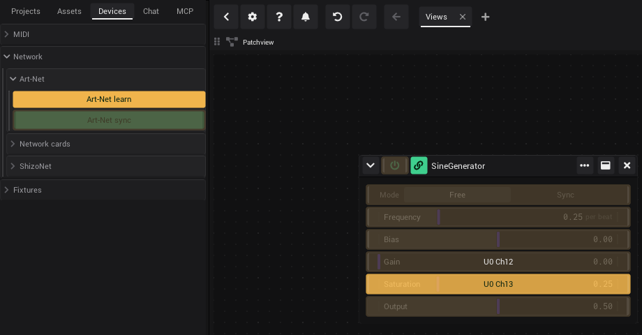
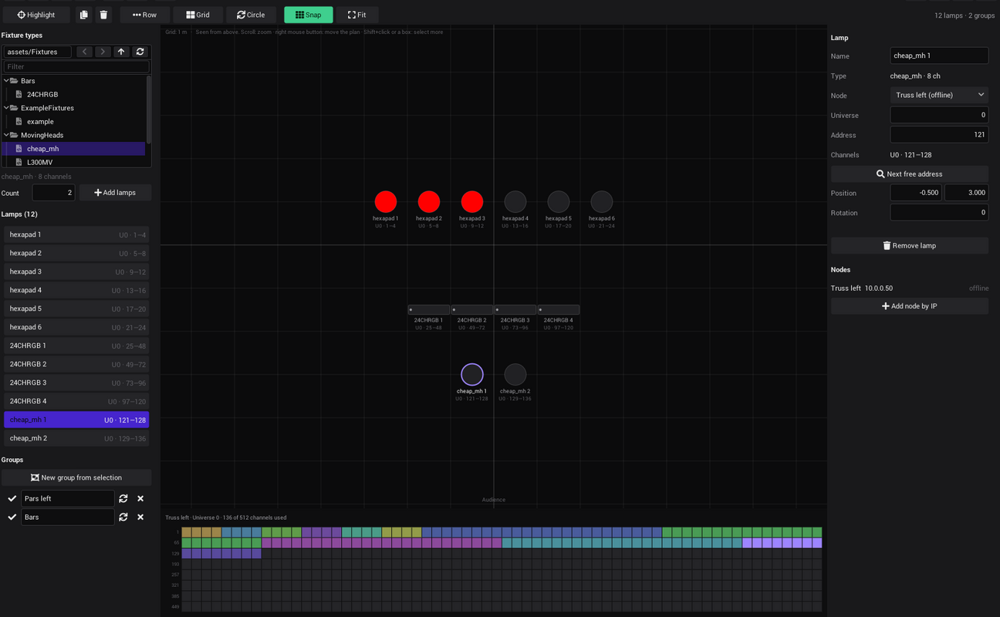
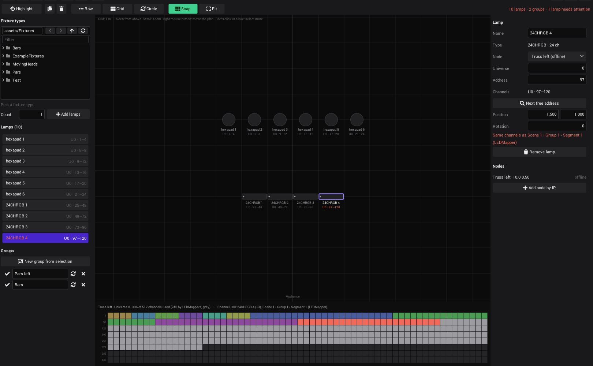
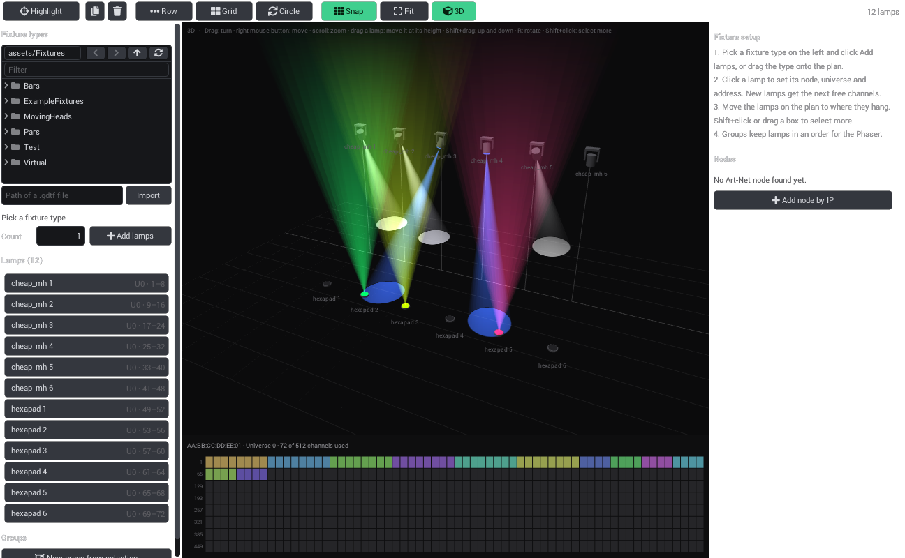
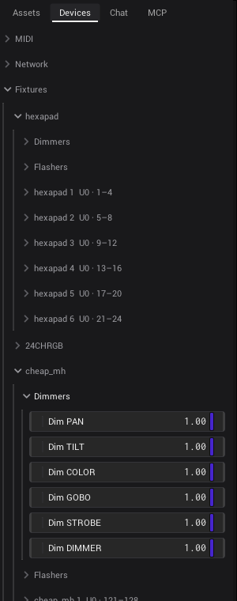
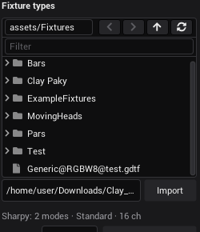
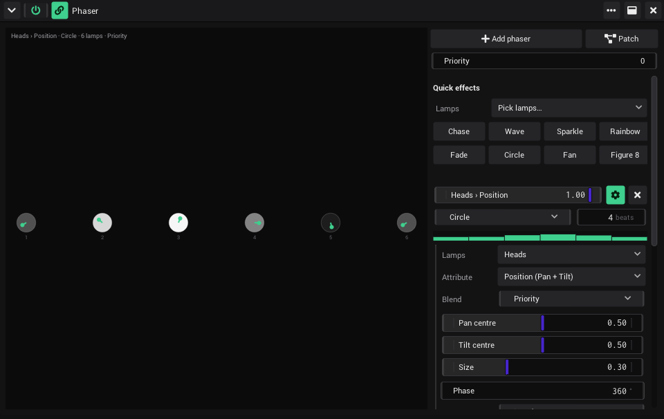
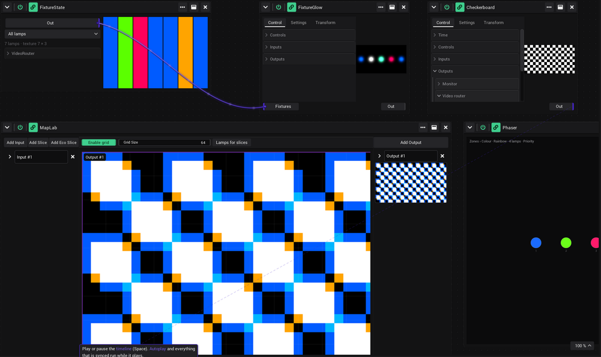
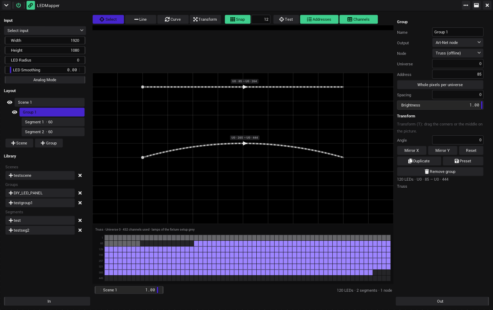
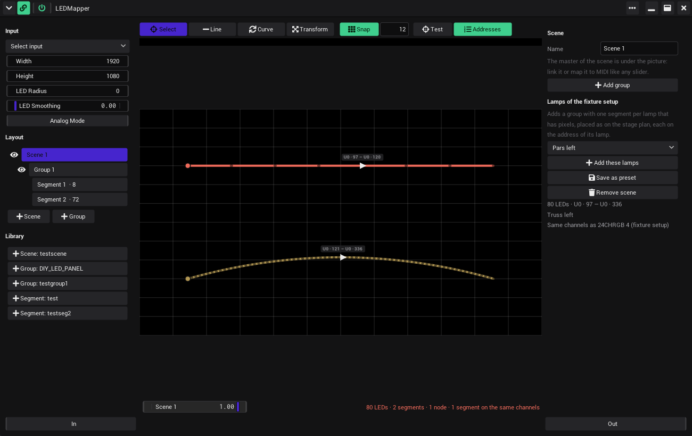

# Output and devices

How the picture leaves VibeVJ (a display or projector, NDI, Spout, other generators) and how VibeVJ talks to lights
(Art-Net, fixtures, LED mapping) and to the DJ booth (Prolink).

> Screenshot to add: a shader window on its *Control* tab with *Outputs* open: *Monitor* (*Display mode*, *Display*),
> *Video router*, *Spout* and *NDI stream*, next to the sidebar tab *Devices* with *Network* and *Fixtures* open.

## Show the picture on a display or projector

Every shader generator can send its picture out. A simple way is the shader *output* in `Shaders` › `Utilities`.

1. Drag *output* from the sidebar tab *Assets* (`Shaders` › `Utilities`) into a view.
2. Link the *Out* port of your [Clipview](Clipview.md#the-parts) (or of any generator) into the input of *output*.
   See [Ports](Linking.md#ports).
3. On the tab *Control*, open *Outputs* › *Monitor*.
4. Choose the *Display mode* first: *Fullscreen* or *Window* (a window without a frame).
5. Choose the *Display*: *Display 1*, *Display 2* …, each with the name of the display, its resolution and its role
   (*Control* or *Output*, see [Settings › Display](Settings.md#display)). The output opens there.
   With *Size* *Custom* (tab *Settings*), *Width* and *Height* are set to the resolution of that display. With *Size*
   *Project* (the standard) the shader keeps the project size, which follows the output displays.
6. *Picture*: what happens when the picture and the display have another shape. *Stretch* (the standard) fills the
   display and distorts the picture, *Fit* shows all of it with black bars, *Fill* fills the display and cuts the
   edges off.
7. To stop, set *Display* to *Off*. Closing the output window does the same.

*Display mode* and *Picture* can be changed while the output shows.

The project keeps the name of the display. At another venue, where the displays are connected in another order, the
output goes to the display with that name. When it is not connected, the output stays off and the [Log](Troubleshooting.md#the-log)
says so: it never lands on the screen VibeVJ itself is on.

## The tabs of a shader

A shader generator has three tabs: *Control*, *Settings* and *Transform*.

The section *Controls* of the tab *Control* holds the shader's own controls. Their names come from the shader's code in
plain words: `bg_colour` shows as *Background colour*, `timeMultiplier` as *Time multiplier*. Its inputs are *In* (or
*In 1*, *In 2*, …, *Channel 0*, …), its picture goes out at *Out*.

### Outputs (tab Control)

| Section | Controls | What it does |
|---|---|---|
| *Monitor* | *Display mode*, *Display*, *Picture* | Picture on a display, see above. |
| *Video router* | *Enable router*, *Video router name* | Offers the picture to other shaders by name. In another shader, open *Inputs*, then the input, and pick the name from the list. *No Input* clears it. |
| *Spout* / *Syphon* | *Enable Spout*, *Spout name* (on macOS *Syphon*) | Sends the picture to other programs on the same computer: Spout on Windows, Syphon on macOS (Resolume, MadMapper, VDMX, OBS list it as *VibeVJ - <name>*). |
| *NDI stream* | *Enable NDI*, *NDI name* | Sends the picture over the network as NDI. |

The names start as the shader name plus a short random code, so two outputs never clash. Type your own name to make it
easy to find in the receiving program.

### Render settings (tab Settings)

The tab has the groups *Render*, *Size*, *Format* and *Mask*.

| Setting | What it does |
|---|---|
| *Size* | *Project* (the standard) uses *Target width* and *Target height* from [*Settings* › *Project*](Settings.md#project). *Custom* uses *Width* and *Height* below. |
| *Render scale* | Multiplies the size. 0.5 renders at half size (faster), 1 at full size. |
| *Component format*, *Pixel format* | The format of the picture. NDI always sends 8-bit RGBA; a float picture is converted (values above 1 are cut off). |
| *Render mask* | Turns the mask input on or off. |

How the time of a shader runs (*Free*, *Manual*, *Sync*) is on [Settings](Settings.md#default-sync).

### Transform and projection mapping (tab Transform)

| Control | What it does |
|---|---|
| *X*, *Y* | Moves the picture. |
| *Rotate*, *Zoom* | Turns and scales it. |
| *Flip X*, *Flip Y* | Mirrors it. |
| *Clip UV* | Cuts the picture off where a move, a turn or the zoom pushes it out of its frame. |
| *Projection mapping* › *Edit Grid* | Shows a grid over the picture. Drag its points to fit the picture onto a surface. |
| *Subdivide*, *Reset* | A finer grid; back to the plain grid. |
| *Grid* › *X*, *Y* | How many fields the grid has across and down, 1 at the start. |
| *Fine* › *X*, *Y* | How finely each field is divided, 4 at the start. |

For several slices and outputs with masks and soft edges, use *MapLab*: see [Mapping](#mapping).

## Blackout

When something goes wrong on the screen or in the lights, press **Ctrl + B** (Cmd + B on a Mac) or the Blackout button
in the bar of the [timeline](Timeline.md#the-transport-bar), next to the show mode lock. Everything that leaves VibeVJ
goes black at once:

- the Display outputs of shaders and of MapLab (the picture on a projector or monitor),
- the NDI of every shader and of the whole window, and the Spout of every shader,
- the brightness and colour channels of your [fixtures](#fixtures) and every [LEDMapper](#ledmapper).

Pan, tilt, gobos and the other channels of a fixture stay where they are, so moving heads do not swing. The views in
VibeVJ keep showing everything, so you see what will come back. The button is marked while the blackout is on.

Press Ctrl + B or the button again: the outputs come back with a fade, one second at the start. Change it in
[*Settings* › *Output* › *Blackout*](Settings.md#output).

- It works in show mode.
- The button has a notch: map it to a MIDI pad ([MIDI](MIDI.md)) to have it under your hand.
- A blackout is not part of the project: opening a project keeps the outputs as they are.
- *ArtnetSender* sends exactly what you give it: the blackout does not change it.

## The whole window as NDI

[*Settings* › *Output*](Settings.md#output) › *NDI* sends the whole VibeVJ window as NDI (*Enable NDI*, *NDI name*,
"ProgramOut" at the start).

## Receiving video

*NDIReceiver* and *SpoutReceiver* (in `Generators` › `Network`) bring video from other programs in. *Camera* (in
`Generators` › `Input`) brings in a webcam, a capture card (HDMI / SDI) or another video device of this computer.

1. Open the list *Pick a sender…* at the top and pick a sender, or type its name into *Sender*.
2. Link *Out* of the generator onward.

- *Flip Y* (NDI) turns the picture upside down. Under the list NDI shows whether it is connected.
- *Size* shows the width and height of the picture that comes in.
- *Video router* offers the picture to shaders by name, as a shader does.
- *Camera*: pick the camera in the list at the top (*Test pattern* shows a moving picture without a camera).
  *Resolution* and *Frame rate* ask the camera for a size and a rate; one it does not have falls back to what it
  delivers by itself. The line under the list shows what comes in, e.g. `Logitech BRIO: 1920x1080 30 fps mjpeg`. A
  camera that is unplugged or used by another program is tried again every few seconds. On macOS the screens are in
  the list too (*Capture screen 0*), and the first time macOS asks whether VibeVJ may use the camera.
- NDI needs the NDI runtime on this computer. *SpoutReceiver* receives Spout on Windows and Syphon on macOS (the list
  shows the Syphon servers as *<app> - <name>*); on Linux it says that neither exists there:
  see [Troubleshooting](Troubleshooting.md#ndi-not-visible).

## Art-Net

The sidebar tab *Devices*, section *Network* › *Art-Net*:

- *Art-Net sync* (on at the start) sends an Art-Net sync after every frame, so all nodes update at the same moment.
- Every Art-Net node that VibeVJ finds on the network gets a section "name [MAC]" with its IP and MAC address.

Two generators in `Generators` › `Network` work with single channels.

| Generator | How to use it |
|---|---|
| *ArtnetSender* | Pick a node in the list at the top (*No node* until you do); its IP and MAC show below. Click *Add channel* or *Add 16-bit channel*: each row has *Universe*, *Channel* (1–512) and a slider *Value* that sends 0–255 (16-bit: 0–65535). × removes a row. *Start universe* and *Start channel* shift all rows. The node is remembered by its MAC address; until it answers, the line below says "not found on the network". |
| *ArtnetReceiver* | It listens to all Art-Net on the network, there is no node to pick. Click *Add channel* or *Add 16-bit channel*. The *Value* of a row follows that channel (a [pure output](Linking.md#pure-outputs)). Click the crosshair of a row (learn, amber while it waits), then move the fader on your console: *Universe* and *Channel* are filled in. *Start universe* and *Start channel* shift all rows. |

With the power button off, the sender stops sending and the receiver stops following. Learn still works.

For whole lamps instead of single channels, use fixtures.

### Art-Net mapping

Any control with a notch can follow a DMX channel of a lighting console, the way it follows a fader of a MIDI
controller: no *ArtnetReceiver* needed. This is how VibeVJ is played from a console (grandMA, ChamSys, ...) that sends
Art-Net.

1. Open the tab *Devices*, section *Network* › *Art-Net*, and click *Art-Net learn*. Every control gets an amber overlay.
2. Click the overlay of the control you want to play, for example the *Mix* of a layer or the power button of a
   generator.
3. Move a fader on the console. The overlay shows what was learned, for example "U0 Ch12" (universe 0, channel 12),
   and the control jumps to the value of the fader.
4. Click the overlay of the next control and move the next fader. Repeat for every control you want.
5. Click *Art-Net learn* again to leave learn mode. The overlays go away and the mappings stay.

- The first channel that changes is learned: start learn while the console stands still. A running chase or effect on
  the same universe can be learned instead of your fader.
- The channel goes over the range of the control: 0 is the minimum, 255 the maximum. A button is on above the middle.
- Only a change of the channel moves the control. While the fader stands, the mouse, [links](Linking.md) and MIDI still
  move it.
- The mapping listens to the Art-Net of every sender on the network, by universe and channel. It is saved with the
  project (and with presets), like a MIDI mapping.
- *Art-Net learn* and *MIDI learn* share the overlay: turning one on turns the other off.
- To remove a mapping: the × in the tab *MIDI* of the options of the control (below), or *Art-Net learn* on, click the
  overlay of the control and press Esc.

In the options of the control, tab *MIDI*, the mapping has a row "Art-Net U0 · Ch 12" (universe 0, channel 12; 16-bit: "Ch 12+13") with its ×, and
*16-bit (fine on the next channel)*: on, the channel and the next one are one value (coarse and fine, 0 to 65535), for
a 16-bit fader. Learn takes the coarse channel (the first one that moves); switch 16-bit on afterwards. A control
that learns another fader keeps its 16-bit setting.

### Network cards

*Devices* › *Network* › *Network cards* chooses the network cards Art-Net and ShizoNet use: VibeVJ looks for nodes over
them (ArtPoll, ShizoNet), sends the Art-Net sync over them, and only accepts nodes from their networks.

- *All* (at the start): every card, as before.
- *Network cards*: the wired and Wi-Fi cards, without docker, VPN, WSL or Hyper-V switches.
- *Picked*: only the cards switched on in the list below. It starts with the cards *Network cards* would use.

The list shows every card with its address, "virtual" and "down" where that applies. *Refresh* reads the cards again,
e.g. after plugging in a USB network adapter. The choice belongs to this computer: it is the same for every project.

## Fixtures

Fixtures are lamps: a par, a moving head, a pixel bar, or a [virtual lamp](#virtual-fixtures) that tints a slice of
MapLab. Each kind of lamp is described once by a file in `Fixtures` of
the *Assets* tab (`Bars`, `MovingHeads`, `Pars` and some examples). The lamps of your rig are set up once per project
in the fixture setup, and saved with the project.

A lamp is addressed the way it is set on the lamp: a node, a universe and a DMX start address. There are no internal
universes or patch layers in between.

### Set up your lamps

1. In the tab *Devices*, open *Fixtures* and click *Fixture setup*. The fixture setup opens in a new tab.
2. Your Art-Net nodes are listed on the right under *Nodes* as soon as they answer. A node that does not answer
   ArtPoll (or is not on the network yet): *Add node by IP*, with its IP address and a name.
3. In *Fixture types* on the left, click a type, set *Count* and click *Add lamps*. Or drag the type onto the plan.
   New lamps get the next free channels of the node you picked last, one after the other. A lamp with a GDTF file
   (GDTF Share, the manufacturer): [import it](#import-a-gdtf-file) first.
4. Click a lamp on the plan or in the list *Lamps*. On the right: *Name*, *Node*, *Universe* and *Address*.
   *Next free address* moves it to the first channels nobody else uses.
5. Move the lamps on the plan to where they hang: drag them, *Row*, *Grid* or *Circle* for the selected lamps. The plan
   is the stage seen from above, the audience at the bottom, one square a metre. The form shows what a lamp is: a moving
   head is round on a square yoke (the notch is its front), a bar is long (the dot is its first pixel), a par round, a
   dimmer square.

| On the plan | What it does |
|---|---|
| Click | Selects a lamp |
| Shift+click, or a box dragged on the empty plan | Selects more lamps. The numbers show the order you picked them in |
| Drag a lamp | Moves the selected lamps (in quarter metres while *Snap* is on) |
| Scroll, right or middle mouse button | Zoom, move the plan. *Fit* shows all lamps |
| Delete, Ctrl+D, Ctrl+A, Esc | Remove, duplicate, select all, select none |
| Arrow keys | Move the selected lamps a quarter metre (with Shift: 5 cm) |
| R, Shift+R | Turn the selected lamps 15° one way or the other |
| Page Up, Page Down | Raise or lower the selected lamps half a metre (with Shift: 10 cm), see [the stage in 3D](#the-stage-in-3d) |
| *3D* | The stage in perspective instead of the plan, see [the stage in 3D](#the-stage-in-3d) |

With several lamps selected, *Node*, *Universe* and *Start address* go to all of them: *Address in order* gives them
addresses one after the other in the order you picked them.

**Problems are red.** Two lamps on the same channels, a lamp past channel 512 or without a node are red in the list
and on the plan, and the top right says how many lamps need attention. A lamp is also red when a segment of a
[LEDMapper](#ledmapper) writes its channels without being meant for it (a segment or group whose *Lamp* is that lamp
is fine). The *universe map* at the bottom shows the 512 channels of the universe of the selected lamp: each lamp has
its own colour, the selected ones are highlighted, channels a LEDMapper sends to are grey, red channels are used twice.
Point at a channel to see who uses it, lamps and LEDMapper segments; click it to select that lamp. **Drag a lamp in the
map** to other channels: its address changes, the other selected lamps of that universe move with it, and the place it
would go is green when it is free (red when something else is there). The arrows at the top right show the universe
before and after.

**Find a lamp in the rig.** Switch on *Highlight*: the selected lamps go to full (white, intensity full). Select other
lamps and they light up instead. Off: back to their values.

**With the AI.** The *Chat* and an AI tool connected over the *MCP* tab can work on the fixture setup too: list, add,
address, move, group and remove lamps, add nodes by IP, show a universe and find channels that are used twice ("put
eight hexapads on the truss node from address 1 and make a group of them"). See [The screen](The-Screen.md#chat-tab).

**With the AI and a camera.** Put a *Camera* (see [Receiving video](#receiving-video)) into a view and point it at the stage: the AI
can then look at the rig while it works. It lights one lamp after the other to find each in the picture, moves a
moving head and looks where its beam lands, tries colours, and corrects the fixture setup by what it sees ("find out
which of the four pars is which and order the group from left to right", "aim the spots at the drum riser"). While it
tests, the lamps it holds send its values instead of their own (also over a running Phaser); *Blackout* still darkens
them. When it is done it lets them go, and they send their own values again. The AI needs a model that can see
pictures (in the *Chat*: a vision model; over *MCP*: a client that takes images).

**Groups.** *New group from selection* makes a group of the selected lamps, in the order you picked them: that order
is the order of a [Phaser](#effects-over-fixtures). ✓ selects the lamps of a group, ⟳ replaces them by the selection.

### The stage in 3D

*3D* in the toolbar of the fixture setup shows the stage in perspective: each lamp at its height, its beam in the colour
it is sent and turned by its pan and tilt, so you see what the [Phaser](#effects-over-fixtures) does to moving heads.

- *Height* (metres above the floor) and *Mount* are in the settings of a lamp, also for several lamps at once. *Standing
  (floor)*: the beam goes up at the middle of tilt; *Hanging (truss)*: the lamp hangs upside down and the beam goes down.
- *Lean* (degrees) leans a lamp towards its front: a bar on the floor angled at the audience, a moving head on the side
  of a truss. *Rotation* turns which way its front is.
- Each kind of lamp has its form, its front in the colour it is sent: a moving head hangs (or stands) on its foot, its
  yoke turns with pan and its head with tilt (you see where it points also when it is dark), a bar is a long box whose
  light is a sheet as wide as the bar, a par is a can, a dimmer a box. The fixture file says what it is (*Kind* in the
  [fixture editor](#make-a-fixture-file)), else it is guessed from the channels.
- A lamp [imported from a GDTF file](#import-a-gdtf-file) is drawn with its own 3D model: its base, its yoke turning
  with pan, its head with tilt, the beam coming out of its lens (in the colour it is sent). The
  [Phaser](#effects-over-fixtures) draws them in its 3D plan and its clip cell once they are big enough there.
- The beams stop at the floor and light it where they land, weaker the farther they reach. Its colour wheel and gobo
  wheel show too: the beam has the colour of the slot the wheel is on (with only a dimmer and a colour wheel), and the
  light on the floor the shape of the gobo it is on (open: round).
- The selected lamps glow at their edges in the accent colour, a lamp with a problem in red.
- How far a moving head turns and how wide its beam is comes from the fixture file (*Pan °*, *Tilt °*, *Beam °* in the
  [fixture editor](#make-a-fixture-file)).
- Drag the empty stage to turn it, drag with the right or the middle mouse button to move it, scroll to zoom. *Fit*
  shows all lamps.
- Click a lamp to select it (Shift+click for more), drag it to move it at its height. Shift+drag it to move it up and
  down, with the selected lamps (the top left shows its height). R, Page Up / Page Down and the arrow keys work as on
  the plan. *3D* again goes back to the plan.

### Play them

The lamps appear in the tab *Devices*, section *Fixtures*, one section per fixture type:

| Part | What it does |
|---|---|
| *Masters* (at the top) | A *Group master* per group of the fixture setup (the brightness of its lamps) and four *Speed masters* for the Phaser. See [Masters](Lighting-Desk.md#masters). |
| *Dimmers* | One *Dim* slider per channel. Scales that channel on every lamp of this type. |
| *Flashers* | A slider and a *Flash* button per channel. While *Flash* is held, every lamp takes the slider value on that channel. |
| One section per lamp | Its name and address, then a slider per channel. A colour channel has a colour picker; an RGBW colour has sliders for red, green, blue and white. |

Every slider has notches: [link](Linking.md) it to an LFO or the [audio analysis](Audio.md), or map it to
[MIDI](MIDI.md). Links and MIDI mappings stay when you re-address or move a lamp.

To program the lamps as on a lighting console (select, palettes, cues, faders), use the
[lighting desk](Lighting-Desk.md).

### Make a fixture file

*Fixture editor*, next to *Fixture setup* in the tab *Devices*, opens the fixture editor.

1. Click *Create new fixture*. Double-click its name to rename it (lamps of that type follow the new name).
2. Click the fixture, then *Add Channel* for each channel, in the order of the DMX chart of the lamp.
3. Give each channel its type: *8-bit*, *16-bit*, *RGB* or *RGBW*, and a count for channels that repeat (the 8
   pixels of a bar: one *RGB* channel with a count of 8).
4. *Function* (on the right of a channel) says what the channel does: *Dimmer*, *Pan*, *Tilt*, *Colour mix*, *Colour
   wheel*, *Strobe / shutter*, ... *Auto* guesses it from the name and shows the guess (*Auto: Pan*); pick another one
   when the guess is wrong. The [Phaser](#effects-over-fixtures) offers effects that fit (a circle for pan and tilt, a
   rainbow for a colour) and the [3D view](#the-stage-in-3d) turns the beam by pan and tilt.
5. *Pan °* and *Tilt °* above the channels: how far the head turns from 0 to full, from its data sheet (most moving
   heads: 540 and 270). *Beam °*: how wide the beam is in the 3D view (0: 15 for moving heads, 30 for other lamps).
6. *Kind*: what the lamp is, for its form on the plan and in the 3D view: *Moving head*, *Bar*, *Par* or *Dimmer*.
   *Automatic* guesses it: pan or tilt make a moving head, two or more colours a bar, one colour a par.
7. The number left of *Function*: the DMX value the channel starts at when a lamp is added (0-255, 16-bit 0-65535): a
   shutter that is closed at 0 gets its "open" value, pan and tilt their middle (32768). Projects that are loaded keep
   their own values.

Lamps of the type in the fixture setup take the change at once.

### Import a GDTF file

GDTF (General Device Type Format) is the fixture format of grandMA3, Vectorworks, Capture and the
[GDTF Share](https://gdtf-share.com): one `.gdtf` file per lamp with all its DMX modes. VibeVJ makes a fixture file of
each mode.

- Paste the path of the `.gdtf` file into the field under *Fixture types* in the fixture setup and click *Import*.
  (Windows: Shift + right-click the file, *Copy as path*; the quotes are taken off.)
- Or put the `.gdtf` file into `assets/Fixtures` (any folder in it). It shows up under *Fixture types*: click it to
  import it, or drag it onto the plan to import it and add a lamp of its first mode where you drop it.

The fixture types go to `assets/Fixtures/<manufacturer>/<fixture>/`, one per DMX mode, named `<fixture> - <mode>`
(*Sharpy - Standard*). The first mode is picked for *Add lamps*; the others are in that folder. The `.gdtf` file is
kept next to them (its 3D models are in it). Importing the same file again writes its fixture files again.

| In the GDTF file | In the fixture file |
|---|---|
| The channels of a mode, in DMX order | 8-bit and 16-bit channels (a 24-bit one: 16-bit plus an 8-bit *ultra*); addresses the mode does not use: *Unused* |
| Red, green, blue (and white) of one cell next to each other | One *RGB* / *RGBW* channel; the same cell repeated (the pixels of a bar) one channel with a count |
| The attribute of a channel (Pan, Dimmer, ColorAdd_R, Shutter1, Gobo1, Zoom, ...) | Its name and its *Function* |
| Pan and tilt range, beam angle, the model of the lamp | *Pan °*, *Tilt °*, *Beam °*, and its size on the plan and in [3D](#the-stage-in-3d) |
| What it is | *Kind*: pan or tilt make a moving head, colours in two or more cells a bar, one a par, else a dimmer |
| The value each channel starts at (its default) | The start value of the channel: a new lamp has its shutter open and pan and tilt in the middle |
| The 3D models (glTF, 3DS) | A simple copy of them (`<fixture>.mesh`), for the [3D view](#the-stage-in-3d) |
| The wheels: colour slots, gobo images | `<fixture>.wheels`: the colour of each slot and a small black and white copy of each gobo, which slot each value of a channel turns to; the [3D view](#the-stage-in-3d) shows them |

A mode with a second DMX start address (a DMX break) gives a fixture file for each part, *(break 2)*. The fixture
files can be changed in the [fixture editor](#make-a-fixture-file) like any other; what it does not show (the size,
where the file came from) stays.

Agents import with `import_gdtf` (MCP, `vibevj_fixture_setup` in the Chat) and add lamps with the paths it returns.

### Effects over fixtures

The *Phaser* in `FixturesEffects` runs an effect over the lamps of a group: each lamp a bit later than the one before. It
uses the words of a lighting desk: wave, speed, phase, width, wings.

**Quick effects.** Drag *Phaser* into a view, pick the lamps under *Quick effects* (a group of the fixture setup, or all
lamps of a type) and click an effect: a phaser that is set up already. Open its ⚙ to change it.

| Quick effect | What it does |
|---|---|
| *Chase*, *Wave*, *Sparkle* | The brightness: one lamp after the other, a soft wave, a random brightness each quarter beat. On lamps without a dimmer channel their colour goes from black to white. On lamps that already run an effect on the same channels it goes over it (*Multiply*: a chase over a rainbow). |
| *Rainbow*, *Fade* | The colour: the rainbow runs over the lamps; or they fade between colour A and B. |
| *Circle*, *Fan*, *Figure 8* | Moving heads (pan and tilt): circles one after the other, sweeping out and in mirrored left and right, a figure 8. |

**A phaser of your own.** *Add phaser*, then in its settings (⚙):

1. *Lamps*: a group of the fixture setup, or all lamps of a type.
2. *Attribute*: what it moves. *Position (Pan + Tilt)* for moving heads, *Colour* for a colour (on a bar: all its
   pixels, or one of them), or one channel such as *DIMMER* (each with what it does, from the
   [fixture file](#make-a-fixture-file)).
3. Under its Level slider: the *Wave* (or the *Shape* of a position, the *Colours* of a colour) and how long a cycle is
   in beats (it follows the BPM of the [timeline](Timeline.md)). These two are always in sight.
4. *Phase* spreads the effect over the lamps: 0° all together, 360° one cycle from the first lamp to the last.

| Setting | What it does |
|---|---|
| Level slider (the row) | 0 holds the lamps at *Low* (a position at its centre, a colour dark), 1 runs the full effect. Link or map it like any slider. |
| *Wave* | *Sine*, *Triangle*, *Ramp up*, *Ramp down*, *Square*, *Pulse*, *Random*, or *Input* (below). |
| *Shape* (position) | *Circle*, *Figure 8*, *Pan sweep*, *Tilt sweep*, *Square*, *Random*, drawn around *Pan centre* / *Tilt centre*, as big as *Size* (1: the whole pan and tilt range). |
| *Colours* (colour) | *Fade*: the wave mixes *Colour A* (bottom) and *Colour B* (top). *Rainbow*: the hues run over the lamps, the Level is the brightness. RGBW lamps get the white part of a colour on W. |
| *Blend* | How it combines with other phasers on the same channels, see below. |
| *Cycle* | Length of a cycle in beats. |
| *Phase* | Degrees of the effect spread over the lamps. 720 makes two waves. |
| *Spread* | Which lamp comes first: *In order* (the order of the group), *From the middle*, *Left to right*, *Right to left*, *Back to front*, *Front to back*, *Outside in*. The directions use where the lamps hang on the plan. |
| *Width* | The part of a cycle the wave runs; the rest of it the lamp stays at *Low*. A *Pulse* with a small width is a chase. |
| *Low*, *High* | The values at the bottom and the top of the wave (one channel). |
| *Wings* | Mirrors the phase: with 2 wings the second half of the lamps runs the other way. |
| *First lamp*, *Last lamp* | Only the lamps from … to … of the group (counted from 0, *Last lamp* -1: to the last). |
| *Auto mirror X* / *Y* | Lamps left of (behind) the middle of the stage get the mirrored value: pan and tilt move symmetrically. |
| *Speed master* | *None*, or *Speed 1* to *Speed 4* of Devices › Fixtures › *Masters*: the cycle runs that many times as fast. See [Masters](Lighting-Desk.md#masters). |
| *Priority* (top) | Orders this Phaser among other Phaser generators on the same channels (see *Blend*). |

**Several phasers on the same channels.** Each phaser has a *Blend*. The phasers are taken from the lowest *Priority*
to the highest (the phasers of one Phaser in their order), each one on top of what the ones before sent:

| Blend | What it does |
|---|---|
| *Priority* | Replaces what is below it: the higher priority wins (as before). |
| *Highest* | The higher value wins (HTP). |
| *Add* | Adds its value. |
| *Multiply* | Scales what is below: a dimmer wave over a colour chase, a chase over a rainbow. |
| *Lowest* | The lower value wins. |

The bars under each row show what the phaser itself sends to each lamp; the plan on the left shows the lamps of the
phaser whose settings are open as they really look (every phaser on them blended), moving heads with a line to where
they point.

**3D.** *3D* (top right of the plan) shows the stage of the fixture setup instead, as
[the stage in 3D](#the-stage-in-3d) does: the lamps at their height, their beams in the colour they are sent and turned
by pan and tilt, lamps of a GDTF import with their 3D model. Drag to turn it, scroll to zoom, right click to go back. *Only its lamps* (on at first) shows only the lamps the
phasers of this Phaser drive (the ones of the phaser whose settings are open with a ring); off, every lamp of the fixture
setup is there and the others are dimmed.

**In a clip.** A Phaser in a [clip](Clipview.md#make-a-clip) draws its plan in the cell of the clip, in 2D or 3D as
set here: every lamp it drives, as the lamps look now. So the grid shows what each Phaser clip drives.

**Input and the patch view.** With the wave *Input* the Level slider is the value that runs over the lamps, each lamp
*Phase delay* beats later than the first. *Patch* (top right) shows the patch view on the left: put an LFO or the audio
analysis there and link it into the slider. The patch view opens by itself when you pick *Input*; the rest of the time
the plan of the lamps takes the whole left side. Phasers of older projects keep their patch view and keep doing what
they did.

### FixtureState

*FixtureState* in `FixturesEffects` turns the lamps into a texture, so the video follows the light: a shader takes the
colours the lamps are sent, where they hang and where moving heads point.

1. Drag *FixtureState* into a view. Under *Out* pick the lamps: *All lamps* of the fixture setup (in its order), a
   group (in its order) or every lamp of a type. The line below says how many lamps the texture has, the squares on
   the right show what each one shows.
2. Link *Out* into an input of a shader, or switch on its *VideoRouter* and pick it in the input of the shader.
   *FixtureGlow* in `Shaders` › `Sources` › `Fixtures` is an example: each lamp a glow in its colour, left to right as
   the lamps hang on the plan, higher the higher they hang.

The texture has one column per lamp and three rows (float RGBA):

| Row | What it holds |
|---|---|
| 0 | What the lamp shows: its colour times its dimmer in R, G, B; the dimmer in A |
| 1 | Where it hangs on the plan, in metres: x (to the right), y (towards the audience), z (height); A = 1 |
| 2 | Pan and tilt 0 to 1 as sent (0.5 for a lamp that does not move); B = 1 for a moving head |

The values are those that [Devices › Fixtures](#play-them) sends: the Phaser, links, MIDI and the blackout move them.
In a shader: `uniform sampler2D fixtures;`, then `texelFetch(fixtures, ivec2(lamp, row), 0)`, and
`textureSize(fixtures, 0).x` is the number of lamps.

## Mapping

Three generators in `Mapping` bring pictures onto surfaces and LEDs. They are tools of their own; this is what each is
for.

| Generator | What it is for |
|---|---|
| *MapLab* | Projection mapping with several inputs, slices and outputs: cut slices out of the inputs, place and warp them with a grid, mask them, blend their edges. Each output has an *Out* port and goes to a display, Spout, NDI or a video router: see [the outputs of MapLab](#the-outputs-of-maplab). |
| *LEDMapper* | LED strips, bars and matrices drawn over a picture; their colours go to Art-Net nodes or to lamps of the fixture setup. See [LEDMapper](#ledmapper). |
| *MaskTransform* | One mask or warp surface between an *In* and an *Out*. |

Their inputs list every picture that is offered by a *Video router*: a shader, a [video](Video.md#controls) or a
receiver with its router on.

### The outputs of MapLab

Under its name each output shows a small live picture of what goes out of it (after its effects); a click on it opens
the output like its arrow does. Open an output with its arrow (right column of MapLab). Besides *Width*, *Height* and
*Edge Smooth* it sends its picture on, without a shader generator in between:

| Section | What it does |
|---|---|
| *VideoRouter* › *Enable Router* | Offers the output under its name in every input list (shaders, LEDMapper, MapLab). |
| *Display* | *Display*: the screen it is shown on (*Off*: none), each with its name, resolution and role. *Display mode*: *Fullscreen* covers that screen, *Window* is a window of its own on it. *Picture*: *Stretch*, *Fit* or *Fill*, as for a shader (see [above](#show-the-picture-on-a-display-or-projector)). |
| *Spout* / *Syphon* | *Enable Spout* sends it to other programs, named after *Spout name*: Spout on Windows, Syphon on macOS. |
| *NDI stream* | *Enable NDI* sends it as an NDI source, named after *NDI name*. |

The names start as the name of the output.

*Size of the display* (under *Width* and *Height*) sets the size of the output to the resolution of the display it is
shown on, or, when it is on none, of the first output display of [*Settings* › *Display*](Settings.md#display).

The project keeps the name of the display an output is shown on, as for a shader: at another venue, where the displays
are connected in another order, the output goes to the display with that name, and stays off when it is not connected
(the [Log](Troubleshooting.md#the-log) says so). It never lands on another display, also not on the screen VibeVJ is on.
A project saved before this has no name yet: its output goes by the place of the display until it is chosen again.

**Effects of an output.** *Effects* opens the effects of the output in the upper half of MapLab (where an input mask
shows). Drag shaders from the *Assets* tab onto the list on the left of it: the first one gets the mapped output, each
next one the one before, and the last one is what the output sends (*Out*, the display, Spout, NDI and the video
router). Click an entry to see its controls; × removes it. The effects are saved with the project.

**LED mapping of an output.** *LED mapping* adds a *LEDMapper* to the effects of the output and opens them: it gets
the picture of this output (after the effects before it), maps its LEDs from it and passes the picture on unchanged.
How the LEDMapper works: see [LEDMapper](#ledmapper). A second click adds a second LEDMapper, for example for
another set of nodes.

### Virtual fixtures

A slice of MapLab can be a lamp: its brightness and colour follow a lamp of the [fixture setup](#set-up-your-lamps),
so the effects for lamps (the [Phaser](#effects-over-fixtures), a chase, a rainbow) play on the projection, and the
console moves the slices with its [Art-Net mapping](#art-net-mapping) as it moves the lamps.

1. Make the slices in MapLab and place them.
2. Click *Lamps for slices* at the top: every slice without a lamp gets a virtual lamp of the type
   `Fixtures` › `Virtual` › *ProjectionZone*, named after the slice, and a group *MapLab slices* with them from left
   to right. On the stage plan they stand upstage (3 m high), across the width of the rig, where the slices are in the
   outputs: a Phaser *Left to right* runs through lamps and slices as one.
3. Run a Phaser over the group *MapLab slices* (a quick effect such as *Rainbow* or *Chase*), or move the lamps in
   Devices › Fixtures.

- The colour of the lamp times its dimmer tints the slice in every output: full and white leaves it as it is, black
  hides it. New virtual lamps start at full and white, so the slices look as before until an effect moves them.
- The list under *Blendmode* in the settings of a slice picks its lamp: *No lamp*, or any lamp of the fixture setup.
  A slice can follow a real lamp too (a par next to the screen): it takes the colour the par is sent.
- A virtual lamp needs no node and is not red for it in the fixture setup. Give it a node and it is sent as well.
- Clicking *Lamps for slices* again adds lamps only for new slices, puts the group in order again and places the lamps
  where the slices are now.
- Besides *Dimmer* and *Colour* a ProjectionZone has *Pan*, *Tilt*, *Zoom*, *Rotate* and *Strobe*: they move, zoom,
  turn and flash the picture in the slice on top of its *Transform*. In the middle (*Strobe* 0) the slice is as before.
  The Phaser runs *Position* (a circle, a figure 8) on slices as on moving heads. See
  [Mapping as lamps](Lighting-Desk.md#mapping-as-lamps).
- Palettes, cues and executors of the [lighting desk](Lighting-Desk.md) move the slices like any lamp.
- The lamps and the group are part of the fixture setup; MapLab keeps which lamp each slice follows.

### LEDMapper

The LEDMapper takes the colours for your LEDs from a picture. Each **segment** is one strip with its own number of
LEDs, drawn where it is in the picture: a line, a curve, or a matrix with several rows. A **group** is what one node
gets (its segments one after the other), a **scene** is a set of groups with a master.

1. Pick the picture in *Input* (every shader, video or receiver whose *Video router* is on).
2. Drag on the picture: a new LEDMapper starts with *Line*. *Curve* draws a curve. A scene and a group are made for the
   first segment; the group goes to the first node found. Or click a preset in the *Library* on the left.
3. Click the segment: on the right set *LEDs*, *Rows* (a matrix), *Colours* (the order of the colour channels; many
   strips are *GRB*) and *White channel* for RGBW LEDs.
4. Click its group in the *Layout* on the left: *Node*, *Universe* and *Address* of the first LED. The segments of a
   group follow one after the other.
5. Switch on *Test*: the selected segment, group or scene is white on the real LEDs and everything else black, to find
   a strip in the rig.

| On the picture | What it does |
|---|---|
| *Select* (V) | Click a segment to pick it. Drag it, its ends, or the square handle of a curve. Delete removes it, Ctrl+D duplicates it, R reverses it. The arrow keys move it (or the selected group) a cell of the grid with *Snap*, else a pixel (Shift: ten). |
| *Line* (L), *Curve* (C) | Drag to draw a segment into the selected group. Its LEDs and colours are those of the segment before. Esc or the right mouse button: back to *Select*. |
| *Transform* (T) | Moves and scales the whole selected group (drag the corners or the middle); *Angle* in its settings turns it. |
| *Snap*, grid | Ends snap to a grid of this many cells across the picture. |
| *Addresses* | Shows the first and the last DMX address of each segment. |
| *Channels* | Shows the channels of the universe of the selection under the picture (below). |

**Where the data starts.** The big dot is the first LED, the arrow the direction of the data. *Reverse* (R) turns it
around; *Zigzag rows* makes every second row of a matrix run back, as most LED panels are wired.

**Channels.** Under the picture are the 512 channels of the universe of the selected segment or group: its segments in
the colours they have on the picture, the lamps of the [fixture setup](#set-up-your-lamps) on that universe grey,
other LEDMappers darker, red where two meet. **Drag a segment there to other channels**: the first segment of a group
moves the whole group (its *Universe* and *Address*), another segment gets its *Own address*. The place it would go is
green when it is free. Lamps of the fixture setup can be dragged the same way: their address in the fixture setup
changes. A segment whose address comes from a lamp cannot be dragged: drag the lamp. The arrows at the top right show
the universe before and after.

**Addresses.** The first and last address of the selection are under its settings. A segment can have its *Own
address* (the next ones follow it). *Spacing* in the group: 0 = each segment right after the one before, otherwise
the channels from the start of one segment to the start of the next (512: a universe each). *Whole pixels per
universe* fills a universe with whole LEDs only (170 RGB, 128 RGBW), as many nodes expect. A segment is red when
another one writes the same channels of its node: in this LEDMapper, in another LEDMapper, or a lamp of the
[fixture setup](#set-up-your-lamps) it is not meant for. The status under the picture counts them, and the settings
of the segment say what it overlaps with.

**Lamps of the fixture setup.** A group's *Output* can be a *Lamp of the setup* instead of a node, and a segment can
have a *Lamp*: the address then comes from the lamp and follows it when you re-address the lamp. *Add these lamps*
in the settings of a scene makes a group of all lamps of a group or type that have colour channels, one segment per
lamp, placed as they hang on the stage plan.

**Masters and switching off.** Under the picture is a *Master* slider per scene (link it or map it to MIDI). The eye
in the *Layout* switches a scene or group off: it is not sent at all. *Brightness* in a group scales its LEDs.

**Presets.** *Preset* in the settings of a scene, group or segment saves it; the *Library* on the left lists the
presets by kind: click one to insert it (a scene as a new scene, a group into the selected scene, a segment into the
selected group; one is made when there is none), × deletes it. Presets can also be dragged in from the *Assets* tab
(`Mapping` › `LEDMapper` › `scenes`, `groups`, `segments`) onto the picture.

| Left column | What it does |
|---|---|
| *LED Radius* | 0: each LED takes the pixel under it. More: the average of a circle of this many pixels. |
| *LED Smoothing* | Changes fade over a few frames. |
| *Analog Mode* | Smoothing like a light bulb: up quickly, down slowly. |
| *Width*, *Height* | Size of the picture the segments are drawn on. |

## Prolink (CDJs)

Two generators in `Generators` › `Network` read the CDJs through **DJ Watch**, a small ESP32 box in the DJ network
(`dj-watch.local`; it was called prolink-bridge before). Both use the same connection.

- **Prolink Bridge** (*ProlinkBridge*) gives the values of the tempo master deck: BPM, beat and bar, beat and downbeat
  pulses, beats to the next cue, cue ramp, drop pulse, progress, playing, on air, master deck, and *Low* / *Mid* /
  *High* from the waveform.
  - *Sync timeline* (on at the start) makes the [timeline](Timeline.md#sync-the-timeline-from-audio) follow the master
    deck while it plays.
  - *Bar lock* (on at the start) also puts the bar on its downbeat.
  - *Phase offset* moves the beat earlier or later; *Pulse length* sets how long the pulses last (10 to 1000 ms).
- With either of them, the [lighting desk](Lighting-Desk.md#dj-link-phrases) plays cues on the phrases of the master
  deck (Intro, Buildup, Drop, ...) and on its memory cues.
- **Prolink Decks** (*ProlinkDecks*) draws the decks with their waveforms, cues and phrases as a video output (*Out*).
  - Each section *Deck 1* … *Deck 4* has *BPM*, *Beat*, *Low*, *Mid*, *High*, *Progress*, *Cue ramp*, *Playing*,
    *On air*, *Phrase ramp*, *Buildup* and *Drop*. These are [pure outputs](Linking.md#pure-outputs): link from them,
    not into them.
  - The section *History* lists the tracks that were played, with *Save CSV*, *Save TXT* and *Clear*.
  - *Time display* (section *Settings*) shows the *Remaining* time of each track (default) or the *Elapsed* time.
  - Next to the BPM of each deck the words *On air* (green, needs a mixer on the network), *Master* and *Sync*; a green
    ▶ before the time while a deck plays.
  - *Style* changes the colours of the waveforms (*CDJ* or *VibeVJ*); the background, texts and badges look like the
    rest of VibeVJ in both.
  - Keys on its picture: H shows the history, + and - zoom, 0 resets the zoom.
  - *Output* sets the size of the picture: fixed sizes from 1920 x 1080 to 3840 x 1080 and flat strips, *Custom*
    (*Width (px)* and *Height (px)*) or *Fit window* (the shape of the generator window, *Height (px)* high). The picture in the
    window takes the whole width of the window.
  - *Zoom* is the time across the waveforms at a width of 1920 px. A wider output shows more seconds at the same speed,
    most of them ahead of the playhead. The zoom bar under the picture shows the seconds you see.

*Source* (in the section *Settings*) is *USB* (finds DJ Watch by itself, or set *Port*), *Demo* (plays a recorded
set, no hardware), *Network* (a relay ESP32 over ShizoNet) or *Network card* (no DJ Watch, see
[Without DJ Watch](#without-dj-watch-network-card)). The line at the top shows the connection ("DJ Watch
connected") or what is wrong: the messages are on [Troubleshooting](Troubleshooting.md#esp32-not-found).

### Without DJ Watch (network card)

With the source *Network card* VibeVJ needs no DJ Watch: this computer joins the DJ network itself, through one of its
network cards, and does what DJ Watch does. It shows up there as one more player (like ShowKontrol or Beat Link),
gets the status of the players and fetches titles, waveforms, cues and artwork from them. Everything else works the
same: both generators, the history, *Sync timeline*.

Use a network card of its own for the DJ network: a second Ethernet port on the board, a PCIe card or a USB Ethernet
adapter.

- **Why a card of its own?** CDJs and mixers are made for a small, quiet network. Art-Net (often many universes, 40
  times a second, as broadcast) and ShizoNet in the same network can disturb them, and with two networks on one card
  the computer does not know which way a broadcast should go. With two cards the DJ network stays as the DJ set it up.
- VibeVJ sends Pro DJ Link only through the card it uses for the DJ network. Art-Net and ShizoNet keep using the
  other card. When the computer would send its own broadcasts (ShizoNet, Art-Net to broadcast) through the DJ card,
  VibeVJ warns: give the light/VJ card priority (below).
- Do not run rekordbox, Beat Link or ShowKontrol on the same computer: they need the same ports (UDP 50000 to 50002).

**Set it up**

1. Plug the card into the switch of the players. Not into a numbered channel port of a mixer: there the mixer wants to
   give out player numbers itself.
2. Set the card to *automatic* (DHCP). Without a router in the DJ network, Windows and macOS then take an address
   169.254.x.y by themselves, like the CDJs. Linux: set the connection to *Link-local only* (NetworkManager:
   `nmcli connection modify <name> ipv4.method link-local`). A fixed address works too, in the same subnet as the
   players.
3. Windows: allow VibeVJ through the firewall for this network (the first start asks; tick *Private* and *Public*,
   the DJ network has no internet and counts as *Public*).
4. In *Prolink Bridge* or *Prolink Decks*: *Settings* › *Source* › *Network card*. Leave *Network card (empty = auto)*
   empty: VibeVJ listens on all cards, sends nothing, and takes the card on which the first CDJ shows up. Or type the
   name of the card (Windows: "Ethernet 2" as in the network settings; Linux: eth1; macOS: en7) or its address.
5. The line at the top shows "Looking for CDJs on all network cards…", then "Network card Ethernet 2: joining the DJ
   network…" (about 6 seconds), then the decks.

| Control | What it does |
|---|---|
| *Network card (empty = auto)* | The card in the DJ network: name or address. Empty: the card on which CDJs show up. |
| *Listen only* | Send nothing into the DJ network. VibeVJ then gets only tempo and beats (and the mixer's on air), no titles, waveforms, cues or play state. For setups where a DJ does not want anything new in the network. |

Both generators share one connection: a different card in one of them switches it for both.

To keep the light/VJ card first for the computer's own broadcasts:

- Windows: *Control Panel* › *Network Connections* › the light/VJ card › *Properties* › *Internet Protocol Version 4* ›
  *Advanced* › untick *Automatic metric* and give it a lower *Interface metric* (for example 5) than the DJ card
  (for example 50).
- macOS: *System Settings* › *Network* › *…* › *Set Service Order*: the light/VJ card above the DJ card.
- Linux: the default route on the light/VJ card (the DJ card without a gateway).

> Screenshot to add: Prolink Decks with *Source* › *Network card*, the line at the top "Network card Ethernet 2", two
> decks with waveforms.

## ShizoNet

*Devices* › *Network* › *ShizoNet* switches ShizoNet on or off (on at the start). Off stops VibeVJ from looking for
ShizoNet devices and from talking to them; Art-Net keeps running. ShizoNet is used by the DJ Watch sources of
[Audio](Audio.md#source) and Prolink when they come over the network.

## See also

- [Assets](Assets.md)
- [Audio](Audio.md)
- [Video](Video.md)
- [Linking](Linking.md)
- [Clipview](Clipview.md)
- [Settings](Settings.md)
- [Troubleshooting](Troubleshooting.md)
