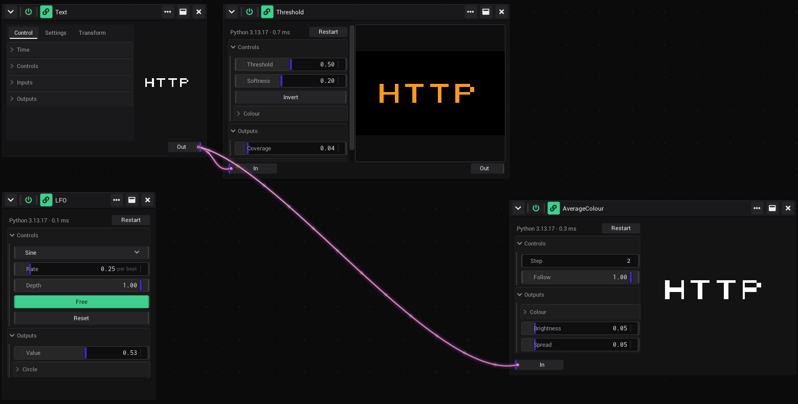

# Python generators

A Python script can be a generator. It gets controls like a [shader](Assets.md#shaders), takes pictures in, and sends
values and a picture out. Use it for what a shader cannot do: machine learning models (hand and face tracking, pose,
object detection), files, network data, statistics of a picture.

The script runs in a Python process of its own, one per generator. When the script fails, hangs or crashes, only
that process ends: the generator shows the error and VibeVJ keeps running. The process waits while the generator is
off; it ends when the generator is closed.



## What you need

Nothing: VibeVJ gets Python itself. The first time a Python generator is used, VibeVJ installs Python 3.12 and the
packages the asset names (see [Dependencies](#dependencies)) with [uv](https://docs.astral.sh/uv/), into a folder of
its own. That needs the internet once; after that it works offline.

- Your own Python instead, for every asset: write its path into `VibeVJ/configs/python.json`:
  `{"python": "/path/to/python3"}`. It wins over everything below, and VibeVJ installs no packages then.
- Without internet and without uv, an asset that names no packages runs with the Python of your system (the first
  `python3`, Windows: `python`, 3.9 or newer).

## The examples

They are in the *Assets* tab under `Generators` › `Python`. Drag one into a Patchview like any generator.

| Generator | What it does |
|---|---|
| *LFO* | A wave in Python: *Shape* (Sine, Triangle, Saw, Square, Noise), *Rate* per beat, *Depth*, *Free* (its own time instead of the beat), *Reset*. Sends *Value* and *Circle* (a point that goes round). |
| *AverageColour* | Link a picture into *In*: sends its average *Colour*, its *Brightness* and the *Spread* (the share brighter than the average). *Follow* below 1 smooths them. |
| *Threshold* | Link a picture into *In*: *Out* is the picture where it is brighter than *Threshold*, in *Colour*, with a soft edge (*Softness*); *Invert* turns it round. *Coverage* is the share that is on. |
| *Edges* | Link a picture into *In*: *Out* shows its outlines in *Colour* (*Gain*, *Threshold*; *Underlay* puts the picture under them). *Amount* is the share that is an edge. Uses numpy: the first time it installs it (see [Dependencies](#dependencies)). |

Open the files (`src/__init__.py` inside the asset) to see how they are written.

## Write your own

1. Make a folder `MyThing.py` in `VibeVJ/assets` (for example in `Generators/Python`), and in it a folder `src` with
   the file `__init__.py`. A single file `MyThing.py` works too.
2. Write the script. Above a variable, a comment `#@` with a type makes it a control:

   ```python
   #@slider min=0 max=1
   speed = 0.5

   #@output float min=0 max=1
   level = 0.0

   def process(time):
       global level
       level = (time * speed) % 1.0
   ```

3. Drag the asset into a Patchview. *speed* is a slider, *level* an output you can [link](Linking.md#make-a-link).

Every frame VibeVJ sets the variables to the values of the controls and calls `process()`. Afterwards it reads the
output variables. `process()` can also return them: `return {"level": 0.3}`.

`process()` gets what it names of these: `time` (seconds since the start), `beat` (the position of the
[timeline](Timeline.md) in beats), `bpm`, `dt` (seconds since the last frame), `frame` (a counter), and the
variables of the controls and inputs. `def process(**values)` gets all of them.

## Controls

The annotations are the ones of the shaders (`//@` there, `#@` here), and the value of the assignment is the default.
`value=` in the annotation wins over it.

| Annotation | Control | The variable in Python |
|---|---|---|
| `#@slider min=0 max=1` | a slider | a float |
| `#@float`, `#@int` | a number field | a float, an int |
| `#@bool` (or `#@button`) | an on / off button | `True` / `False` |
| `#@trigger` | a button to press | `True` for the one frame after a press |
| `#@enum options=(A, B, C)` (or `#@choice`) | a list | the text (`shape = "A"`) or the index (`shape = 0`), as the default is |
| `#@color` (or `#@rgb`, `#@rgba`) | colour sliders with a colour picker | a tuple `(r, g, b)` from 0 to 1 |
| `#@vec2` … `#@vec4`, `#@slidervec2` …, `#@ivec2` … | a group of numbers | a tuple |
| `#@text` | a text field | a string |

- More attributes: `displayname="Speed"`, `decimals=3`, `unit="per beat"`, `tooltip="..."`. A long annotation can go on
  over the next comment lines (`# max=10`).
- The annotation stands at the start of a line, directly above a variable at the start of a line. A variable with a
  type (`speed: float = 0.5`) works too.
- `#@settings rate=30 timeout=2000` (anywhere in the file): at most 30 calls a second, 2000 ms before a call counts as
  hanging (default 5000).

The controls are saved with the project and in [presets](Generators.md#presets), and can be linked and mapped to
[MIDI](MIDI.md) like any control.

## Inputs

```python
#@input size=(320,180) format=rgba
input = None
```

An input is a port at the bottom of the window: link a picture into it. While `process()` runs, the variable holds a
`shz.Image`, or `None` while nothing is linked.

- `image.width`, `image.height`, `image.channels` (4 RGBA, 3 RGB, 1 gray) and `image.data`: the bytes, one per
  channel, the rows from the top.
- `image.pixel(x, y)` is one pixel, `image.to_pil()` and `image.to_numpy()` turn it into a Pillow image or a numpy
  array (when those packages are installed).
- `size=(w,h)` is the size the picture is read at (default 320 × 180): small is fast. `format=gray` gives one byte of
  brightness per pixel.
- `image.data` is valid while `process()` runs. Keep a copy with `bytes(image.data)`.
- An input called `input` is *In*: stacked onto a clip of the [Clipview](Clipview.md) it gets the picture of the clip.

## Outputs

```python
#@output float min=0 max=1
level = 0.0

#@output texture
result = None
```

- A value output is a control in *Outputs*: `float`, `int`, `bool`, `vec2` … `vec4`, `rgb`, `rgba`, `text`, or `list`
  (any list, for example the points a tracker found).
- `#@output texture` is the picture of the script, the port *Out*: a `shz.Image(width, height, data)`. Gray or RGB
  data (`channels=1` or `3`) is made RGBA. A Pillow image or a numpy array works too. One picture output per script.

## Dependencies

A script that needs packages (numpy, Pillow, mediapipe, torch, …) names them in the `asset.json` of its asset folder:

```json
{
    "home": "assets/Generators/Python/Edges.py",
    "id": "0194abce5c5124e7",
    "python": {
        "version": "3.12",
        "dependencies": ["numpy>=1.26", "mediapipe==0.10.*"]
    }
}
```

- `dependencies`: a list of packages as `pip` takes them (a name, a version: `numpy>=1.26`, `torch==2.5.*`).
- `version`: the Python version (`3.11`, `3.12.4`). Without it: 3.12.
- A `requirements.txt` in the asset folder (or next to `src/__init__.py`) works too: one package per line, `#` for
  comments. Its options (`--index-url`, `-r`) are left out; a package index of your own goes into the configuration of
  uv (`uv.toml`).
- A single `.py` file cannot name packages: make a folder asset for it.

**The first use.** When a generator starts and its packages are not installed yet, the status line says what VibeVJ
does (*Installing Python 3.12…*, *Installing dependencies: numpy…*, under it the last line of uv). VibeVJ keeps
running meanwhile; the script starts when it is done. Large packages (torch) can take minutes. Two generators of the
same asset wait for the same install.

**Each set of packages has its own environment.** Assets that name the same packages and Python version share one;
an asset that needs another version of a package gets its own, so two assets never get in each other's way. When you
change the packages in `asset.json`, the next start installs the new set (the old environment stays until you delete
it).

**When it fails** (no internet, a package that does not exist or has no version for this Python) the status line is
red with the reason, the [Log](Troubleshooting.md#the-log) has the message of uv, and *Retry* tries again. Nothing
half installed stays.

**Where it is.** Everything goes into one folder, not into the asset and not into your own Python:

| | |
|---|---|
| Windows | `%LOCALAPPDATA%\VibeVJ\python` |
| macOS | `~/Library/Caches/VibeVJ/python` |
| Linux | `~/.cache/VibeVJ/python` |

Inside: `venvs/` (one folder per environment), `python/` (the Pythons), `uv-cache/` (the downloads) and `tools/` (uv,
when VibeVJ downloaded it). To free the space, close VibeVJ and delete the folder: what is needed is installed again on
the next use. The tooltip of the status line names the environment of a generator: delete only that folder to install
its packages again (or ask the [Chat](The-Screen.md#chat-tab) to, the query `reinstall_python_env`). `"cache": "D:/VibeVJ-Python"` in
`configs/python.json` puts the folder somewhere else.

**uv** is the one on your `PATH`, else VibeVJ downloads it (from the releases of astral-sh/uv, checked against the
SHA-256 VibeVJ knows). `"uv": "/path/to/uv"` in `configs/python.json` picks one.

## Errors

The line at the top of the window says what the script does: the Python version and how long the last frame took. When
something is wrong it is red, and the [Log](Troubleshooting.md#the-log) gets the error once. Rest the
mouse on the line to read the traceback.

- **An error in `process()`**: the script keeps running, the next frames try again. The error goes away with the first
  frame that works.
- **The script fails to load**, **Python ends** (a crash, `sys.exit()`), **a frame takes too long**: press *Restart*.
- **The install of the packages failed**: the button says *Retry* (see [Dependencies](#dependencies)).
- **`ModuleNotFoundError`**: the script imports a package its `asset.json` does not name.
- **Python is slower than the frames**: frames are left out, the picture of VibeVJ does not wait for Python.
- **You change the file**: Python starts again with the new code, the controls keep their values. When you add,
  remove or change an annotation, the window says so: *Reload module* in the … menu of the window makes the controls
  again (they keep their values and links).

## See also

- [Assets](Assets.md)
- [Generators](Generators.md)
- [Linking](Linking.md)
- [Output and devices](Output-and-Devices.md)
