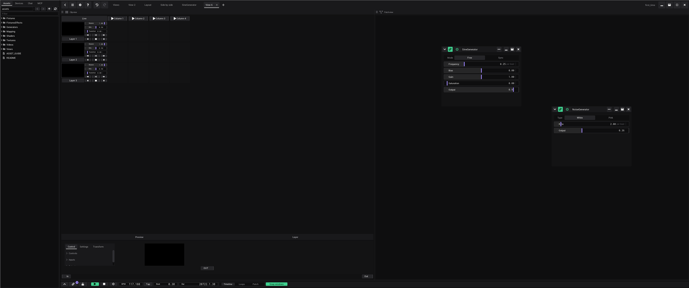

# VibeVJ user wiki

How to use VibeVJ, written for VJs. Each page says what a part of the program is for and how to use it step by step.

The same pages are in the program: the **?** button of the top bar, or F1, opens them in the Help window.

The design wiki (`../../design/wiki/`) explains what the colours, notches and sizes of the interface mean. This wiki
explains what you do with them.

## Pages

| Page | What it covers |
|---|---|
| [Getting started](Getting-Started.md) | Install, start, your first project, save and open |
| [Tutorials](Tutorials.md) | Step by step to a whole result: visuals on the beat, an effect chain, a live set, a MIDI controller, a projector, lights, a show on the timeline, the night of the show |
| [The screen](The-Screen.md) | Top bar, sidebar, areas and views, moving views, undo, the Help window, tooltips |
| [Generators](Generators.md) | What a generator is, adding one, the window header, selecting and moving, presets |
| [Assets](Assets.md) | What comes with VibeVJ: generators, shaders, views, mapping, fixtures |
| [Linking](Linking.md) | Notches, dragging links, link types, the options of a control, envelopes, cable view |
| [Clipview](Clipview.md) | Layers, clips, columns, Master / Mix / Transition, autoplay, live and next, macros |
| [CueList](CueList.md) | Clips as lists of cues with big buttons |
| [Timeline](Timeline.md) | Play, Stop, BPM and Tap, Bar, clips on lanes, the loop, the view switch, show mode |
| [MIDI](MIDI.md) | Devices, MIDI learn, MIDI mapping |
| [Web remote](Web-Remote.md) | A phone or tablet as a remote: transport, blackout, clips, your own faders; pairing and trust |
| [Audio](Audio.md) | Audio Input Analysis: beat, energy, break and drop |
| [Python generators](Python-Generators.md) | A Python script as a generator: controls from `#@` comments, pictures in, values and a picture out |
| [Video](Video.md) | Video clips: playback, speed, formats |
| [Output and devices](Output-and-Devices.md) | Shader output, NDI, Spout, Art-Net, fixtures, mapping, Prolink |
| [Lighting desk](Lighting-Desk.md) | Programmer, palettes, cue stacks and executors for lamps and mapping, as on a lighting console |
| [Settings](Settings.md) | Project, links, appearance, output, view scaling |
| [Shortcuts and tips](Shortcuts-and-Tips.md) | Keys and gestures |
| [Troubleshooting](Troubleshooting.md) | When something does not work |

## Where to start

- New here: [Getting started](Getting-Started.md), then the [tutorials](Tutorials.md), then [The screen](The-Screen.md).
- You want things to move: [Linking](Linking.md) and [Audio](Audio.md).
- You play live: [Clipview](Clipview.md), [MIDI](MIDI.md), the [web remote](Web-Remote.md) and [show mode](Timeline.md#show-mode).
- You bring the picture out: [Output and devices](Output-and-Devices.md).
- You run light and video together, as from a lighting console: [Lighting desk](Lighting-Desk.md).

## Words

The wiki uses the same words as the program. They are in `glossary.json`: the Help window shows them as its page
*Glossary*, and the tooltips of the program show them as links.

## Writing a page

Every new feature or UI change adds or updates its page here in the same pull request (see `../AGENTS.MD`,
*Documentation: every feature gets its user wiki page*).

- Plain Markdown, English, sentence case, the words of the program.
- What it is for, then the steps, then a table of the controls if there are many.
- At least one current screenshot or GIF in `media/`. Until it is taken, a line `> Screenshot to add: …` says what to
  capture (the Help window does not show such a line).
- Only what the program does today. Planned things are marked *(Planned.)*.

### Writing a tutorial

A tutorial (`Tutorial-<Name>.md`, listed on [Tutorials](Tutorials.md) and in `HELP_ORDER` of
`src/menu/helpwindow.shio`) builds one whole result from a new project. It differs from a reference page:

- It starts with what you build, the time it takes and what you need (hardware, an earlier tutorial).
- Its parts are steps in the order you do them, each part a heading, so the Help window and links can lead there.
  Each step names the control as the program shows it; a part ends with a link to the reference page that says more.
- It ends with "What you learned", a "Next:" line and "See also".
- Walk it through in the running app before it is merged (on Linux under Xvfb: `_testing/linux_app/`), and take its
  picture there. What the walk-through found (2026-11-01): the window of a shader has its controls on the left and the
  picture on the right, its sections (*Controls*, *Outputs*) start closed; the *Filter* of the *Assets* tab filters on
  Enter; the *Preview* of a Clipview is a shader with its own *Outputs* › *Monitor*; a clip dropped onto the timeline
  opens the *Clip* panel, which covers part of the lanes.

### Links

- Link to the place that says more, not only to the page: `[Moving a view](The-Screen.md#moving-a-view)`, on the same
  page `[Moving a view](#moving-a-view)`.
- The name of a heading in a link is its text in small letters, signs dropped, a `-` for every blank: "Undo and
  redo" is `#undo-and-redo`. GitHub and the Help window make it the same way.
- Renaming a heading breaks the links to it: search the wiki, `glossary.json` and the tooltips (`[[wiki:`) for its
  old name.
- `python _testing/wiki/check_links.py` (from the root of the repository) checks every link, picture, glossary page
  and tooltip link, and says which ones lead nowhere.
- A page ends with "See also": a list of links, one per line. The Help window shows them as buttons.
- In the Help window a link shows a tooltip: the glossary term with the same name as the link text, or the heading
  and the first lines of the part it leads to. So start every part with a sentence that says what it is about.

### What the Help window shows

Headings (three levels), paragraphs, lists (one level of nesting), tables, pictures and GIFs, notes (`>`), code
blocks, links. Bold and italic show in paragraphs, list items and notes (not in tables and headings, there they lose
their marks). A `|` inside a table cell is written `\|`.

### The glossary and the tooltips

`glossary.json` has one entry per term: `title`, `text` and `page`, and `auto` for some. The key is in small letters.

- `text` is one or two sentences. Other terms in it are links: `[[area]]`, or `[[area|areas]]` to show another word.
- `page` is the place in the wiki that says more: `The-Screen#views-and-tabs`.
- The Help window finds the terms in the text of the pages by itself and gives the first use of each in a part (the
  text under a heading) a dotted line: its tooltip is the term, a click goes to `page` (#378). Whole words in any case
  and the plural with -s / -es / -ies; not in headings, code, links, **bold** and *italic*, not on the page of the
  term's own `page`, and not when a link of the same paragraph already shows the word. So write a term plainly, and
  the name of a control in bold or italic.
- `"auto": false` keeps a term out of that: a word the pages also use in another sense (*live*, *port*, *palette*,
  *loop*, *stack*, *cue*, ...). `_testing/nanogui/help_term_links.shio` checks the linking on the real pages.
- A tooltip in the program links a term the same way: `"Split right: an empty [[area]] appears beside this one"`.
- A tooltip leads into the wiki with `[[wiki:The-Screen#moving-a-view]]` on a line of its own. It shows as *More in
  the wiki (F1)*, and F1 on the control follows it. A tooltip that links a term needs none: F1 follows the page of
  the term.
