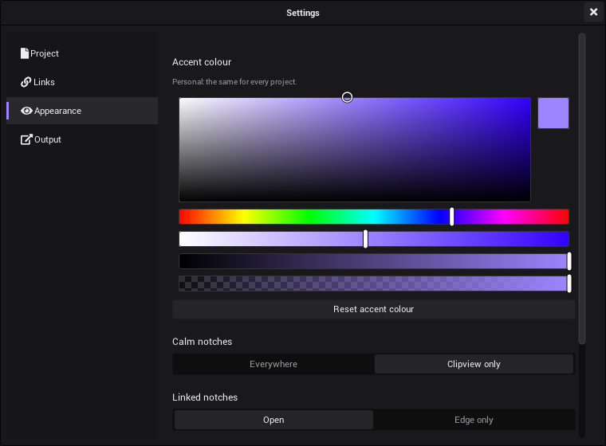

# Settings

The settings have a window of their own, *Settings*. Its pages *Project* and *Links* belong to the project, the pages
*Appearance* and *Display* are personal and valid for every project, and the page *Output* is for the output of the
whole window. This page also explains how to scale views with Page Up and Page Down.

## Open the settings

1. Click the gear button (⚙) in the top bar, between the sidebar button and the help button (?).
2. Click a page in the list at the left side of the window: *Project*, *Links*, *Appearance*, *Output* or *Display*.

The window floats above the program.

- **Move:** drag its header.
- **Close:** click its ×, or press Esc while the window has the focus. Closing keeps all values.

## Project

The settings on the page *Project* are saved with the project, except *Autosave*. The page has three sections,
"Output size", "Timing" and "Autosave".

| Setting | What it does |
|---|---|
| *Size from* | Where the output size comes from: *Output displays* (the standard for a new project) takes the resolution of the first output display of [*Display*](#display) and follows when displays are plugged in or out, also at another venue. *Manual*: *Target width* and *Target height*. Without an output display the size stays as it is. |
| *Target width*, *Target height* | The output size. New shader generators and the mapping tools start with this size. Typing a value sets *Size from* to *Manual*. |
| *Common size…* | Sets the output size to a common one: 16:9 (1280 × 720 to 3840 × 2160), 16:10, 21:9 (2560 × 1080, 3440 × 1440, 3840 × 1600, 5120 × 2160), 32:9, 4:3 and 5:4. *Size from* becomes *Manual*. |
| *Target FPS* | How many frames per second VibeVJ draws. Starts at the refresh rate of your screen. The lowest value is 30; 0 means no limit. It has no options: to map it to MIDI, see [MIDI](MIDI.md#the-midi-tab-in-the-options). |
| *Default sync* | How the time of a new shader generator runs: *Free*, *Manual* or *Sync* (see below). |
| *Current FPS* | Shows the frames per second VibeVJ reaches right now. |
| *Autosave* | How often the open project is saved to the autosave folder: *Off*, *1 min*, *2 min*, *5 min* (the standard) or *10 min*. Personal, see below. |

### Default sync

Every shader generator has a *Time* section with its own *Sync* setting. *Default sync* only sets what a **new** shader
starts with; you can change each shader later.

| Choice | The shader's time |
|---|---|
| *Free* | Runs on its own, in seconds, times the shader's *Multiplier*. |
| *Manual* | Stands still. You set *Time* yourself, or link it to another control. |
| *Sync* | Follows the timeline position, in beats. It stops when the timeline stops. |

### Autosave

*Autosave* writes the open project into the folder `VibeVJ/autosave/` as often as you choose here. If VibeVJ does not
close properly, the next start offers to restore it: see [Autosave](Getting-Started.md#autosave). It never writes into
your project folder.

The setting is personal like the ones of *Appearance*: it is kept in `VibeVJ/engine/style.json`, the same for every
project, and takes effect at once. Saving a big project takes a moment, and an autosave can make a frame late, so
there is none in [show mode](Timeline.md#show-mode): the time starts again when you leave it. If an autosave still
shows in your output while you build, choose a longer time.

## Links

The settings on the page *Links* are saved with the project.

| Setting | What it does |
|---|---|
| *Cable view* | Draws every link whose two controls are on screen as a cable: the cable view. |
| *Off-screen link hints* | Puts a small badge with a number on a control whose link partner is not on screen. |

### Cable view and off-screen link hints

*Cable view* turns the whole screen into the cable view: every link whose two ends are visible is drawn as a cable.
It does not open the notches. Turn it off to keep the screen calm while you play. The link button in the
[timeline bar](Timeline.md#the-transport-bar), next to the show mode lock, is the same switch.

- A generator with *Always draw links* on (the link icon in its header) draws its own cables also when *Cable view* is
  off. See [Generators](Generators.md). The link button in the timeline bar counts these local cable views in a small
  bubble and, when you rest the mouse on it, splits to offer a broken link that ends them all ([Linking](Linking.md#seeing-your-links)).
- *Off-screen link hints* work only while *Cable view* is on. The badge counts the links of that control whose other end
  is not visible right now: in another tab, scrolled away or covered by a window. It is not the number of all links.
- In show mode there is no cable view and no badges.

More about cables and notches: [Seeing your links](Linking.md#seeing-your-links) and
[Calm notches](Linking.md#calm-notches).

## Appearance

The settings on the page *Appearance* are personal. They are not saved in the project but in the file
`VibeVJ/engine/style.json`, so they stay the same for every project. They take effect at once.

| Setting | What it does |
|---|---|
| *Interface size* | How big everything is drawn: a slider from 50 % to 200 %, on top of the scale of your system, and *Auto*. See [Interface size](#interface-size). |
| *Accent colour* | The colour picker sets your highlight colour, used for links and selection. Violet at the start. |
| *Reset accent colour* | Sets the accent colour back to violet. |
| *Depth* | How much sections and panels stand out: *Flat*, *Subtle* (the standard) or *Strong*. See [Depth](#depth). |
| *Calm notches* | Where free notches show their grey edge: *Everywhere* (the standard) or *Clipview only*. |
| *Linked notches* | *Open* (the standard): a linked notch is open. *Edge only*: it stays a thin coloured edge until you hover the row. |
| *Area headers* | *Always* (the standard): every area shows its header. *Auto-hide*: the header takes no room and only comes while the mouse is at the top edge of the area. One area can differ, see [The screen](The-Screen.md#the-header-of-an-area). |

### Interface size

VibeVJ follows the display scale of your system. On a screen where that is too small or too big, *Interface size*
changes it for VibeVJ alone:

1. Open *Settings* › *Appearance*.
2. Drag the slider under *Interface size*, in steps of 5 %. *100 %* is the scale of your system. The number next to it
   shows the size while you drag; the views and the timeline change when you let go.
3. *Auto* gives VibeVJ the choice again.

With *Auto* (until you pick a size), VibeVJ looks at the screen its window is on. Only a screen as dense as 4K, with at
least 2000 rows at the scale of the system (a 4K screen at 100 %, mostly under Linux), gets everything bigger, so that
about 1920 × 1080 still fit. Every other screen keeps *100 %*, an ultrawide screen too (2560 × 1080, 3440 × 1440,
5120 × 1440): it is wide, not dense. Useful beyond that when you stand far from the screen. It works the same on Windows, Linux and macOS: on a Mac the window keeps its size and everything in it is
drawn bigger or smaller, still sharp on a Retina screen.

### Depth

Sections (the blocks with a chevron, like *Inputs* and *Outputs*) and the panels of a view, like *Preview* and *Layer* of
the Clipview, can stand out from what is around them:

| Choice | What you see |
|---|---|
| *Flat* | No panels: sections are only their title and chevron, panels only their tone. |
| *Subtle* | The standard. A section sits on a slightly lighter panel with a light top edge and a dark bottom edge; a section inside a section is one step lighter again. Panels with a header get the same edges. |
| *Strong* | The same, twice as strong. |

To change it:

1. Open *Settings* › *Appearance*.
2. Pick *Flat*, *Subtle* or *Strong* under *Depth*.

### Calm notches

Free notches are thin grey edges at rest in every view. A notch opens in full while the mouse is over its row, while you
drag a link from it, and while it is linked (unless *Linked notches* is *Edge only*). The cable view does not open them.

| Choice | What you see |
|---|---|
| *Everywhere* | Free notches show a grey edge in every view. |
| *Clipview only* | Free notches show a grey edge only in the Clipview; elsewhere they appear when you hover the row. |

To change it:

1. Open *Settings* › *Appearance*.
2. Pick *Everywhere* or *Clipview only* under *Calm notches*.

The cable view draws the cables, it does not open the notches.

### Linked notches

| Choice | What you see |
|---|---|
| *Open* | A linked notch is open at full width, so you see at once which rows are linked. |
| *Edge only* | A linked notch is a thin coloured edge, quieter with many links. Hover the row to open it. |

Show mode always shows linked notches as thin coloured edges, whatever you pick.

### Move areas with

Holding this key and dragging anywhere in an area moves its view to another area: *Alt + drag* (the standard),
*Ctrl + Alt + drag* or *Off*. Some window managers on Linux move a window with Alt + drag and never pass it on; pick
*Ctrl + Alt + drag* there. Dragging an area by its header always works. See
[The screen](The-Screen.md#moving-a-view).

## Output

The page *Output* is for the output of the whole VibeVJ window.

| Setting | What it does |
|---|---|
| *Blackout* | How the outputs come back after a [blackout](Output-and-Devices.md#blackout): *At once*, *0.5 s*, *1 s* (the standard), *2 s* or *4 s*. Personal, kept in `VibeVJ/engine/style.json`. |
| *NDI stream* | In the section "NDI". *Enable NDI* sends the whole VibeVJ window, interface included, as an NDI source named after *NDI name* (*ProgramOut* at the start). |

The NDI output of a single shader is on [Output and devices](Output-and-Devices.md).

## Display

The page *Display* lists every connected display: its name, the size the system runs it at (with its shape: 16:9,
16:10, 21:9, …), its refresh rate and, for each one, two choices. They are personal, kept in `VibeVJ/engine/style.json`
for each display by its name, so they come back at another venue however the displays are plugged in. Two displays of
the same model are told apart by their order ("Name (2)").

| Setting | What it does |
|---|---|
| Role | *Control*: a screen of the operator, at the FOH. It shows VibeVJ; the size of the picture does not matter for it. *Output*: a projector, an LED wall or a monitor on stage; the picture is made for it. *Auto* (the standard): the display the VibeVJ window is on is *Control*, every other one *Output*. |
| Resolution | The size the picture is made in for this display. *Auto* (the standard): the size the system runs it at. The list also has the common sizes (16:9, 16:10, 21:9, 32:9, 4:3, 5:4; "the display lists it" marks the ones the display reports itself), other sizes the display reports, and *Custom…* for any width and height. Pick one when a display reports a wrong size, for example behind a scaler, a splitter or an LED processor. |
| *Detect displays* | Looks at the displays again. VibeVJ also notices by itself when a display is plugged in or out. |

What follows from it:

- The project size follows the first output display while *Size from* on the page [*Project*](#project) is *Output
  displays*. The line at the top of the page says which size and display that is.
- The *Display* lists of the outputs (a shader, MapLab) name each display with its resolution and role:
  "Display 2 · BenQ W1070 · 1920 × 1080 (16:9) · Output".
- A shader whose *Size* is *Custom* renders in the resolution of the display it is shown on. With *Size* *Project* it
  keeps the project size. See [Output and devices](Output-and-Devices.md#show-the-picture-on-a-display-or-projector).

VibeVJ does not switch the mode of a display: the system keeps running it at its size, and *Picture* (*Stretch*, *Fit*,
*Fill*) of the output decides how a picture of another shape is shown on it.

## View scaling with Page Up and Page Down

You can make the content of a view bigger or smaller, for example to fit a big Clipview on a small screen.

1. Click into the view, or into the sidebar.
2. Press Page Up to make it bigger, Page Down to make it smaller. Each press changes the size by about 10 %.

| Where | How to scale | Kept after a restart |
|---|---|---|
| An area of a view tab, a tab of a Tabview, half of a split | Page Up / Page Down | Yes, with the project |
| The sidebar | Page Up / Page Down | No |
| A Patchview | Mouse wheel, the zoom chip, Ctrl + 0 / Ctrl + 1; right or middle mouse button drags the area | Yes, with the project |
| The timeline area | Mouse wheel; right or middle mouse button drags the area | No |

Scaling does not work while a generator window is maximized.

## See also

- [Linking](Linking.md)
- [The screen](The-Screen.md)
- [Output and devices](Output-and-Devices.md)
- [Getting started](Getting-Started.md)
- [Shortcuts and tips](Shortcuts-and-Tips.md)
