# Stage

The stage is the room, the set and the decoration of a show in 3D: trusses, panels, the decoration you printed or
built, put where they stand. The [fixture setup](Output-and-Devices.md#the-stage-in-3d) shows them in its 3D view next
to the lamps, so you see the rig in the room it hangs in. The stage is saved with the [project](Getting-Started.md).

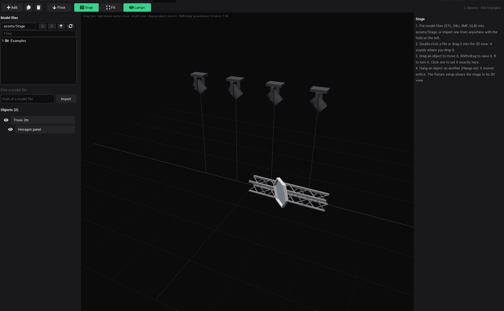

The Stage menu is in the toolbox button at the right end of the top bar ([Tools](The-Screen.md#tools)), and in the
command palette (Ctrl + K, "Stage"). Closing its tab only hides it.

## Model files

A model on the stage comes from a 3D model file in `assets/Stage` (subfolders are fine). VibeVJ reads:

| Format | Notes |
|---|---|
| **STEP** (`.step`, `.stp`) | From Fusion and every CAD program. Converted once into triangles (see [STEP files](#step-files)); each body is a part with its name and colour, an assembly places its parts as it says. |
| **3MF** | From Fusion, Bambu Studio, MakerWorld downloads. Says its unit; each body is a part with its colour. |
| **STL** | From any CAD or printing program. No unit in the file: millimetres unless you set *Unit*; z up unless you set *Up*. One part, no colour. |
| **OBJ** (with its `.mtl`) | Each object or group is a part, with the colour of its material. Millimetres and y up unless you set *Unit* and *Up*. |
| **glTF binary** (`.glb`) | Metres; each node with a mesh is a part, with the base colour of its material. |
| **Gaussian splats** (`.ply`, `.splat`) | A scan of the venue: see [Scans of the venue](#scans-of-the-venue). |

*Examples* in `assets/Stage` has a 2 m truss (STL) and a hexagon panel with a diffuser (3MF) to try it out.

- A file from somewhere else: paste its path into *Path of a model file* on the left and click *Import*. It is copied
  into `assets/Stage` (an OBJ with its `.mtl`) and put on the stage.
- A model is read once, in the background: a big one shows a moment later. *Reading* in the status at the top right
  counts the ones still being read; a file that cannot be read is red in the list, its reason in its tooltip and in the
  inspector.
- A model file you change and save again is read again the next time the Stage menu opens.

## STEP files

A STEP file has the exact surfaces of the CAD model, not triangles. VibeVJ converts it once into triangles with
OpenCASCADE and keeps them in a file next to it (`<name>.step.stagemesh`).

1. Put the STEP file on the stage like any other. Until it is converted it is orange in the list and shows nothing.
2. Select it: the inspector shows *STEP* with *Detail* (how close the triangles follow curved surfaces: *Coarse* 1 mm,
   *Normal* 0.3 mm, *Fine* 0.1 mm) and *Convert*.
3. The first time, VibeVJ asks before it installs OpenCASCADE (a CAD library in Python): about 170 MB to download once,
   1.2 GB on disk, in the same place as the environments of [Python generators](Python-Generators.md#dependencies), for
   every project. The inspector shows what is being installed, then *Converting*. The status at the top right says
   *converting STEP* meanwhile; the program goes on as usual.
4. When it is done the model shows: each body of the file with its name and colour.

- Keep the `.stagemesh` next to the STEP file (copy both, put both into your project's folder): another computer shows
  the model without OpenCASCADE.
- Changed and exported again in Fusion: the old version stays visible, the inspector says that the file changed; click
  *Convert again*.
- Fusion designs made with y up (the Fusion default for older designs): set *Up* to *Y up*.

## Build the stage

1. **Add** in the toolbar has everything that goes onto the stage: the model file picked in *Model files* on the left,
   an LED wall or a screen, and the pieces made from their measures (trusses, decks, ...). What you choose **follows
   the mouse**, standing on what is under it and snapping to the grid and the joints of trusses: **click** where it
   goes, Escape or a right click if not (a drag of the right button turns the view meanwhile). A model file can also be double-clicked or dragged into the 3D view:
   it stands where you drop it.
2. Drag an object to move it over the stage at its height. *Shift + drag* moves it up and down (the top left shows the
   height). R turns it by 15° around its vertical axis, Shift + R back.
3. Click an object to set it exactly in the inspector on the right: *Position* in metres (x to the right, y towards the
   audience, z up, as in the fixture setup), *Turn* in degrees around x, y and z, *Scale*.
4. *Floor* puts the selected objects on the floor: their lowest point at height 0. A model from CAD often has its
   origin somewhere else.

- *Snap* (on): a drag snaps to 5 cm.
- **Standing on things**: an object that stands on the floor or on something goes up onto what you drag it over and
  down again beside it: a DJ booth onto the decks, a top onto a sub. What carries: decks, booths, speakers and model
  files that stand on the floor (not trusses, stairs, stands, curtains or what hangs). Raised objects keep their
  height.
- *Lamps* shows the lamps of the fixture setup in the Stage view too, with their beams as they are sent.
- **The mouse** works as in Fusion and other CAD programs: drag with the **right** mouse button to turn the view, with
  the **middle** one to move it, scroll to zoom. The **left** button only selects and moves objects, so turning the
  view never moves anything, even when a large object (a scan of the ground) fills the picture. A right click without
  moving does what it did before (it takes away what is being placed). In the show mode, where nothing can be moved,
  the left button turns the view too.
- *Fit* (or F while no tool is on) shows the selected objects, or everything when nothing is selected.
- Shift + click (or Ctrl + click) selects more; a drag then moves them all. Ctrl + A selects all, Escape none; a click
  on the empty stage selects none.
- **Drag on the empty stage** (left button) draws a box: what is in it is selected (with Shift: added).
- **View** in the toolbar (or the numpad): *Top* (7) a plan from straight above, *Front* (1) as the audience sees it,
  *Side* (3): without perspective, true to scale (a metre is as long on the screen at any height), with a scale bar at
  the bottom right and the outline and name of every object; *3D* (0) with perspective again. They show the selected
  objects or everything. **Save the plan (PNG)** in View writes the view, twice its size, without the palette and the
  hints, into the folder `screenshots` of VibeVJ (the status says where).

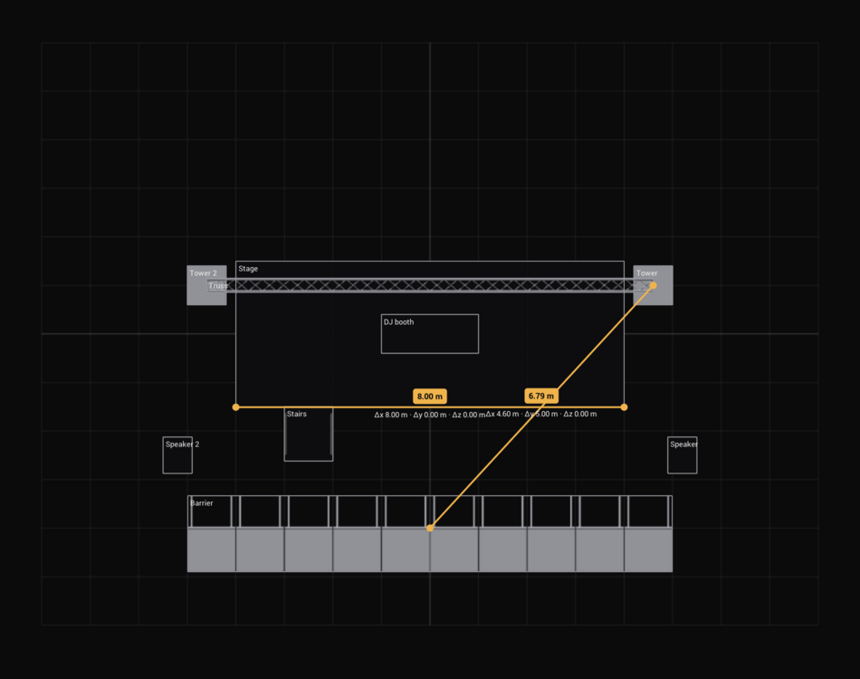

### Measure

The **tape measure** (the ruler at the end of the palette, or **M**): click two points, it shows how far they are
apart and how far along x, y and z. A point snaps to a joint (a truss end, the top of a tower) or a corner of an object
within a few pixels (a ring shows it), else it is on the surface under the mouse, else on the floor. While you measure,
the line follows the mouse. The measurements stay (also in a saved plan) until **Escape**: once cancels the one being
measured, again clears them all. The right mouse button turns the view as usual. They are not saved with the
project.
- **Undo** (Ctrl + Z, the arrows at the top left) takes back a change of the stage: an added or removed object, a
  drag, a turn, the numbers on the right, a folder, a change the Chat made. A drag is one step; numbers changed within a
  second are one step. The tooltip of the arrow says what it takes back ("Stage: move").
- The copy button (Ctrl + D) duplicates the selected objects, the bin (Delete) removes them. The model files stay.

## Trusses, decks and more

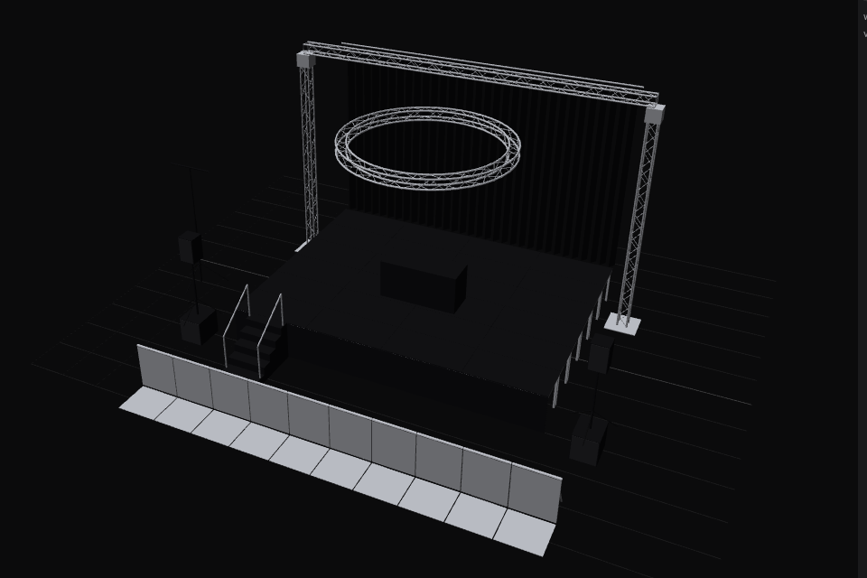

What stands at every show is in **Add** in the toolbar, made from its measures (no model file needed). Click a size
in the list, then where it goes on the stage; on the right are all its measures, every one can be changed.

| Piece | Measures |
|---|---|
| Truss | profile (square, triangle, ladder), straight (length) or an arc (radius, angle; 360°: a circle), width (290 mm: the common rental truss), the tubes, aluminium or black |
| Stage (decks) | decks across and deep, the size of one deck (2 × 1 m is the common system), height of the top (legs of 20 to 100 cm), surface, a black skirt at the front or all around |
| Stairs | width, height (that of the deck), tread, handrails. Their top step's back edge is their place: put it at the front edge of the deck |
| Ground support | height to the top of the sleeve block (where the truss across goes), the truss, the base plate |
| Crank stand | height, the T-bar on top |
| Speaker | width, depth, height, on a stand (the height of the box's bottom; 0: on the floor) |
| Front barrier | elements of 1 m, height, the step plate in front |
| Curtain | width, height, folds, colour, on a pipe |
| DJ booth | width, depth, height of the table |

- Each stands with the middle of its bottom on its place and faces the audience (+y). A straight truss lies along x;
  turn it with R or the [turn tool](#move-and-turn-tools). A truss hung at 6 m: its *Position* z 6.
- *Type* turns a piece into another one (with that one's defaults).

### Join trusses

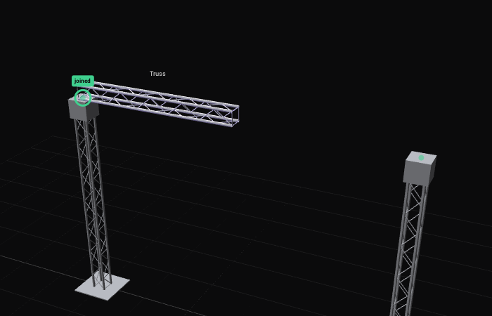

With *Snap* on, a truss you drag (over the floor, up and down with Shift, or with the [move tool](#move-and-turn-tools))
joins the next free piece when it comes near: its end onto the end of another truss that points at it, or onto the
top of a ground support tower (it then lies on the sleeve block, its end over the middle of the tower). A tower
dragged under a truss end joins it too. While you drag, the free joints show as green dots, the one it joined as a
green ring. Turn a truss first (R, the turn tool) so that its end points at the one it should join. Snap off: nothing
joins.
- They are saved in the project like the models, and the fixture setup's 3D view shows them.

## Move and turn tools

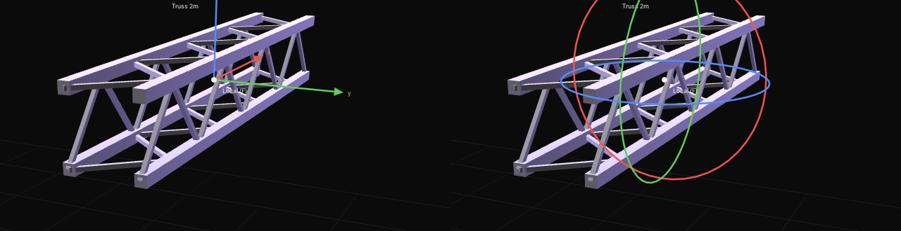

For exact placing, as in a rocket workshop: select an object, then pick a tool in the palette at the bottom left of
the 3D view, or press its key (the small number on the button). The button under the mouse says what it does.

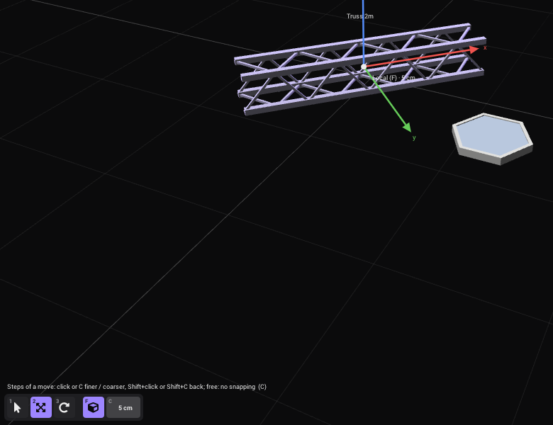

| Key | Tool | |
|---|---|---|
| 1 | Select | the normal drag over the floor |
| 2 | Move | three arrows: drag one to move the object only along that axis |
| 3 | Turn | three rings: drag one to turn the object only around that axis |
| F | World / Local | the globe (World) or the cube (Local): the arrows and rings along the axes of the stage (x right, y towards the audience, z up) or along the object's own axes, as it is turned |
| C, Shift + C | Steps | the last button: finer / coarser steps of the tool in use, round to *free* (no snapping). Turn: free, 1°, 5°, 15°, 30°, 45°, 90° (R turns by them too); move: free, 1 cm, 5 cm, 10 cm, 25 cm, 50 cm, 1 m. Click: the next, Shift + click: back |

Drag a ring *along* it, from where you grab it: that point of the ring follows the mouse, so the object turns the way you
pull, from whatever side you see the ring. While you turn, a slice of the ring shows how far, from where you grabbed it
to where it is now, with the angle beside it and the marks of the steps around the ring.

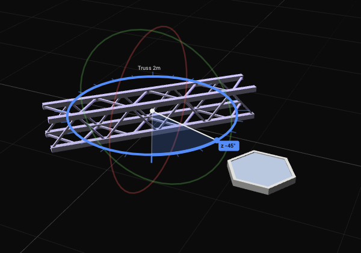

- The steps start at 5 cm and 15°. The label at the middle shows how far (`x +400 mm`, `z -90°`). *Snap* in the toolbar
  is for dragging objects over the floor with the select tool (5 cm).
- The tools sit in the middle of the object's model (its box), and it turns around that point: it stays where it
  is. With more objects selected they all move or turn together, around the middle of the first one.
- An object that [hangs on another](#hang-an-object-on-another) moves along the axes you see, even when the one it hangs
  on is turned.
- Beside the arrows and rings the mouse works as with the select tool: click another object to select it, drag with
  the right mouse button to turn the view.
- **Type a number** while you drag an arrow or a ring: `1.5` and the object is moved exactly 1.5 m along that axis
  (a ring: turned 1.5°), `-` turns the sign round, Backspace takes a digit back; let go of the mouse to keep it. The
  label says what you typed. While dragging, 1, 2, 3 are digits, not the tools.
- **Escape** (or the right mouse button, pressed while the left one is held) while you drag an object, an arrow or a ring: everything goes back where it
  was.
- **Alt + drag** an object: a copy of it (of the selected ones) is dragged away, the original stays. Alt + click
  without moving makes no copy.

## Rows and spacing

- **Row** (on the right of an object, *Copies in a row…*): *Copies* (how many, it with them), the axis (its own x, y or z, as it is turned)
  and the step in metres; 0 is as big as it is, so they touch: trusses end to end, decks edge to edge. *Make the row*
  puts the copies after it (with what hangs on it) and selects them all. Eight panels along a truss: hang the first
  on the truss at its left end, then a row of 8 along x with the step you want.
- **Distribute evenly** (with three or more selected): the first and the last you selected stay, the ones between go on
  the line between them at equal distances. Select them in the order of the row.

## Symmetry

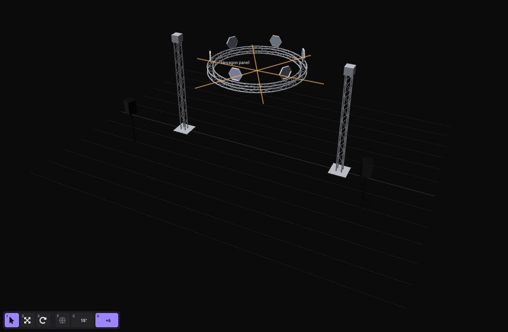

The last button of the palette (or **X**, **Shift + X** back) sets the symmetry new pieces get: *off*, *Mirror* or
*×2* to *×8*. A piece added then (with Add, or a model file dropped in) comes with its counterparts at once:

- **Mirror**: a second one mirrored at the middle: of the stage (x = 0), or, when it hangs on something, of that: two
  lamps on a truss sit mirrored on its middle, wherever the truss stands and however it is turned.
- **×2 … ×8**: the pieces turned around the middle, or around the centre of what they hang on: panels around a truss
  circle.
- The pieces of a group stay linked: move, turn or change the measures of one, the others follow. Selected
  together they move as they are.
- Removing one removes the group. *Symmetry* on the right says what group a piece is in; *Detach* takes it out.
- While symmetry is on, the view shows its mirror line or its spokes.

## LED walls and screens

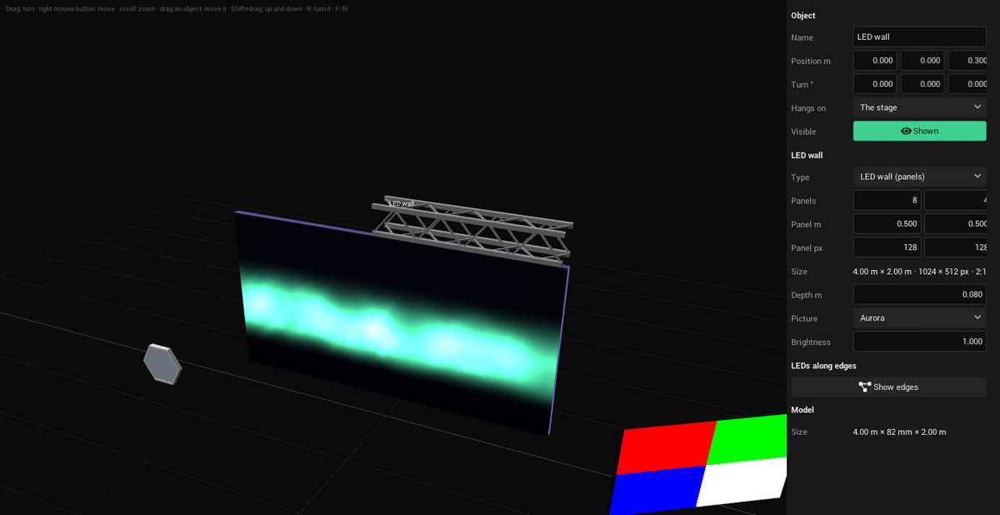

An LED wall, a projection screen or a monitor on the stage shows a picture of VibeVJ: you see the visuals where they
will be, next to the rig and the decoration.

1. *Add* › *LED wall* (or *Screen*) in the toolbar puts one on the stage where you click. Its place is the middle of its
   bottom edge; it faces the audience. Move, raise, turn and hang it like any object (on a truss: *Hangs on*).
2. *Type*: *LED wall (panels)* is built of panels: *Panels* across and up, *Panel m* (the size of one, 0.5 × 0.5 m is
   common) and *Panel px* (its pixels: P3.9 on 0.5 m is 128 × 128). *Size* says how big the wall is and how many pixels
   its picture needs (the size of the output you send to it, and its aspect). *Screen / monitor* takes its width and
   height in metres.
3. *Picture*: what it shows. The list has every picture whose **video router** is on (a shader, video or output:
   *Outputs* › *Video router* › *Enable router*), by its name. Pick the one that goes to the real wall.
4. The picture shows with [Simulation](#simulation) on (it is drawn again every frame then); off, the wall is dark.
   *Brightness* makes it brighter or darker here only.

The fixture setup's 3D view shows the walls and their pictures too. A pixel-mapped LED wall that gets its colours over
Art-Net is a matrix in the [LEDMapper](Output-and-Devices.md#ledmapper), placed [on the stage](#leds-on-the-stage).

## Scans of the venue

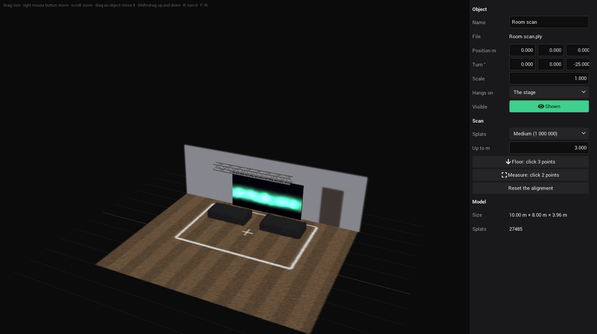

A scan of the room you play in (its floor, the walls, what stands there) is the base the stage is built on: the
trusses, the decoration, the LED walls and the lamps stand where they will stand, and you see whether they fit. VibeVJ
shows scans made as **Gaussian splats**, as phone and desktop apps make them from a video or photos of the room
(Scaniverse, Polycam, Luma, Postshot, and other 3D Gaussian splatting tools): export a `.ply` (or a `.splat`) and put it
into `assets/Stage`. A plain point cloud `.ply` (points with colours) works too.

1. Add the file as any model (double-click, or drag it into the 3D view). A scan comes in a frame of its own: often
   standing on its side, its floor anywhere, in a size that is not metres.
2. **Floor: click 3 points** (in the settings on the right), then click three points of its floor in the 3D view, far
   apart (drag to turn the view between the clicks). The scan is turned and moved so that its floor is level at height 0.
3. **Measure: click 2 points**, then two points whose real distance you know (the edge of the stage, a door, tape
   marks), enter it under *Real m* and click *Scale to it*: the scan has its real size. Many phone scans (with LiDAR)
   are in metres already: measure once to check.
4. Turn it around the vertical with *Turn* z so that its walls run along the axes, move it with *Position*.
   *Reset the alignment* starts again.

- *Splats*: how many are drawn at most (*Low* 300 000, *Medium* 1 000 000, *High* 4 000 000): every n-th of a bigger
  scan, for a slower computer.
- *Up to m*: only what is up to this height above its floor (the ceiling and what hangs from it go, so you look in from
  above); 0 shows everything.
- A scan is drawn as it was seen from every side (the colour of each splat without its changes with the angle). It is
  not lit by the lamps and lets no light through.

## The open-air example

The template **openair** (*Projects* › *Templates*, see [Templates](Getting-Started.md#templates)) is a whole open-air
floor to look at and to start from: everything on this page in one project.

| Folder | What is in it |
|---|---|
| *Gelände (Splat-Scan)* | a clearing in a forest, about 100 × 130 m: meadow, a trampled floor, gravel paths, 198 trees and bushes. A [scan](#scans-of-the-venue) as a `.splat`, made by a script, not scanned (see below) |
| *Bühne* | a stage of 12 × 5 m, 1.2 m high, with stairs, DJ booth, four ground support towers, a truss square at 6.5 m, the LED wall behind the DJ, a black curtain, a front barrier |
| *PA* | two subs and a top on each side, two delay towers in the middle of the floor ([symmetry](#symmetry): a change of one side changes the other) |
| *LED-Wände* | the LED wall of the stage, side LED walls on risers turned to the floor, an LED banner under the front truss, delay screens on the delay towers. All show the picture *Hauptausgang*: the video router of the composition (the mix of the clip view) |
| *LED-Tunnel* | six hexagon frames over the path to the entrance with a ring of [LEDs along the inner edge](#leds-along-edges) of each, in the LEDMapper of the view tab *Mapping & LED*. Their colours are its [3D effect](#colours-of-the-leds-on-the-stage) (a rainbow from the back to the front); the frames are [opal acrylic](#materials), so they glow |
| *Mapping* | a wall of white cubes beside the floor and a projector on the roof of the FOH hut pointing at it. MapLab (beside the LEDMapper) is empty: the mapping itself is yours to make |
| *FOH*, *Bar & Sitzplätze* | a FOH hut with the desks, a bar in a 20 ft container, beer tables |

The lamps of the fixture setup (moving heads under the front truss, pars in the pit, bars on the stage) have no
Art-Net node: nothing is sent until you give them one.

- The LED walls stay black until a clip plays: launch a column of the clip view (*Views*).
- Turn the [Simulation](#simulation) on to see the LED walls and the glowing frames as they will look.
- The models are in `assets/Stage/OpenAir`. The scan and the models are made by the scripts in
  `tools/stage_openair` of the source repository (Python, no packages needed); a denser scan (`--detail 1`) fits the
  same stage.

## Lamps on the stage

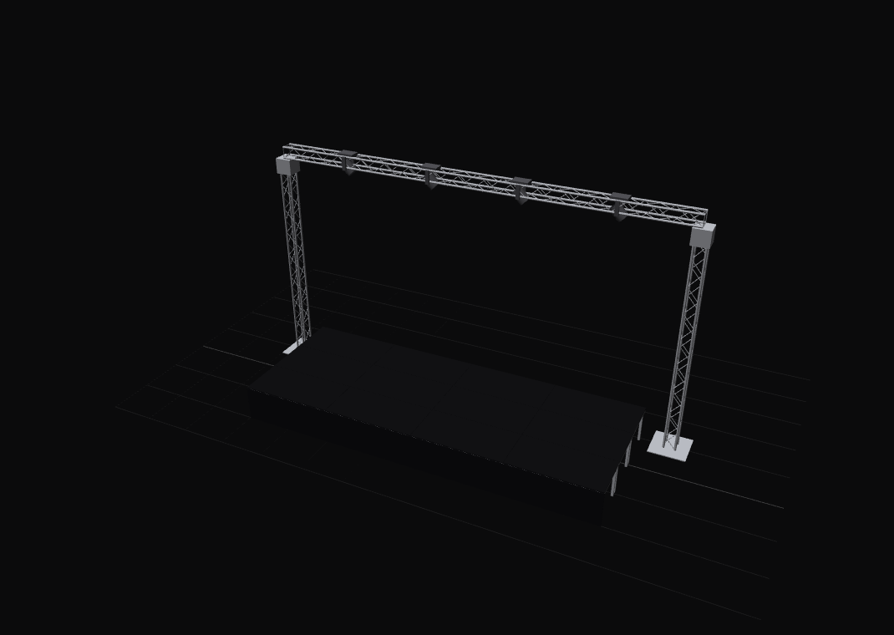

The lamps of the [fixture setup](Output-and-Devices.md#set-up-your-lamps) are shown in the Stage view (*Lamps* in the
toolbar), and they can be moved here too:

- Click a lamp to select it (Shift: more); on the right its position, *Mount* and *Hangs on*. Its addresses and type
  stay in the fixture setup.
- Drag it over the stage at its height, Shift + drag up and down, Escape back.
- A **hanging** lamp dragged under a truss (with *Snap* on) goes under its bottom chord, on its middle line, and
  **hangs on it**: moved, raised or turned, the truss takes the lamp with it. Dragged away from the truss it hangs on
  nothing again. A **standing** lamp stands on what is under it (the decks).
- *Hangs on* (here and in the fixture setup's inspector) hangs a lamp on any object of the stage, or on *Nothing*. A
  lamp that hangs on something has no pole down to the floor in 3D.
- Its position stays in the world (what the effects and the beams use); where it is on the object is kept, so moving it
  by hand along the truss works too.

## Hang an object on another

*Hangs on* in the inspector hangs an object on another one: a panel on a truss, a decoration on its stand. It then
moves, turns and scales with it, and its *Position* and *Turn* are measured from that object. In the list it is shown
indented under it. Removing or duplicating an object takes what hangs on it along.

## Hide an object

The eye in front of an object in the list (or *Visible* in the inspector) hides it in the 3D views without removing
it: a wall that is in the way of the camera, a variant of the set you do not use tonight.

## Folders

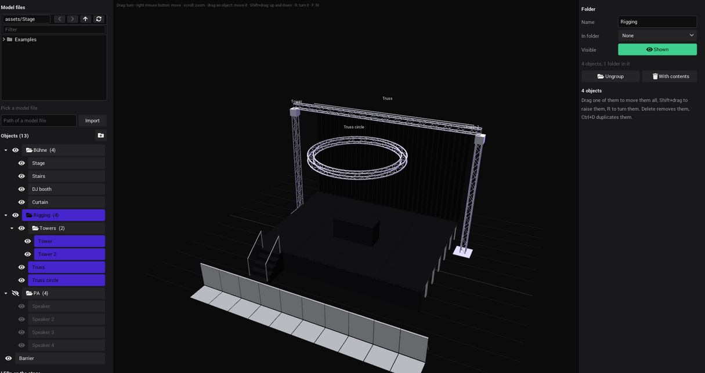

Folders keep a big stage in order and show or hide parts of it together: the PA, the rigging, a variant of the set.

- The folder button next to *Objects* (or **Ctrl + G**) makes a new folder with the selected objects in it.
- **Subfolders**: click a folder, then the folder button (or *Subfolder* on the right): a new empty folder in it. A
  folder can be put into another one later too (*In folder*), as deep as you like (*Rigging / Towers / Left*).
- **Drag** an object in the list onto a folder to put it in there (with the other selected objects, when it is one
  of them); onto an object: into that object's folder; onto *Objects* at the top: out of every folder. A folder dragged
  onto another one goes into it.
- *Folder* in the inspector of an object puts it into a folder or a subfolder (or *None*).
- The **eye** of a folder hides everything in it, at any depth. The objects keep their own eye: shown again, the
  folder shows what was shown before. An object hidden by its folder is grey in the list.
- The arrow opens or closes a folder in the list.
- A click on a folder selects everything in it: drag one of them to move them all, or use the
  [move and turn tools](#move-and-turn-tools). On the right: its name, the folder it is in, *Ungroup* (the folder goes,
  what was in it stays) and *With contents* (the folder and everything in it go).
- Folders move nothing. To move an object with another one, hang it on it ([Hang an object on
  another](#hang-an-object-on-another)).

## LEDs on the stage

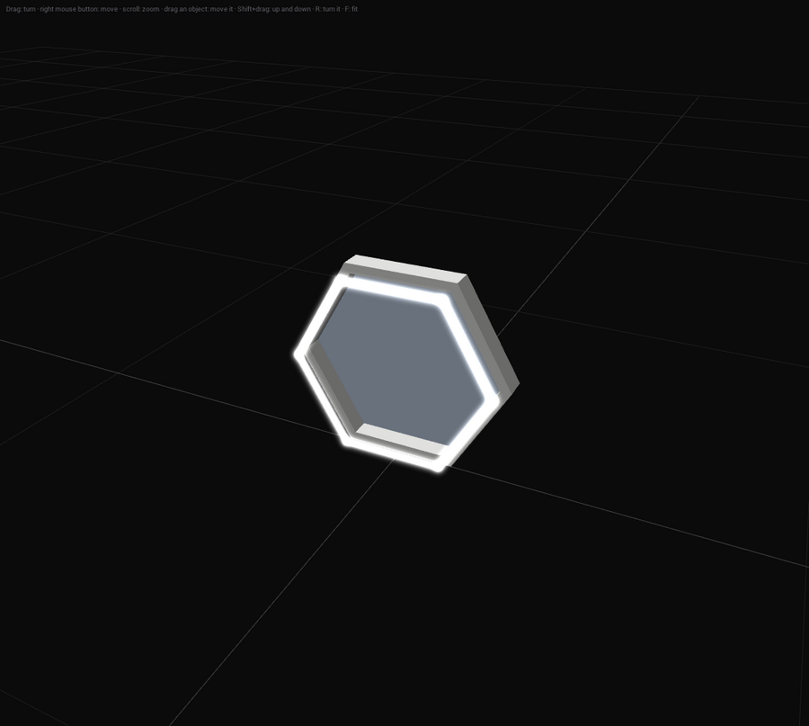

The LEDs of a [LEDMapper](Output-and-Devices.md#ledmapper) can stand on the stage too, in the colours they are sent:
you see what the LEDs do on the decoration they are built into.

1. In the LEDMapper, click a group in its *Layout* and switch on *On the stage* (in its settings on the right).
2. *Position* is where the middle of the group's LEDs stands, in metres, as the objects of the stage. Without a turn the
   picture of the LEDMapper stands upright facing the audience: its left to the left, its top up. *Turn* turns it
   (*Turn* x 90°: lying flat, LEDs in the floor or the ceiling).
3. *Width* is how wide the whole picture of the LEDMapper is on the stage; its height follows the picture's shape. Under
   it the group's own size on the stage, to match your strips: a hexagon of 54 cm across needs a *Width* at which the
   group says 54 cm.
4. *Hangs on*: an object of the stage the LEDs move with (the panel they are built into). *Position* and *Turn* are then
   measured from that object.

Several groups make a 3D arrangement: give each its own place, for example the same hexagon at five depths, 30 cm
apart, for a tunnel. The list *LEDs on the stage* on the left of the Stage menu shows every placed group with its LEDs
and size. The fixture setup's 3D view shows them as well.

## LEDs along edges

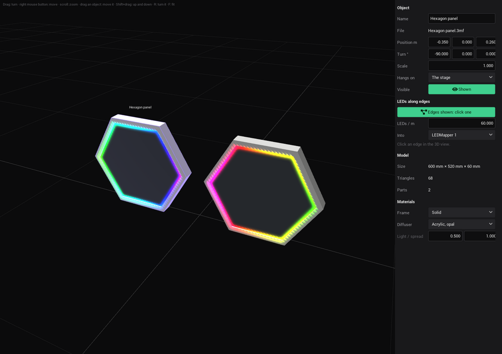

A strip that follows the shape of a model (the inner edge of a frame, the outline of a letter) does not need to be drawn
by hand: put it on an edge of the model.

1. Select the object and click *Show edges* under *LEDs along edges* in the inspector. The sharp edges of the model
   (where two faces meet at more than 30°, and the open borders) are drawn as lines.
2. *LEDs / m* is the density of your strip (30, 60, 144 ...); *Into* the LEDMapper that gets it.
3. Click an edge in the 3D view: the strip goes around the whole outline the edge belongs to (it goes on at each corner
   along the edge that turns least and stays in the same plane), a closed ring when the outline closes. **Shift**+click
   puts it on that one straight piece only.

The LEDMapper gets a group *Edges of* the object (one per object) with a segment per strip, as many LEDs as the length
needs, hanging on the object: the strip moves with it. The segment is a line in the LEDMapper's *Layout* as any other
(its address, its order, *Reverse*), only its LEDs stand along the edge on the stage. Give the group its
[colours](#colours-of-the-leds-on-the-stage) (*3D effect*, a projection) as for every group.

## Colours of the LEDs on the stage

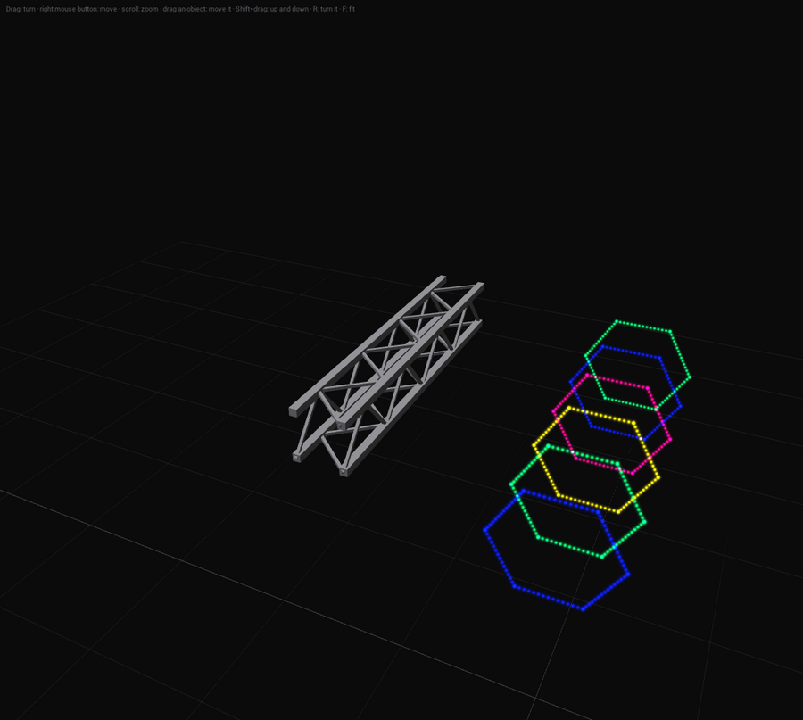

*Colours* in *On the stage* of a group says where its LEDs take their colours:

| Colours | What the LEDs show |
|---|---|
| *Picture (as drawn)* | the picture of the LEDMapper where the group is drawn on it, as without the stage |
| *Projected from the front* | the picture laid over every group of this LEDMapper projected from the front, by where its LEDs stand: as if a projector in the audience shone the video through the whole arrangement. The picture keeps its proportions and covers all of them |
| *Projected from above* / *from the side* | the same from above (the plan) or from the side |
| *3D effect* | the *3D effect* of the LEDMapper (below), by where the LEDs stand |

**3D effect** (left side of the LEDMapper, under the settings): it runs through the box around every LED that uses
it, so several groups at different places make one effect in the room.

- *Effect*: *Plane sweep* (a plane of colour A moving through), *Sphere pulse* (rings from the middle outwards),
  *Noise* (clouds drifting through), *Rainbow* (the colours along the direction).
- *Direction*: left to right, back to front (towards the audience) or top to bottom.
- *Speed*, *Size*, *Colour A*, *Colour B*: like every control they can be linked (an LFO, the audio, MIDI).

The masters, *Brightness* and *Test* of the LEDMapper work on these colours as on the picture's.

## Materials

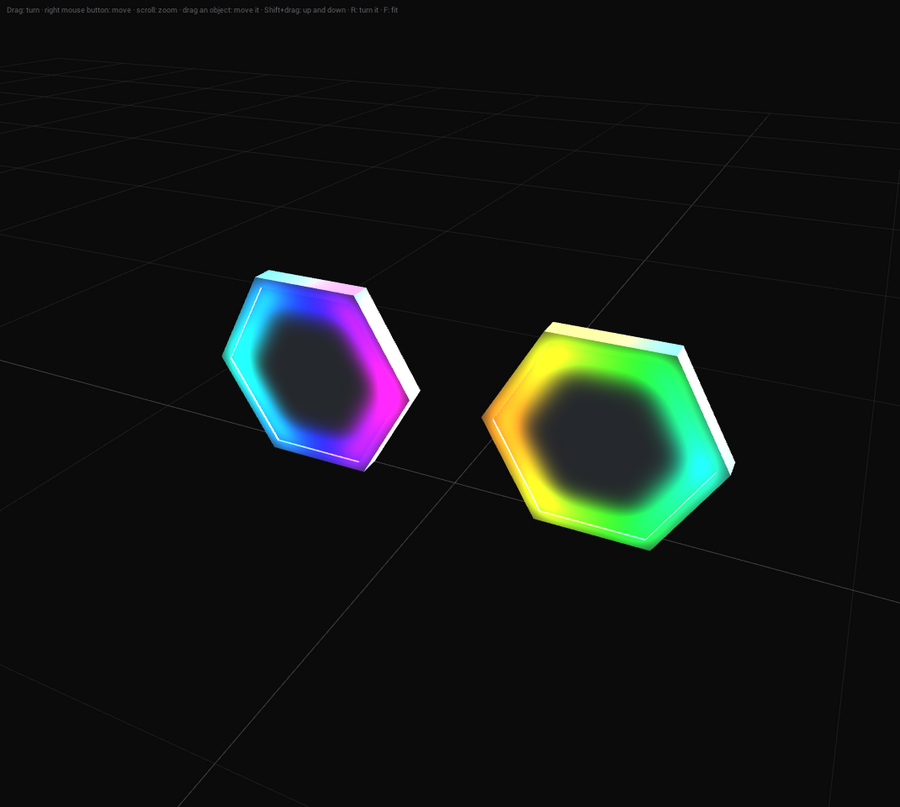

Each body of a model can be made of a material that light comes through: *Materials* in the inspector lists the bodies
of the selected object (a 3MF from Fusion or Bambu Studio and a STEP file have one per body; an STL file is one body).

| Material | What it does |
|---|---|
| *Solid* | no light comes through (the start) |
| *PETG, printed (white)* | a soft glow, the LEDs not to be seen as points from a few centimetres on |
| *Spandex* | spreads the light the most |
| *Acrylic, opal* | an even glow |
| *Acrylic, clear* / *Glass, clear* | the LEDs as points behind it |
| *Glass, frosted* | between clear and opal |

Under a translucent body, *Light* (how much comes through, 0..1) and *Spread* (how much wider the spot of an LED gets
per metre between the LED and the surface) can be changed: the starting values are estimates, match them to a photo
of your part. The farther the LEDs are behind the surface, the wider and dimmer their spots: try the distance before you
print the frame.

A translucent body shows the light of the LEDs on the stage within half a metre of it (up to eight groups), with
*Simulation* on. Off, every body is solid.

### Measure a material

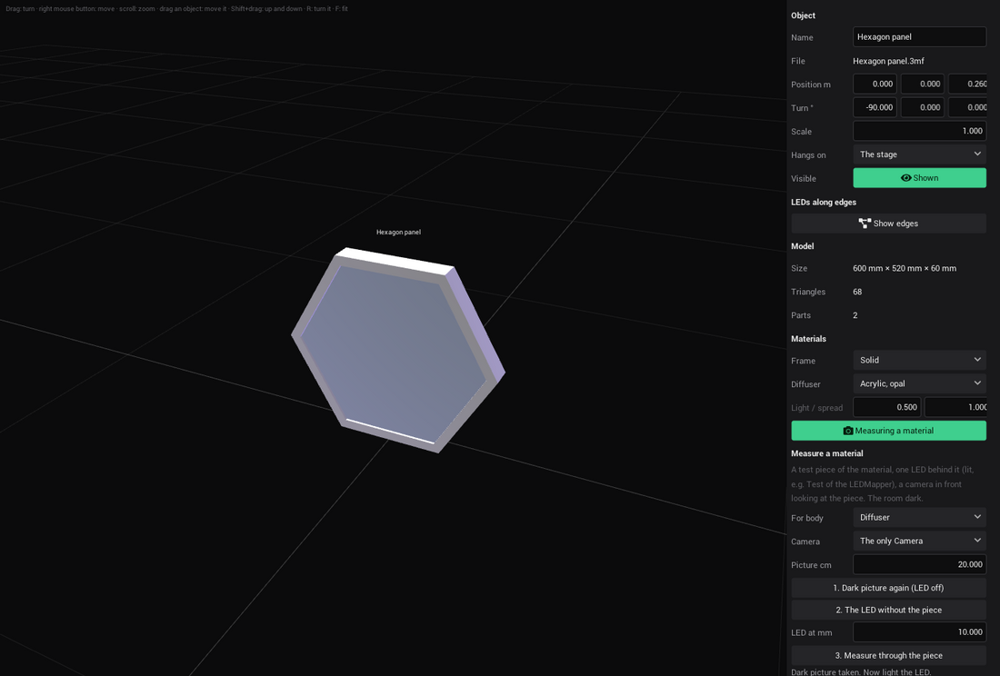

The starting values of the materials are estimates. For a material you print or cut yourself (your PETG with its wall
and infill, your Spandex), measure them: *Measure a material with a camera* under *Materials* of the selected object.

You need a test piece of the material, one LED behind it that you can light (*Test* of the
[LEDMapper](Output-and-Devices.md#ledmapper), or a strip on a node), and a camera in front of the piece, looking straight
at it (*Generators* › *Input* › *Camera*). Darken the room, and fix the camera's exposure if it can (a webcam that
brightens by itself changes the light it measures).

1. *For body*: the body that gets the values. *Camera*: where the picture comes from. *Picture cm*: how wide the
   camera's picture is at the surface of the piece (hold a ruler there once).
2. **Dark picture (LED off)**: the room without the LED; everything after is measured against it.
3. **The LED without the piece** (optional): the LED itself at the same place, so *Light* (how much comes through) is
   measured too. Dim it so it is not burnt out white in the picture.
4. Put the piece in front of the LED, enter *LED at mm* (from the LED to the surface the camera sees) and
   **Measure through the piece**. Do this at two to four distances (e.g. 3, 5, 10, 20 mm): the farther, the wider and
   fainter the spot.

Under the measures it shows *Spread* and *Light*, and how far the measures are from the line (*off by*). **Use for**
the body takes them; **Save as a preset** with a name (e.g. *PETG white 2 mm, 15 % gyroid*) puts them into
`assets/Stage/Materials`: every body can take it from its list, and the file can be given to others.

- *Spread* is from how much wider the spot gets per mm the LED is farther away; *Light* is the light of the spot
  through the piece compared with the LED without it.
- A spot too faint to be seen at a distance: nearer, or a brighter LED (*No light seen*).
## Simulation

*Simulation* in the toolbar shows the light as it looks: a glow around each LED, the LEDs through the translucent
[materials](#materials), the beams of the lamps of the fixture setup lighting the models (their walls, the decoration)
where they land, and the pictures on the [LED walls and screens](#led-walls-and-screens). Off, each LED is a small dot in its colour and the models are not lit by the lamps. The setting is saved with the project. Switch it off for the show: the computer's graphics are then
for the visuals.

## Things to know

- The Stage menu does not light anything and sends nothing: it is the room. The lamps are set up in the
  [fixture setup](Output-and-Devices.md#set-up-your-lamps).
- In the fixture setup's 3D view the models are shown but cannot be clicked: clicks go to the lamps.
