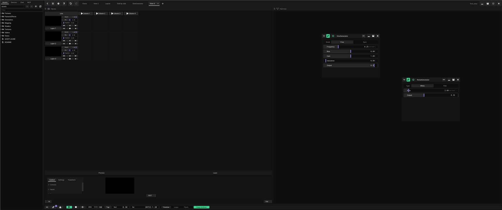
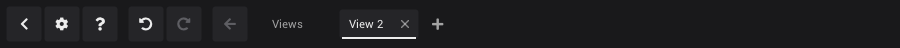
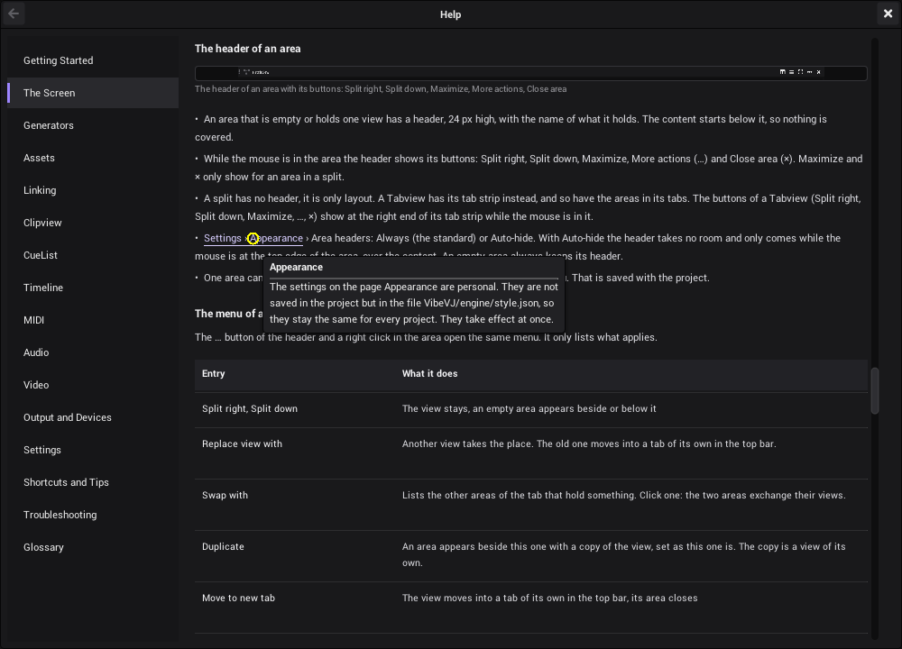
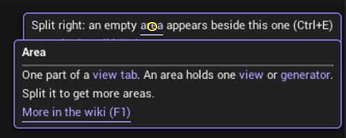
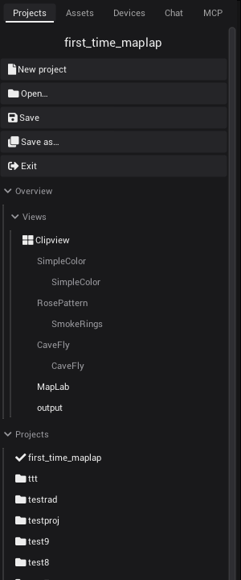
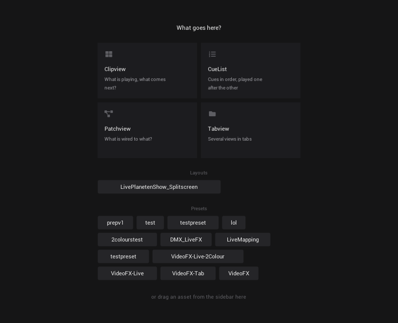
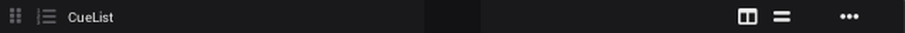
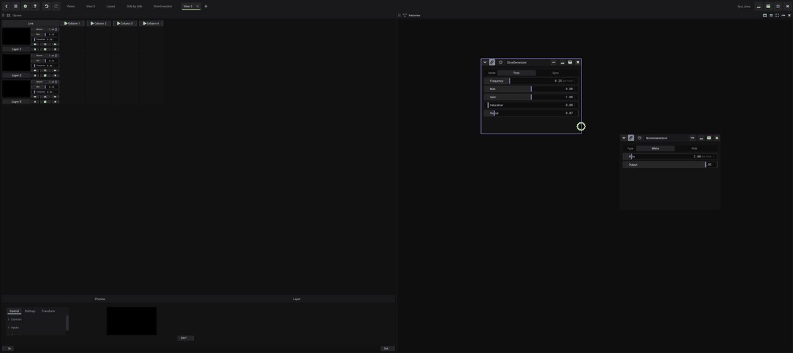
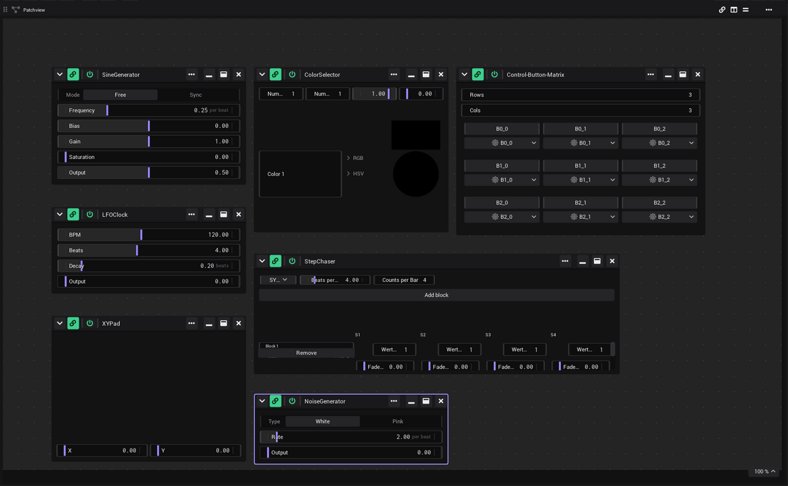

# The screen

This page shows where things are in the VibeVJ window: the sidebar, the views with their tabs, the generator windows and
the timeline area. You design most of the screen yourself, by splitting it into areas and choosing a view for each.



## The areas

| Area | Where | What it is for |
|---|---|---|
| Sidebar | Left | Your projects, the assets, devices and the AI chat |
| Top bar | Top | Sidebar button, settings, help, undo and redo, the view tabs with **+**, the project name and the window buttons |
| Views | Right, below the top bar | The work area: every view tab is split into areas, each with one view or generator |
| Generator windows | Inside the views | One window per generator, with its controls |
| Timeline | Bottom | Tempo, play position, transport and show mode |

## The program window

VibeVJ runs without the frame of the system on Windows and Linux, so it brings its own. On a Mac it uses the window of
macOS instead (see [On a Mac](#on-a-mac) below):

- **The buttons** sit at the top right, on the top bar. From left to right the window gets bigger: *Minimize*,
  *Maximize*, *Full screen*, and *Close* in the corner.
- **Maximize** fills the screen but leaves the taskbar free, and turns into *Restore* while the window is maximized.
- **Full screen**: the window fills the whole monitor and covers the taskbar or panel,
  which is what you want for a show or on a small screen. The button or **F11** switch it on, and again lead back to
  where the window was before (maximized or its own size). *Maximize* also leads out of it.
  - VibeVJ starts this way. On Windows you also get there by dragging a tab bar to the top of the screen, and out of it
    by dragging a tab bar away from the top.
  - On Linux the window manager does the full screen, so its own keys or menu for it work too, and the buttons follow.
  - On a Wayland desktop VibeVJ runs through XWayland, and the full screen works the same way.
- **Close** (✕) works like *Exit* in the [Projects tab](#projects-tab): a project with a name is saved and VibeVJ quits, an unnamed project
  first asks "Save the new project before quitting?". In show mode it does nothing, so a stray click does not end the
  show.
- **Move:** drag an empty part of the top bar or of the sidebar's tab bar. A plain click on it changes nothing. Tabs,
  **+** and the buttons do not move the window.
- **Resize:** drag the outer edge or a corner of the window (a band of 5 px; the cursor changes there). Not while it is
  maximized or in the full screen.
- **Size and place are kept:** VibeVJ starts the way you left it: maximized, in the full screen, or as a window at its
  place and size. When that monitor is not connected any more, it opens on the main one. The window does not get
  smaller than 960 × 600 (less on a smaller screen); the views and the timeline follow every change of its size.

### On a Mac

- **The traffic lights** (close, minimize, zoom) sit at the top left, as in every Mac program. With the sidebar shown
  they are in a band at its top; with the sidebar hidden the buttons of the top bar move right to make room for them.
  The green one zooms the window or, held or with **Ctrl + Cmd + F**, takes it into the full screen of macOS: a Space
  of its own, the menu bar and the Dock hide, Cmd + Tab and the swipe between Spaces keep working.
- **VibeVJ starts zoomed**: the window fills the screen below the menu bar, next to the Dock.
- **Move** by dragging the free part of the top bar or the band of the sidebar. The window snaps to the edges of the
  screen like every Mac window. A **double click** there does what *System Settings › Desktop & Dock › Double-click a
  window's title bar* says (zoom or minimize). **Resize** at any edge or corner.
- **Closing** the window or **Cmd + Q** works like *Exit*: a named project is saved, an unnamed one asks first.
- **The menu bar** at the top of the screen has *File*, *Edit*, *View*, *Show*, *Window* and *Help*. Its items do what
  their keys do; *VibeVJ › Settings…* (**Cmd + ,**) opens the settings, *Help › VibeVJ Help* (**Cmd + ?**) this wiki.
- **The trackpad:** two fingers move a Patchview, the timeline (sideways) and the mapping editors; pinch to zoom.
  With **Cmd** held, two fingers zoom like the mouse wheel. A mouse wheel zooms as on Windows and Linux.

## Top bar



```
[sidebar] [⚙] [?] [🔔] | [undo] [redo] | [back] | [Views] [View 2] [+]  … free space …  project name [window buttons]
```

- **Sidebar button:** at the left edge. It shows or hides the sidebar; its chevron points where the sidebar goes.
- **⚙ (Settings):** opens the *Settings* window. See [Settings](Settings.md).
- **? (Help):** opens this wiki in a window of the program, where you left it; a second click closes it. F1 opens it
  at the part that explains what the mouse is on. See [The Help window](#the-help-window).
- **Bell (Log):** opens the log of errors and warnings; its badge counts the errors since you looked last. See
  [The log](Troubleshooting.md#the-log).
- **Undo, redo:** take back the last change of the layout, a link or a value, or do it again (Ctrl + Z, Ctrl + Y).
  Their tooltips name the step. See [Undo and redo](#undo-and-redo).
- **View tabs:** each tab is its own work area. **+** adds an empty one. Double-click a tab to rename it, drag it to move
  it along the bar, click its × to delete it (a tab with views in it asks first). The last view tab stays. The tabs and
  their names are saved with the project. A view that you close in an area gets a tab of its own here.
- A tab comes to the front when you let go of it, not when you press it. So you can take a tab that is not in front and
  drag it down into an area of the tab you are looking at: see [Moving a view](#moving-a-view).
- **Free space:** moves the window, see [The program window](#the-program-window).
- **Project name:** at the right, left of the window buttons. An unnamed project shows *&lt;New Project&gt;*. New,
  open and save are in the [Projects tab](#projects-tab) of the sidebar.
- **Window buttons:** see [The program window](#the-program-window).

Views are not chosen in the top bar. An empty area offers them, a filled one has them in its menu: see
[Views and tabs](#views-and-tabs).

### The Help window

The Help window shows the pages of this wiki, listed at its left side. It floats above the program like the
*Settings* window: drag its header to move it, close it with its × or with Esc.



- **Links:** a word in the accent colour leads to another page or to a part of this one. Rest the mouse on it and a
  tooltip shows what is behind it; click it to go there. The list "See also" at the end of a page is made of buttons
  that do the same.
- **Back:** the arrow at the left of the header goes back to where you followed the last link.
- **Search:** type words into the field above the list and press Enter. The page *Search* lists every part of the wiki
  and every term of the glossary that has all the words, the ones with a word in their heading first; click one to go
  there.
- **Read again:** the arrows next to *Back* read the page from its file again. A page whose file changed is read again
  by itself when you open it, so you can write the wiki with the window open.
- **Pictures:** rest the mouse on a picture and a magnifier shows the part under it at full size. Click the picture
  to see it big in a window of its own; a click on the big picture closes it. Animations play by themselves.
- **Glossary:** the page before *Search* lists the words VibeVJ uses for its parts, each with the place in the wiki
  that says more.

### Tooltips

Rest the mouse on a button or a control and its tooltip says what it does.



- **Words as links:** a word shown as a link in a tooltip (for example *area*) has a tooltip of its own. Rest the
  mouse on the tooltip for a second until its edge turns violet (it is locked now), then on the word. That tooltip
  can have links again.
- ***More in the wiki (F1)*:** many tooltips end with this link. Click it, and the Help window opens at the part
  that explains the thing.
- **F1** does the same at once, without waiting for the tooltip: put the mouse on a button and press F1.
- A locked tooltip closes when the mouse leaves it, with a click on its text, or with Esc.

All gestures are on [Shortcuts and tips](Shortcuts-and-Tips.md#tooltips).

## Sidebar

The sidebar has five tabs. The settings are not here: they have a window of their own, opened from the
[top bar](#top-bar).

| Tab | What you find there |
|---|---|
| *Projects* | New, open and save, an overview of the project you have open, and all your projects and templates. See [Projects tab](#projects-tab). |
| *Assets* | All assets in the `assets` folder: generators, shaders, views, textures, fixtures. What comes with VibeVJ is on [Assets](Assets.md). |
| *Devices* | *MIDI*, *Network* (*Art-Net*, *ShizoNet*) and *Fixtures*. See [MIDI](MIDI.md) and [Output and devices](Output-and-Devices.md). |
| *Chat* | An AI chat that can look at and change your generators. |
| *MCP* | A server for outside AI tools (for example Claude), next to the chat. |

- **Show or hide the sidebar:** the sidebar button at the left edge of the top bar (tooltip *Show / hide the sidebar*).
  The views and the timeline take the free space.
- **Make it wider or narrower:** drag its right edge.
- **Make its content bigger or smaller:** click into the sidebar, then press Page Up or Page Down.
- VibeVJ starts with the *Assets* tab in front; it opens the project you used last by itself.

### Projects tab

Everything about your projects in one place: open and save them, see what is in the one you have open, and switch to
another one.



From top to bottom:

- **The name of the project** you have open. An unnamed project shows *&lt;New Project&gt;*.
- **The actions:** *New project*, *Open…*, *Save*, *Save as…* and *Exit*. What each one does is in
  [Getting started](Getting-Started.md#save).
- ***Overview*:** what is in the project you have open. One section per [view tab](#top-bar), with the views in its
  areas (with the icon they have in the picker of an empty area) and, below each view, the generators in it. A
  generator inside another one (an effect stacked onto a clip, a shader in a Shaderstack) is indented below it. The
  generators of the timeline's *Patch* have a section *Timeline*. Click a view or a generator: its view tab comes to
  the front and the area shows, also inside a Tabview. The overview follows while you work: a new generator, a
  closed view or a renamed tab shows up in it.
- ***Projects*:** every saved project, newest first. The one you have open has a check mark. Click a project to open
  it. A click on the open one asks first, then opens its saved state again: what you changed since the last save is
  lost.
- ***Templates*:** the templates, if there are any. Click one to start a new project from it. See
  [Templates](Getting-Started.md#templates).

Click the title of a section to fold it. The sections of the overview stay folded while you work.

Dragging a view or a generator out of another project in the list into your project, like a preset. *(Planned.)*

### Assets tab

- Folders with a **cube icon** are assets (for example *SineGenerator* or a shader). The list shows names without their file extension. Drag them into a view.
- At the top: back, forward, up and refresh buttons, the current folder, and a *Filter* box that finds files by name.
- **Double-click a file** to open its text in a new tab next to *Views*. Close that tab with its ×.
- After you save a preset, press refresh if the new file does not show up yet.

### Chat tab

1. The first time, fill in *API*, *Token* and, if you want, *Model*, then click *Connect*.
2. Type in the box at the bottom and click *Send*. *Stop* ends an answer, *Clear* empties the chat.
3. The list under *Clear* sets how hard it thinks: *Low*, *Medium* or *High*.

Next time, one click on *Connect* is enough.

The chat works on the generator you clicked last, and on the [fixture setup](Output-and-Devices.md#set-up-your-lamps)
without a click: its lamps, groups, nodes and DMX addresses, and the channels that are used twice. An AI tool on the
*MCP* tab gets the same (the generator `fixture_setup` in its list).

## Views and tabs

The big area on the right has the view tabs of the top bar. A view tab starts as one empty *area*. An area holds one
view or generator; you split it to get more areas.

1. Pick a view in the empty area, or drag an asset from the *Assets* tab into it.
2. Split the area with its header, or drop more assets on its edges.

| View | What it does |
|---|---|
| Clipview | A grid of clips in layers and columns, for playing live. See [Clipview](Clipview.md). |
| CueList | The same clips as lists of cues with big buttons, for running a show. See [CueList](CueList.md). |
| Patchview | A free area: generators sit in their own windows anywhere, and their links are drawn. See [Generator windows](#generator-windows). |
| Tabview | Tabs, each holding one view or generator. See [Things to know](#things-to-know). |
| Links | Every link of the project in one list: where it comes from, where it goes, its type and value. See [The Links view](Linking.md#the-links-view). |
| HorizontalSplit | Two or more areas side by side. Drag the line between two of them to change their sizes. |
| VerticalSplit | Two or more areas on top of each other. Drag the line between two of them to change their sizes. |

You do not pick the two splits yourself: *Split right*, *Split down* and a drop on an edge make them. They are not
listed in the *Assets* tab.

- **More than two:** splitting an area that already lies in a split of the same direction adds one more area to that
  split, beside it. Three columns are one split with three areas, not a split in a split. Closing one gives its room
  to its neighbour.
- **Sizes:** rest the mouse on the line between two areas: it turns violet and the cursor changes. Drag it to share
  the room of these two areas; the others keep theirs. The sizes are saved with the project.

### An empty area

An empty area asks "What goes here?":



- **Tiles:** one per view (*Clipview*, *CueList*, *Patchview*, *Tabview*, *Links*), with its icon, name and purpose. Click one.
- **Layouts:** layouts you saved from a view tab (right-click the tab, *Save layout as preset…*). Click one to get the
  whole layout into the area.
- **Presets:** up to twelve presets of the views, below the tiles. Click one to load it.
- **Drop:** drag an asset from the sidebar into the area. What there is to drag is on [Assets](Assets.md).
- A small area shows the views as a plain list, with *Layouts and presets* as a menu at its end. A very small one
  shows a **+** button that opens the list of views.

### The header of an area



- An area that is empty or holds one view has a header, 24 px high, with the name of what it holds. The content starts
  below it, so nothing is covered.
- While the mouse is in the area the header shows its buttons: *Cables*, *Split right*, *Split down*, *Maximize*,
  *More actions* (⋯) and *Close area* (×). *Maximize* and × only show for an area in a split.
- **A narrow area** (below 220 px) keeps only ⋯ and ×: *Split right*, *Split down* and *Maximize* are in its menu then.
  Below 120 px the icon and the name go too. An area is never narrower than 72 px when you drag the line between two.
- *Cables* (the link) shows the [links](Linking.md#seeing-your-links) of the area as cables. While it is on it stays lit,
  also when the mouse is elsewhere.
- A split has no header, it is only layout. A Tabview has its tab strip instead, and so have the areas in its tabs.
  The buttons of a Tabview (*Split right*, *Split down*, *Maximize*, ⋯, ×) show at the right end of its tab strip
  while the mouse is in it.
- **[*Settings* › *Appearance*](Settings.md#appearance) › *Area headers*:** *Always* (the standard) or *Auto-hide*. With *Auto-hide* the header
  takes no room and only comes while the mouse is at the top edge of the area, over the content. An empty area always
  keeps its header.
- One area can differ from the setting: *Auto-hide header* / *Keep header* in its menu. That is saved with the project.

### The menu of an area

The ⋯ button of the header and a right click in the area open the same menu. It only lists what applies.

| Entry | What it does |
|---|---|
| *Split right*, *Split down* | The view stays, an empty area appears beside or below it |
| *Replace view with* | Another view takes the place. The old one moves into a tab of its own in the top bar. |
| *Swap with* | Lists the other areas of the tab that hold something. Click one: the two areas exchange their views. |
| *Duplicate* | An area appears beside this one with a copy of the view, set as this one is. The copy is a view of its own. |
| *Move to new tab* | The view moves into a tab of its own in the top bar, its area closes |
| *Maximize* / *Restore the layout* | The area gets all the room of the splits around it, and gives it back |
| *Close area* | The area goes. Its view moves into a tab of its own in the top bar. |
| *Save as preset…* | Saves what the area holds, as it is set now, under a name. A preset of a view is offered in every empty area; presets of generators are in the *Assets* tab, in the `presets` folder of the generator. What a preset holds is on [Generators](Generators.md#presets). |
| *Delete view…* | Deletes the view and everything in it, after a question |
| *Auto-hide header* / *Keep header* | This area differs from the setting |
| *Show cables* / *Hide cables* | The [links](Linking.md#seeing-your-links) of this area as cables, as the link button of its header. For a Tabview: of all its tabs. |
| *Close other tabs*, *Close all tabs* | Tabview only: right-click its tab strip |

- **Closing never deletes.** The view moves into a tab of its own in the top bar, with its state, links and MIDI
  mappings. The split it was in dissolves into the side that remains. Only *Delete view…* deletes.
- Buttons, text fields and MIDI controls keep their own right click.

### Dropping an asset

Dropping onto a filled area never replaces what is there. While you drag an asset from the sidebar, the area shows where
the drop lands:

- **Edge** (the outer quarter of a side): *Split left / right / up / down*. The area splits; what was there moves into
  the other half as it is (same controls, links and MIDI mappings), the new one goes to the side you dropped on.
- **Middle:** *Add as tab*. A Tabview gets one more tab, also when you drop on what one of its tabs shows; anything else
  becomes the first tab of a new Tabview, next to the new one.
- **Empty area:** takes the drop as it is (*Drop here*).
- **Into a view:** over a CueList, a Patchview or the grid of a Clipview, that view takes what you drop: a generator,
  a media file, also a view or a preset of one (a cue, a window, a clip). That is how views go into each other, for
  example a Patchview preset as a building block in another Patchview. The zones do not show there. To put something
  beside such a view, use *Split right* or *Split down* and drop into the empty area, or drag the header of an area.

### Moving a view



- Drag the header of an area (not its buttons), a tab of a Tabview, or a view tab of the top bar (down, out of the bar)
  onto another area.
- Or hold Alt and drag anywhere in the area. If your window manager keeps Alt + drag for itself, pick another key in
  [*Settings* › *Appearance* › *Move areas with*](Settings.md#move-areas-with).
- **Hold Ctrl when you let go** to drop a copy: the view you dragged stays where it is. Dropped on its own area, the
  copy lands beside it.
- To reach an area in another tab, hold the drag over that tab for a moment: it comes to the front. This works for the
  view tabs of the top bar and for the tabs of a Tabview.
- The same zones show: an edge splits that area and the view goes into the new half, the middle adds it as a tab, an
  empty area takes it. This also works over a CueList, a Patchview or a Clipview.
- The view moves with its state, links and MIDI mappings.
- The area it left closes and its split dissolves. A tab it left goes; the last tab of a Tabview stays, empty, and so
  does the last view tab of the top bar.
- An area cannot be dropped into itself.

### View windows

A view tab can move into a window of its own, for example onto a second monitor: the clips on one screen, the
Patchview or the mapping on the other. This works on Windows and Linux, not yet on a Mac: there the menu item is missing,
and a project saved with view windows opens their views in their tabs.

- **Open:** right-click the view tab in the top bar › *Open in own window*. The views go into the new window as they
  are, with their state, links and MIDI mappings. Nothing is reloaded and the output does not stop.
- **The tab stays** in the top bar and shows *Show the window* (brings it to the front) and *Back into the tab*.
  Right-clicking the tab offers the same.
- **Back:** close the window with the × of its frame, or *Back into the tab*. The views come back into their tab.
- **Inside the window** everything works as in a view tab: split, move, maximize and close areas, pick views, and the
  same keys (Ctrl + E, Ctrl + D, Ctrl + W, Ctrl + Space, F6, Ctrl + Z / Ctrl + Y, and Ctrl + S, Space, Shift + Space
  and T of [Shortcuts](Shortcuts-and-Tips.md#keys)). Undo and redo share one history with the main window.
- **F11** in the window makes it fill its monitor, without a frame: a projector or an output monitor. F11 again brings
  the frame back, at the place and size from before.
- **Saved with the project:** which tabs are in windows, where the windows are, how big, and whether they fill their
  monitor. Loading the project opens them there again. A window whose monitor is not connected any more opens where
  the system puts it.
- Dialogs (names, questions) and the Help window open in the main window, which comes to the front for them.
- Assets and views cannot be dragged from one window into another yet: move a view with *Back into the tab* and the
  usual moving inside a window.
- Renaming the view tab also renames its window.

### Undo and redo

Ctrl + Z takes back the last change of the layout, of a link or of a value, Ctrl + Y (or Ctrl + Shift + Z) does it
again. The two buttons in the top bar do the same; their tooltips name the step.

- **What it covers:** splitting, moving, swapping, duplicating and closing areas, the line between two areas you
  dragged, adding and deleting views, the view tabs (add, rename, delete, dragged to another place in the bar), also the
  tabs of a Tabview, and generators you dragged out of a Patchview, into an area or into another Patchview, moved or
  copied ([Select and move generators](Generators.md#select-and-move-generators)). Undo deletes a copy; redo makes it
  again with the settings it had.
- **Generators and clips:** a generator you dragged from the sidebar into a Patchview, or deleted with its × (undo
  makes it again with its settings and its links), and in a [Clipview](Clipview.md#move-copy-delete) a clip you made,
  moved or copied, an asset you stacked onto a clip and an entry you removed from its stack (the clip goes with its
  last entry, undo brings it back). Undo and redo keep the guid of what they make again, so the steps after it still
  find it.
- **Nothing is reloaded:** the views move back into place as they are, with their state, links and MIDI mappings. Only
  a view that you deleted is loaded again, as it was when you deleted it.
- **Links** too: a link you made (dragged, dropped or chosen in a link menu), removed (also in the
  [Links view](Linking.md)), its type changed, and a cable you pulled into shape or laid again with a double click. Undo
  brings a removed link back with its type and its cable. Links that generators make by themselves are not steps.
- **Values** too: a slider you dragged (the whole drag, from pressing to letting go, is one step), a switch or a list
  you clicked, a number or a text you typed and confirmed. Turning the mouse wheel over a field is one step as long as
  you keep turning. The tooltip names the control: *Undo: Value: Bias*.
- **Not values:** what a [link](Linking.md), [MIDI](MIDI.md), the timeline or a generator itself sets, anything you do
  in show mode, and the controls that steer rather than edit: Play, Stop, Follow, the position, the view switch and
  *Snap windows* of the timeline bar, the autoplay buttons of a Clipview and the position of a video. A button that
  only triggers something (*Restart*) has no value to take back.
- **Not yet:** generators moved inside one Patchview, and what a layer of a Clipview holds.
- Loading a project or *New project* empties the history. Up to 100 steps are kept.
- In show mode undo and redo are off.
- A code editor and the mapping editors keep their own Ctrl + Z while they have the focus, and so does a field while
  you type into it: press Enter first. A slider or a field you only clicked or turned passes Ctrl + Z on.

### Things to know

- **Nesting:** every area can take any view, so you can put a Clipview in one tab and a Patchview in the other half of a
  split.
- **Tabview:** **+** after the last tab adds an empty tab. Drop an asset on the tab strip to get a new tab named after
  it. Double-click a tab to rename it. Its × closes it: the view moves into a tab in the top bar, nothing is deleted. The
  last tab stays, empty.
- **In a Patchview** a view is a window like any generator. The areas of a split or a Tabview in such a window are not
  split further: they have no *Split right* and *Split down*, and a drop on them is always *Add as tab*. Splits belong
  to the layout of a view tab.
- **Show mode** locks the layout: picking, splitting, closing, replacing and moving do nothing. See
  [Timeline](Timeline.md#show-mode).
- **Size:** click into a view and press Page Up or Page Down to scale it. The scale is saved with the project.
- **Keys:** Ctrl + E and Ctrl + Shift + E split the area the mouse is in, Ctrl + D duplicates it, Ctrl + Space
  maximizes it, Ctrl + W closes it, F6 goes to the next area, Ctrl + Tab to the next tab of the top bar. See
  [Shortcuts and tips](Shortcuts-and-Tips.md#keys).

## Generator windows

Every generator lives in its own window. The window header and its buttons are on [Generators](Generators.md).

- **In a Patchview** (and in the timeline area) windows float: drag the header to move a window, drag an edge or corner to
  resize it. The mouse wheel zooms the area, dragging with the right mouse button moves it.
- **In an area** (a view tab, a tab of a Tabview, half of a split) the generator fills the area and has no window
  header. Click into it and press E to show the window header, press E again to hide it.
- In a Patchview, new windows have *Always draw links* on, so you see their cables at once.

### Zoom and the grid of a Patchview

A Patchview is a canvas with a faint dot grid: a fine dot every 16 px, every fourth one a little stronger. Windows
snap to the fine dots:

- **Moving:** while you drag a window by its header, it glides to the grid point nearest to the cursor. Where it is
  while you drag is where it stays when you let go.
- **Resizing:** the edge you drag lands on the grid, the edge across from it stays where it is.
- **New generators** land on the grid as well.



- **New generators** come in as big as their controls need, never bigger than the part of the canvas you see. When
  you drop one on top of another, it moves to the nearest free spot instead. The same goes for generators the AI adds.
- **Zoom:** the mouse wheel zooms at the cursor. A step that passes 100 % stops there, so the natural size is easy to
  find again. One step in and one step out always land where you started. On a Mac trackpad a pinch zooms and two
  fingers move the canvas (with Cmd held they zoom).
- **The zoom chip** in the bottom right corner shows the zoom. Click it for *Show everything*, *Show the selection*,
  *100 %*, *Zoom in* and *Zoom out*.
- **Keys:** Ctrl + 0 shows everything, Ctrl + 1 goes to 100 %. They work on the Patchview the mouse was over last.
- **Panning** with the right mouse button stops a little past the edges of the canvas, so you cannot get lost in
  empty space.
- Zoom and position of each Patchview are saved with the project.

The grid dots fade out when you zoom far out. Far out, windows are small and their text is hard to read: use
*Show everything* to find your way, then zoom in where you want to work.

## Timeline area

The timeline sits at the bottom. It starts as a single bar.

1. Drag the bar up to open the timeline.
2. Click the chevron button (tooltip *Open or collapse the timeline*) to close it to a bar, and again to open it at its last height.

With *Snap windows* on, the views above get smaller or bigger as you move the bar, so nothing is covered.

| In the bar | What it does |
|---|---|
| Chevron | Closes the timeline to a bar |
| Link | *Cable view* on or off. The small violet bubble counts the local cable views; rest the mouse on it and the broken link on its right half ends them all. See [Linking](Linking.md#seeing-your-links). |
| Lock | Show mode. See [Timeline](Timeline.md). |
| Play, Stop, Follow | Transport. Stop also goes back to the start. |
| *BPM*, *Tap* | Tempo, and tap tempo |
| *Beat*, *Bar* | Where the playhead is |
| *View* | *Timeline*, or *Loops* / *Patch*: a free area for generator windows. Windows there snap to a grid. |
| *Snap windows* | Keeps the views and the timeline stacked |

Today *Loops* and *Patch* show the same area.

## See also

- [Getting started](Getting-Started.md)
- [Generators](Generators.md)
- [Assets](Assets.md)
- [Clipview](Clipview.md)
- [CueList](CueList.md)
- [Timeline](Timeline.md)
- [Settings](Settings.md)
- [Shortcuts and tips](Shortcuts-and-Tips.md)
