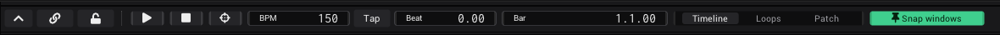
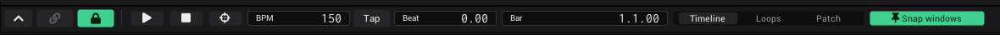

# Timeline

The timeline sits at the bottom of the window. Its bar holds the controls for the whole program: tempo, position, Play,
the cable view and the show mode lock. Autoplay in the [Clipview](Clipview.md#autoplay-and-duration) and every synced
shader and control run on its beats.

## The transport bar

From left to right:

| Control | Tooltip | What it does |
|---|---|---|
| Chevron | *Open or collapse the timeline* | Collapses the timeline to its bar. Click it again (or drag the bar up) to open it at its last height. |
| Link | *Cable view: show every link* | [Cable view](Linking.md#seeing-your-links) on or off: every link on screen as a cable. The same switch as in [*Settings* › *Links*](Settings.md#links). Green while on. |
| Lock | *Show mode: lock notches and editing* | [Show mode](#show-mode). |
| *Play* | *Play or pause the timeline* | Runs the timeline. Green while playing. Click again to pause. |
| *Stop* | *Stop and go back to the start* | Stops and goes back to the start (Bar 1.1.00). |
| *Follow* | *Follow the playhead* | While it is on, the timeline pages along with the playhead: when the playhead reaches the right edge (or jumps out of view), the view moves so the playhead is at the left again. Dragging the ruler still moves the view by hand. |
| *BPM* | | The tempo. 150 at the start. |
| *Tap* | *Click on each beat to set the tempo* | Tap the tempo. |
| *Beat* | | Where the playhead is inside the current beat, from 0 to 1. |
| *Bar* | | The position as bar.beat.tick. |
| *View* | | *Timeline* / *Loops* / *Patch*. See [The view switch](#the-view-switch). |
| *Snap windows* | *The view area above follows the timeline when you move or collapse it* | See [Snap windows](#snap-windows). On at the start. |

- **On a narrow screen** (below about 1440 px, or with the sidebar open on a laptop) *BPM*, *Beat*, *Bar* and *View*
  get narrower and *Snap windows* keeps only its pin icon, so the whole bar stays on screen.
- **Linking:** *Play*, *Stop*, *Follow*, *BPM*, *Beat*, *Bar*, *View* and *Snap windows* have notches, so you can
  [link](Linking.md) them or map them to [MIDI](MIDI.md). *Beat* is the usual source for anything that should pulse.
- **The bubble on the link button:** while *Cable view* is off, it counts the generators that draw their own links.
  Rest the mouse on the button and a broken link slides in on its right half (*End all local cable views*): a click
  ends them all.
- **No keys:** Play, Stop and Tap have no keyboard shortcut. Map them to a MIDI pad if you need them under your hand.

## Set the tempo

1. Click *BPM* and type the tempo. Press Enter.
2. Or click *Tap* on each beat, at least twice. The tempo is the average of your last taps (eight at most). Wait two
   seconds to start over.
3. Or let the music set it: see [Sync the timeline from audio](#sync-the-timeline-from-audio).

## Beat and Bar

- *Bar* shows the position as bar.beat.tick, with 4 beats per bar. Ticks are hundredths of a beat. The start is 1.1.00.
- To jump, click *Bar* and type the position **in beats**, then press Enter. For example 16 jumps to 5.1.00.
- *Beat* runs from 0 to 1 within every beat. Link it to anything that should pulse with the music.

## Open and size the timeline

- Drag the bar up to open the timeline, or click the chevron. The first time, the chevron opens it at about 40 % of
  the window.
- Drag the top edge of the timeline to make it taller or smaller. At least a strip of the views stays visible above.
- The height is not saved: after a restart the timeline is a bar again.

## The ruler

The view *Timeline* shows a ruler and the playhead. The numbers on the ruler are beats, counted from 0, one number
every 4 beats (a bar). The line of text reads the beat under the playhead, the zoom and the beats in view.

| Gesture | Does |
|---|---|
| Mouse wheel over the timeline | Zooms in or out around the mouse, from 1/8 to 64 times. At 1 you see 16 beats. Away from you zooms in, as in a Patchview. |
| Drag on the ruler | Left or right moves the view, up or down zooms. |
| Right click on the ruler | Moves the playhead to the nearest whole beat. A left click does not move it. |

The timeline has no clips or lanes of its own yet: it is the clock of the program.

## The view switch

| View | Shows |
|---|---|
| *Timeline* | The ruler and the playhead. |
| *Loops* | An area for [generator windows](The-Screen.md#generator-windows) that belong to the timeline. |
| *Patch* | Today the same area as *Loops*. |

- The generators in this area are saved with the project.
- Windows there snap to a grid of 16 px when you move or resize them, as in a Patchview: see
  [Zoom and the grid of a Patchview](The-Screen.md#zoom-and-the-grid-of-a-patchview).
- You can select and move them as in a Patchview: see [Select and move generators](Generators.md#select-and-move-generators).

## Snap windows

With *Snap windows* on, the view area above always ends where the timeline starts, so moving the timeline up or down
resizes the views. With it off, the views only get smaller when the timeline would cover them.

## Show mode

Show mode locks the program for performing, so nothing gets linked, moved or closed by accident, by mouse or by touch.

1. Click the lock in the bar, right of the link button. It closes and turns green.
2. Play your show.
3. To leave, press the lock, hold it for at least 400 ms, then let go (tooltip *Hold to leave show mode*). A short
   click does nothing, so a stray touch does not unlock it.

| Locked | Still working |
|---|---|
| Notches: no options, no linking, no hold and drag | Values and sliders |
| The layout: splitting, closing, moving and replacing views; adding, renaming and deleting tabs | Buttons |
| Moving and resizing windows, Alt + drag | Play, Stop, BPM and Tap |
| Dropping assets, moving clips | Clips, columns and cues |
| Every right-click menu | MIDI |
| Undo and redo | The power buttons of the generators |
| Closing generators, *Paste settings*, *Reload module* | |
| *Exit* and the close button of the window | |
| The cable view | |

- While locked, free notches are hidden and linked ones stay as a coloured edge. No cables are drawn. See
  [Linking](Linking.md#show-mode).
- Show mode is not saved. VibeVJ always starts unlocked.
- To lock only one Clipview, use its [*Live*](Clipview.md#live) button.

## Sync the timeline from audio

1. Add the generator *Audio Input Analysis* (see [Audio](Audio.md)).
2. Turn on its *Sync timeline* button.
3. Press *Play*.

The *BPM* of the timeline now follows the tempo that is heard, and the playhead is nudged gently into step with the
beat. Turn *Sync timeline* off to set the tempo yourself again.

The generator *Prolink Bridge* does the same with CDJs. Its *Sync timeline* is on at the start and follows a deck
that is playing: see [Output and devices](Output-and-Devices.md#prolink-cdjs).

If the tempo changes although you set it by hand, one of the two is on: see
[Troubleshooting](Troubleshooting.md#the-tempo-keeps-changing-by-itself).

## See also

- [Clipview](Clipview.md)
- [Audio](Audio.md)
- [Linking](Linking.md)
- [The screen](The-Screen.md)
- [Shortcuts and tips](Shortcuts-and-Tips.md)
