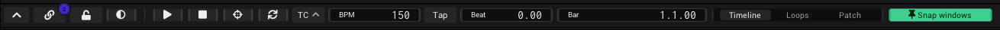
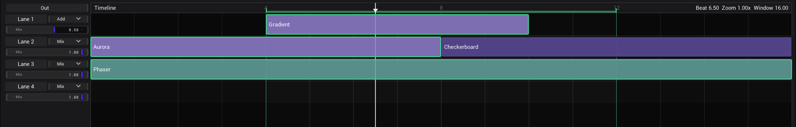
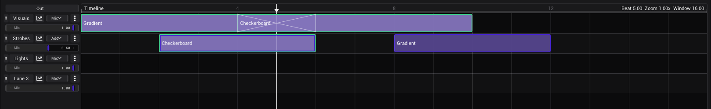
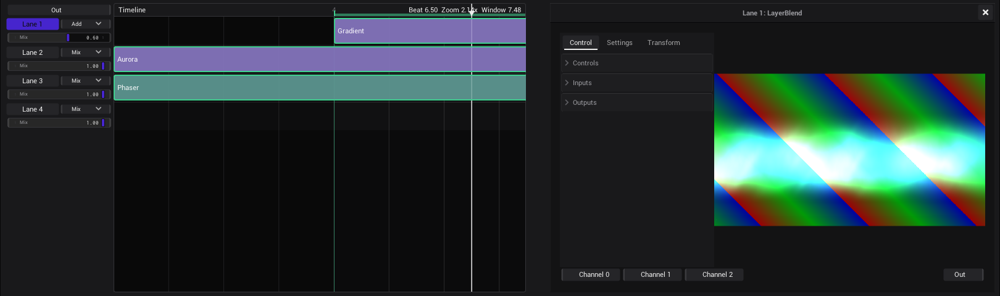
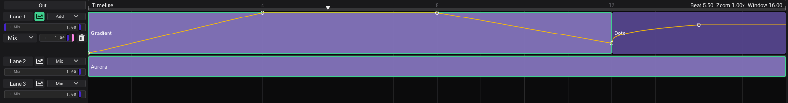
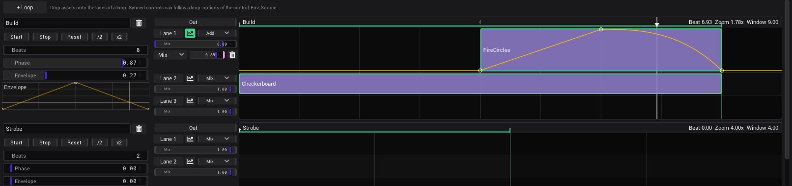
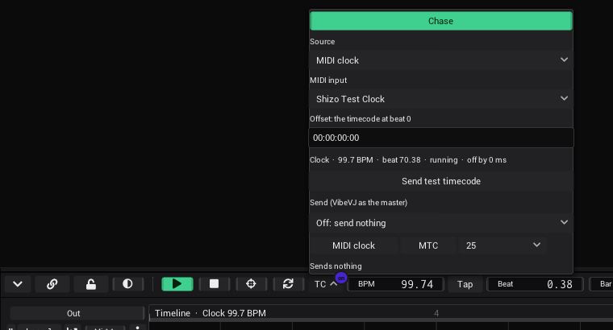
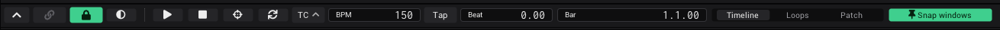

# Timeline

The timeline sits at the bottom of the window. Its bar holds the controls for the whole program: tempo, position, Play,
the cable view and the show mode lock. Autoplay in the [Clipview](Clipview.md#autoplay-and-duration) and every synced
shader and control run on its beats. Shaders, videos and generators can also be put on its lanes as
[clips](#clips-and-lanes) that play while the playhead runs through them, with [cues](#cues) that start things on the
way, and a whole show of [songs](#shows) can be programmed on it, one timeline per song.

## The transport bar

From left to right:

| Control | Tooltip | What it does |
|---|---|---|
| Chevron | *Open or collapse the timeline* | Collapses the timeline to its bar. Click it again (or drag the bar up) to open it at its last height. |
| Link | *Cable view: show every link* | [Cable view](Linking.md#seeing-your-links) on or off: every link on screen as a cable. The same switch as in [*Settings* › *Links*](Settings.md#links). Green while on. |
| Lock | *Show mode: lock notches and editing (Ctrl+L)* | [Show mode](#show-mode). Key: Ctrl + L; hold it to leave. No notch for MIDI. |
| Blackout | *Blackout (Ctrl+B)* | All outputs to black at once, again: back with a fade. See [Blackout](Output-and-Devices.md#blackout). Has a notch for MIDI. |
| *Play* | *Play or pause the timeline (Space)* | Runs the timeline. Green while playing. Click again to pause. Key: Space. |
| *Stop* | *Stop and go back to the start (Shift+Space)* | Stops and goes back to the start (Bar 1.1.00). Key: Shift + Space. |
| *Follow* | *Follow the playhead* | While it is on, the timeline pages along with the playhead: when the playhead reaches the right edge (or jumps out of view), the view moves so the playhead is at the left again. Dragging the ruler still moves the view by hand. |
| *Loop* (circling arrows) | *Loop* | While it is on and the timeline plays, the playhead jumps from the end of the loop range back to its start. Green while on. See [Loop](#loop). |
| *TC* | *Timecode and clock* | The timeline follows MIDI Time Code, MIDI clock or LTC, or sends MIDI clock and MTC to another program: *Chase*, the source, the input, the offset and the output are in its popup. A bubble shows while it chases (*on*) or sends (*out*). See [Timecode](#timecode). |
| *BPM* | | The tempo. 150 at the start. |
| *Tap* | *Click on each beat to set the tempo, or press T* | Tap the tempo. Key: T. |
| *Beat* | | Where the playhead is inside the current beat, from 0 to 1. |
| *Bar* | | The position as bar.beat.tick. |
| *View* | | *Timeline* / *Loops* / *Patch*. See [The view switch](#the-view-switch). |
| *Snap windows* | *The view area above follows the timeline when you move or collapse it* | See [Snap windows](#snap-windows). On at the start. |

- **On a narrow screen** (below about 1440 px, or with the sidebar open on a laptop) *BPM*, *Beat*, *Bar* and *View*
  get narrower and *Snap windows* keeps only its pin icon, so the whole bar stays on screen.
- **Linking:** *Play*, *Stop*, *Follow*, *Loop*, *BPM*, *Beat*, *Bar*, *View* and *Snap windows* have notches, so you can
  [link](Linking.md) them or map them to [MIDI](MIDI.md). *Beat* is the usual source for anything that should pulse.
- **The bubble on the link button:** while *Cable view* is off, it counts the generators that draw their own links.
  Rest the mouse on the button and a broken link slides in on its right half (*End all local cable views*): a click
  ends them all.
- **Keys:** Space plays or pauses, Shift + Space stops, T taps the tempo. They work anywhere in the program, also in
  show mode, but not while you type in a text field or a code editor. For a show, a MIDI pad is still safer under your
  hand: see [MIDI](MIDI.md).

## Set the tempo

1. Click *BPM* and type the tempo. Press Enter.
2. Or click *Tap* (or press T) on each beat, at least twice. The tempo is the average of your last taps (eight at
   most). Wait two seconds to start over.
3. Or let the music set it: see [Sync the timeline from audio](#sync-the-timeline-from-audio).

## Beat and Bar

- *Bar* shows the position as bar.beat.tick, with 4 beats per bar. Ticks are hundredths of a beat. The start is 1.1.00.
- To jump, click *Bar* and type the position **in beats**, then press Enter. For example 16 jumps to 5.1.00.
- *Beat* runs from 0 to 1 within every beat. Link it to anything that should pulse with the music.

## Open and size the timeline

- Drag the bar up to open the timeline, or click the chevron. The first time, the chevron opens it at about 40 % of
  the window.
- Drag the top edge of the timeline to make it taller or smaller. At least a strip of the views stays visible above.
- The height is not saved: after a restart the timeline is a bar again.

## The ruler

The view *Timeline* shows a ruler, the playhead and the [lanes](#clips-and-lanes). The numbers on the ruler are beats,
counted from 0, one number every 4 beats (a bar); beat 0 is at the left edge at the start. The line of text reads the
beat under the playhead, the zoom and the beats in view. The bar at the bottom of the ruler is the [loop](#loop) range.

| Gesture | Does |
|---|---|
| Mouse wheel over the timeline | Zooms in or out around the mouse, from 1/8 to 64 times. At 1 you see 16 beats. Away from you zooms in, as in a Patchview. |
| Trackpad (Mac) | Two fingers sideways move the time, a pinch zooms around the mouse, two fingers with Cmd held zoom like the wheel. |
| Drag on the ruler | Left or right moves the view, up or down zooms. |
| Right click on the ruler | Moves the playhead to the nearest whole beat. A left click does not move it. |
| Shift + drag on the ruler | Draws a new [loop](#loop) range, on whole beats. |
| Drag an end of the loop bar | Moves that end of the loop. |
| Double click on the ruler | Adds a [cue](#cues) there (a flag at the top of the ruler). |
| Drag the flag of a cue | Moves the cue along the ruler; a click on it opens it in the panel. |

## Clips and lanes

Put shaders, videos, pictures and generators on the timeline as clips, like in a video editor. A clip plays only while
the playhead is inside it: it starts when the playhead enters it and stops when the playhead leaves it. Outside it, it
does not run at all. Any generator can be a clip, also one without a picture, like the *Phaser* of a fixture: its
light runs while the playhead is in the clip.

**Make a clip.**

1. Open the timeline and choose *View* › *Timeline*.
2. Drag an asset from the *Assets* tab onto a lane. It becomes a clip of 16 beats (4 bars), starting at the beat on the
   grid left of where you let go. A violet line shows where it lands.
3. Or drag in a generator that is already set up: Alt + drag it out of a Patchview. It moves into a clip of its own,
   with its links and MIDI mappings, and runs while the playhead is in the clip; several generators give a clip each,
   one lane below the other. With Ctrl when you let go the clips get copies and the generators stay
   ([Select and move generators](Generators.md#select-and-move-generators)). A clip of a [Clipview](Clipview.md)
   dragged by its name tag: the timeline gets a copy with all its settings; the original stays.

There is always one empty lane at the bottom: drop onto it and a new lane comes below.

**Edit clips.**

| Gesture | Does |
|---|---|
| Drag a clip | Moves it in time and to another lane, on whole beats. Hold Shift for no snapping. When several clips are selected, they all move together. |
| Drag the left or right end of a clip | Makes it start earlier or later, or makes it longer or shorter. |
| Drag the small square at a top corner of a clip | Its [fade](#fades) in (left) or fade out (right). |
| Click a clip | Selects it (violet outline). The *Clip* panel opens on the right with its stack and controls. |
| Shift + click, Ctrl + click | Shift adds a clip to the selection, Ctrl (Cmd on a Mac) adds or removes one. |
| Drag on an empty part of the lanes | A rubber band: the clips it touches are selected (with Shift or Ctrl added to the selection). |
| Ctrl + A | Selects all clips of the timeline. |
| Delete (or Backspace) | Deletes the selected clips. Also the bin in the head of the panel. |
| Ctrl + C, Ctrl + V | Copies the selected clips, pastes them at the playhead on the lanes they came from. A copy keeps the settings of every entry of its stack. Also from one timeline into another (a [loop timeline](#loop-timelines)). |
| Ctrl + D | Duplicates the selected clips: the copies come right after them. |
| Click an empty part of a lane | Selects nothing; the panel closes. |
| Ctrl + Z / Ctrl + Y | Undo and redo of adding, moving, resizing, deleting, pasting and duplicating clips, of their fades, of the entries of their stacks and of the loop range. Moving several clips at once is one step. |

- A clip the playhead is in has a green outline, like a live clip of the Clipview.
- **A video** dropped onto a lane is as long as the video (from its *In* to its *Out* point, at its *Speed*), in beats
  at the tempo now: a clip of 3 seconds at 150 BPM is 7.5 beats. Other assets are 16 beats long.
- Ctrl + C and the other keys work while the lanes have the focus: click a clip or an empty part of a lane first.
- **The *Clip* panel** shows the stack of the selected clip, as the *Layer* window of a Clipview does: drag more assets
  onto its list to stack effects onto the clip, × removes one. The clip goes with its last entry. Adding and removing an
  entry are steps of the undo history: Ctrl + Z brings a removed entry back with its settings (and the clip, when it
  was the last one). Above the list, *Timeline clip* has its [fades](#fades). Drag the left edge of the panel to make
  it wider; × in its head closes it.
- When the panel opens or closes, the beats keep their width: the clips do not jump.
- Clips are saved with the project. In [show mode](#show-mode) clips cannot be moved, resized, deleted or dropped.

### Lanes

Each lane has a head on the left:

| Part | What it does |
|---|---|
| The grip (dots on the left) | Drag it up or down to move the lane. A violet line shows where it lands. Its clips, envelopes, links and MIDI mappings move with it. |
| *Lane 1*, *Lane 2* … or its name | Click it to see the *LayerBlend* of the lane in the panel: the same blend settings as a layer of the Clipview, its picture, and *Outputs* to send it to a display. |
| The curve button | Shows or hides the [envelopes](#envelopes) of the lane. |
| Blend mode | How the lane is laid over the lanes below it: *No Blend*, *Add*, *Add Mask*, *Mix* (the start), *Multiply*, *MultiplyInput*, or a chroma key. |
| The menu (three dots) | The name of the lane (type it and press Enter), *Add a lane above*, *Add a lane below*, *Move up*, *Move down*, *Delete the lane*. |
| *Mix* | How strongly the clip of the lane covers the lanes below. With *Mix* as the blend mode it is the opacity of the lane. 1 at the start. |

- A lane keeps its number when it moves: *Lane 3* stays *Lane 3* at the top. Give it a name to say what it is for.
- *Delete the lane* deletes it with its clips and envelopes. Ctrl + Z brings everything back, also the links of other
  controls to it and its MIDI mappings.
- Adding, deleting, moving and renaming lanes are steps of the undo history. Not in [show mode](#show-mode).

- Lane 1 is the top. It is laid over Lane 2, Lane 2 over Lane 3, and so on, as the layers of a Clipview.
- A lane without a playing clip lets the lanes below it through.
- When two clips on one lane overlap, they **crossfade**: over the overlap the later clip fades in over the earlier one,
  from 0 where it starts to all of it where the earlier one ends. A cross on the overlap shows it, in the
  [curve](#fades) of the later clip. Make the overlap longer for a slower fade. Both clips play during the fade.
- **Out** (above the lane heads) is the finished picture of the timeline: [link](Linking.md) it into an output shader,
  or open *Lane 1* and use its *Outputs*: see [Output and devices](Output-and-Devices.md#show-the-picture-on-a-display-or-projector).
- The blend mode and *Mix* of a lane have notches: map them to [MIDI](MIDI.md) or link them.

For asset makers: a clip gets the dispatcher commands `clip_start`, `clip_position` (every frame) and `clip_stop`,
and a shader the uniforms `CLIP_POS` and `CLIP_TIME`: see the asset guide (`assets/ASSET_GUIDE.MD`).

### Fades

A clip can fade in at its start and fade out at its end, over the lanes below it, as a clip fades in on an empty
layer of the Clipview. Without fades it starts and ends at once.

- Select the clip: a small square sits at each of its top corners. Drag the left one to the right for the fade in,
  the right one to the left for the fade out. They snap to a quarter beat; hold Shift for no snapping. The fade shows
  as a curve on the clip.
- Or type the beats in the *Clip* panel, under *Timeline clip*: *Fade in*, *out*.
- *Curve* there is the shape of the fades and of a [crossfade](#lanes) into the clip:

| *Curve* | Shape |
|---|---|
| *Linear* | The same speed all the way. A crossfade dips a little in the middle when the two pictures differ. |
| *Equal power* | Fast at the start, slow at the end; in a crossfade both clips are stronger in the middle (cos / sin): no dip. |
| *S curve* | Slow at both ends, fast in the middle. |

- The fades and the curve are saved with the clip, copied with it (Ctrl + C, Ctrl + D) and each change is a step of
  the undo history.
- A clip that crossfades with another one uses the crossfade, not its fade in, over the overlap.

## Envelopes

An envelope is a curve along the whole timeline that moves a control while the playhead runs: it fades a lane in and
out, raises an effect towards a drop, sweeps a colour. Each lane can have envelopes, one per control they drive, as in
Ableton Live: there are no envelope clips, the curve is as long as the timeline.

1. Click the curve button in the head of a lane. The lane gets taller and shows its first envelope, an orange line. It
   drives the *Mix* of the lane and starts flat at its *Mix* now.
2. Click on the line to add a point, and drag it. The value shows next to it while you drag.
3. Press *Play*: the *Mix* follows the line.

| Gesture | Does |
|---|---|
| Click on the line | Adds a point there and drags it. Points snap to a quarter beat; hold Shift for no snapping. |
| Double click in the lane | Adds a point where you click, also away from the line. |
| Drag a point | Moves it in time (not past the points next to it) and up or down. |
| Alt + drag on a segment | Bends it: up or down makes it start slowly or fast. |
| Right click or double click on a point | Deletes it. On one of several selected points: deletes all of them. |
| Click a point | Selects it (a violet ring). |
| Shift + click a point | Adds it to the selection, or takes it out. |
| Drag on an empty part of the lane | A rubber band: the points it covers are selected. On a lane that shows its envelope it selects points, not clips. |
| Drag a selected point | Moves all selected points together, in time and up or down. |
| Delete (or Backspace) | Deletes the selected points (before clips: while points are selected the keys work on them). |
| Ctrl + C, Ctrl + V | Copies the selected points; pastes them at the playhead, into the envelope that has selected points (else the one they came from). The points that were in their span go, the pasted ones are selected. |
| Ctrl + Z / Ctrl + Y | Undo and redo of every change of the points, of adding and deleting envelopes. |

- Before its first point an envelope holds the value of that point, after its last point the value of the last one.
  Two points on one beat make a jump.
- While an envelope is shown, a press on its line or its points edits the envelope; a press anywhere else on the lane
  still selects and moves clips.
- **More envelopes on a lane.** When the lane is shown tall enough, its head has a row for the envelopes: the list
  names the envelope shown by the control it drives; *+ New* in the list adds one. Next to the list is the output of
  the envelope shown, *Env*: [link](Linking.md) it from its right notch to any control, of a shader, a generator, a
  Clipview, a lamp. The link is *Normalized*: the envelope runs through the range of that control. The bin deletes
  the envelope shown, with its links.
- An envelope sets its control only when its own value changes: move the control by hand and it stays until the
  envelope moves on.
- Envelopes, their points and their links are saved with the project. Showing them or not is saved too, but is not a
  step of the undo history. In [show mode](#show-mode) they cannot be edited.

## Loop

The loop repeats a part of the timeline while it plays: a show of 8 bars that runs again and again, or one passage
you are working on.

1. Shift + drag on the ruler from where the loop should start to where it should end. The green bar at the bottom of
   the ruler shows it. Or drag the ends of the bar.
2. Click *Loop* in the bar (the circling arrows). It turns green, and the lanes outside the loop get darker.
3. Press *Play*. When the playhead reaches the end of the loop, it jumps back to its start; the clips there start again.

- The loop range is 0 to 16 beats at the start. It snaps to whole beats.
- A playhead you put after the loop plays on: the loop only catches it from inside.
- The range is saved with the project, *Loop* with the controls. Changing the range is a step of the undo history;
  *Loop* on or off is not, like *Play*.

## Cues

A cue is a flag on the ruler that does something when the playhead passes it while the timeline plays: start a clip
of a Clipview at the drop, take a cue of the lighting desk at the chorus, send a MIDI note to another program, start a
loop timeline.

1. Double click on the ruler where it should be. An orange flag appears, the *Cue* panel opens on the right.
2. Choose what it *Does* and fill in the fields below. *Fire now* runs it, to try it.
3. Give it a *Name*: the flag shows it.

| *Does* | Fields |
|---|---|
| *Clipview: launch a clip* | The Clipview (*The first Clipview*, or one by its path), the row and the column of the cell, from 0. |
| *Clipview: launch a column* | The Clipview and the column. |
| *Lighting desk: a command* | A command line of the [lighting desk](Lighting-Desk.md), e.g. `goto 3 stack Main` (cue 3 of the stack Main), `go stack Main`, `off stack Main`. |
| *MIDI: send a message* | The MIDI output and the message as hex bytes, as MIDI monitors show them: `90 3C 7F` is note 60 on, velocity 127, channel 1; `B0 10 40` a controller. |
| *Loop timeline: start / stop* | The name of the [loop timeline](#loop-timelines), *Start* or *Stop*. |
| *Song: go to a song* | The name or number of a [song](#shows): the show goes on with it. |
| *AI query of a generator* | Any query an AI agent can run: the live_path of the generator, the query and its arguments as JSON. |

- A cue runs only when the playhead runs over it while the timeline plays, also when it is reached by the
  [timecode](#timecode). A jump past it (a click on the ruler, a locate of the master) does not run it. When the
  [loop](#loop) jumps back to its start, the cues at the start run again.
- Drag a flag to move the cue; a click selects it and opens it. Delete with a flag selected deletes the cue.
- Cues belong to the timeline (each [song](#shows) has its own) and are saved with the project. Adding, moving,
  changing and deleting them are steps of the undo history; not in [show mode](#show-mode).
- Loop timelines have no cues.

## Shows

A show is a list of songs, each with a timeline of its own: its lanes, clips, envelopes, loop and cues. One plays at a
time. Program a set once, then pick the songs by hand, by MIDI, or let the timecode of the music pick them.

The song button sits above the lane heads, right of *Out*: it shows the song that plays. Click it for the list.

| In the list | Does |
|---|---|
| *+ Song* | A new, empty song at the end of the list. |
| ⏴ ⏵ (previous, next) | The song before or after. MIDI-mappable. |
| *Song* | The song by number, from 0 (the first song). Map a MIDI program change to it: program 0 plays the first song, 1 the second. |
| *By TC* | The [timecode](#timecode) picks the song (below). |
| ▶ (Go) of a row | This song plays. MIDI-mappable (a note per song). |
| Name, *Starts at (TC)*, *BPM* | The name of the song, the timecode where it starts (hh:mm:ss:ff) and its tempo. |
| The bin of a row | Deletes the song with its timeline (not the first song). Ctrl + Z brings it back. |

- A song picked by hand, by MIDI, by a cue or by an AI agent plays from its start; its *BPM* (when it has one) becomes
  the tempo. *Play* keeps playing: the show goes on with the new song.
- **By timecode.** Give each song the timecode it starts at, e.g. 01:00:00:00, 02:00:00:00, 03:00:00:00 (one an
  hour, as timecode-driven shows do), turn on *By TC* and chase MTC or LTC (*TC* in the bar). The song whose start is
  the last one at or before the timecode plays, and its start is the offset: at 02:00:30:00 the second song plays,
  30 seconds in. A locate of the master into another hour switches the song. Songs without a timecode are picked only
  by hand.
- All songs share *Out* and the *Clip* panel: links to *Out* keep working whichever song plays. The songs that do not
  play rest: their clips are stopped.
- The first song is the timeline of a project from before the shows; projects without songs open as one song.
- The songs, their timecodes and BPMs are saved with the project (`timeline_shows.json`). Adding, deleting and
  renaming songs and changing their timecode or BPM are steps of the undo history; picking a song is not.

## The view switch

| View | Shows |
|---|---|
| *Timeline* | The ruler, the playhead and the [lanes with their clips](#clips-and-lanes). |
| *Loops* | The [loops](#loops): timelines of their own that turn along the main timeline. |
| *Patch* | An area for [generator windows](The-Screen.md#generator-windows) that belong to the timeline. |

- The generators in the *Patch* area are saved with the project.
- Windows there snap to a grid of 16 px when you move or resize them, as in a Patchview: see
  [Zoom and the grid of a Patchview](The-Screen.md#zoom-and-the-grid-of-a-patchview).
- You can select and move them as in a Patchview: see [Select and move generators](Generators.md#select-and-move-generators).

## Loops

A loop is a timeline of its own with a fixed length in beats. It turns along the main timeline: it moves while the
timeline plays, at its BPM, and stands still while it stops. But it has its own place in its turn, which you start,
stop and reset on their own. Use it for things that should repeat every 2, 8 or 16 beats, or that should only run for a
while.

*View* › *Loops*, then *+ Loop*. Each loop is a row:

| Part | What it does |
|---|---|
| Name | Shown in the *Source* list of synced controls. |
| *Start* | The loop turns, from where the main timeline is: a loop of 4 beats started on beat 6 is half way through its turn, so loops started at different times still meet on the bars. |
| *Stop* | The loop stands still where it is. |
| *Reset* | Back to the start of the turn, now. |
| */2*, *x2* | Half or twice as fast. The size of the change shows next to the buttons. |
| *Chase* | While the loop runs, it is where the main timeline is in its turns, as if it had run from beat 0, instead of counting on by itself. When the timeline jumps (a [timecode](#timecode) or MIDI clock it chases locates), the loop jumps with it. |
| *Beats* | How many beats one turn takes. |
| *Phase* | Where the loop is in its turn, 0 to 1. [Link](Linking.md) it to anything that should follow the loop. |
| *Envelope* | The curve on the right, read at the phase of the loop. Link it to the controls it should drive. |
| The bin | Deletes the loop. Controls that followed it stand still. |

- *Start*, *Stop*, *Reset*, */2*, *x2* and *Beats* are controls: map them to a pad or a button of your controller
  ([MIDI](MIDI.md)), or link a beat or a button to them.
- A synced control can follow a loop instead of the main timeline: its options, tab *Env*, *Source*
  ([Envelope and sync](Linking.md#envelope-and-sync)). With *SYNC* it then runs through its range once per turn of the
  loop.
- The loops are saved with the project, the turn they are in too.

### Loop timelines

Each loop is also a timeline of its own, on the right of its row: lanes with clips, blending and
[envelopes](#envelopes), the same as the main timeline. Drop assets onto its lanes, move and resize clips, show the
envelopes of a lane: everything of [Clips and lanes](#clips-and-lanes) works here too.

- Its playhead runs over the range in its ruler (green), again and again, while the loop runs. The range is one turn
  of the loop: *Beats* sets its length, or drag its ends; Shift + drag in its ruler draws another one.
- A clip dropped onto a loop is as long as its turn.
- *Start* starts the loop and its clips play; *Stop* stops them, the loop stands still. Like everything synced, a
  running loop only moves while the main timeline plays. Map *Start* and *Stop* to pads of your controller to start a
  loop like a clip ([MIDI](MIDI.md)).
- Its picture is at its own *Out* above its lane heads: link it into an output shader or into a layer, like the
  *Out* of the main timeline.
- The clips of all loops share the *Clip* panel at the right of the view *Loops*.
- **Start a loop from the main timeline:** drop the generator *LoopTrigger* (*Generators* › *Utility*) onto a lane of
  the main timeline and pick the loop in its *Loop* list (the *Clip* panel). While the playhead is inside that clip the
  loop runs: *From the start* begins its turn when the clip begins (off: from where the main timeline is, on the bars),
  *Stop at the end* stops it when the playhead leaves the clip. So a show on the timeline starts and stops its loops by
  itself.
- *Chase* (in the head of the row) keeps a running loop on the place of the main timeline, also when a
  [timecode](#timecode) or MIDI clock moves the timeline.
- An empty loop costs nothing: the blending of its lanes starts with its first clip.
- The small curve under the controls is the older envelope of the loop, read once per turn (*Envelope*).
- Deleting a loop (its bin) is a step of the undo history: Ctrl + Z makes it again in its place, with its timeline,
  its controls, links and MIDI mappings. The undo steps of its clips and envelopes from before do nothing after that.

## Timecode

For a show that runs to a fixed time or to the tempo of another program, the timeline can follow a master: a DAW, a
show controller or a lighting desk. The playhead then goes where the master is, starts and stops with it, and jumps
when it jumps. The other way round, VibeVJ can be the master and send MIDI clock and MIDI Time Code
([Send](#send-vibevj-as-the-master)).

| *Source* | What comes in | The playhead |
|---|---|---|
| *MIDI Time Code* | MTC on a MIDI input: the time of the master, 24, 25, 29.97 drop frame or 30 frames a second | (timecode − offset) × BPM / 60 beats |
| *MIDI clock* | MIDI clock on a MIDI input: 24 clocks a beat, Start, Continue, Stop and the song position | the song position in beats; the *BPM* of the timeline follows the tempo of the clock |
| *LTC (audio input)* | SMPTE timecode as sound (LTC), read by the generator [*Audio Input Analysis*](Audio.md#ltc-timecode-as-sound) on its input | (timecode − offset) × BPM / 60 beats |

1. Connect the master: MIDI to a MIDI input of the computer (in the DAW: send MIDI Time Code or MIDI clock to that
   port), LTC to the sound input the *Audio Input Analysis* listens to.
2. Click *TC* in the bar. Choose the *Source* and the *MIDI input* (*Any MIDI input*: the one that sent last).
3. For timecode type the *Offset*: the timecode where beat 0 of the timeline is, as hh:mm:ss:ff. A show that starts at
   01:00:00:00 has its first beat there. MIDI clock needs none: its song position counts from the start of the song.
4. Turn on *Chase*. Start the master.

- With timecode the playhead is at (timecode − offset) × BPM / 60 beats: at 150 BPM, ten seconds after the offset is
  beat 25. Set the *BPM* of the show first; a different BPM puts the timecode on other beats.
- With MIDI clock the tempo is the tempo of the clock, measured over the last beat and smoothed; a new tempo of the
  master (more than a fifth faster or slower) is taken at once. The song position the master sends when it locates
  moves the playhead (in sixteenth notes).
- The master starts: the timeline plays from where the timecode is. It stops: the timeline stops there. It locates
  (jumps, also while it stands): the playhead jumps there.
- While both run, every frame the playhead goes to the timecode of that frame: a master that runs a little fast or
  slow does not let the timeline drift away. The frame rates of MTC, 24, 25, 29.97 drop frame and 30, are read from the
  timecode; the popup shows the time that comes in, the rate and how far the playhead is off.
- LTC that plays backwards (a tape or a DAW scrubbing back) moves the playhead back with it.
- While chasing, the ruler shows the timecode (or the tempo of the clock) next to *Timeline*, and the [loop](#loop)
  does not catch the playhead. [Loop timelines](#loop-timelines) with *Chase* on go with the playhead.
- *Chase* has a notch: map it to [MIDI](MIDI.md) or link it. The source, the input, the offset and the output are
  saved with the project.
- With [songs](#shows) that have a start timecode and *By TC* on, the timecode picks the song and its start is the
  offset instead of the *Offset* of the popup (and of the MTC sent).
- **Without a master:** *Send test timecode* plays timecode from the offset at 25 fps into the virtual MIDI device
  (*Shizo Virtual MIDI*), to rehearse the show. Choose that input or *Any*. For AI agents there are a test clock and a
  test LTC as well (see the MCP queries of the timeline).

### Send: VibeVJ as the master

Under *Send* in the popup of *TC*: choose a MIDI output and turn on *MIDI clock*, *MTC* or both. Another program or
device then follows the timeline of VibeVJ.

- *MIDI clock*: 24 clocks a beat at the *BPM*, also while the timeline stands (the receiver keeps the tempo). *Play*
  sends the song position and Continue (Start at beat 0), *Stop* / pause sends Stop, a jump of the playhead while it
  plays sends Stop, the new song position and Continue; while it stands a move of the playhead sends the song position.
- *MTC* with the rate next to it: quarter frames while the timeline plays, a full frame where it starts or jumps and
  when the playhead moves while it stands. The timecode is the *Offset* plus the time of the playhead at the *BPM*.
- The messages go out from a thread of their own, evenly, not with the frames of the program; the thread follows the
  playhead every frame, so a loop or a jump of the timeline comes out as a jump.
- To the virtual MIDI device (*Shizo Virtual MIDI*) they come in as its input, and on Linux and macOS other programs
  get them from its port of the system.

## Snap windows

With *Snap windows* on, the view area above always ends where the timeline starts, so moving the timeline up or down
resizes the views. With it off, the views only get smaller when the timeline would cover them.

## Show mode

Show mode locks the program for performing, so nothing gets linked, moved or closed by accident, by mouse or by touch.

1. Click the lock in the bar, right of the link button, or press **Ctrl + L** (Cmd + L on a Mac). The lock closes and
   turns green.
2. Play your show.
3. To leave, press the lock, hold it for at least 400 ms, then let go (tooltip *Hold to leave show mode*). Or hold
   **Ctrl + L** for at least 400 ms, then let go. A short click or a short key press does nothing, so a stray touch or
   key does not unlock it.

| Locked | Still working |
|---|---|
| Notches: no options, no linking, no hold and drag | Values and sliders |
| The layout: splitting, closing, moving and replacing views; adding, renaming and deleting tabs | Buttons |
| Moving and resizing windows, Alt + drag | Play, Stop, BPM, Tap and Blackout |
| Dropping assets, moving clips | Clips, columns and cues |
| Every right-click menu | MIDI |
| Undo and redo | The power buttons of the generators |
| Closing generators, *Paste settings*, *Reload module* | |
| *Exit* and the close button of the window | |
| The cable view | |
| The [autosave](Getting-Started.md#autosave) | |

- While locked, free notches are hidden and linked ones stay as a coloured edge. No cables are drawn. See
  [Linking](Linking.md#show-mode).
- Show mode is not saved with the project, and the autosave does not keep it either. VibeVJ always starts unlocked, also
  after a crash and on another computer. Opening another project while VibeVJ runs keeps the lock as it is.
- The lock cannot be mapped to MIDI, so a controller message sent by mistake cannot unlock a show. The command palette
  has *Show mode on / off* (Ctrl + K).
- Values you change in show mode are no [undo](The-Screen.md#undo-and-redo) steps. The history from before stays and
  works again when you leave show mode.
- To lock only one Clipview, use its [*Live*](Clipview.md#live) button.

## Sync the timeline from audio

1. Add the generator *Audio Input Analysis* (see [Audio](Audio.md)).
2. Turn on its *Sync timeline* button.
3. Press *Play*.

The *BPM* of the timeline now follows the tempo that is heard, and the playhead is nudged gently into step with the
beat. Turn *Sync timeline* off to set the tempo yourself again.

The generator *Prolink Bridge* does the same with CDJs. Its *Sync timeline* is on at the start and follows a deck
that is playing: see [Output and devices](Output-and-Devices.md#prolink-cdjs).

If the tempo changes although you set it by hand, one of the two is on: see
[Troubleshooting](Troubleshooting.md#the-tempo-keeps-changing-by-itself).

## See also

- [Clipview](Clipview.md)
- [Audio](Audio.md)
- [Linking](Linking.md)
- [The screen](The-Screen.md)
- [Shortcuts and tips](Shortcuts-and-Tips.md)
