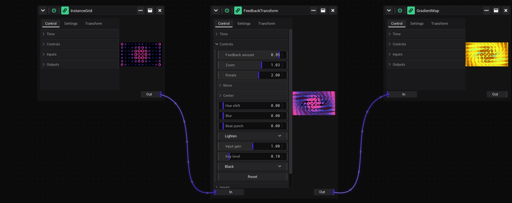

# Tutorial: An effect chain

In this tutorial you build a generative picture from three building blocks, like the operators of TouchDesigner: a
pattern, a feedback that leaves trails, and a colour ramp. Each one is a shader of its own; you link the picture of
one into the next through their ports. At the end it goes into a clip.

- **Time:** about 15 minutes.
- **You need:** nothing but VibeVJ. [Visuals on the beat](Tutorial-Visuals-on-the-Beat.md) shows how links are made.

## The source: a pattern

1. Start a new project (*Projects* › *New project*) and click the *Patchview* tile.
2. In the *Assets* tab, go to `Shaders` › `Sources` › `Patterns` and drag *InstanceGrid* to the left of the Patchview.
3. It shows a grid of shapes that grow and shrink in a wave. Click *Controls* to open them; drag the lower right
   corner of the window to make it taller.
4. Try the lists: the one that reads *Square* is the shape (*Star*, *Ring*, *Heart*, …), the one that reads *Radial
   wave* is the field that moves them (*Beat chase*, *Spiral*, …). Try *Columns* and *Rows* too.
5. Pick *Ring* as the shape and *Radial wave* as the field for the next steps.

*Field speed* counts waves per beat: the pattern follows the tempo of the timeline as soon as it plays. See
[InstanceGrid](Assets.md#instancegrid-sources--patterns).

## The trails: a feedback

A feedback lays the last picture under the new one, a little zoomed and turned, again and again: tunnels and spirals.

1. Go to `Shaders` › `Effects` › `Feedback&Blur` and drag *FeedbackTransform* to the right of InstanceGrid.
2. Its picture is black: an effect needs a picture to work on. Its ports are at the bottom of the window: *In* on the
   left, *Out* on the right.
3. Hover *Out* of InstanceGrid. Drag from its right edge onto *In* of FeedbackTransform. A cable joins the two.
4. The rings now leave trails that fly towards you and turn.

Shape the trails:

| Control | Try | What it does |
|---|---|---|
| *Zoom* | 1.03 | More than 1 flies in, less than 1 flies out. |
| *Rotate* | 2 | Degrees per frame: a spiral. |
| *Feedback amount* | 0.95 | How much of the last picture stays: longer trails. |
| *Hue shift* | 0.01 | The trails change colour: rainbow trails. |
| *Beat punch* | 0.5 | A small zoom on every beat. |

*Reset* clears the trails. More: [FeedbackTransform](Assets.md#feedbacktransform-effects--feedbackblur).

## The colours: a gradient map

1. Go to `Shaders` › `Effects` › `Color` and drag *GradientMap* to the right of FeedbackTransform.
2. Link *Out* of FeedbackTransform into *In* of GradientMap.
3. Open its *Controls* and pick a palette in the list that reads *Four colours*: *Fire*, *Neon*, *Acid*, … The
   brightness of the picture picks the colour, dark the left end of the ramp, bright the right end.
4. Raise *Cycle speed* to 0.5: the colours run through the picture.

The window of GradientMap now shows the result of the whole chain. Every window shows the picture of its own step,
so you see what each building block does. See [GradientMap](Assets.md#gradientmap-effects--color).

## Make it move on its own

1. Drag *SineGenerator* (`Generators` › `Math`) into the Patchview.
2. Link its *Output* into *Rotate* of FeedbackTransform. The spiral turns one way, then the other.
3. Lower *Frequency* of the sine for a slow change.

Any value of the chain can be driven this way: by an LFO, by the [audio analysis](Audio.md), by a fader of a
[MIDI controller](Tutorial-MIDI-Controller.md).

## The same chain as a clip

The chain can also live in a cell of a Clipview, where it plays with other clips. There the effects need no links: the
entries of a clip are a stack, and each one gets the picture of the one before.

1. Split the area: Ctrl + E, or *Split right* in the header of the area. Click the *Clipview* tile in the new area.
2. Drag *InstanceGrid* from the *Assets* tab onto the first cell of *Layer 1*. It becomes a clip.
3. Drag *FeedbackTransform* onto that clip, then *GradientMap*. They are stacked onto it, in this order.
4. Click the name tag of the clip: the *Layer* window at the bottom shows its stack. Click an entry to see its
   controls.
5. Click the picture of the clip to start it.

See [The stack of a clip](Clipview.md#the-stack-of-a-clip). How a set of clips is played is the next tutorial.

## Keep it

- Save the project: Ctrl + S.
- To use the settings of one shader again, click ⋯ in its header › *Save preset…*. The preset shows up in the `presets`
  folder of the shader in the *Assets* tab. See [Presets](Generators.md#presets).
- To keep the whole Patchview with its three shaders and their links, right-click the area › *Save as preset…*. It is
  offered in every empty area from then on.

## What you learned

- A shader with an *In* port is an effect; its *Out* port gives its picture to the next one.
- Each window shows the picture of its own step, so a chain is easy to follow.
- In a clip the same effects are a stack: no links needed.

Next: [A live set in the Clipview](Tutorial-Live-Set.md).

## See also

- [Tutorials](Tutorials.md)
- [Assets](Assets.md)
- [Linking](Linking.md#ports)
- [Clipview](Clipview.md)
- [Generators](Generators.md#presets)
