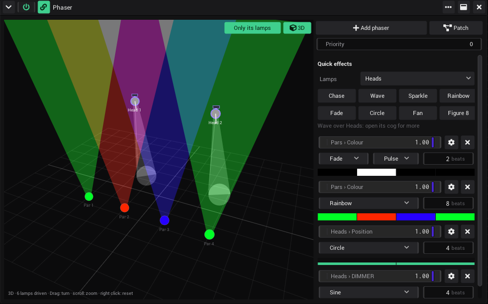

# Tutorial: Lights on the beat

In this tutorial VibeVJ drives lamps over Art-Net: you set up four pars and two moving heads, put them in groups, and
run a chase, a rainbow and a circle over them that follow the tempo. At the end the brightness follows the bass.

- **Time:** about 20 minutes.
- **You need:** lamps behind an Art-Net node in the network of the computer, and their DMX addresses. Without lamps
  the steps work too: the fixture setup and the Phaser show what the lamps would do, on the plan and in 3D.

## The node

1. Connect the Art-Net node to the network of the computer.
2. Open the *Devices* tab of the sidebar, section *Network* › *Art-Net*. The node shows up as "name [MAC]" with its IP
   address as soon as it answers.
3. Is the computer in more than one network (Wi-Fi and a cable)? *Network cards* sets which ones Art-Net uses. See
   [Network cards](Output-and-Devices.md#network-cards).

## Set up the lamps

1. In *Devices*, open *Fixtures* and click *Fixture setup*. It opens in a new view tab.
2. Your node is listed on the right under *Nodes*. No node in sight? *Add node by IP*, with its IP address and a name.
3. In *Fixture types* on the left, open `Pars` and click *hexapad* (or the type of your pars). Set *Count* to 4 and
   click *Add lamps*. Four pars appear on the plan, one after the other on the channels of the node.
4. Open `MovingHeads`, click the type of your heads, *Count* 2, *Add lamps*.
5. Click a lamp: on the right are its *Name*, *Node*, *Universe* and *Address*. Type the address that is set on the
   lamp itself.

A lamp that shares channels with another one, or has no node, is red. The universe map at the bottom shows the 512
channels and who uses them. Your lamp type is not in the list? Import its GDTF file or make a fixture file: see
[Fixtures](Output-and-Devices.md#fixtures).

**Find each lamp:** select it and turn on *Highlight*. It goes to full white in the rig.

## Place them and make groups

1. Drag the lamps on the plan to where they hang: the plan is the stage from above, the audience at the bottom, one
   square a metre. Select the four pars (Shift + click, or drag a box around them) and click *Row*.
2. With the four pars selected, click *New group from selection* and call it `Pars`. The order you picked them in is
   the order of a chase.
3. Select the two heads, make a group `Heads`.
4. Click *3D*: the stage in perspective. Set *Height* and *Mount* of the heads (*Hanging (truss)*, 4 metres).

See [Set up your lamps](Output-and-Devices.md#set-up-your-lamps) and [The stage in 3D](Output-and-Devices.md#the-stage-in-3d).

## A chase in one click

1. Go back to your first view tab. Drag *Phaser* from `FixturesEffects` in the *Assets* tab into a view.
2. Under *Quick effects*, open the list *Pick lamps…* and pick the group *Pars*. Click *Chase*. A phaser is set up,
   a row with its name (*Pars › Colour*), its Level slider and its wave: the pars light one after the other.
3. Press Space to play the timeline. The chase follows its tempo: tap it with T, or let the music lead
   ([Sync timeline](Audio.md#sync-timeline)).
4. Click *Rainbow* for the same group: a second phaser. The chase now runs over a rainbow.

The plan on the left of the Phaser shows the lamps as they really look. See
[Effects over fixtures](Output-and-Devices.md#effects-over-fixtures).

## The moving heads

1. Under *Quick effects*, pick the group *Heads* and click *Circle*. The heads draw circles one after the other.
2. A circle moves the heads, it does not light them. Click *Wave* for the same group: their dimmer now rises and falls,
   and the beams show.
3. The field *4 beats* in its row is the cycle: how many beats one circle takes. Open the ⚙ of the circle for the
   rest (make the window taller to see all of it): *Size* makes the circle bigger, *Pan centre* and *Tilt centre*
   move it.
4. Set *Wings* to 2: the two heads now move mirrored.
5. Click *3D* at the top right of the plan: you see where the beams land on the floor. Drag to turn the stage, scroll
   to zoom.

## The bass drives the light

Each phaser has a Level slider in its row: 0 holds the lamps at *Low*, 1 runs the full effect. Like every slider it can
be linked.

1. Add *AudioInputAnalysis* (`Generators` › `Audio`) to a view, as in
   [Visuals on the beat](Tutorial-Visuals-on-the-Beat.md#the-audio-analysis).
2. Link *Low energy* into the Level slider of the chase. The chase now breathes with the bass.

Or let the light change with the video: a Phaser is a clip like a shader. Drop one into each column of a free layer of
your Clipview, each with other quick effects, and the light changes with the columns and with autoplay. See
[Clips](Clipview.md#make-a-clip).

## Masters and the blackout

- *Devices* › *Fixtures* › *Masters*: a *Group master* for each group (the brightness of its lamps) and four *Speed
  masters*. Set *Speed* in the ⚙ of a phaser to *Speed 1*, and that master makes it faster or slower. Map them
  to faders of your controller. See [Masters](Lighting-Desk.md#masters).
- Ctrl + B sends the brightness and colour of every lamp to black, together with the video. Pan, tilt and gobos stay
  where they are, so the heads do not swing. See [Blackout](Output-and-Devices.md#blackout).

## Keep it

The lamps, the groups and the Phaser are saved with the project: Ctrl + S.

## What you learned

- Lamps are set up once per project in the fixture setup: node, universe, address, place on the stage.
- Groups set the order of an effect; the Phaser runs it, on the beats of the timeline.
- A Level slider can be linked like any value, and a Phaser can be a clip.

Next: store looks and play them like on a console with the [lighting desk](Lighting-Desk.md), or put everything on
[the timeline](Tutorial-Timeline-Show.md).

## See also

- [Tutorials](Tutorials.md)
- [Output and devices](Output-and-Devices.md#fixtures)
- [Lighting desk](Lighting-Desk.md)
- [Audio](Audio.md)
- [Troubleshooting](Troubleshooting.md#lights-do-not-react-art-net-fixtures)
