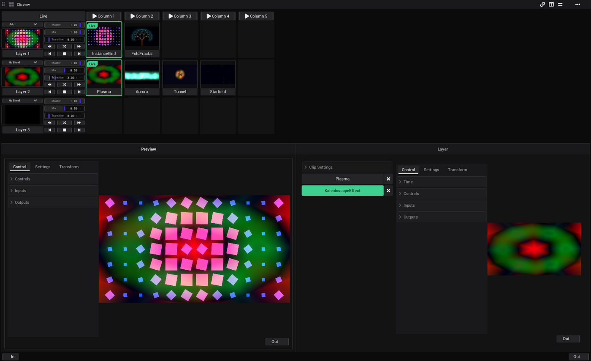

# Tutorial: A live set in the Clipview

In this tutorial you build a small set to play live: a layer of backgrounds, a layer of overlays on top, effects on the
clips, soft fades between them, columns that change the whole picture at once, and autoplay that plays the set by
itself.

- **Time:** about 20 minutes.
- **You need:** nothing but VibeVJ. Music and [Visuals on the beat](Tutorial-Visuals-on-the-Beat.md) help, but are
  not needed.

## How the Clipview works

Each row is a layer, each cell a clip. A click on a clip starts it on its layer, and the clip that ran there before
stops. Layer 1 is the top row: it is laid over Layer 2, Layer 2 over Layer 3. So backgrounds go into a lower row, and
what lies on top of them into a higher one. More: [Layers](Clipview.md#layers).

1. Start a new project and click the *Clipview* tile.
2. The Clipview has 3 layers and 4 columns. The window *Preview* at the bottom left shows the finished picture.

## The backgrounds: Layer 2

1. In the *Assets* tab, go to `Shaders` › `Sources` › `Basic`.
2. Drag *Plasma* onto the first cell of *Layer 2*. It becomes a clip, named after the shader.
3. Drag *Aurora* onto the second cell, *Tunnel* onto the third, *Starfield* onto the fourth.
4. Click the picture of *Plasma*. It gets a green ring and a *Live* badge: it is on air, and the *Preview* shows it.
5. Click *Aurora*. It takes the place of *Plasma* at once: a hard cut.

The grid grows as you fill it: there is always one free row and one free column at the edge.

## Fades

1. In the cell of *Layer 2* on the left, find *Transition* and set it to 2. It counts seconds.
2. Click *Tunnel*. Its ring is dashed while it fades in over two seconds.
3. Click *Starfield* while a fade runs. It waits as *Next* (amber ring) and starts when the fade ends.

One clip can have a fade of its own: select it (click its name tag), then in the *Layer* window *Clip Settings* ›
*Autoplay* › *Transition*. See [Live and next clips](Clipview.md#live-and-next-clips).

## The overlays: Layer 1

1. From `Shaders` › `Sources` › `Patterns`, drag *InstanceGrid* onto the first cell of *Layer 1*, *FoldFractal* onto
   the second.
2. Start *InstanceGrid*. The *Preview* shows only the grid: the background is gone.

The blend mode of a new layer is *No Blend*: its clip covers everything below. Lay it over the background instead:

3. In the cell of *Layer 1* on the left, set the blend mode (the list above the picture) to *Add*.
4. Raise *Mix* to 1. The grid is now added over the background.
5. Try *Multiply* (the overlay darkens the background) and *Mix* (a crossfade of the two layers).

The blend modes are listed on [Layers](Clipview.md#layers). *Master* is the brightness of a layer: pull it down to fade
a layer out by hand.

## An effect on a clip

A clip is a stack: drop an effect onto it and it works on the picture of the clip.

1. From `Shaders` › `Effects` › `Kaleidoscope`, drag *KaleidoscopeEffect* onto the clip *Plasma* (the cell, not an
   empty one).
2. Click the name tag of *Plasma* (below its picture). The tag turns violet, and the *Layer* window at the bottom right
   shows the stack: *Plasma*, then *KaleidoscopeEffect*. Click an entry to see its controls.
3. Start *Plasma*: it is a kaleidoscope now. Click the entry *KaleidoscopeEffect*, open its *Controls* and set
   *Kaleidoscope segments* to 8.
4. × beside an entry of the stack removes it.

See [The stack of a clip](Clipview.md#the-stack-of-a-clip).

## Columns

The buttons *Column 1*, *Column 2*, … at the top start every clip in their column at once: a whole look with one click.

1. Drag the clips so that the columns make good pairs: drag a clip by its name tag to an empty cell. Hold Ctrl when
   you let go to copy it.
2. Click *Column 1*, then *Column 2*. Both layers change together, each with its own fade.

A layer without a clip in the column stops: leave a cell empty to take a layer out for that look.

## Autoplay

Autoplay plays the clips of a layer one after the other, each for a number of beats.

1. Click the name tag of *Layer 2* (*Layer 2* on the left). In the *Layer* window, open *Layer Settings*, then
   *Autoplay*, and set *Duration* to 16 (four bars).
2. Click the button ⏩ of the layer (*Autoplay forwards*: the right one of the upper row of small buttons; the lower
   row is *Previous clip*, *Stop the layer* and *Next clip*). It turns green.
3. Press Space to play the timeline. Every 16 beats the next background starts.
4. Do the same for *Layer 1* with *Duration* 32. The two layers now change at different times, so the pairs are new
   all the time.

Autoplay counts the beats of the timeline: it waits while the timeline stands. Set the tempo with *Tap* (or T), or let
the music set it ([Sync timeline](Audio.md#sync-timeline)). See [Autoplay and Duration](Clipview.md#autoplay-and-duration).

## Lock it for playing

Click *Live* in the top left corner of the Clipview. Clips cannot be moved, dropped or deleted any more, and the name
tags are plain labels: a hurried click starts a clip and changes nothing else. Click *Live* again to edit.

## Keep it

Press Ctrl + S and give the project a name. To use the same Clipview in another project, right-click it › *Save as
preset…*.

## What you learned

- Clips start by a click; the layer decides what lies on top; the blend mode decides how.
- *Transition* fades, columns change the whole picture, autoplay plays by itself on the beats of the timeline.
- Effects are stacked onto a clip.

Next: put the layers and clips under your hands with [a MIDI controller](Tutorial-MIDI-Controller.md), and bring the
*Preview* onto [a projector](Tutorial-Projector.md).

## See also

- [Tutorials](Tutorials.md)
- [Clipview](Clipview.md)
- [CueList](CueList.md)
- [Timeline](Timeline.md)
- [Assets](Assets.md)
