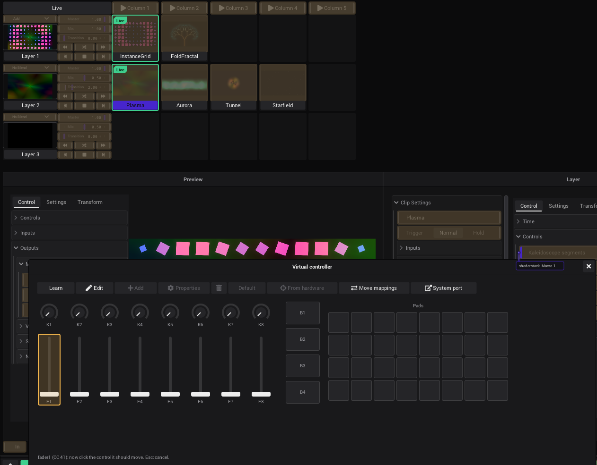

# Tutorial: Play with a MIDI controller

In this tutorial the set of [A live set in the Clipview](Tutorial-Live-Set.md) gets under your hands: faders for the
brightness of the layers, pads for the columns, a pad for the blackout and knobs that play the effect of whichever clip
is running. No controller at hand? The virtual controller of VibeVJ does the same on the screen, and the mappings move
to a real controller later.

- **Time:** about 15 minutes.
- **You need:** a project with a Clipview (the one of the last tutorial, or any). A MIDI controller with faders, knobs
  or pads, or none.

## The controller

- **A real controller:** plug it in. Open the *Devices* tab of the sidebar, section *MIDI*: it shows up there within a
  second, with its name. See [Your devices](MIDI.md#your-devices).
- **No controller:** click *Virtual controller* in the same section. A window with knobs, faders, buttons and pads
  opens; it sends MIDI like a controller, as the device *Shizo Virtual MIDI*. See
  [The virtual controller](MIDI.md#the-virtual-controller).

## Faders for the layers

1. In *Devices* › *MIDI*, click *MIDI learn*. It turns amber, and every control gets an amber overlay.
2. Click the overlay of *Master* of *Layer 1* in the Clipview.
3. Move the first fader of the controller. The overlay now says what it learned, for example "CC 41 ch1".
4. Click the overlay of *Master* of *Layer 2*, and move the second fader.
5. Click *MIDI learn* again. The overlays go away, the mappings stay.

Move the faders: the layers fade in and out. A fader fills the whole range of the control, 0 to 1. See
[Map a control with MIDI learn](MIDI.md#map-a-control-with-midi-learn).

**With the virtual controller** it is even shorter: right-click a fader of the virtual controller (it gets an amber
frame), then click the control it should move. The line at the bottom of the controller says what was mapped, for
example *MASTER now follows fader1 (CC 41 on channel 1)*. No learn mode needed. See
[Learn in two clicks](MIDI.md#learn-in-two-clicks).

## Pads for the columns

1. *MIDI learn* on.
2. Click the overlay of *Column 1* at the top of the Clipview, then hit the first pad. Then *Column 2* and the second
   pad, and so on.
3. *MIDI learn* off.

A pad sends a note: the control gets its velocity while it is pressed. Each pad now starts a whole look. The transport
buttons of a layer (*Next clip*, *Previous clip*, the autoplay buttons) are learned the same way. See
[What a message does](MIDI.md#what-a-message-does).

## A pad for the blackout

The *Blackout* button of the timeline bar sends every output to black at once, and back with a fade. Learn it like the
columns: *MIDI learn* on, click the overlay of the blackout button in the timeline bar, hit a pad you will find in the
dark. See [Blackout](Output-and-Devices.md#blackout).

## Knobs for the effects: macros

Every clip has eight macros: sliders you link to what is worth playing in that clip. The layer has eight macros too,
and with *Map to clip macros* on they play the macros of whichever clip runs. So eight knobs play every clip of the
layer.

1. Select the clip *Plasma* (click its name tag). In the *Layer* window, open *Clip Settings*, then *Macros*.
2. Click the entry *KaleidoscopeEffect* of the stack and open its *Controls*: they show beside the clip settings.
3. Drag from the right notch of *Macro 1* onto *Kaleidoscope segments*. Click the entry *Plasma*, open its *Controls*,
   and link *Macro 2* to *Plasma speed*.
4. Select another clip of the layer and link its *Macro 1* and *Macro 2* to two of its own controls.
5. Click the name tag of *Layer 2*. In *Layer Settings* › *Macros*, turn on *Map to clip macros*.
6. Learn *Macro 1* and *Macro 2* of the layer to two knobs.

Start a clip: the knobs now play its macros. When another clip starts, the layer macros jump to the values of that
clip. See [Macros](Clipview.md#macros).

## Feedback to the controller

When a value changes in VibeVJ (the mouse, a link, a clip that starts), it is sent back to the controller: motor
faders move, pad lights follow. This is *MIDI backpropagate* in the options of a control, tab *MIDI*. An endless
encoder needs *Relative* there. See [The MIDI tab in the options](MIDI.md#the-midi-tab-in-the-options).

## From the virtual controller to the real one

Mappings learned on the virtual controller belong to *Shizo Virtual MIDI*. On site they move to your real controller,
nothing is learned again:

1. Plug the real controller in and click *Edit* in the virtual controller.
2. Select an element and click *From hardware*, then move the knob or fader of the real controller that should play it.
   Repeat for every element you use.
3. Click *Move mappings*: *From device* *Shizo Virtual MIDI*, *To device* your controller.

See [Later with a real controller](MIDI.md#later-with-a-real-controller).

## Keep it

The mappings are saved with the project: Ctrl + S. They work again as soon as a controller with the same name is
connected.

## What you learned

- *MIDI learn*: click the control, move the fader.
- Pads start columns and clips, faders set levels, the blackout is one pad away.
- Macros let eight knobs play whichever clip runs.

Next: [The picture on a projector](Tutorial-Projector.md).

## See also

- [Tutorials](Tutorials.md)
- [MIDI](MIDI.md)
- [Clipview](Clipview.md#macros)
- [Linking](Linking.md)
- [Troubleshooting](Troubleshooting.md#a-midi-controller-does-not-react)
