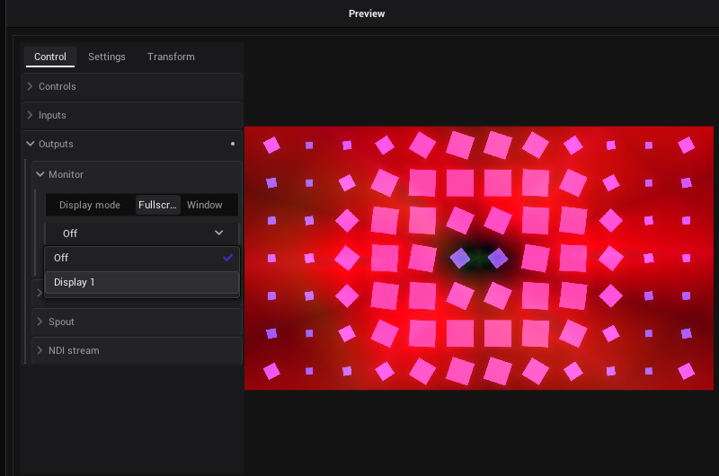

# Tutorial: The picture on a projector

In this tutorial the picture of your Clipview goes onto a projector (or an LED wall, or a second monitor), fitted to
the wall, while VibeVJ stays on your own screen. You also set the blackout under your hand and see how fast the output
runs.

- **Time:** about 10 minutes.
- **You need:** a project with a Clipview ([A live set in the Clipview](Tutorial-Live-Set.md)), and a second display:
  a projector or a monitor plugged into the computer. Without one, the steps work with a window on your own screen.

## Tell VibeVJ which display is which

1. Plug the projector in and let the system run it as a display of its own (extend the desktop, do not mirror it).
2. Click ⚙ in the top bar to open the *Settings*, page *Display*. Every display is listed with its name and size.
3. Leave *Role* at *Auto*: the display VibeVJ is on is *Control*, the projector is *Output*. Set it by hand when you
   have more than two displays.
4. If the projector reports a wrong size (behind a scaler or a splitter), pick its real *Resolution* here.

The picture of VibeVJ is made in the size of the first output display. See [Display](Settings.md#display).

## Send the picture out

The window *Preview* at the bottom left of the Clipview shows the finished picture. It is a shader like any other, so it
can send that picture out by itself.

1. In the *Preview* window, tab *Control*, open *Outputs*, then *Monitor*.
2. Set *Display mode* to *Fullscreen*.
3. Open the list under it (it reads *Off*) and pick the display of your projector: *Display 2* …, each with the name of
   the display, its size and its role. The picture is on the projector now.
4. To stop, set the list back to *Off*.

Without a second display, pick *Window* and *Display 1*: the output opens as a window without a frame, over VibeVJ.
Set the list back to *Off* to close it. See
[Show the picture on a display or projector](Output-and-Devices.md#show-the-picture-on-a-display-or-projector).

**Any other picture** (a shader of a Patchview, the timeline) goes out the same way: every shader has *Outputs* ›
*Monitor*. Or use the shader *output* (`Shaders` › `Utilities`) as a fixed exit: link the *Out* port of what you want
to show into its input, *Channel 0*, and set its *Monitor*. The *Out* port of the Clipview is at its bottom right
corner.

## Fit the picture to the wall

When the picture and the projector have different shapes, *Picture* decides:

| *Picture* | Shows |
|---|---|
| *Stretch* | Fills the display, the picture is distorted. |
| *Fit* | All of the picture, with black bars. |
| *Fill* | Fills the display, the edges are cut off. |

A projector that stands at an angle gives a skewed picture. The tab *Transform* of the *Preview* fits it to the wall:

1. Open *Projection mapping* and turn on *Edit Grid*. A grid lies over the picture.
2. Drag the corners of the grid until the picture lies straight on the wall. Watch the wall, not the window.
3. *Subdivide* gives more points, for a wall that is not flat. *Reset* starts again.
4. Turn *Edit Grid* off.

*X*, *Y*, *Rotate* and *Zoom* on the same tab move the whole picture. Several surfaces, masks and soft edges are a job
for *MapLab*: see [Mapping](Output-and-Devices.md#mapping).

## Other ways out

The same section *Outputs* sends the picture to other programs and computers, instead of a display or as well:

- *Spout* (Windows) or *Syphon* (macOS): to Resolume, MadMapper, OBS on the same computer.
- *NDI stream*: over the network.

Give them a name you find again. See [Outputs (tab Control)](Output-and-Devices.md#outputs-tab-control).

## The blackout

Something goes wrong on stage? Press **Ctrl + B**, or the blackout button in the timeline bar. Every output goes black
at once: the display, NDI, Spout, the lights. The views of VibeVJ keep showing everything, so you see what will come
back. Press it again: the picture comes back with a fade.

Map it to a pad of your controller, as in [Play with a MIDI controller](Tutorial-MIDI-Controller.md#a-pad-for-the-blackout).
See [Blackout](Output-and-Devices.md#blackout).

## Does it run smoothly?

Press **Ctrl + Shift + P**. A small panel shows the frames per second and the generators that cost the most. A shader
that is too heavy: lower its *Render scale* (tab *Settings*), or switch off the generators you do not show (the power
button in their header). See [The output stutters](Troubleshooting.md#the-output-stutters).

## At another venue

The project keeps the **name** of the display, not its number. At the next venue, where the displays are plugged in
another order, the output goes to the display with that name. A projector with another name: pick it once under
*Display*. The output never lands on the screen VibeVJ is on.

## What you learned

- *Outputs* › *Monitor* of the *Preview* (or of any shader) sends the picture to a display.
- *Picture* and the grid of *Transform* fit it to the wall.
- Ctrl + B is the blackout of every output.

Next: [Lights on the beat](Tutorial-Lights.md), or the [night of the show](Tutorial-Show-Night.md).

## See also

- [Tutorials](Tutorials.md)
- [Output and devices](Output-and-Devices.md)
- [Settings](Settings.md#display)
- [Troubleshooting](Troubleshooting.md#the-display-output-is-wrong)
