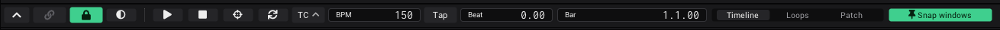

# Tutorial: The night of the show

This tutorial is a checklist for the night itself: what to do at home, at the venue before the doors open, while you
play, and when something goes wrong. Each step links to the page that says more.

- **Time:** about 10 minutes to read; do it once at home before the first real show.
- **You need:** the project of your show, built with the other [tutorials](Tutorials.md).

## At home

1. **Save under the name of the show:** *Projects* › *Save as…*, for example `club_2026_11_07`. Your work of the last
   weeks stays as it was. See [Save](Getting-Started.md#save).
2. **Make a backup:** copy the folder `VibeVJ/projects/<name>/` onto a USB stick. A project is that folder and nothing
   else. See [What is saved with a project](Getting-Started.md#what-is-saved-with-a-project).
3. **Put the controls you need on one screen:** a view tab with the Clipview or CueList, a
   [ShowControls](Assets.md#show-controls) surface with your faders, the masters of the lights. What you do not touch
   during the show goes into other tabs.
4. **Map what must be under your hand** to the controller: the layer masters, the columns, the blackout. See
   [Play with a MIDI controller](Tutorial-MIDI-Controller.md).
5. **No controller on site?** Prepare everything with the [virtual controller](MIDI.md#the-virtual-controller), and
   move the mappings to the real one when it is plugged in.
6. **Videos:** convert long or 4K clips to HAP (right-click in *Assets* › *Convert to HAP*): they cost less and jump
   at once. See [Which files play well](Video.md#which-files-play-well).

## At the venue, before the doors open

1. **Displays:** plug in the projector, then open *Settings* › *Display*. Check that it is listed as *Output* and has
   the right size. The outputs of your project find it by its name; a new name: pick it once under *Display* of the
   output. See [The picture on a projector](Tutorial-Projector.md).
2. **Lights:** connect the Art-Net node. In the fixture setup, *Highlight* each group to see that every lamp answers.
   See [Lights on the beat](Tutorial-Lights.md).
3. **Sound:** check that *AudioInputAnalysis* hears the mixer (*BPM* and *Beat* move), or tap the tempo. With CDJs:
   the [Prolink Bridge](Output-and-Devices.md#prolink-cdjs).
4. **Controller:** move a fader: does the control follow? Not? See
   [A MIDI controller does not react](Troubleshooting.md#a-midi-controller-does-not-react).
5. **Run it once:** start every column, every cue, the blackout and back. Press **Ctrl + Shift + P**: the frames per
   second should stay at the target. See [The output stutters](Troubleshooting.md#the-output-stutters).
6. **Save** (Ctrl + S). Show mode has no autosave, so this is the state you come back to.

## The phone as a remote

A phone or tablet in the same network can play Play, Tap, the blackout and the clips, from the dance floor or from the
stage.

1. *Devices* › *Network* › *Web remote*: pick the *Network* the phone is in and click *Web remote*.
2. Click *Pairing and controls…* and scan the QR code with the phone.
3. On the page *Controls* of that window, switch on *Add the controls you move*, move the faders you want on the phone,
   switch it off again.

See [Web remote](Web-Remote.md).

## Lock it: show mode

Press **Ctrl + L** (or the lock in the timeline bar). The lock turns green. Now nothing can be moved, linked, closed or
deleted by a hurried click or a touch: no layout, no right-click menus, no undo, no close button of the window. What you
play keeps working: values, buttons, clips, columns, cues, MIDI, Play, Tap and the blackout.

To leave show mode, **hold** the lock (or Ctrl + L) for half a second, then let go. A short press does nothing. See
[Show mode](Timeline.md#show-mode).

## When something goes wrong

| What | Do |
|---|---|
| Something wrong on the screen or the lights | **Ctrl + B**: every output black at once. Fix it in the views (they keep showing everything), then Ctrl + B again: the picture comes back with a fade. See [Blackout](Output-and-Devices.md#blackout). |
| The tempo runs away | *Sync timeline* of the audio analysis or the Prolink Bridge is on: turn it off and tap. See [The tempo keeps changing by itself](Troubleshooting.md#the-tempo-keeps-changing-by-itself). |
| A clip does not move on in autoplay | The timeline stands: press Space. See [Autoplay does not move on](Troubleshooting.md#autoplay-does-not-move-on). |
| The output stutters | Ctrl + Shift + P names the generator that costs the most: switch it off with its power button. |
| The output window is gone | *Display* of the output went to *Off*: pick the display again. See [The display output is wrong](Troubleshooting.md#the-display-output-is-wrong). |
| VibeVJ stopped | Start it again. It asks to restore the autosave: *Yes* gives the state of the last autosave, *No* the last save. See [Autosave](Getting-Started.md#autosave). |
| An error message | The bell in the top bar counts the errors; click it for the log. See [The log](Troubleshooting.md#the-log). |

## After the show

1. Hold Ctrl + L to leave show mode.
2. *Exit* in the *Projects* tab (or the close button of the window) saves the project and closes VibeVJ.

## What you learned

- Save under the name of the show, back up the project folder, test everything once on site.
- Show mode locks what you build and leaves what you play.
- Ctrl + B is the answer to every surprise on the screen.

## See also

- [Tutorials](Tutorials.md)
- [Timeline](Timeline.md#show-mode)
- [Output and devices](Output-and-Devices.md#blackout)
- [Web remote](Web-Remote.md)
- [Troubleshooting](Troubleshooting.md)
