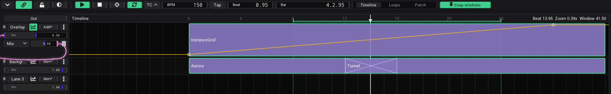

# Tutorial: A show on the timeline

In this tutorial you lay out a short show on the timeline, like in a video editor: clips on lanes that start and stop
with the playhead, a crossfade from one to the next, an overlay that rises towards the drop, and a loop that repeats
the part you are working on.

- **Time:** about 15 minutes.
- **You need:** nothing but VibeVJ. A song with a known tempo helps.

## Open the timeline

1. Start a new project and click the *Patchview* tile (the timeline needs no view, but its picture has to go somewhere).
2. Drag the bar at the bottom of the window up, or click its chevron. The timeline opens.
3. Set *View* in the bar to *Timeline*. You see the ruler (numbers are beats, one every bar) and the lanes.
4. Click *BPM* and type the tempo of your song, for example 128. Press Enter.

The mouse wheel zooms the timeline, a drag on the ruler moves it. See [The ruler](Timeline.md#the-ruler).

## Clips on a lane

1. In the *Assets* tab, go to `Shaders` › `Sources` › `Basic` and drag *Aurora* onto the first lane, at beat 0. It
   becomes a clip of 16 beats (4 bars).
2. Drag *Tunnel* onto the same lane, right after it, at beat 16.
3. Press Space. The playhead runs; while it is inside a clip, the clip plays and has a green outline. Shift + Space
   stops and goes back to the start.

A clip you drop is selected, and the *Clip* panel opens on the right with its stack: drop more assets onto that list
to stack effects onto the clip. The panel covers part of the lanes, so close it with × in its head (or click an empty
part of a lane) before the next drop.

Drag a clip to move it, drag its ends to make it longer or shorter. Everything snaps to whole beats (hold Shift for no
snapping). See [Clips and lanes](Timeline.md#clips-and-lanes).

## A crossfade

1. Drag the left end of *Tunnel* back to beat 12. The two clips overlap from beat 12 to 16; a cross marks the overlap.
2. Play from the start: over the overlap *Tunnel* fades in over *Aurora*.

A longer overlap is a slower fade.

## A second lane on top

1. Drag *InstanceGrid* (`Shaders` › `Sources` › `Patterns`) onto the empty lane below the first one: a new empty lane
   comes below it. Drag the right end of the clip to beat 32, so it runs as long as the two others together.
2. The top lane is laid over the ones below it. Drag the grip (the dots on the left of a lane head) of the lane with
   InstanceGrid up, above the first lane. It keeps its name, *Lane 2*, at the top.
3. In its lane head, set the blend mode (the list that reads *Mix*) to *Add*.
4. Give the lanes names: the menu (three dots) of a lane head has the name at its top. Type `Overlay` there and press
   Enter; call the other lane `Backgrounds`.

See [Lanes](Timeline.md#lanes).

## Towards the drop: an envelope

An envelope is a curve along the timeline that moves a control while the playhead runs.

1. Click the curve button in the head of the lane *Overlay* (left of its blend mode). The lane gets taller and shows
   an orange line: the envelope of its *Mix*, flat at its value now.
2. Click on the line at beat 0 and drag the point down to 0.
3. The line now lies at the bottom. Click on it at beat 28 and drag that point up to the top.
4. Play: the overlay rises from nothing at the start to full at beat 28. Alt + drag on the line between two points bends
   it, for a slow start and a fast end.

*+ New* in the envelope row of the lane adds an envelope for another control, and its *Env* output can be linked to
any control of the program: an effect, a lamp, a layer. See [Envelopes](Timeline.md#envelopes).

## Work on a part: the loop

1. Shift + drag on the ruler from beat 8 to beat 24. The green bar at the bottom of the ruler is the loop range.
2. Click *Loop* (the circling arrows) in the bar. It turns green.
3. Play: the playhead jumps from beat 24 back to beat 8, again and again. Change the clips and the envelope while it
   loops.
4. Click *Loop* again to play on.

See [Loop](Timeline.md#loop).

## The picture out

The finished picture of the timeline is at *Out*, above the lane heads. Link it into the input (*Channel 0*) of the
shader *output* (`Shaders` › `Utilities`) and send that to a display with its *Outputs* › *Monitor*, as in
[The picture on a projector](Tutorial-Projector.md#send-the-picture-out).

## Start it with the music

- **With the tempo:** set the *BPM* and press Space on the first beat of the song.
- **Following the music:** the audio analysis with *Sync timeline* sets the tempo and keeps the playhead on the beat.
  See [Sync the timeline from audio](Timeline.md#sync-the-timeline-from-audio). With CDJs the *Prolink Bridge* does
  the same: see [Prolink](Output-and-Devices.md#prolink-cdjs).
- **To a fixed time:** a DAW or a show controller sends MIDI Time Code, and the timeline follows it. See
  [Timecode](Timeline.md#timecode).

## Keep it

The clips, lanes, envelopes and the loop range are saved with the project: Ctrl + S.

## What you learned

- A clip on a lane plays while the playhead is inside it; overlapping clips crossfade.
- Lanes are layered like the layers of a Clipview, with a blend mode each.
- An envelope moves a control over the whole timeline; the loop repeats a part.

Next: [The night of the show](Tutorial-Show-Night.md).

## See also

- [Tutorials](Tutorials.md)
- [Timeline](Timeline.md)
- [Clipview](Clipview.md)
- [Audio](Audio.md)
- [Shortcuts and tips](Shortcuts-and-Tips.md#timeline)
