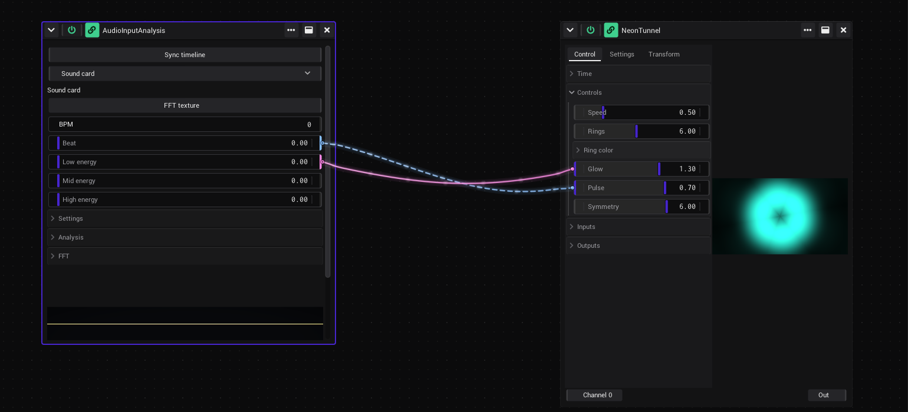

# Tutorial: Visuals on the beat

In this tutorial a shader starts to move with the music: it flashes on every beat and glows with the bass. On the way
you learn the Patchview, the *Assets* tab, links and their types, and the audio analysis.

- **Time:** about 10 minutes.
- **You need:** music that the computer hears (a line-in, a microphone or an audio interface). No music input? The
  part [Without a music input](#without-a-music-input) uses the tempo of the timeline instead.

## Make room

1. In the sidebar, open the *Projects* tab and click *New project*. Answer *Yes*.
2. The big area asks "What goes here?". Click the *Patchview* tile. A Patchview is a free canvas for generator
   windows: they sit where you drop them, and the links between them are drawn as cables.

Scroll with the mouse wheel to zoom the canvas, drag with the right mouse button to move it. More:
[Zoom and the grid of a Patchview](The-Screen.md#zoom-and-the-grid-of-a-patchview).

## A shader as the picture

1. Open the *Assets* tab of the sidebar and go to `Shaders` › `Sources` › `VJ`. Faster: type `neon` into *Filter*
   and press Enter.
2. Rest the mouse on *NeonTunnel* for half a second. A small window beside the sidebar plays it: so you see a shader
   before you use it.
3. Drag *NeonTunnel* into the right half of the Patchview. Its window opens where you let go: the controls on the
   left, the picture on the right, the ports *Channel 0* (in) and *Out* at the bottom.
4. Click *Controls* to open that section. Drag the lower right corner of the window to make it taller, until you see
   all of them: *Speed*, *Rings*, *Ring color*, *Glow*, *Pulse* and *Symmetry*.
5. Try them: drag *Speed*, *Rings* and *Symmetry*, open *Ring color* and pick another colour. A double click on a
   slider lets you type a value.

Every control of the shader is a row with two notches, a thin edge on the left (in) and on the right (out). They open
when the mouse is on the row. See [Notches: left in, right out](Linking.md#notches-left-in-right-out).

## The audio analysis

1. In the *Assets* tab go to `Generators` › `Audio` and drag *AudioInputAnalysis* into the left half of the
   Patchview. The values go from left to right then: from the music to the picture.
2. Pick the *Source* in the list under *Sync timeline*: *Sound card* is the recording input of your computer. Choose which one that is in the sound
   settings of your system. The line under *Source* says what VibeVJ hears.
3. Play music. *BPM*, *Beat* and the three energy rows start to move.

*Beat* runs from 0 to 1 during every beat and starts again at 0 on the next one. *Low energy* is the bass: 1 is as loud
as it was lately, 0 is quiet. These rows have only a right notch: the analysis writes them, you link **from** them. See
[The values](Audio.md#the-values).

## Flash on every beat

1. Hover *Beat* in the audio analysis. Its right notch opens.
2. Press on the right notch and drag to the row *Pulse* of NeonTunnel. The rows that can take the link get a thin violet
   outline. Let go over *Pulse*.
3. The tunnel now pulses: *Pulse* follows *Beat*, it rises during the beat and falls back at the next one.

A pulse that rises is late. A flash should be bright **on** the beat and fade after it, so turn the link around:

4. Click the left notch of *Pulse*. Its options open.
5. Open the tab *In*. The row of the link shows the sender, *Beat*, and the type, *Normalized*. Pick *Inverted* in
   that list. Click outside the options to close them.
6. Now *Pulse* is at the top on the beat and falls during the beat: a flash.

The three link types are on [Link types](Linking.md#link-types). The cable shows the type: magenta for *Normalized*,
light blue and dashed for *Inverted*.

## Glow with the bass

1. Drag a link from the right notch of *Low energy* to *Glow* of NeonTunnel.
2. The link is *Normalized*: *Low energy* 0 to 1 becomes the whole range of *Glow*, 0 to 2.
3. Too jumpy? Click the left notch of *Glow*, tab *Main*, and raise *smoothing*: the value now follows with a delay.

To give the glow less range, set *min* and *max* of *Glow* on the same tab: the link fills only that part. See
[The options of a control](Linking.md#the-options-of-a-control).

## See the links

Click the link button in the [timeline bar](Timeline.md#the-transport-bar) at the bottom. *Cable view* draws every
link as a cable, with small pulses that run from the sender to the receiver. Click it again to hide them. A generator
in a Patchview draws its own cables anyway (the link icon in its header). See
[Seeing your links](Linking.md#seeing-your-links).

## The timeline in time

1. In the audio analysis, turn on *Sync timeline*.
2. Press Space (or *Play* in the timeline bar).

The *BPM* of the timeline follows the music now, and its *Beat* is in step with the beat. Everything that runs on the
timeline (autoplay of clips, synced controls, the Phaser of the lights) is in time with the music. See
[Sync the timeline from audio](Timeline.md#sync-the-timeline-from-audio).

## Without a music input

The timeline has a *Beat* of its own. It runs while the timeline plays, at its *BPM*.

1. Press Space to play the timeline.
2. Tap the tempo: press T on each beat, at least twice. Or click *BPM* and type it.
3. Drag a link from the right notch of *Beat* in the timeline bar to *Pulse* of the shader, and make it *Inverted* as
   above.

For *Glow*, use a *SineGenerator* (`Generators` › `Math`) with *Mode* *Sync*: link its *Output* into *Glow*.

## Keep it

Press Ctrl + S, type a name such as `beat_tunnel` and click *Save*. See [Save](Getting-Started.md#save).

## What you learned

- Assets are dragged from the sidebar into a view; a shader can be seen before with the mouse resting on it.
- A link goes from the right notch of a sender to a row of the receiver. Its type decides how the value travels.
- The audio analysis gives the beat and the energy of the music as values, and can lead the timeline.

Next: [An effect chain](Tutorial-Effect-Chain.md) links pictures instead of values. Or put the tunnel into a set of
clips: [A live set in the Clipview](Tutorial-Live-Set.md).

## See also

- [Tutorials](Tutorials.md)
- [Linking](Linking.md)
- [Audio](Audio.md)
- [Generators](Generators.md)
- [Timeline](Timeline.md)
