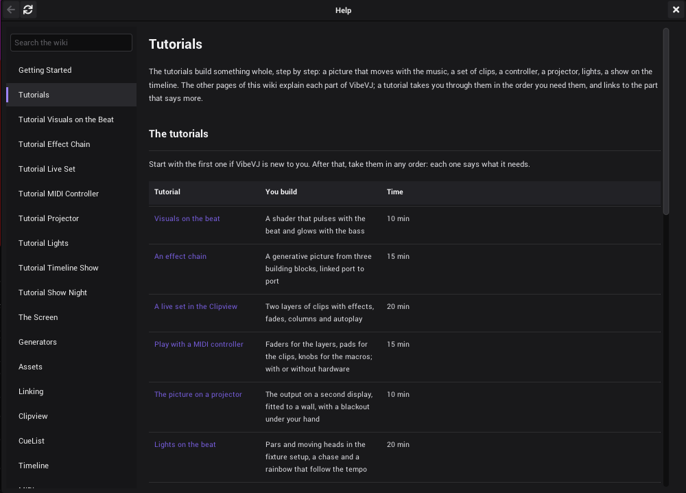

# Tutorials

The tutorials build something whole, step by step: a picture that moves with the music, a set of clips, a controller,
a projector, lights, a show on the timeline. The other pages of this wiki explain each part of VibeVJ; a tutorial
takes you through them in the order you need them, and links to the part that says more.

## The tutorials

Start with the first one if VibeVJ is new to you. After that, take them in any order: each one says what it needs.

| Tutorial | You build | Time |
|---|---|---|
| [Visuals on the beat](Tutorial-Visuals-on-the-Beat.md) | A shader that pulses with the beat and glows with the bass | 10 min |
| [An effect chain](Tutorial-Effect-Chain.md) | A generative picture from three building blocks, linked port to port | 15 min |
| [A live set in the Clipview](Tutorial-Live-Set.md) | Two layers of clips with effects, fades, columns and autoplay | 20 min |
| [Play with a MIDI controller](Tutorial-MIDI-Controller.md) | Faders for the layers, pads for the clips, knobs for the macros; with or without hardware | 15 min |
| [The picture on a projector](Tutorial-Projector.md) | The output on a second display, fitted to a wall, with a blackout under your hand | 10 min |
| [Lights on the beat](Tutorial-Lights.md) | Pars and moving heads in the fixture setup, a chase and a rainbow that follow the tempo | 20 min |
| [A show on the timeline](Tutorial-Timeline-Show.md) | Clips on lanes that crossfade, an envelope towards the drop, a loop | 15 min |
| [The night of the show](Tutorial-Show-Night.md) | A checklist: save, test, lock, play, and what to do when something goes wrong | 10 min |

## Before you start

- VibeVJ is installed and starts: see [Getting started](Getting-Started.md#install).
- Every tutorial starts with a new project: *Projects* tab › *New project*. So nothing of your own work is in the way,
  and you can save the result under a name of its own.
- Keep the [Help window](The-Screen.md#the-help-window) open beside the program: F1 opens it, and its links lead to the
  part that says more about each step.
- Something went wrong? Ctrl + Z takes back the last step: see [Undo and redo](The-Screen.md#undo-and-redo).

## The words

The tutorials use the words of the program. The most important ones:

| Word | Means |
|---|---|
| Generator | Everything that runs in VibeVJ: a shader, an LFO, the audio analysis, a view. See [Generators](Generators.md). |
| Asset | A file in the *Assets* tab of the sidebar that you drag into a view to make a generator. See [Assets](Assets.md). |
| Area | A part of a view tab that holds one view. You split it to get more. See [The screen](The-Screen.md#views-and-tabs). |
| Notch | The small tab at the edge of a row: left in, right out. You drag links from it. See [Linking](Linking.md#notches-left-in-right-out). |
| Port | An *In* or *Out* row that carries a picture instead of a value. See [Ports](Linking.md#ports). |
| Clip | A generator in a cell of a Clipview, or on a lane of the timeline. See [Clipview](Clipview.md#clips). |

All of them are on the page *Glossary* of the Help window.

## See also

- [Getting started](Getting-Started.md)
- [The screen](The-Screen.md)
- [Shortcuts and tips](Shortcuts-and-Tips.md)
- [Troubleshooting](Troubleshooting.md)
