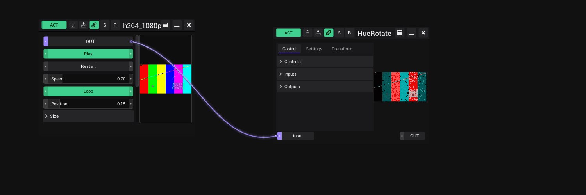
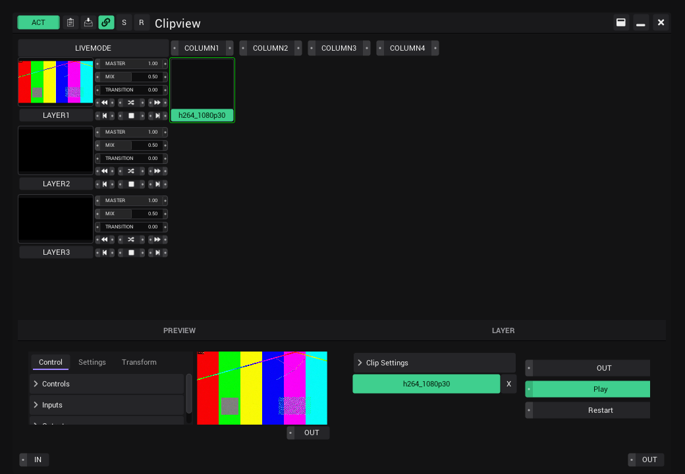

# Video clips

Play video files as generators: in a Patchview, in a cell of a Clipview, as the input of a shader or on a mapped
output.

## What you need

VibeVJ decodes video with FFmpeg 9. On Windows and Linux the FFmpeg libraries come with VibeVJ, in the folder
`ffmpeg` next to the nanogui module (`shizotech/packages/nanogui/native/<platform>/ffmpeg`). Without them a video
generator shows why it cannot play instead of a picture: install VibeVJ again, or put an LGPL build of FFmpeg 9 into
that folder (`avformat-63.dll`, `avcodec-63.dll`, `avutil-61.dll`, `swscale-10.dll`, `swresample-7.dll`; on Linux
`libavformat.so.63`, `libavcodec.so.63`, `libavutil.so.61`, `libswscale.so.10`, `libswresample.so.7`).

VibeVJ looks for them in this order: the folder named in the environment variable `SHZ_FFMPEG_DIR`, the folder of
the nanogui module, its `ffmpeg` folder, then the system path (so a system FFmpeg 9 on Linux works too).

On a Mac, install FFmpeg with Homebrew: `brew install ffmpeg`. VibeVJ finds it there by itself.

## Use a video

1. Open the *Assets* tab and find the file (`.mp4 .mov .m4v .mkv .webm .avi .mxf .mpg .mpeg .ts .wmv`).
2. Drag it into a [Patchview](The-Screen.md#views-and-tabs), or into a cell of a [Clipview](Clipview.md#make-a-clip).
   In a Clipview, click the cell to start the clip on its layer.
3. Link *Out* to the input of a shader or another generator ([Ports](Linking.md#ports)). The video is a picture source
   like an image or a shader.

## Controls

| Control | What it does |
|---|---|
| *Out* | The picture. Link it to an input. |
| *Play* | Plays or holds the current frame. |
| *Restart* | Starts the clip from its first frame. |
| *Speed* | -4 to 4 times normal speed. Below 0 the clip plays backwards; that needs a file in which every frame stands on its own (HAP, ProRes, DNxHR, see [Which files play well](#which-files-play-well)). Other files go from 0 to 4. |
| *Loop* | On: the clip starts over at its end. Off: it stops on its last frame. |
| *Position* | Where the clip is (0 to 1). Drag it to jump or to scrub through the clip; a [link](Linking.md) or a MIDI fader on it scrubs too. |
| *Frame back*, *Frame forward* | Stop the clip and move it by one frame. |
| *Size* | *Width* and *Height* of the video. They only show the size; typing in them changes nothing. |
| *Options* › *Flip Y* | Turns the picture upside down. |
| *Options* › *HW Decode* | On: the graphics card decodes the video. Off: the processor does. Leave it on. |
| *Options* › *Audio* | Plays the sound of the clip (off at the start). It plays while the clip plays forward at normal speed, in step with the picture; paused, backwards, faster or slower the clip is silent. The sound goes to the default output of the computer. |
| *Options* › *Volume* | How loud the sound of this clip is. |
| *Options* › *Convert to HAP* | Makes a HAP copy of the file next to it (`name_hap.mov`), which can play backwards. The line under the controls shows how far it is; a second click cancels. Drag the copy in from *Assets* when it is ready. |
| *VideoRouter* › *Enable Router* | Offers the clip under its name in the *Inputs* list of every shader and in the input lists of LEDMapper and MapLab. |
| *VideoRouter* › *VideoRouterName* | That name. The file name at the start. |

- *Options* and *VideoRouter* are closed at the start: click their title to open them.
- **Power off** (the power button in the header) stops the clip from decoding, so clips that are not shown cost
  nothing.
- *Play*, *Speed*, *Loop*, *Position* and the options are saved with the project; after loading, the clip goes on
  from where it was.

The line under the controls tells how the clip is decoded, for example `h264 1920x1080 60 fps, d3d11va, zero-copy`:

- `d3d11va` (or another decoder name): the graphics card decodes. `software`: the processor decodes.
- `zero-copy`: the frames stay on the graphics card all the way. This is the fastest path (Windows).
- `backwards`: the file can play backwards (negative *Speed*).
- `sound`, `sound off`: the file has sound, and whether *Audio* is on. With *Audio* on but no sound coming, the line says why
  (for example when there is no output device).
- Without a file that plays, the line says "No video" or what went wrong.

## Which files play well

- **H.264 and HEVC** (`.mp4`, `.mov`, `.mkv`), 8 or 10 bit, are decoded by the graphics card. On an RTX 4080 about 14
  clips 1080p60 H.264, 24 clips 1080p60 HEVC, 4 clips 4K60 H.264 or 8 clips 4K60 HEVC run at the same time without
  dropped frames. With more clips than the graphics card can decode, the clips slow down; the rest of VibeVJ keeps its
  frame rate.
- **HAP, ProRes and DNxHR** (`.mov`) are decoded by the processor. Every frame stands on its own, so they jump,
  scrub and play backwards without waiting: a jump takes 15 ms (HAP 1080p) to 40 ms (ProRes 1080p), HAP 1080p plays
  backwards at 4x with every frame. 4K ProRes and DNxHR keep the speed backwards but show fewer frames (15 to 20 per
  second). HAP is the cheapest: the graphics card unpacks it, so even 16 clips in 4K play at once (RTX 4080).
  To make a HAP copy of any clip, right-click it in *Assets* › *Convert to HAP*, or use *Options* › *Convert to HAP* of
  the video. The copy (`name_hap.mov`) lands next to the file; the line at the bottom of *Assets* shows how far it is.
- **Jumping and scrubbing** work with H.264 and HEVC too, a bit slower (about 70 ms per jump in 1080p, 120 ms in 4K):
  the graphics card has to decode from the last full frame before the position.
- **Sound** plays only when *Audio* of the clip is on, and only at normal speed forward. A HAP copy keeps the sound.

## See also

- [Clipview](Clipview.md)
- [Generators](Generators.md)
- [Output and devices](Output-and-Devices.md)
- [Linking](Linking.md)
- [Troubleshooting](Troubleshooting.md)
