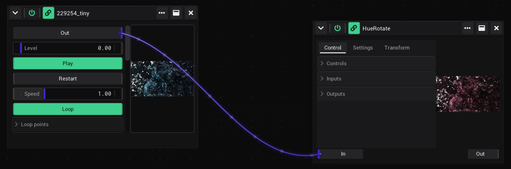
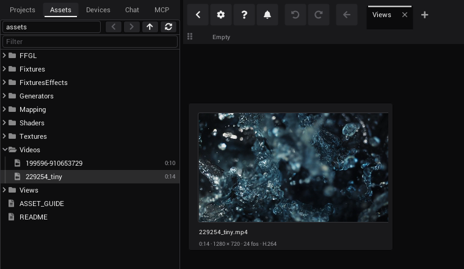
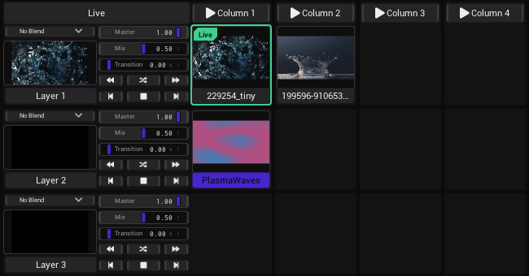

# Video clips

Play video files as generators: in a Patchview, in a cell of a Clipview, as the input of a shader or on a mapped
output.

## What you need

VibeVJ decodes video with FFmpeg 9. On Windows and Linux the FFmpeg libraries come with VibeVJ, in the folder
`ffmpeg` next to the nanogui module (`shizotech/packages/nanogui/native/<platform>/ffmpeg`). Without them a video
generator shows why it cannot play instead of a picture: install VibeVJ again, or put an LGPL build of FFmpeg 9 into
that folder (`avformat-63.dll`, `avcodec-63.dll`, `avutil-61.dll`, `swscale-10.dll`, `swresample-7.dll`; on Linux
`libavformat.so.63`, `libavcodec.so.63`, `libavutil.so.61`, `libswscale.so.10`, `libswresample.so.7`).

VibeVJ looks for them in this order: the folder named in the environment variable `SHZ_FFMPEG_DIR`, the folder of
the nanogui module, its `ffmpeg` folder, then the system path (so a system FFmpeg 9 on Linux works too).

On a Mac, install FFmpeg with Homebrew: `brew install ffmpeg`. VibeVJ finds it there by itself.

## Use a video

1. Open the *Assets* tab and find the file (`.mp4 .mov .m4v .mkv .webm .avi .mxf .mpg .mpeg .ts .wmv`).
   Each video shows its length at the right end of its row. Rest the mouse on it for half a second: a small window
   beside the sidebar plays it (without sound) and says its size, frame rate, codec, whether it
   [plays backwards](#which-files-play-well) and whether it has sound.

   

2. Drag it into a [Patchview](The-Screen.md#views-and-tabs), or into a cell of a [Clipview](Clipview.md#make-a-clip).
   In a Clipview, click the cell to start the clip on its layer. The cell shows the picture of the video, like the
   cell of a shader.
3. Link *Out* to the input of a shader or another generator ([Ports](Linking.md#ports)). The video is a picture source
   like an image or a shader.

## Controls

| Control | What it does |
|---|---|
| *Out* | The picture. Link it to an input. |
| *Level* | How loud the sound of the clip is right now, 0 to 1 (after *Volume*). An output: [link](Linking.md) it into anything, for example the size of a shape. It needs *Audio*, *Pre-listen* or *Audio analysis* on. See [Sound](#sound). |
| *Play* | Plays or holds the current frame. |
| *Restart* | Starts the clip from its first frame (from *In* when it is set). |
| *Speed* | -4 to 4 times normal speed. Below 0 the clip plays backwards; that needs a file in which every frame stands on its own (HAP, ProRes, DNxHR, see [Which files play well](#which-files-play-well)). Other files go from 0 to 4. |
| *Loop* | On: the clip starts over at its end. Off: it stops on its last frame. With *In* / *Out*: see [Loop points and cues](#loop-points-and-cues). |
| *Loop points* › *In*, *Out*, *Loop mode* | Loop a part of the clip (0 to 1 through it), *Forward* or *Ping-pong*. See [Loop points and cues](#loop-points-and-cues). |
| *Cues* › *Set cues*, *Cue 1* to *Cue 8*, *Clear cues* | Up to 8 places in the clip to jump to with a click or a MIDI pad. See [Loop points and cues](#loop-points-and-cues). |
| *Position* | Where the clip is (0 to 1). Drag it to jump or to scrub through the clip; a [link](Linking.md) or a MIDI fader on it scrubs too. |
| *Jog* | A knob without end, like the jog wheel of a DJ player: turned, it moves the clip frame by frame and holds it; when it stops turning the clip plays on. Map a jog wheel or an endless encoder to it as *Relative*. See [Jog](#jog). |
| *Jog settings* › *Jog touch*, *Jog step* | *Jog touch*: held, the clip holds (map the touch note of a jog wheel to it). *Jog step*: how many frames one step moves the clip (1 at the start). |
| *Frame back*, *Frame forward* | Stop the clip and move it by one frame. |
| *Sync* | *Off*: the clip runs at its own speed. *Bars*: it follows the [timeline](Timeline.md). *Deck*: it follows a CDJ. See [Sync](#sync). |
| *Sync settings* › *Bars*, *Deck*, *Offset* | How many bars the clip lasts (*Bars*), which CDJ it follows (*Deck*, 0 = the tempo master), and how many seconds into the clip the bars or the track start (*Offset*). |
| *Size* | *Width* and *Height* of the video. They only show the size; typing in them changes nothing. |
| *Options* › *Flip Y* | Turns the picture upside down. |
| *Options* › *HW Decode* | On: the graphics card decodes the video. Off: the processor does. Leave it on. |
| *Options* › *Audio* | Plays the sound of the clip (off at the start). It plays while the clip plays forward at normal speed, in step with the picture; paused and backwards the clip is silent, faster or slower too unless *Pitch* is on. The sound goes to the main output: the default output of the computer, or the one chosen in [*Settings* › *Sound*](Settings.md#sound). |
| *Options* › *Volume* | How loud the sound of this clip is. |
| *Options* › *Audio analysis* | Sends the sound of the clip to the [audio analysis](Audio.md) (*Source* *Video clips*): BPM, beat, FFT and energy follow the clip. Works with *Audio* off too. See [Sound for the audio analysis](#sound-for-the-audio-analysis). |
| *Options* › *Pre-listen* | Plays the sound of the clip on the pre-listen output (headphones) instead of the main output, also with *Audio* off. See [Pre-listen](#pre-listen). |
| *Options* › *Pitch* | The sound plays at the other speeds too (forward, 0.1 to 4 times): higher when faster, lower when slower, like a turntable. Off: sound only at normal speed. |
| *Options* › *Convert format*, *Convert size* | What *Convert* makes: HAP (the default), HAP Alpha, HAP Q, ProRes or DNxHR, at the size of the file or scaled down to 2160p, 1080p, 720p or 480p. See [Converting](#converting). |
| *Options* › *Convert result* | *Copy*: *Convert* makes a copy next to the file. *Replace*: the converted file takes the place of the file and the original goes to `_originals`, see [Replace the original](#replace-the-original). |
| *Options* › *Convert to HAP* | Makes a copy of the file in that format and size next to it (`name_hap.mov`, `name_prores_720p.mov`, ...), which can play backwards; the button says what it makes (*Replace with HAP* with *Convert result* › *Replace*). The line under the controls shows how far it is; a second click cancels. Drag the copy in from *Assets* when it is ready. |
| *VideoRouter* › *Enable Router* | Offers the clip under its name in the *Inputs* list of every shader and in the input lists of LEDMapper and MapLab. |
| *VideoRouter* › *VideoRouterName* | That name. The file name at the start. |

- *Loop points*, *Cues*, *Jog settings*, *Options* and *VideoRouter* are closed at the start: click their title to open them.
- **Power off** (the power button in the header) stops the clip from decoding, so clips that are not shown cost
  nothing.
- *Play*, *Speed*, *Loop*, *Position*, the loop points, the cues and the options are saved with the project; after
  loading, the clip goes on from where it was.

The line under the controls tells how the clip is decoded, for example `h264 1920x1080 60 fps, d3d11va, zero-copy`:

- `d3d11va` (or another decoder name): the graphics card decodes. `software`: the processor decodes.
- `zero-copy`: the frames stay on the graphics card all the way. This is the fastest path (Windows).
- `backwards`: the file can play backwards (negative *Speed*).
- `sound`, `sound off`: the file has sound, and whether *Audio* is on. With *Audio* on but no sound coming, the line says why
  (for example when there is no output device). `(to the audio analysis)`: *Audio analysis* is on. `pre-listen`: the
  sound goes to the pre-listen output (or the line says why it does not).
- Without a file that plays, the line says "No video" or what went wrong.

## Sync

*Sync* ties a clip to the music, so it stays on the beat without hand work:

- **Bars**: the clip is stretched to whole bars of the [timeline](Timeline.md): with *Bars* 4 it lasts 4 bars (16
  beats) and starts over on the bar. When the BPM changes (tap, a CDJ, the audio analysis), the clip gets faster or
  slower with it. With the timeline stopped the clip stands still, and moving the timeline cursor moves through it.
  A clip that would have to run more than 4 times faster is too short for that many bars: the line under the
  controls says "too fast", take more bars.
- **Deck**: the clip follows the track on a CDJ: play, pause, cue, jumps and the pitch of the deck move the clip
  with it. It needs a *ProlinkBridge* or *ProlinkDecks* generator in the project (`Generators` › `Network`, see
  [Prolink](Output-and-Devices.md#prolink-cdjs)); the clip reads the decks from it. *Deck* 0 follows the tempo
  master, 1 to 6 a fixed player. The position comes from the CDJ-3000, or on older players from the beat grid of the
  track, so a track that was not analysed in rekordbox has none (the line under the controls says so).
- *Offset* moves the clip against the bars or the track, in seconds of the clip, e.g. to start a music video where
  the song starts.

While *Sync* is on, *Speed* does nothing; *Play* off still holds the frame. Files in which every frame stands on its
own (HAP, see below) follow jumps at once; H.264 needs a moment for each jump, so with them the sync jumps at most
once a second.

## Loop points and cues

**Loop points** loop a part of the clip instead of all of it. *In* and *Out* (in *Loop points*) go from 0 (the
start) to 1 (the end); the line under the controls shows the part in minutes and seconds, `loop 0:01.2 to 0:01.8`.

- *Loop mode* *Forward*: at *Out* the clip jumps back to *In*. Backwards (negative *Speed*) it jumps from *In* to *Out*.
- *Loop mode* *Ping-pong*: at *Out* the clip turns round and plays backwards to *In*, there forward again, at the
  speed of *Speed*. It needs a file in which every frame stands on its own (HAP, ProRes, DNxHR, see
  [Which files play well](#which-files-play-well)); other files loop forward, and the line says so. Ping-pong over the
  whole clip: leave *In* at 0 and *Out* at 1.
- *Loop* off: the clip stops on the last frame before *Out*; *Restart*, *Play*, *Position* or a cue start it again.
- *Restart* starts at *In*. A jump before *In* (*Position*, a cue) plays on into the loop; a jump beyond *Out* goes
  back to *In*.
- With *Sync* on, the sync places the clip, and the loop points do nothing.

**Cues** are up to 8 places in the clip. Turn *Set cues* on and click a *Cue* button: it remembers where the clip is
now (its name shows the time, `Cue 3  0:02.7`). With *Set cues* off a click on a cue jumps there; map the cue
buttons to the pads of a MIDI controller to hit them live. *Clear cues* forgets them all.

Jumps are instant with HAP and the other files whose frames stand on their own; H.264 and HEVC need a moment for each
jump, so short loops of such files can stutter at *In*. *Convert* makes a copy that loops cleanly.

## Jog

*Jog* moves the clip by frames, like the jog wheel of a DJ player or a turntable: while it turns, the clip holds and
follows it, forward or back; 0.2 s after the last step it plays on (when it played before). A clip that was paused
stays paused where the jog left it.

- **MIDI:** [MIDI learn](MIDI.md#map-a-control-with-midi-learn) *Jog* with the jog wheel, then set the mapping to
  *Relative* in the [MIDI tab](MIDI.md#the-midi-tab-in-the-options) of its options: *Relative (1 = up, 127 = down)*
  or *Relative (65 = up, 63 = down)*, as the manual of the controller says (with the wrong one the clip runs the wrong
  way or jumps). An absolute knob or fader does not work here: it has an end, the jog has none. An endless knob of
  the [virtual controller](MIDI.md#the-virtual-controller) learns *Relative* by itself.
- **Touch:** many jog wheels send a note when the top is touched. Map it to *Jog settings* › *Jog touch*: the clip
  holds as long as the hand is on the wheel, and plays on when it is let go.
- **Mouse:** drag *Jog* up or down.
- *Jog settings* › *Jog step*: how many frames one step moves the clip, 1 at the start. A jog wheel sends many steps
  per turn; with a higher value one turn goes further into the clip.
- Jumping is instant with HAP and the other files whose frames stand on their own, so scratching works best with
  them; H.264 needs a moment for each jump. *Convert* makes such a copy.
- With *Sync* on, the sync places the clip and *Jog* does nothing.
- The clip is silent while it is held, like when it is paused.

## Sound

Where the sound of the clips plays is chosen in [*Settings* › *Sound*](Settings.md#sound): the main output (the
default output of the computer unless you choose another one) and, if you want, a pre-listen output for headphones.

- *Level* (at the top of the controls) shows how loud the clip is and can be [linked](Linking.md) into any control:
  a shape that pulses with the sound of the clip, a light that follows it. It moves while the sound is decoded, so
  one of *Audio*, *Pre-listen* or *Audio analysis* has to be on; with *Audio* off and only *Audio analysis* on it
  moves without anything to hear. It falls back slowly, like a meter.

### Pre-listen

With *Options* › *Pre-listen* on, the sound of the clip goes to the pre-listen output (headphones) instead of the
main output: you hear a clip before the audience does, like the cue button of a DJ mixer. The clip itself may be
on screen or not.

1. Choose the headphones as *Pre-listen output* in [*Settings* › *Sound*](Settings.md#sound).
2. Switch *Pre-listen* on in the clip. *Audio* can stay off.
3. Switch *Pre-listen* off (and *Audio* on) when the audience should hear it.

- A clip on *Pre-listen* goes neither to the main output nor to the [audio analysis](#sound-for-the-audio-analysis).
- Without a pre-listen output the clip is heard nowhere; the line under the controls says why.
- *Pre-listen* is saved with the project.

## Sound for the audio analysis

The [audio analysis](Audio.md) (BPM, beat, FFT, energy) can listen to video clips instead of the sound card: so the
visuals follow the clip that plays, without a microphone or line-in.

1. In the video: *Options* › *Audio analysis* on. *Audio* (the speakers) can stay off.
2. In the audio analysis: *Source* › *Video clips*. The line under it says how many clips it hears.

- The analysis gets what the speakers would play: the sound of every clip with *Audio analysis* on, mixed, at the
  *Volume* of each clip, in step with the picture. Paused, backwards, faster or slower (without pitch) the clip is
  silent, also for the analysis.
- Without an output device (no sound card, nothing plugged in) the analysis still hears the clips; *Audio* then says
  that there is no output device.
- *Audio analysis* is saved with the project.

## Which files play well

- **H.264 and HEVC** (`.mp4`, `.mov`, `.mkv`), 8 or 10 bit, are decoded by the graphics card. On an RTX 4080 about 14
  clips 1080p60 H.264, 24 clips 1080p60 HEVC, 4 clips 4K60 H.264 or 8 clips 4K60 HEVC run at the same time without
  dropped frames. With more clips than the graphics card can decode, the clips slow down; the rest of VibeVJ keeps its
  frame rate.
- **HAP, ProRes and DNxHR** (`.mov`) are decoded by the processor. Every frame stands on its own, so they jump,
  scrub and play backwards without waiting: a jump takes 15 ms (HAP 1080p) to 40 ms (ProRes 1080p), HAP 1080p plays
  backwards at 4x with every frame. Backwards, a jump and a frame step need one frame at a time, which VibeVJ decodes
  on all cores of the processor, so ProRes and DNxHR go backwards about as smoothly as forward; when the processor
  cannot keep up, frames are left out and the speed stays (4K used to show only 15 to 20 frames backwards per
  second). HAP is the cheapest: the graphics card unpacks it, so even 16 clips in 4K play at once (RTX 4080).
  All HAP variants go to the graphics card that way: HAP, HAP Alpha, HAP Q, HAP Q Alpha (HAP Q with transparency),
  HAP R (the best colours of HAP, with transparency) and HAP Alpha-Only (shown in gray). VibeVJ cannot make HAP Q Alpha
  and HAP R itself, other programs (Adobe's Hap exporter, TouchDesigner, ...) can. The graphics card unpacks HAP R
  only with OpenGL 4.2 or its BPTC textures; without them (the OpenGL of macOS stops at 4.1) the processor decodes
  it, which is slower.
  To make a HAP copy of any clip, right-click it in *Assets* › *Convert to HAP*, or use *Options* › *Convert to HAP* of
  the video. The copy (`name_hap.mov`) lands next to the file; the line at the bottom of *Assets* shows how far it is.
  A whole folder goes at once, see [Converting](#converting).
- **Jumping and scrubbing** work with H.264 and HEVC too, a bit slower (about 70 ms per jump in 1080p, 120 ms in 4K):
  the graphics card has to decode from the last full frame before the position.
- **Sound** plays only when *Audio* of the clip is on, and only forward: at normal speed, or at any speed with *Pitch*. A HAP copy keeps the sound.

## Converting

*Convert* makes a copy of a clip in which every frame stands on its own, so it jumps, scrubs and plays backwards without
waiting. The copy lands next to the file, the original stays as it is; or the converted file takes the place of the
clip, see [Replace the original](#replace-the-original).

- **One clip**: right-click it in *Assets*, or use *Options* › *Convert to HAP* of the video generator.
- **A whole folder**: right-click the folder in *Assets* › *Convert N videos here to ...*. The videos in that folder
  (not in its subfolders) are converted one after the other; the line at the bottom of *Assets* shows the file, how far
  it is and how many of the folder are done ("folder: 3 of 12"), and says at the end how many were converted, left out
  or failed. Left out are files that are in the chosen format already (a HAP file for HAP), files whose copy exists
  already (converted before), and the copies *Convert* made of the files there (`clip_hap.mov` next to `clip.mp4`).
  While a folder converts, the right-click menu offers *Stop converting the folder*: the running file is cancelled,
  the copies made so far stay.

The right-click menu (and *Convert format* / *Convert size* in the *Options* of the generator) picks what the copy is:

| Format | What it is | Copy |
|---|---|---|
| HAP | The graphics card unpacks it: the cheapest to play, also many clips in 4K. A file with transparency becomes HAP Alpha. The default. | `name_hap.mov` |
| HAP Alpha | HAP with transparency. | `name_hapalpha.mov` |
| HAP Q | Better colours than HAP (fewer blocks in gradients), files twice as big. | `name_hapq.mov` |
| ProRes | ProRes 422 HQ (4444 with transparency): for editing programs, decoded by the processor. | `name_prores.mov` |
| DNxHR | DNxHR HQ: for editing programs, decoded by the processor. At least 256 × 120 pixels. | `name_dnxhr.mov` |

| Size | What it does |
|---|---|
| Original | The size of the file (HAP cuts it to a multiple of 4 pixels). |
| 2160p, 1080p, 720p, 480p | Scaled down so that the shorter side has at most that many pixels, the aspect kept: 1080p makes 1920 × 1080 of a 4K clip and 1080 × 1920 of an upright one. A smaller file is never enlarged. The copy gets the size in its name: `name_hap_1080p.mov`. |

A 4K clip converted to HAP 1080p is about a quarter of the size and much lighter to play, when the output does not need
4K. The menu of *Assets* remembers the format and size for the next time; the generator saves its choice with the project.
The sound of the clip goes into the copy too.

### Replace the original

To keep only the converted file, pick *Result* › *Replace the original* in the right-click menu of *Assets* (or
*Options* › *Convert result* › *Replace* in the video generator; the button then says *Replace with HAP*). It works for
one clip and for a whole folder.

- The converted file is written next to the clip as `clip.mp4.replacing` and **checked** before anything else happens:
  every frame of it can be read, it has as many frames and seconds as the clip, and its first and last frame decode.
  A file that does not check out is deleted and the clip stays as it is.
- Then it **takes the place of the clip**: `clip.mp4` becomes `clip.mov` (HAP and the other formats are always `.mov`;
  a `.mov` keeps its name). Every clip of the open project that plays the file follows it, at the place where it was,
  and can play backwards now. Save the project to keep the new name in it; a project saved before finds `clip.mov`
  by itself.
- The **original is kept** in the folder `_originals` next to the clip (`_originals/clip.mp4`; `clip (2).mp4` when
  that name is taken). `_originals/replaced.json` lists what replaced what. Nothing is deleted: to go back, move the
  file out of `_originals` to where it was and delete or move away the `.mov`. Delete `_originals` when you do not
  need the originals any more.
- Left out: a clip that is in the chosen format already, a clip whose new name is taken by another file (`clip.mov`
  next to `clip.mp4`), and the files in `_originals`.
- Safe when something goes wrong: a cancel, a full disk or a failed check leaves the clip untouched. The swap keeps the
  original under a second name (in `_originals`) before it touches anything, so the file is never gone, not even when
  the program stops in the middle; a step that fails undoes the steps before it. If VibeVJ stopped during a
  replacement, a leftover `clip.mp4.replacing` (or `.replacing.part`) can be deleted.

## See also

- [Clipview](Clipview.md)
- [Generators](Generators.md)
- [Output and devices](Output-and-Devices.md)
- [Linking](Linking.md)
- [Troubleshooting](Troubleshooting.md)
