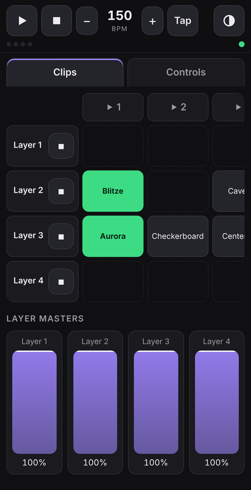
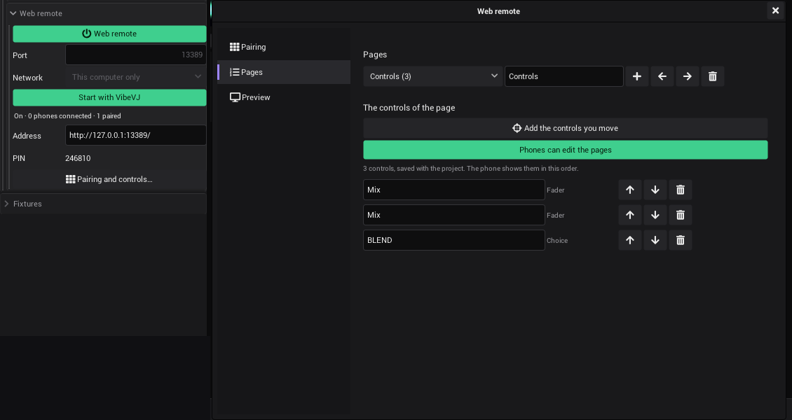
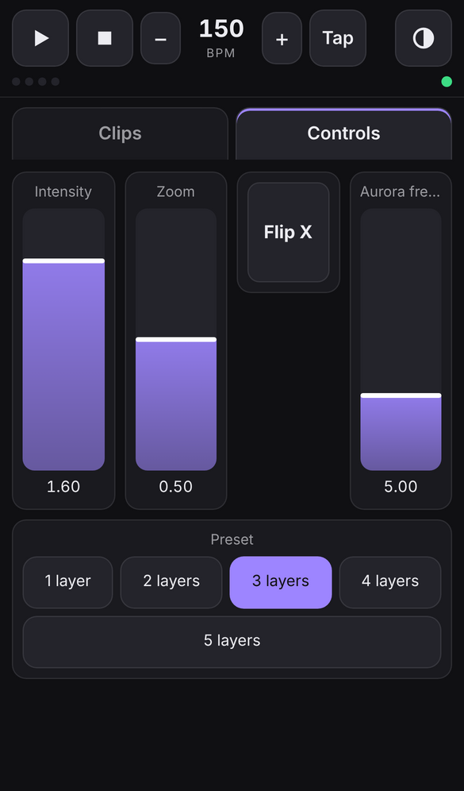
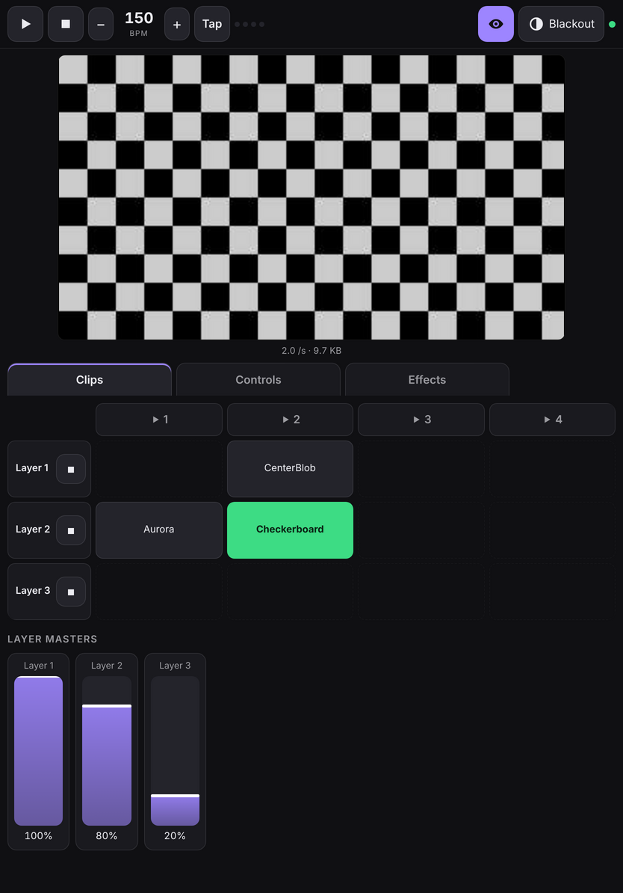
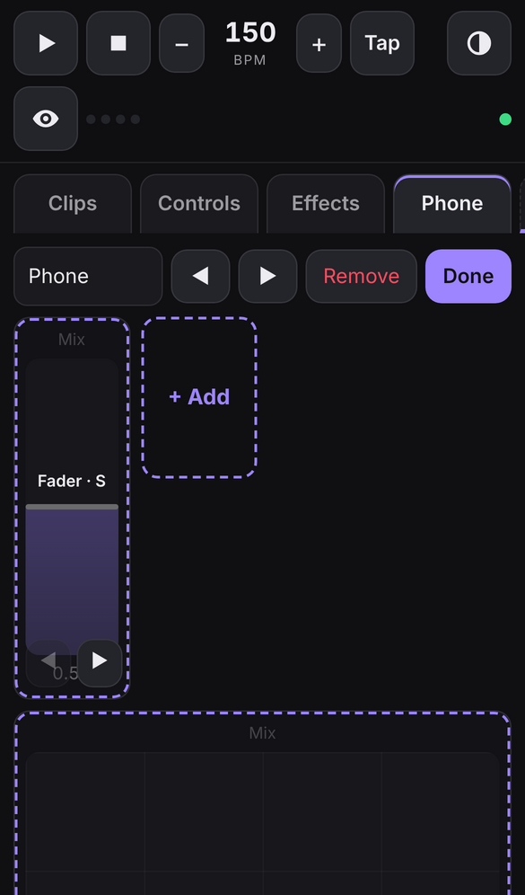
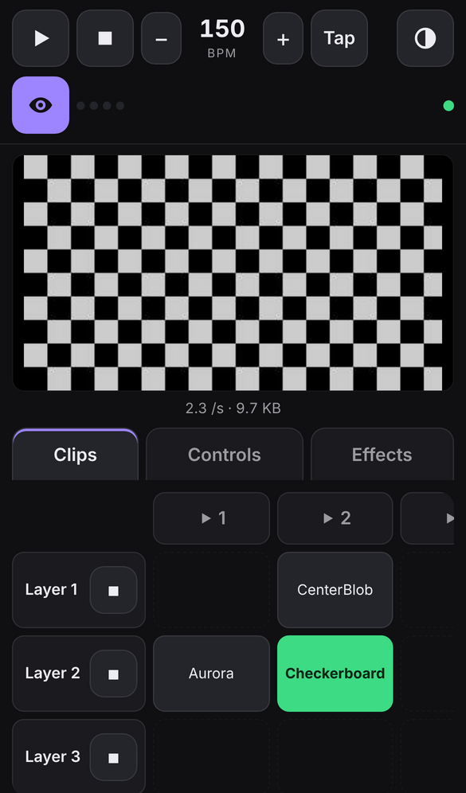
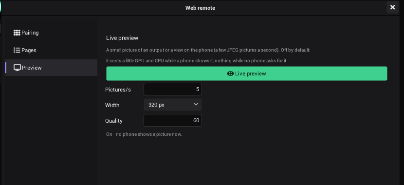

# Web remote

Play VibeVJ from a phone or a tablet in the same network: Play, Stop, Tap and BPM, the blackout, the clips of every
Clipview, pages of controls you pick (in VibeVJ or on the phone itself) and a small live picture of your output. It is
a web page that VibeVJ serves itself: nothing to install, no internet needed. It works in Safari and Chrome on phones
and tablets.

## Turn it on

The web remote is in the [sidebar](The-Screen.md#sidebar), tab *Devices*, section *Network › Web remote*.

1. Pick the *Network*: *Every network* (default), one network card (the Wi-Fi the phone is in), or *This computer
   only* (to try it in a browser on the same computer).
2. Change the *Port* if 13350 is taken (only while the web remote is off).
3. Click *Web remote*. It turns green, and *Address* shows the address for the phone, for example
   `http://192.168.1.20:13350/`.
4. *Start with VibeVJ* turns it on at every start.

The line under the buttons says how many phones are connected and paired. Port, network and the paired phones belong
to this computer (in `configs/web_remote.json`), not to the project.

## Pair a phone

A phone has to be paired once before it can play. Pairing needs the PIN that VibeVJ shows.

- **With the QR code:** click *Pairing and controls…* and scan the code with the camera of the phone. The code has
  the address and the PIN: the remote opens and pairs by itself.
- **By hand:** open the *Address* in the browser of the phone and type the 6 digits of the *PIN*.

The phone keeps the pairing: it opens the remote again without the PIN. Add the page to the home screen for a full
screen app (Safari: *Share › Add to Home Screen*; Chrome: *Add to home screen*).

*New PIN (forget every phone)* makes a new PIN, and every phone has to pair again. Use it when a phone was lost, or
when people you do not trust saw the PIN.

## What the remote shows

The bar at the top is always there:

| Button | What it does |
|---|---|
| Play | Play or pause the [timeline](Timeline.md#the-transport-bar). Green while it plays |
| Stop | Stop and back to the start |
| − / BPM / + | The tempo, one BPM down or up |
| Tap | Tap the beat; the press counts, as with *Tap* in VibeVJ |
| Blackout | All outputs to black at once, and back with a fade, as the [blackout](Output-and-Devices.md#blackout) of VibeVJ. Red while on |
| Eye | The [live preview](#live-preview): a small picture of your output above the tabs. Only there while the preview is on in VibeVJ |

The four dots show the beat while the timeline plays. *SHOW* appears while VibeVJ is in
[show mode](Timeline.md#show-mode). The dot at the right end is green while the phone is connected.

Below the bar are the tabs: *Clips* and one tab for each [page](#pages) of controls (*Controls* at the start).

**Clips** shows the grid of a [Clipview](Clipview.md) as in VibeVJ: the layers from the top, the columns side by side.
Tap a clip to start it (the live clip of each layer is green), tap ▶ of a column to start the column, ■ of a layer to
stop the layer. Below the grid are the masters of the layers. With several Clipviews (a CueList counts as one), buttons
above the grid pick one. A wide grid scrolls sideways.

**Controls** (and every other page) holds your own controls: the ones you picked in VibeVJ or on the phone (see below).

Faders: put a finger anywhere on a fader and slide. The value moves with the finger from where it was, it never jumps to
where you touch. Each finger has its own fader: move two or more at once. When the value changes in VibeVJ (the mouse,
MIDI, a link, a cue), the fader on the phone moves with it, except while your finger is on it.

| Kind | The control in VibeVJ | On the phone |
|---|---|---|
| Fader | A slider, a number with a range | Slide up and down |
| Fader across | A slider, a number with a range ([edited](#edit-the-pages-on-the-phone) to show it so) | Slide left and right |
| Number | A number without a range (or a fader edited to show it so) | − and + |
| Button | A button | A toggle is switched by a tap; a button that is only on while held is on while your finger is on it |
| Choice | A list (a blend mode, a preset) | A button for each entry |
| XY | A vector of two (a position), or two faders made into one pad on the phone | A square pad: drag the point |

On a tablet everything is bigger, and the grid shows more columns:

## Pages

The controls of the remote are on named pages, one tab each on the phone: for example *Mix* for the layers, *FX* for
the effects, *Lights* for the lamps. Every page has its own controls in its own order. The pages are saved with the
[project](Getting-Started.md#what-is-saved-with-a-project). A project made before there were pages opens with its
controls on the page *Controls*.

## Put controls on a page in VibeVJ

1. Click *Pairing and controls…* and open the page *Pages*.
2. Pick the page in the list at the top. **+** makes a new page, the field next to the list renames it, ◀ ▶ move it
   one tab earlier or later, the bin removes it (the controls themselves stay; the last page stays).
3. Switch on *Add the controls you move*. The line *Web remote* in the sidebar says so while it is on.
4. Move the controls you want on the phone: a slider of a shader, the *Mix* of a layer, a button, a list. Each one comes
   onto the page picked above (moving it again does not add it twice).
5. Switch *Add the controls you move* off.

In the list you can rename an entry (the name the phone shows), move it up or down (the order on the phone) and take it
off (the control itself stays). An entry whose control is gone (its generator was deleted) shows on the phone as "not
in this project".

## Edit the pages on the phone

Tap **Edit** on a page. The controls get a dashed frame and stop playing, so nothing moves by mistake.

| What | How |
|---|---|
| A new page | **+ Page** at the end of the tabs. Its name is in the field above the controls: type a new one |
| Order of the pages | ◀ ▶ next to the name |
| Remove the page | *Remove* (the controls themselves stay in VibeVJ) |
| Add controls | **+ Add**: a list of the controls of the project. Type a few letters of the name, the shader or the layer (`mix`, `aurora speed`, `layer_ctrls_1`) and tap the ones you want. A ✓ shows what you added |
| Order of the controls | ◀ ▶ at the bottom of a control |
| Name, look, width | Tap the control: *Name*, *Show as* (Fader, Across, − +, XY, as the control allows), *Width* S / M / L (one cell, two cells, the whole row), *Earlier* / *Later*, *Remove from the page* |
| An XY pad of two faders | On a fader *Show as* › *XY*, then pick the fader for Y from the list: one pad moves both (for example the X and Y of a position, or two effects at once) |

Tap **Done** to play again. The changes are saved with the project, as the ones made in VibeVJ, and VibeVJ's list
follows at once.

Editing is not possible in [show mode](Timeline.md#show-mode), neither in VibeVJ nor on the phone: the phone says so.
The remote itself keeps playing in show mode. *Phones can edit the pages* (page *Pages* of the window) switches the
edit mode of the phones off: then the pages stay as you made them in VibeVJ.

## Live preview

A small picture of an output or a view on the phone, a few pictures a second: you see what the audience sees while
you walk around with the phone.

1. In VibeVJ: *Pairing and controls…* › page *Preview*, switch on *Live preview*. It is off at the start.

   

2. On the phone tap the eye in the bar. The picture appears above the tabs; tap the eye again to hide it.
3. With more than one picture there is a list under it: an *Output* shader (Shaders › Utilities › output), a
   Clipview, a shader in a view of its own. Each phone picks its own.

| Setting | What it does |
|---|---|
| *Pictures/s* | 1 to 15 a second (5 at the start) |
| *Width* | 160 to 640 pixels (320 at the start); the height follows the shape of the picture |
| *Quality* | JPEG quality, 20 to 95 (60 at the start). Lower is smaller and quicker over a slow Wi-Fi |

A VibeVJ whose program files are older than the web remote (the JPEG encoder of the graphics module is missing) has
no preview: the page *Preview* says so, the phones show no eye, and everything else of the remote works. Update the
program.

The pictures are made only while a phone shows them, and stop a few seconds after the last phone hid them or went
to sleep. The line under the settings says what it costs: the picture is made small on the graphics card, read back
without waiting for it, and turned into a JPEG on a thread of its own, so the frames of VibeVJ do not wait for the
phone. The preview settings belong to this computer, not to the project. The picture is about 5 to 30 KB; at 5
pictures a second that is less than 150 KB a second of the Wi-Fi.

## How the changes count

The remote sets values as a MIDI controller does:

- They are no steps of the [undo history](The-Screen.md#undo-and-redo): moving a fader on the phone does not fill it.
- [Links](Linking.md) follow, as they follow a fader moved with the mouse.
- Several phones can play at once. The last change wins, as with two MIDI controllers.

## Trust and safety

- The web remote is off until you switch it on, and it only listens on the network you picked.
- Only paired phones can play. Pairing needs the PIN; after 5 wrong PINs in a minute an address has to wait, and after
  20 wrong PINs in all the PIN changes by itself.
- A paired phone reaches the transport, the blackout, the clips and the controls on its pages, nothing else: no
  files, no projects, no settings. In its edit mode it can put any control of the project on a page; switch *Phones
  can edit the pages* off to hold the phones to the pages you made. The remote serves only the files of its own page.
- The live preview is off until you switch it on, and only paired phones get its pictures.
- A phone that sends too many changes a second gets "Too fast" and has to wait.
- The remote uses plain HTTP, like most stage equipment. Anyone who can read the traffic of the Wi-Fi can read the
  pairing of a phone. For shows where that matters, use a network of your own (a small router for VibeVJ and the
  phones), not the Wi-Fi of the venue.
- Reaching the remote from outside the local network (over the internet, through a server) is not part of it yet.

## When it does not work

| What you see | What to do |
|---|---|
| The phone does not load the page | Phone and computer must be in the same network. Check *Network* (not *This computer only*) and the address. A firewall of the computer may block the port: allow VibeVJ, or the port, for the private network |
| "Cannot open port …" | Another program uses the port: pick another one |
| "… (not found)" in *Network* | The network card picked before is not there (another place, another adapter): pick another one |
| "Wrong PIN" / "Too many tries" | Check the PIN in VibeVJ; after too many tries wait a minute |
| The phone asks for the PIN again | The PIN was renewed (*New PIN*) or the phone forgot its data: pair again |
| The dot in the bar is red | The connection is gone (Wi-Fi, VibeVJ closed, the web remote off). The page connects again by itself |
| No eye in the bar | The live preview is off in VibeVJ (*Pairing and controls…* › *Preview*), or the project has no output shader and no view with a picture |
| The preview is slow or jerky | A slow Wi-Fi: lower *Width* or *Quality*. The preview never makes more pictures a second than VibeVJ draws frames |
| No *Edit* on a page | *Phones can edit the pages* is off in VibeVJ |
| "Show mode: the pages cannot be changed now" | Leave show mode in VibeVJ to edit the pages |

## See also

- [MIDI](MIDI.md)
- [Clipview](Clipview.md)
- [Timeline](Timeline.md)
- [Output and devices](Output-and-Devices.md)
