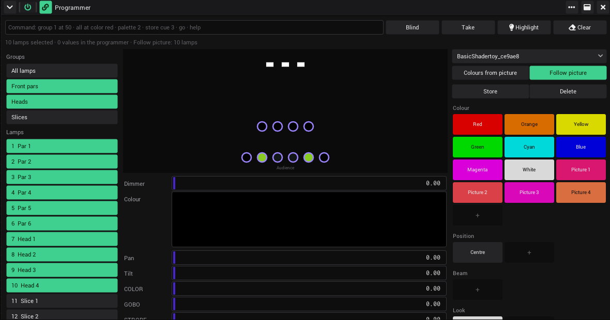
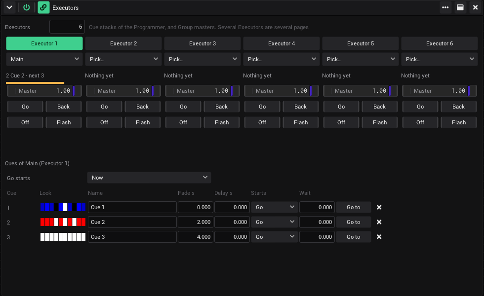
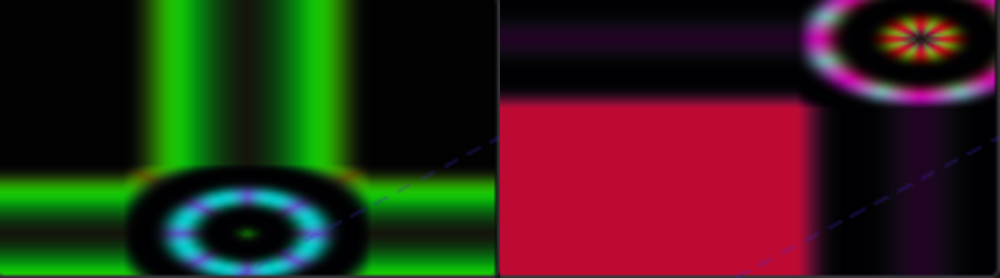

# Lighting desk (#719): test on Windows and macOS

[#719](https://github.com/shizotech/shizoscript3_source/pull/719): "combine our video mapping approach better with the
classic way of controlling a lighting console like grandMA, inside the program". Branch `claude/adoring-tesla-ygcafo`.
Built and checked on Linux in a container, with software OpenGL (Mesa llvmpipe) under Xvfb, driven with xdotool and over
MCP. What a container cannot show: a real GPU (MapLab with the zones moving every frame), a Retina screen, a person's
mouse and keyboard (Ctrl+click in the selection, typing in the command line, dragging the executor faders), a MIDI
controller on the executors, Art-Net out to real lamps.

**No C++ changed**: only scripts (`.shio`), assets (`.json`) and Markdown. The binaries of `main` run the branch as they
are; no build is needed (on a Mac `setup_mac.sh --build` still bundles the new scripts).

---

## What changed

| Area | Before → now |
|---|---|
| Engine | new `engine.desk` (`engine/patch/desk.shio`, `desk_runtime.shio`): programmer, palettes, cue stacks with tracking, fade, delay, Go / Follow / Wait / Beats, sent every frame after the generators (dimmers HTP, the rest LTP, programmer on top). Saved as `desk.json`. AI: live_path `desk` (`desk_command`, `get_desk_state`, `get_lamp_values`), Chat tool `vibevj_desk` |
| Generators (`assets/FixturesEffects`) | new **Programmer**, **Executors**, **LampValues**, **CueTrigger** |
| ProjectionZone (`assets/Fixtures/Virtual`) | Dimmer, Colour → + Pan, Tilt, Zoom, Rotate, Strobe (defaults 0.5 / 0); MapLab moves, zooms, turns and flashes the picture of the slice. New type **Look** (Dimmer, Colour, Speed, Size, FX 1–4) |
| MapLab | *Lamps for slices* places the lamps upstage across the rig, where the slices are in the outputs |
| Devices › Fixtures | new section **Masters**: Speed 1–4, a Group master per group |
| Phaser | new setting *Speed master* per phaser |
| Beyond MA (review on #719) | stage plan selection and place words, colours from the picture (palettes, Follow picture), cues on Drop / Break, Go on the next beat / bar, Record, cue looks, Blind / Take, undo of stores |
| Third review on #719 | **Groups as link targets**: Devices › Fixtures › Masters › *Groups* › a group: Master, Colour (R/G/B), Dimmer, Pan, Tilt, Release; a ColorSelector row has *Lamps* (all lamps or a group) and colours them directly. DeskInput is gone. The values controls had before the desk are saved (`base` in `desk.json`) and put back after a load |
| Second review on #719 | **DJ Link phrases** drive stacks without AI (*On a DJ phrase*: Go / Cue of its name, *Starts* *Phrase*, *Go starts* *Next 4 bars* / *Next phrase*); command line `store cue … name … starts …`, `phrases …`, `music …` |

Save keys: `desk.json` (new; a stack has `quantize` and `on_phrase`), the Executors state (`count`, `targets`, `picked`),
LampValues (`lamp`), CueTrigger (`stack`, `action`, `cue`), ColorSelector (`lamps`), `desk.json` `group_inputs` and `base`. New control IDs: `GROUP_MASTER` / `group_master_<id>`, the
group inputs `Colour` / `Dimmer` / `Pan` / `Tilt` with `group_input_<id>` (R, G, B: `group_input_<id>_r` …), `SPEED_1..4` / `speed_masters`, the
Phaser's `Speed master` / `<guid>`, the Executors' `Master` / `Go` / `Back` / `Off` / `Flash` with `executor_<n>`. The IDs of
the Dimmer and Colour controls of existing ProjectionZone lamps did not change (new channels come after them).

### Checked on Linux

- `run_tests.sh --no-gui` (after merging main): 113 passed, 0 failed (`fixture_desk`, `fixture_patch`, `fixture_fx`, `patch_ai`,
  `vibevj_mcp_bridge` among them). `shz --check __init__.shio`, `check_assets.sh` 69/69, `check_links.py` 831 links, 0 broken.
- After the second and third review: `fixture_desk.shio` (phrases, `music` / `phrases` / `store … name … starts`, the
  values of inputs) and `smoke.py desk` (a DJ phrase over `music phrase Drop`; a group input on its lamps, sending again
  after save and load, `release_group` back to before) pass. By hand under Xvfb: a ColorSelector row with *Lamps* Front
  colours only Front, the inputs of Back only Back (screenshot in the wiki, `lighting-desk-groups.png`).
- `smoke.py static generators desk fixturecam closesave`: passed (fixturecam: the known FFmpeg warning of a container) (the new phase `desk`: programmer, clear, a stack with a
  fade and Off, the four generators, `desk.json` saved and loaded).
- By hand in the app: the screenshots below, Group master and Speed master (a phaser on Speed 1 at 0 stands still),
  LampValues with a Look, CueTrigger on switching it on, MapLab: Pan / Tilt / Zoom / Rotate / colour of a zone.





## Phase 0: get the branch

```
git fetch origin claude/adoring-tesla-ygcafo
git checkout claude/adoring-tesla-ygcafo
```

- **Windows**: `& .\_testing\windows_app\testcopy.ps1 -Name pr719` (no build needed), start it with `start.ps1`.
- **macOS**: `sh shzscript_macos/setup_mac.sh --build`, then `cd dist/VibeVJ_macos_arm64 && ./VibeVJ.out`.

## Phase 1: automatic checks

- [ ] `_testing/run_tests.sh <shz> fixture_desk.shio fixture_patch.shio fixture_fx.shio patch_ai.shio` → all pass.
- [ ] `shz --check __init__.shio` from `_shizoengine3` (testcopy.ps1 runs it).

## Phase 2: a rig (MCP: `vibevj_query`, live_path `fixture_setup`, or by hand in the fixture setup)

- [ ] `add_fixtures` hexapad × 4 (group *Front pars*), cheap_mh × 2 (group *Heads*), ProjectionZone × 3 (group *Slices*).

## Phase 3: the Programmer (a person)

- [ ] Drag *Programmer* (`FixturesEffects`) into a Patchview. Groups and lamps are listed on the left.
- [ ] Click *Front pars*: the four pars are pushed, the middle shows Dimmer, Colour, … Ctrl+click *Heads* adds them.
- [ ] Drag *Dimmer*: Devices › Fixtures shows the pars' colours scaled (they have no dimmer), the heads' DIMMER. The
      word *Dimmer* turns violet (in the programmer).
- [ ] Click the palette *Red*: pars and slices red. *Clear*: everything back to what it was before.
- [ ] Type `group 1 at color blue at 50` + Enter in the command line: the status line says what happened.
- [ ] *Store cue* (stack *New stack*, cue 0, fade 2) twice with different colours: a stack *Stack 1* with cues 1 and 2.
- [ ] *Highlight* on: the selected real lamps at full on the rig (needs a node and lamps).

## Phase 4: the Executors (a person; a MIDI controller if there is one)

- [ ] Drag *Executors* in. Executor 1 → the stack. *Go*: cue 1; *Go*: cue 2 fades 2 s (the bar under the list amber,
      then green). *Back*, *Off* (lamps back to before), *Flash* held: at full, let go: off again.
- [ ] *Master* down: the dimmers (pars: their colour) go down. MIDI learn on *Master* and *Go*: the fader and a pad work.
- [ ] Click *Executor 1*: its cues below. Rename one, set *Starts* to *Beats* with *Wait* 4, play the timeline, *Go* the
      cue before: the next one comes after 4 beats.
- [ ] Executor 2 → *Group: Heads*: its Master moves Devices › Fixtures › Masters › Groups › Heads › Master.

## Phase 5: MapLab with zones (GPU)

- [ ] MapLab with a shader input (its Video router on), three slices, an output on a display. *Lamps for slices*: three
      ProjectionZone lamps; in the fixture setup they stand upstage at 3 m, left to right as the slices.
- [ ] Command line: `group slices pan 80` → the pictures move right; `tilt 80` up; `zoom 0` half size; `rotate 75` a
      quarter turn; `strobe 50` flashes about 10 times a second; `clear` → back.
- [ ] A Phaser *Circle* over *Slices*: the pictures circle. Fluid on a real GPU at 60 fps?
- [ ] A Phaser with *Speed master* Speed 1; Devices › Fixtures › Masters › Speed 1 at 2: twice as fast, 0: stands still.

## Phase 6: shaders and clips

- [ ] *LampValues*: *New look*, link *Colour - R/G/B* into a colour parameter of a shader; `fixture "Look 1" at color
      red`: the shader follows.
- [ ] *CueTrigger* in a clip of a Clipview (stack, *Go to cue* 2); start the clip: cue 2 plays. Load the project again:
      no cue starts by itself.
- [ ] Blackout (top bar) with a stack running: lamps go dark, Group masters and the desk do not bring them back.
- [ ] Save, quit, start again: palettes, stacks, executors, LampValues, CueTrigger as before.

## Phase 7: what goes beyond a console (a person)

- [ ] **Stage plan** in the Programmer: click a lamp, Ctrl+click a second, drag a rectangle around several; the
      selection on the left follows. `group heads left at 0`, `lit at color red` on the command line.
- [ ] **Colour from the picture**: a shader with its Video router on, picked at the top of the palettes. *Colours from
      picture*: palettes *Picture 1 …* in the colours of the shader. *Follow picture* with the pars selected: they
      follow the shader live; off: back to before. Close the Programmer while it follows: the lamps stop following
      within half a second.
- [ ] **Music**: Audio Input Analysis on a sound card with music. A cue with *Starts* *Drop* after a cue with a break:
      it starts when the music drops. *Go starts* *Next bar* with the timeline playing: Go waits for the one
      ("Waits for the bar").
- [ ] **Record**: a Phaser running, *Record* with nothing selected: the cue has the Phaser's frozen moment; its *Look*
      in the cue list shows the colours.
- [ ] **Blind / Take**: *Blind*, change the colours: the rig stays, the plan shows the new look. *Take* with Fade 3:
      the rig fades in.
- [ ] **Undo**: *Store cue*, Ctrl+Z: the cue is gone, Ctrl+Y: back. *Clear*, Ctrl+Z: the programmer is back.

## Phase 8: DJ Link and other generators (second review on #719)

- [ ] **Phrases with CDJs** (DJ Watch on the network, a track analysed by rekordbox with phrases): a ProlinkBridge
      connected. A stack with cues named *Intro*, *Buildup*, *Drop*, *Break*, *Outro*; in the Executors *On a DJ
      phrase* *Cue of its name*, Go once. Play the track: each new phrase plays its cue (Verse 1 … plays a cue *Verse*).
      *Off*: it stops following. Load the project while the deck plays: no cue starts for the running phrase.
- [ ] Without CDJs: the command line `music phrase Drop` does the same (`phrases match` first).
- [ ] *Go starts* *Next phrase* with CDJs: Go waits ("Waits for the phrase" under the list), the cue comes with the
      next phrase. *Next 4 bars* with the timeline playing: waits for the 4-bar line.
- [ ] A cue with *Starts* *Phrase*: comes at the next phrase after the cue before.
- [ ] **ColorSelector with Lamps**: a ColorSelector, *Lamps* of row 1 → *Front pars*. Pick colours: the pars follow,
      the heads do not. A cue Go after it: the cue wins; pick again: the ColorSelector wins. Switch the generator off
      (or close it): the pars go back within half a second.
- [ ] **Inputs of a group**: Devices › Fixtures › Masters › Groups › *Heads*: link an LFO into *Pan*, the RGB vector of
      a shader or ColorSelector onto *Colour* (R, G, B link). The heads follow. *Dimmer* of *Front pars* down: the pars
      get darker in their colour. *Release*: the lamps go back to what they had.
- [ ] Save and load with group inputs sending: they send again after the load; *Release* then gives the lamps back
      what they had before (not the colour of the input).

## Results

### Windows (date)

Machine, per phase pass / fail, screenshots of anything wrong, fixes with their commit.

### macOS (date)

Machine, per phase pass / fail, screenshots of anything wrong, fixes with their commit.
