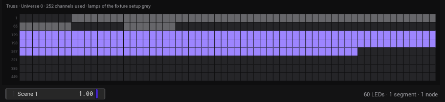
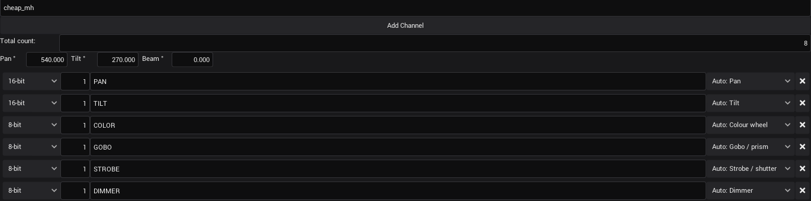

# LEDMapper, Phaser and the 3D stage (#655): test on Windows and macOS

[#655](https://github.com/shizotech/shizoscript3_source/issues/655): "The LEDMapper looks like an almost finished
product … the presets don't work … prepare the fixture / light pipeline for a 3D stage … the phaser needs more
functionality to work with specific types of channels (moving heads, colors) … the patchview should be optional, with
easier direct controls … how phasers on the same channels interact (add, highest value, multiply) … drag on the channel
view to adjust the start channel and move fixtures around the universe." Branch `claude/happy-tesla-9i91ou`.

Built and checked on Linux in a container, with software OpenGL (Mesa llvmpipe) under Xvfb, driven with xdotool and
over MCP. What a container cannot show: a real GPU (the 3D view and the beams with additive blending), a real Art-Net
node and lamps (does the rig really do what the plan and the 3D view show), a person's mouse and keyboard focus, a
Retina screen, Windows paths (the preset files).

**No C++ changed**: only scripts (`.shio`), Markdown and pictures. The binaries of `main`
run the branch as they are; no build is needed (on a Mac `setup_mac.sh --build` still bundles the new scripts).

---

## What changed

### LEDMapper (`assets/Mapping/LEDMapper.asset`)

| Before | Now |
|---|---|
| A click on a preset in the *Library* did nothing: `fileio.files()` names the files relative to their folder, the click read `DIY_LED_PANEL.json` from the app folder and got `{}` | The full path is read; the kind comes from `type`, else the folder (`scenes`, `groups`, `segments`), else the content (`ledmap_preset_kind`). Drops from the Assets tab the same |
| The Library a flat list | By kind, with × to delete a preset; after an insert the tool is *Select* |
| A new LEDMapper started with *Select*: dragging on the empty picture did nothing | Starts with *Line* when it is empty, a hint in the middle of the picture says what to do |
| — | Esc or the right mouse button: back to *Select*; arrow keys move the selected segment / group (a grid cell with Snap, else a pixel, Shift ten) |
| — | **Channels** (toolbar, on by default): the 512 channels of the universe of the selection under the picture. Drag a segment to other channels (the first segment of a group moves the group, another one gets its own address); the lamps of the fixture setup on that universe are grey blocks and can be dragged too (their address changes). Arrows: the universe before / after |
| Window 1300 × 820 | 1400 × 880 (room for the Channels) |

Save keys: `fixture_scenes`, `grid`, `snap`, `labels` as before, new `channels`. New AI queries `list_presets`,
`insert_preset`.

### Phaser (`assets/FixturesEffects/Phaser.asset`, `engine/patch/fx.shio`)

| Before | Now |
|---|---|
| One channel per phaser | *Attribute* also **Position (Pan + Tilt)** (shapes: Circle, Figure 8, Pan sweep, Tilt sweep, Square, Random; Pan centre, Tilt centre, Size) and **Colour** (Fade A–B with two colour pickers, or Rainbow; on a bar all pixels or one) |
| What a channel does was not known | Every channel has a *function* (dimmer, pan, tilt, colour, colour wheel, strobe, gobo, beam, speed, control, other): from the fixture file, else guessed from its name. Shown in the attribute list |
| Two phasers on one channel: the higher priority won, nothing else | **Blend** per phaser: Priority (as before), Highest (HTP), Add, Multiply, Lowest; lower priorities first. Also across Phaser generators |
| The patch view took the lower half always | **Patch** button: hidden for a new Phaser, the plan takes the left side; shown for projects from before (they keep it), opens by itself when a wave is set to *Input* |
| All settings behind the cog | Wave (or Shape / Colours) and Cycle always under the Level slider |
| — | **Quick effects**: pick lamps, click Chase, Wave, Sparkle, Rainbow, Fade, Circle, Fan, Figure 8. On lamps without a dimmer a brightness effect fades their colour black → white; on lamps that already have an effect on the same channels it blends with Multiply |
| The plan showed the phaser's own value | The plan shows what the lamps really get (all phasers blended); moving heads with a line to where they point |

**Control IDs did not change** (`Control`, `Wave`, `Beats`, `Phase`, `phase_mode`, `Width`, `Low`, `High`, `Wings`,
`Phase Delay`, `Start device`, `End device`, `Auto Mirror X/Y`, `Priority`): MIDI mappings and links of old projects
keep working. New IDs: `Blend`, `Shape`, `Colour mode`, `Pan centre`, `Tilt centre`, `Size`, `Colour A`, `Colour B`.
Save state: `items` as before, new `show_patch`, `quick_target`. New AI queries `add_quick_effect`, `show_patch`;
`list_phasers` has `sent` (what the controls of each lamp have, blended).

### Fixture setup, fixture editor, Devices > Fixtures

- **3D** (toolbar): the stage in perspective, lamps at their height, beams in the colour they are sent, turned by pan
  and tilt, drawn additive. Drag: turn, right button: move, scroll: zoom, click / Shift+click: select, drag a lamp:
  move it at its height. `engine/patch/stage3d.shio`.
- Lamp settings: **Height** (`z`, metres) and **Mount** (`floor` / `hanging`), also for several lamps. Lamps of older
  patches get `z = 0`, `mount = "floor"` (`patch_fixture_defaults`). AI: `set_fixture` takes `z`, `mount`.
- The universe map is `engine/patch/channelmap.shio` now: **drag a lamp** to other channels (the selected lamps of
  that universe move with it), green / red where it would go, arrows for the universe before / after.
- Fixture editor: **Function** per channel ("Auto: Pan" shows the guess), **Pan °**, **Tilt °**, **Beam °** per type
  (written to the file only when not the default). Opening a fixture no longer rewrites its file.
- Devices > Fixtures: intensity (Highlight, blackout) by the function `dimmer` (same as the old name rule unless a
  file names another function). `lamp_pan_tilt()` for the 3D view.

### Checked on Linux

- Tests: `fixture_fx.shio` (new), `stage3d.shio` (new), `ledmap.shio`, `fixture_patch.shio` (both ran nothing since
  the sample projects were deleted, #581: now only their project part is skipped), `dmx_usage.shio`, `patch_ai.shio`:
  all pass. `run_tests.sh --no-gui`: 99 passed (the two shizonet tests need the Art-Net port free: they pass when no
  VibeVJ runs); GUI tests under Xvfb: 29 passed, `video_playback` fails without FFmpeg in the container.
- `shz --check __init__.shio`, `check_assets.sh` 62/62, `_testing/wiki/check_links.py` 740 links.
- In the app (Xvfb, MCP): a rig of 6 hanging moving heads and 6 pars; quick effects Circle + Wave on the heads, Rainbow
  + Chase (Multiply) on the pars: `list_phasers` `sent` shows rainbow × chase; the 3D view shows coloured beams and
  the heads' circles. LEDMapper: the DIY_LED_PANEL preset inserts with a click; a drawn segment over the lamps is red,
  dragged in Channels from 1 to 129 it is free; a lamp dragged there moves from 1 to 81; Esc and the arrow keys.
  Fixture setup: a lamp dragged in the universe map from 49 to 113.



## Phase 0: get the branch

```
git fetch origin claude/happy-tesla-9i91ou
git checkout claude/happy-tesla-9i91ou
```

- **Windows**: `& .\_testing\windows_app\testcopy.ps1 -Name pr655` (no build needed), start it with `start.ps1`.
- **macOS**: `sh shzscript_macos/setup_mac.sh --build`, then `cd dist/VibeVJ_macos_arm64 && ./VibeVJ.out`.

## Phase 1: automatic checks

- [ ] Windows (Git Bash) / macOS: `_testing/run_tests.sh <shz> fixture_fx.shio stage3d.shio ledmap.shio fixture_patch.shio dmx_usage.shio patch_ai.shio` → all pass.
- [ ] `shz --check __init__.shio` from `_shizoengine3` (testcopy.ps1 runs it).

## Phase 2: a rig (MCP or by hand)

Over MCP (`fixture_setup`): `add_artnet_node` (a real node if there is one), `add_fixtures` 6 × `cheap_mh` and 6 ×
`hexapad`, `set_fixture` the heads to `z = 5`, `mount = "hanging"`, x from -5 to 5; groups *Heads* and *Pars*. Or
by hand in Devices › Fixtures › *Fixture setup*.

## Phase 3: fixture setup and 3D

- [ ] *3D*: the floor grid, the heads on poles at 5 m, the pars on the floor; *Fit* shows all. Drag turns it smoothly,
      right button moves it, scroll zooms.
- [ ] Click a lamp: selected (violet ring), *Height* and *Mount* in its settings; change *Height*: it moves up.
      Drag it: it moves on its level and snaps to a quarter metre.
- [ ] Highlight on with a head selected: its beam goes white and full; *Dimmer* of a head up in Devices › Fixtures:
      its beam shows, *PAN* / *TILT* sliders turn it.
- [ ] Beams add up where they cross (brighter), the 3D view stays fluid with 12 lamps on the real GPU (and with 100).
- [ ] Universe map: drag a lamp to free channels (green), drop: its address changes, the plan and the list follow.
      Onto taken channels: red, it overlaps and turns red after the drop. The arrows show the next universe.
- [ ] Fixture editor: open `MovingHeads/cheap_mh`: Function shows "Auto: Pan", "Auto: Tilt", "Auto: Colour wheel",
      …; the file is not changed by opening it (`git status`). Set *Pan °* to 360: the file gets `"pan_range": 360`.



## Phase 4: Phaser

- [ ] Drag *Phaser* into a view: the plan takes the left side, *Patch* is off. *Patch* on: the patch view comes back
      below the plan.
- [ ] Quick effects with *Heads* picked: *Circle*, *Fan*, *Figure 8* move the heads (3D view: beams draw the shape).
      With *Pars*: *Rainbow*, then *Chase*: the chase gets *Blend* Multiply and only the lit lamp shows its rainbow
      colour. *Sparkle* / *Wave* on the heads: their dimmer.
- [ ] A quick effect on lamps that do not fit (*Circle* on Pars): a red line under the buttons says why, nothing added.
- [ ] Cog of a phaser: the settings fit the attribute (Position: Pan centre, Tilt centre, Size; Colour: Colour A / B;
      a channel: Width, Low, High). Change the attribute: the settings and the quick row follow.
- [ ] Two Phaser generators on the same lamps: *Priority* of the second higher and its blend *Add* / *Highest*:
      the lamps get the blend (plan on the left, Devices › Fixtures sliders).
- [ ] Wave *Input*: the patch view opens; link an LFO from it into the Level slider: the value runs over the lamps.
- [ ] Save the project, load it again: phasers, blends, colours, shapes, *Patch* on/off as they were. A project with a
      Phaser saved on `main`: it loads with the patch view shown, its generators and links work as before.
- [ ] With a real node and lamps: the lamps do what the 3D view shows (circle on the heads, the colours on the pars).
      **Needs hardware.**

## Phase 5: LEDMapper

- [ ] A new LEDMapper: *Line* is on, the picture says "Drag on the picture to draw a strip of LEDs". Drag: a segment.
      Esc or right click: *Select*.
- [ ] *Library*: click *DIY_LED_PANEL* (Groups), *testscene* (Scenes), *test* (Segments): each is inserted and
      selected. Windows: also after the app was started from another folder (testcopy). × deletes a preset (after
      the question); *Preset* in a group's settings saves one and it shows up.
- [ ] Drag a preset from Assets › Mapping › LEDMapper › groups onto the picture: inserted.
- [ ] *Channels*: the universe of the selected segment; give the group the node of the lamps: the segment over the lamp
      channels is red. Drag it to free channels: green while dragging, the group's *Address* changes. Drag the second
      segment: it gets *Own address*. Drag a grey lamp block: its address in the fixture setup changes.
- [ ] Arrow keys move the selected segment one grid cell (Snap) / one pixel (Snap off, Shift ten); with only a group
      selected the group moves. (The picture must have the keyboard focus: click it first.)
- [ ] *Channels* off: the picture gets the room back; saved with the project.
- [ ] *Test* still lights the selection on the real LEDs. **Needs hardware.**

## Results
