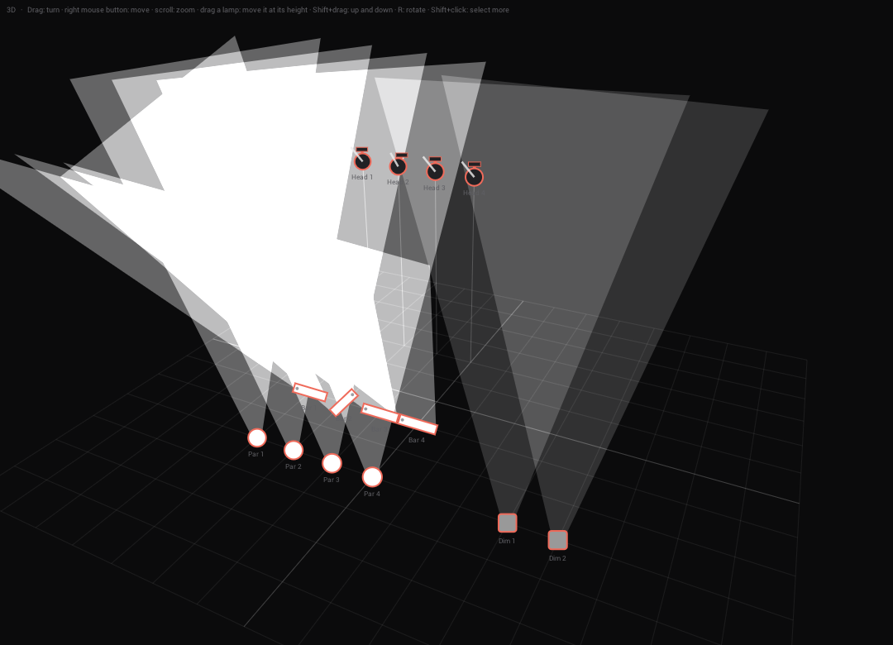
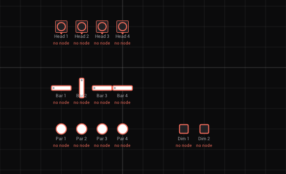
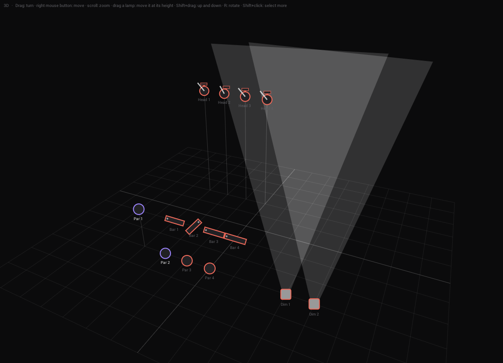

# Fixture 3D view follow ups (#669): test on Windows and macOS

[#669](https://github.com/shizotech/shizoscript3_source/issues/669): "There is no differentiation between fixtures,
everything currently is just a lamp, no indication for moving heads or LED bars or other fixtures" and "3D
transformation controls still missing (no z axis, no rotation)". Branch `claude/zen-galileo-o96q0v`, on top of #681
(`claude/sharp-wozniak-vhonq3`, which moved the 3D drawing to `engine/patch/stage3d_draw.shio`). Built and checked on
Linux in a container (Mesa llvmpipe under Xvfb), driven over MCP with its debug input. What a container cannot show: a
real GPU, a Retina screen, a person's mouse and keyboard focus, other window managers.

The **GDTF import** (the other point of #669: a `.gdtf` file becomes fixture types, one per DMX mode, with its 3D
models, start values and wheels) has its own checklist: [gdtf-test-669.md](gdtf-test-669.md).

**C++**: the part of this checklist is only scripts (`.shio`) and Markdown; the GDTF import changed the zip and the
nanogui module (see its checklist).

---

## What changed

| Area | Before → now |
|---|---|
| Fixture types (`engine/patch/patch.shio`) | new `kind` (head, bar, par, dimmer) and `pixels`, `length` of every type: `"kind"` of the fixture file, else guessed (pan / tilt: head, 2+ colours: bar, 1 colour: par, else dimmer). `patch_lamp_size(f)` for the plan and 3D |
| Lamps | new key `lean` (degrees towards the front of the lamp, 0 in older projects, `patch_fixture_defaults`) |
| 3D view (`stage3d.shio`, `stage3d_draw.shio`) | every lamp a circle → a head on its yoke (foot on the side it is fixed to) with a nose where it points, a bar from its first pixel to its last with a sheet of light as wide as the bar, a round par, a square dimmer. The beam leans with `lean`. Clicks hit a bar along its whole length. The Phaser's 3D plan and clip cell draw the same (they use `stage3d_draw.shio`) |
| Plan (2D) | heads: round on a square yoke with a notch at the front; dimmers square; bars and pars as before |
| Fixture setup: input | **3D: Shift+drag a lamp** moves it (and the selected ones) up and down, the height shows top left; Shift+click without moving still selects more. **R / Shift+R** turns the selected lamps 15°, **Page Up / Page Down** raises / lowers them 0.5 m (Shift: 0.1 m), **arrow keys** move them a quarter metre (Shift: 5 cm), in the plan and in 3D, held keys repeat |
| Inspector | new field *Lean* under *Mount* (one lamp and several) |
| Fixture editor | new row *Kind* (Automatic, Moving head, Bar, Par, Dimmer), saved as `"kind"` only when not Automatic |
| MCP (`patch_ai.shio`) | `set_fixture` takes `lean`; lamps and `list_fixture_types` report `kind` |
| Kinds | colour channels of one byte each (R G B in another order) make a par, not a dimmer; `"length"` of a fixture file sets the length of a lamp |

Save keys: lamps get `lean`; a fixture file can get `kind`. Projects and fixture files from before load as before (lean
0, kind guessed). No control IDs changed.





### Checked on Linux

- `run_tests.sh --no-gui`: 103 passed, 0 failed (new checks in `stage3d.shio`: lean standing / hanging / turned, the
  axis and the up of a lamp, the ends of a bar, the distance to a bar on the screen; in `fixture_patch.shio`: the kinds
  of the shipped types, `"kind"` from a file, an unknown kind guessed, `patch_lamp_size`).
- `shz --check` of `__init__.shio`, `engine/menus/fixtures/setup.shio`, `editor.shio`, the Phaser asset and
  `engine/generators/clipview.shio`; `check_assets.sh` 63/63; `_testing/wiki/check_links.py` 754 links, 0 broken.
- In the app (MCP + debug input): 4 heads (hanging at 5 m, one leaned 40°), 4 bars (leaned 35°, one turned 90°), 4 pars,
  2 dimmers: the plan and 3D as in the pictures, no script errors. Shift+drag on Par 1 in 3D: 0 → 1.75 m, x / y kept;
  Shift+click on Par 2: selected too. On the plan with Bar 1 selected: R, R, Shift+R → rotation 15; Page Up × 2 → 1 m;
  right arrow → x + 0.25. `list_fixtures` reports the kinds.
- Fixture editor: the *Kind* row sits under *Pan °* / *Tilt °* / *Beam °*; *Par* for `cheap_mh` writes `"kind": "par"`
  and `list_fixture_types` reports `par` right away.
- `smoke.py static generators`: passed (40 of 40 assets, the Phaser among them).

## Phase 0: get the branch

```
git fetch origin claude/zen-galileo-o96q0v
git checkout claude/zen-galileo-o96q0v
```

- **Windows**: `& .\_testing\windows_app\testcopy.ps1 -Name pr669` (no build needed), start it with `start.ps1`.
- **macOS**: `sh shzscript_macos/setup_mac.sh --build`, then `cd dist/VibeVJ_macos_arm64 && ./VibeVJ.out`.

## Phase 1: automatic checks

- [ ] `_testing/run_tests.sh <shz> stage3d.shio fixture_patch.shio patch_ai.shio fixture_fx.shio` → all pass.
- [ ] `shz --check __init__.shio` from `_shizoengine3` (testcopy.ps1 runs it).

## Phase 2: a rig

Devices › Fixtures › *Fixture setup*: add 4 × `MovingHeads/cheap_mh`, 4 × `Bars/24CHRGB`, 4 × `Pars/hexapad`,
2 × `Test/1ch`. Or over MCP (`fixture_setup`): `add_fixtures` as in the Linux check above.

- [ ] The plan: heads round on a square yoke with a notch, bars long with a dot on the first pixel, pars round, dimmers
      square.

## Phase 3: by hand (needs a person)

- [ ] Click a bar, press R a few times: it turns 15° each, Shift+R back. The *Rotation* field follows.
- [ ] Arrow keys move the selected lamps, Shift + arrow in small steps; held keys repeat smoothly. Typing in a text
      field of the inspector (a name with an R in it) does **not** turn the lamp.
- [ ] Page Up / Page Down: *Height* follows; never below 0.
- [ ] *3D*: heads on their yokes, the nose shows where they point; bars as bars with a sheet of light; Highlight on lights
      them.
- [ ] Set *Mount* of the heads to *Hanging*, *Height* 5: the yoke is above the head, the beams go down. *Lean* 40: the
      beam leans towards the front of the lamp (turn *Rotation* to see it follow).
- [ ] Shift+drag a lamp up and down: it moves smoothly, the height shows top left, *Snap* gives quarter metres. With
      several selected they all move. Shift+click without moving still adds / removes a lamp from the selection.
- [ ] Click along a long bar (not only its middle): it is selected.
- [ ] Fixture editor: set *Kind* of `cheap_mh` to *Par* → the setup draws its lamps round; back to *Automatic* → heads
      again. The file has no `"kind"` then.
- [ ] Phaser in 3D (#681) and its clip cell: the lamps have the same forms.
- [ ] Save the project, load it: *Lean* and the heights are kept; a project saved on `main` loads with lean 0.

## Phase 4: GDTF

The GDTF import is tested with [gdtf-test-669.md](gdtf-test-669.md).

## Results

### Windows (date)

Machine, GPU, driver. Phase 1–3: pass / fail per item, screenshots for anything wrong, fixes with their commit.

### macOS (date)

Machine. Phase 1–3 as above.
