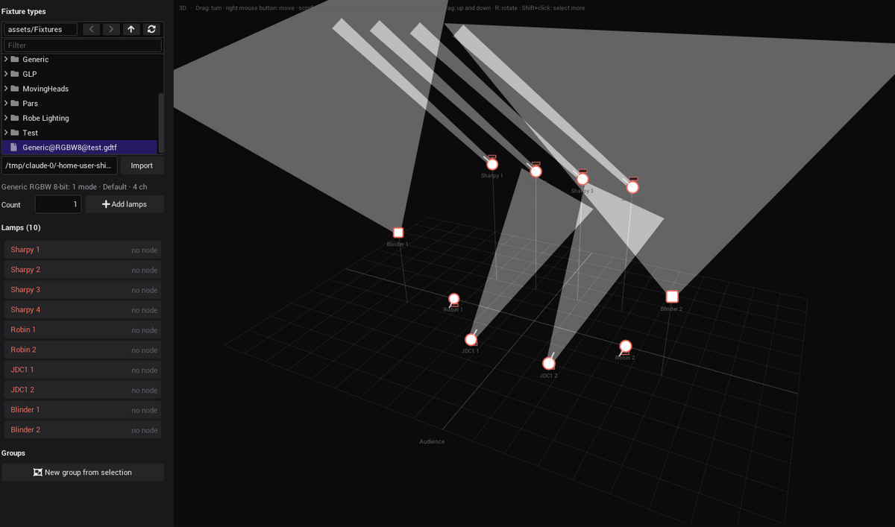
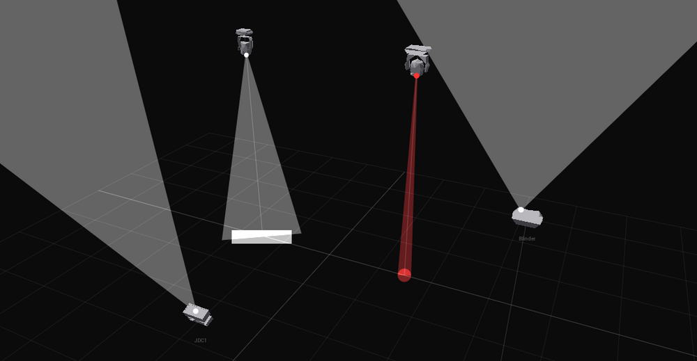
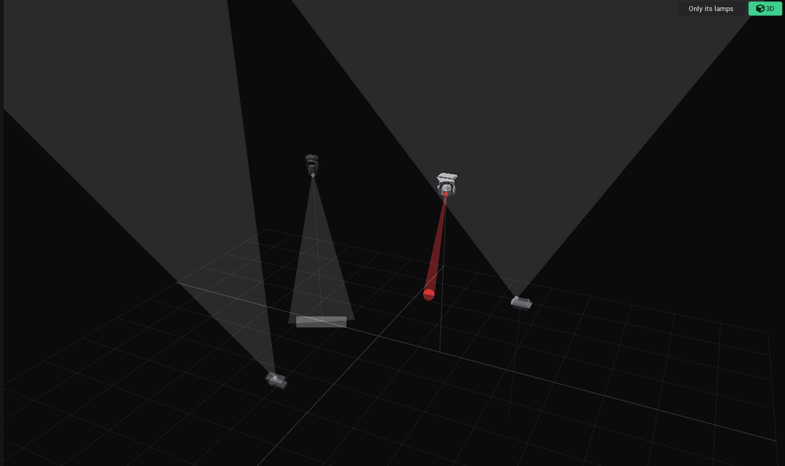
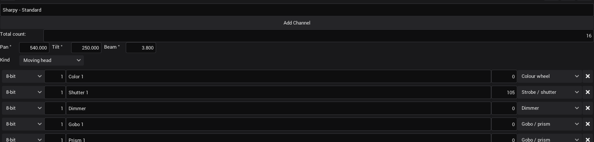

# GDTF import (#669): test on Windows and macOS

[#669](https://github.com/shizotech/shizoscript3_source/issues/669): "For the future, the idea was to adopt the grandma
fixture system and being able to import their format [...] a directory with fixture channel information, aswell as an
actual 3D .obj file" — the format is GDTF (General Device Type Format, DIN SPEC 15800). Branch
`claude/intelligent-johnson-ie2kve`, on top of #684 (`claude/zen-galileo-o96q0v`: lamp kinds, lean, 3D controls), which
is on top of #681. Built and checked on Linux in a container (Mesa llvmpipe under Xvfb), driven over MCP and with
xdotool. What a container cannot show: the MSVC build of the zip module, Windows paths (drive letters, backslashes,
"Copy as path" quotes, non-ASCII folder names), a real GPU, a person's mouse.

**C++ changed**: the `zip` module can read archives now and stores a `std.buffer` with all its bytes
(`modules/shzmodule_zip/main.cpp`), the `nanogui` module has a new `nvgFillPolygons(points, corners)` (many convex polygons filled in one
call, each as a path of its own: the app's screens have no stencil buffer, and NanoVG fills one path of many shapes
as its whole bounding box there; `modules/shzmodule_nanogui/context_nano.cpp`). Both modules must be built (Windows: `build.ps1`; macOS:
`setup_mac.sh --build`). Everything else is scripts (`.shio`) and Markdown.

---

## What changed

| Area | Before → now |
|---|---|
| `zip` module | could only write (`add`, `add_file`, `save`) → also reads: `zip.file(path)` / `load(path)`, `names()`, `has(name)`, `read(name)` (string), `read_binary(name)` (std.buffer), `extract(name, target)`. A missing file, a file that is no zip archive or a missing entry is a runtime error `try / catch` gets |
| `engine/patch/xml.shio` (new) | a small XML reader (elements, attributes, text, entities, CDATA, comments) |
| `engine/patch/gdtf.shio` (new) | GDTF → fixture files: one per DMX mode (and per DMX break), channels in DMX order with geometry references and their breaks instantiated (the pixels of a bar), 16-bit, 24-bit as 16 + 8, a fine byte that is not next to its coarse one, unused addresses as *Unused*, R G B (W) of one cell as *RGB* / *RGBW*, repeated cells as one channel with a count, the *Function* of each channel from its GDTF attribute, *Kind*, pan / tilt range, beam angle, length and width from the model |
| `engine/patch/gdtf_zip.shio` (new) | the only `import zip` of the app, loaded in a module of its own: without the zip package the setup still loads, only the import says why it fails |
| Fixture setup | *Fixture types* lists `.gdtf` files too: a click imports, a drag onto the plan imports and adds a lamp of the first mode there. New row under the list: a path field and *Import* (for a file anywhere on the computer). The import runs on a thread; the label under the row says what it made (tooltip: every mode) |
| Fixture files | written to `assets/Fixtures/<manufacturer>/<fixture>/<fixture> - <mode>.json` with the `.gdtf` next to them (a `.gdtf` already in `assets/Fixtures` stays where it is). New keys `length`, `width` (metres, read by `patch_type` for the plan and 3D) and `gdtf` (file, manufacturer, fixture, mode, dmx_break, the 3D models in the archive) |
| Fixture editor | keeps the keys it does not show (`gdtf`, `length`, `width`) when it saves |
| `patch_reload_types()` | emptied the type cache, so the next draw of the setup read the fixture files: a file read suspends the draw, it went on after its frame and every `nvg*` call was an error (seen after an import with the setup open in 3D; the fixture editor's save could do the same) → reads the cached types again at once, the cache is never empty |
| MCP (`patch_ai.shio`) | new query `import_gdtf(path)` → the types it made, for `add_fixtures` |
| Channel defaults | the import writes `"default"` (0..1, a list for RGB / RGBW) per channel: the Default of the channel function it starts in (`InitialFunction`): shutter open, pan / tilt in the middle. `patch_type` puts it on each control (not into the signature: a lamp that is there keeps its values when only a start value changes, #695); Devices › Fixtures sets new lamps to it (`fixture_menu.apply_defaults`; a loaded project sets its saved values after it). The fixture editor shows it as a DMX value (0-255, 16-bit 0-65535) left of *Function*, for 8 / 16-bit channels |
| Lamp colour (3D, plan) | colour × dimmer when a lamp has both (a GDTF wash has its colours full by default and is dark until its dimmer opens) |
| 3D models | `engine/patch/gdtf_mesh.shio`: glTF (node transforms, y up → z up) and 3DS read in script, scaled to the model's Length / Width / Height, simplified to ≤ 70 triangles a part (vertex clustering), the parts of a mode's geometry tree with their matrices → `<fixture>.mesh` (JSON, trees that only differ in their names once: the JDC1 has one per mode). The fixture file names it (`gdtf.mesh`) and the parts pan and tilt turn (`gdtf.pan_part`, `gdtf.tilt_part`, indices). `stage3d.shio`: the parts turned by pan (z) and tilt (x) so the head points where `stage3d_beam_dir` says (tested), front faces only, 6 grey levels, the farther part first. `stage3d_draw.shio`: drawn instead of the sign when the lamp is at least 26 px on the screen, the beam from its lens, the projection cached while camera, lamp and pan / tilt stay. "Big enough" is measured on the whole model at rest (`mesh.extent`: base, yoke and head), not on the base. The fixture setup, the Phaser's 3D plan and its clip cell draw them (each its own cache) |
| Wheels | the import reads the `<Wheels>` of the file: per slot its colour (CIE xyY → RGB) and its gobo image (PNG / BMP in the archive → a 24 × 24 black and white mask, the corners outside the circle dark) → `<fixture>.wheels`; per channel with a wheel (`"wheel"`) which slot each value turns to (`ChannelSet WheelSlotIndex`). Shutter and other channels that only point at a wheel are left out. `patch_wheel_slot`, `fixture_menu.lamp_gobo`: the 3D view draws the floor light of a lamp on a gobo in the shape of the gobo, the beam of a lamp with a dimmer and a colour wheel (and no RGB) in the colour of its slot |

Save keys: fixture files can have `length`, `width`, `gdtf` (with `mesh`, `wheels`), a channel `default` and `wheel`; nothing else changed. Projects and fixture files from before
load as before. No control IDs changed.







### Checked on Linux

- Real GDTF files (9, from the `zeevonk` 0.3.0 crate: Clay Paky Sharpy, Robe Robin 600 LEDWash, GLP JDC1, Elation DARTZ
  360 and Cuepix Blinder WW2, Generic dimmer and RGBW, a 30-channel benchmark): every DMX mode (29) has the same
  channels at the same addresses as `pygdtf` 1.4.5 (`get_dmx_channels`), every fixture file is valid for `patch_type`,
  the footprints match. Import 4-310 ms per file without models, with models up to 1.1 s (Sharpy: 9000-vertex glTF
  parts). One `.mesh` per fixture (6-26 KB); Sharpy shutter default 105/255 ("Open 1"), pan / tilt 0.5.
- `run_tests.sh --no-gui` (after the merge of `0bd836ab`): 105 passed, 0 failed, 39 skipped. New: `gdtf.shio` (XML reader, names and functions,
  a hand-written GDTF with geometry references, breaks, Overwrite, 16 / 24 bit, gaps, virtual channels, two modes of one
  name, the files read back by `patch_type`, the reload), `gdtf_import.shio` (the zip read API, import from outside and
  from inside the fixture folder, again, errors). `--gui` under Xvfb: 135 passed, 4 failed — `video_camera`,
  `video_playback` (no FFmpeg in the container), `tab_tooltips`, `value_undo` (pass when run alone).
- `shz --check __init__.shio`, `editor.shio`, `setup.shio`, `gdtf_zip.shio`, the Phaser; `check_assets.sh` 63/63; wiki
  links 764, 0 broken.
- `check_libcxx_linux.sh` (clang + libc++, the macOS build): every module built (zip too), tests 106 passed, 0 failed
  (`gdtf.shio` and `gdtf_import.shio` with the libc++ zip module), stdlib 73 passed, 0 failed.
- In the app: imports over MCP, from the path field, by a click on a `.gdtf` in *Fixture types*, by dragging it onto the
  3D plan (lamp added where it was dropped); a rig of Sharpy, Robin, JDC1 and blinders; the setup open in 3D with
  Highlight during every import: no script error.
- Models in the app: drawn, beams from the lenses, dark lamps dark; the 3D view takes 15-17 ms a frame with 9 models
  (as without them: the projection is cached, each grey level of a part is one `nvgFillPolygons`). Devices › Fixtures of a
  new Sharpy: Shutter 1 0.41, Pan / Tilt 0.50. Fixture editor: Shutter default set to 200 → the file has 0.78431 and
  keeps `gdtf`, `length`, `width`.
- Wheels in the app (Dartz, Sharpy): Dartz *Gobo 1* 0.07 → Fixed Gobo 4 (a disc), 0.08 → Fixed Gobo 5 (a bar), the floor
  light has that shape; Sharpy *Color 1* 0.025 → Dark Red, beam and plan dot red. The setup's 3D view with 4 models and a
  gobo 10-12 ms a frame. The Phaser (Circle on the Sharpy, 3D): the Sharpy's model turns, *Only its lamps* off shows the
  other three on their models too (the Dartz too since `mesh.extent`). Project saved and loaded: the lamp values and the
  models are back.

## Phase 0: get the branch

```
git fetch origin claude/intelligent-johnson-ie2kve
git checkout claude/intelligent-johnson-ie2kve
```

- **Windows**: `& .\_testing\windows_app\build.ps1` (the zip module changed), then
  `& .\_testing\windows_app\testcopy.ps1 -Name pr669g -Binaries <build out>`, start it with `start.ps1`.
- **macOS**: `sh shzscript_macos/setup_mac.sh --build`, then `cd dist/VibeVJ_macos_arm64 && ./VibeVJ.out`.

GDTF files to test with: any from the [GDTF Share](https://gdtf-share.com) (free account), or the ones of the check
above: `curl -L https://crates.io/api/v1/crates/zeevonk/0.3.0/download | tar xz` → `zeevonk-0.3.0/benches/data/**/*.gdtf`.

## Phase 1: automatic checks

- [ ] `_testing/run_tests.sh <shz> gdtf.shio gdtf_import.shio fixture_patch.shio patch_ai.shio stage3d.shio` → all pass
      (`gdtf_import.shio` needs the built zip package next to shz; without it the runner skips it — that is a fail here).
- [ ] `shz --check __init__.shio` from `_shizoengine3` (testcopy.ps1 runs it).

## Phase 2: import (MCP or by hand)

- [ ] MCP `import_gdtf` with the full path of the Sharpy file (Windows: `C:\Users\...\Clay_Paky@Sharpy@....gdtf`, with
      backslashes) → `ok`, types *Sharpy - Standard* (16 channels) and *Sharpy - Vector* (20), folder
      `assets/Fixtures/Clay Paky/Sharpy` with the `.gdtf` in it.
- [ ] The same from a folder with a space and a non-ASCII letter in its name (`C:\Users\...\Lämpchen test\`) → `ok`.
- [ ] `add_fixtures` of `assets/Fixtures/GLP/GLP JDC 1/JDC 1 - Mode 3 SPix (68ch).json` → 68 channels; Devices ›
      Fixtures shows the type without errors in the log (no "cannot contain '@/'").

## Phase 3: by hand (needs a person)

- [ ] Fixture setup, *Fixture types*: Windows Explorer, Shift + right-click a `.gdtf` → *Copy as path*, paste into the
      field under the list, *Import* → the label says "<fixture>: <n> modes · <first mode> · <n> ch", the new folder is
      in the list, *Add lamps* adds that mode. On the Mac: Option + right-click in Finder → *Copy "…" as Pathname*.
- [ ] Copy a `.gdtf` into `assets/Fixtures`, click the refresh arrow of the list: the file shows. Click it → imported,
      no copy of it made. Drag it onto the plan → a lamp of its first mode where you dropped it.
- [ ] With the setup in 3D and *Highlight* on, import a big file (Robin 600 LEDWash): the picture does not freeze or
      flicker, no errors in the log (the notification bell stays as it was).
- [ ] A file that is no GDTF (rename a `.png` to `.gdtf`) → the label says it is not a zip archive; a path that does
      not exist → "No file ...".
- [ ] Fixture editor: open an imported type, change a channel name → the file keeps `"gdtf"`, `"length"`, `"width"`.
- [ ] 3D: an imported Sharpy is drawn as a head with a narrow beam (3.8°), the blinder as a dimmer with a wide one.

## Phase 4: models and start values (needs a person, a real GPU)

- [ ] Import Sharpy, Robin 600 LEDWash, JDC1; add one of each, *3D*, zoom in (scroll): each is drawn with its model
      (base, yoke, head) once it is big enough, the sign when it is far. Standing and *Hanging*: the head on the right
      side; *Lean* 30 and *Rotation* 90 turn the model with the beam.
- [ ] Highlight: the beam comes out of the lens (the coloured dot), not out of the base. A Phaser circle on the Sharpys:
      the yokes turn with pan, the heads with tilt, the beams follow.
- [ ] A rig of 20+ imported heads in 3D: the view stays smooth when the camera turns (`nvgFillPolygons`, cached projection).
- [ ] Devices › Fixtures of a new Sharpy: *Shutter 1* 0.41, *Pan* / *Tilt* 0.50. Save the project with other values,
      load it: the saved values, not the defaults.
- [ ] Fixture editor: the number left of *Function* is the start value as DMX (Shutter 1: 105); change it, add a lamp:
      it starts there. An RGB channel has no number (greyed out).
- [ ] A lamp with other values than its start values (Devices › Fixtures, e.g. *GOBO* 0.6): change only a start value of
      its type in the fixture editor → the lamp keeps its values (the Mac test found them reset to the start values).

## Phase 5: wheels and the Phaser (needs a person, a real GPU)

- [ ] Import the Elation DARTZ 360 and add a lamp (hanging, 4 m), Highlight it, *3D*. Devices › Fixtures › Dartz
      *Gobo 1*: 0.00 → round floor light; 0.07 → a smaller disc; 0.08 → a bar; 0.24 → round again (open).
- [ ] A Sharpy, *Dimmer* 1, *Color 1* 0.025 → the beam and the dot on the plan dark red; 0.15 → Deep Green; 0 → white.
- [ ] Drag *Phaser* into a view, *Quick effects* › all Sharpys › *Circle*, *3D*: the models turn with the circle;
      *Only its lamps* off: the other imported lamps on their models, dimmed. Put the Phaser into a clip: the cell draws
      the models too (smaller: far ones as signs).
- [ ] Models look like their lamps, not like boxes (each face filled on its own; a GPU driver that ignores
      `nvgShapeAntiAlias(false)` may show thin seams between faces: screenshot it).

## Results

### Windows (date)

Machine, GPU, driver. Phase 1–5: pass / fail per item, screenshots for anything wrong, fixes with their commit.

### macOS (date)

Machine. Phase 1–5 as above.
