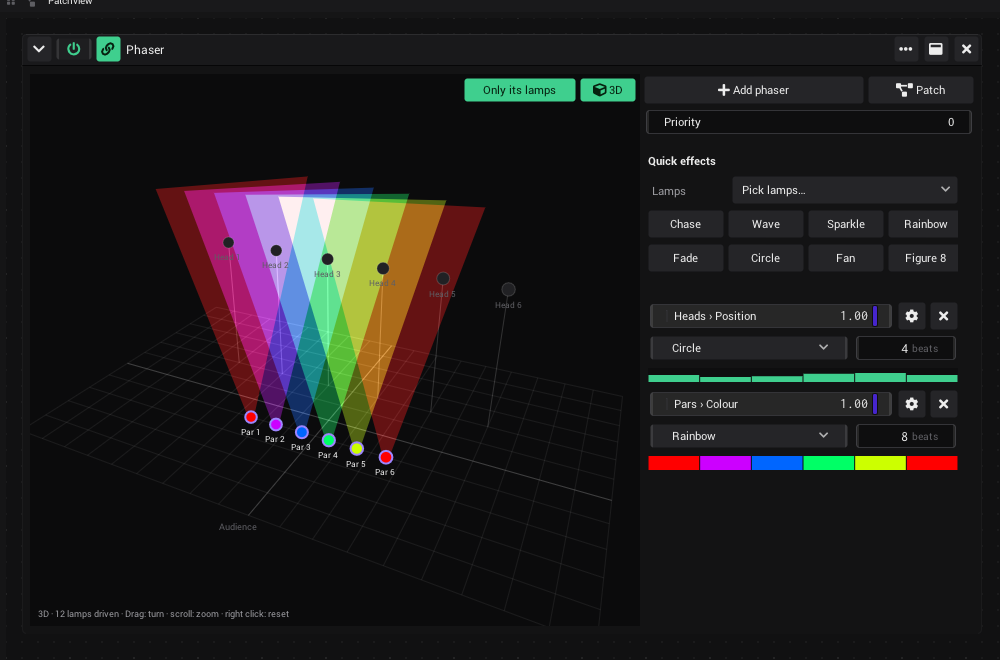
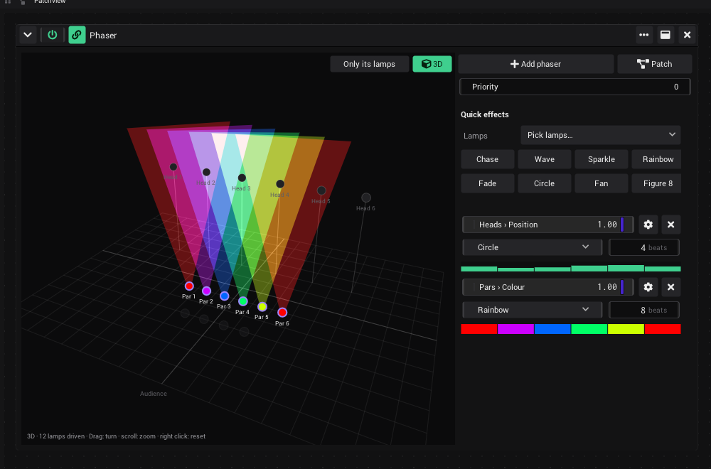
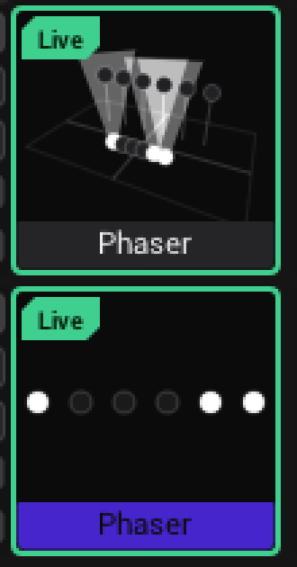

# Phaser in 2D / 3D and in the clip cell (#677): test on Windows and macOS

[#677](https://github.com/shizotech/shizoscript3_source/issues/677): "make an option to also show the 3D view in there
from the fixture setup. There should be 2 options: toggle between the 2D/3D view and when in the 3D view, an option to
toggle all fixtures visible or just the ones that the phaser is actually driving (default on). This should be drawn in
the clip preview inside the clips cell so you can always see what a phaser is driving currently." Branch
`claude/sharp-wozniak-vhonq3`. Built and checked on Linux in a container, with software OpenGL (Mesa llvmpipe) under
Xvfb, driven over MCP. What a container cannot show: a real GPU (how fluid a grid of Phaser clips stays), a Retina
screen, a person's mouse (dragging and scrolling the 3D plan).

**No C++ changed**: only scripts (`.shio`) and Markdown. The binaries of `main` run the branch as they are; no build
is needed (on a Mac `setup_mac.sh --build` still bundles the new scripts).

---

## What changed

| Area | Before → now |
|---|---|
| Phaser plan (`assets/FixturesEffects/Phaser.asset`) | 2D only → **3D** button (top right of the plan): the stage of the fixture setup with beams, as the fixture setup's 3D view. Drag turns, scroll zooms, right click resets. **Only its lamps** (in 3D, on at first): only the lamps the phasers of this generator drive; off: every lamp of the fixture setup, the others dimmed. The lamps of the phaser whose settings are open get a violet ring. The caption moved to the bottom left |
| Clip cell (`engine/generators/clipview.shio`) | a clip without a picture showed its name only → a Phaser clip draws its lamps in the cell, 2D or 3D as set in the Phaser: every lamp it drives, as they look now (all phasers blended) |
| Engine contract (`engine/contracts/generator_module.shio`, `clipstackview.shio`) | new commands `has_cell_preview` / `draw_cell(size)` (`Transitionable`): any module without a picture can draw its clip cell |
| 3D drawing | moved out of the fixture setup into `engine/patch/stage3d_draw.shio`; the fixture setup draws with it (no visible change) |
| MCP | Phaser query `set_view` {view: 2d / 3d, only_driven: 0 / 1} |

Save keys: the Phaser state gets `view3d`, `only_driven`, `camera` {yaw, pitch, zoom}. Projects from before load in
2D with *Only its lamps* on. No control IDs changed.

### Checked on Linux

- `shz --check __init__.shio`, `check_assets.sh` 63/63, `_testing/wiki/check_links.py` 752 links, 0 broken.
- `run_tests.sh`: `vibevj_contracts`, `stage3d`, `fixture_fx`, `fixture_patch`, `dmx_usage`, `patch_ai`,
  `module_class_contract`: 7 passed.
- `smoke.py static generators`: passed. `clipundo` fails at its first drop from the sidebar, on `main` the same (the
  sidebar position of the test asset), not this branch.
- In the app (MCP): 6 hanging moving heads, 6 pars; two Phaser clips (Circle on the heads + Rainbow on the pars; Chase
  on the pars). The cells show the heads with beams in 3D and the chase in 2D; the Phaser window in 3D with only its
  lamps and with all lamps; saved and loaded: both Phasers come back in 3D, *Only its lamps* as it was. The fixture
  setup's 3D view draws as before.





## Phase 0: get the branch

```
git fetch origin claude/sharp-wozniak-vhonq3
git checkout claude/sharp-wozniak-vhonq3
```

- **Windows**: `& .\_testing\windows_app\testcopy.ps1 -Name pr677` (no build needed), start it with `start.ps1`.
- **macOS**: `sh shzscript_macos/setup_mac.sh --build`, then `cd dist/VibeVJ_macos_arm64 && ./VibeVJ.out`.

## Phase 1: automatic checks

- [ ] `_testing/run_tests.sh <shz> vibevj_contracts.shio stage3d.shio fixture_fx.shio fixture_patch.shio` → all pass.
- [ ] `shz --check __init__.shio` from `_shizoengine3` (testcopy.ps1 runs it).

## Phase 2: a rig (MCP or by hand)

Over MCP (`fixture_setup`): `add_fixtures` 6 × `assets/Fixtures/MovingHeads/cheap_mh.json` (group *Heads*) and 6 ×
`assets/Fixtures/Pars/hexapad.json` (group *Pars*), `set_fixture` the heads to `z = 5`, `mount = "hanging"`, x from -5
to 5. Or by hand in Devices › Fixtures › *Fixture setup*.

## Phase 3: the Phaser window (needs a person for the mouse)

- [ ] Drag *Phaser* into a Patchview; quick effects *Circle* on Heads, *Rainbow* on Pars. The plan is 2D, the caption
      at the bottom left, the *3D* button top right, no *Only its lamps* button.
- [ ] *3D*: the floor grid, the heads on poles, the pars with rainbow beams; *Only its lamps* shows and is on.
      Drag turns the stage smoothly, scroll zooms, a right click goes back to the first view (and opens no menu of
      the area; in 2D the right click still opens it).
- [ ] After a click, a drag or a scroll in the plan, *3D* and *Only its lamps* are still drawn and can be clicked
      (the Windows test of `a0d8b4d2` lost them: the focused plan was drawn over them).
- [ ] Open the cog of the Rainbow phaser: the pars get a violet ring.
- [ ] Add a lamp that no phaser drives: with *Only its lamps* off it shows dimmed, on it is gone.
- [ ] *3D* off: the plan from above as before.

## Phase 4: clip cells

- [ ] Drag *Phaser* onto a cell of a Clipview, set it up as in phase 3: the cell shows the lamps (2D), also before the
      clip is launched. *3D* in its window: the cell shows the stage, in the same angle as the window.
- [ ] Launch the clip: the cell moves with the effect (circles of the heads, the rainbow running).
- [ ] A grid with 8 Phaser clips (some in 3D) on the real GPU: the Clipview stays fluid.
- [ ] A shader clip next to it still shows its picture; a Phaser with a shader stacked after it shows the shader's
      picture, not the lamps.
- [ ] Move and copy a Phaser clip (drag the name tag, Ctrl): the new cell draws its lamps.
- [ ] Save the project, load it: the Phasers in 2D / 3D and *Only its lamps* as they were; a project saved on `main`
      with a Phaser loads in 2D.

## Results

### Windows (date)

Machine, GPU, driver. Phase 1–4: pass / fail per item, screenshots for anything wrong, fixes with their commit.

### macOS (date)

Machine. Phase 1–4 as above.
